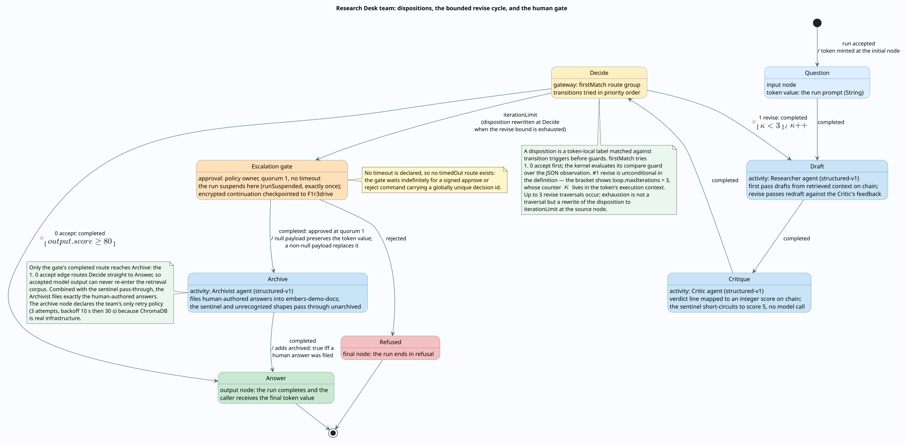
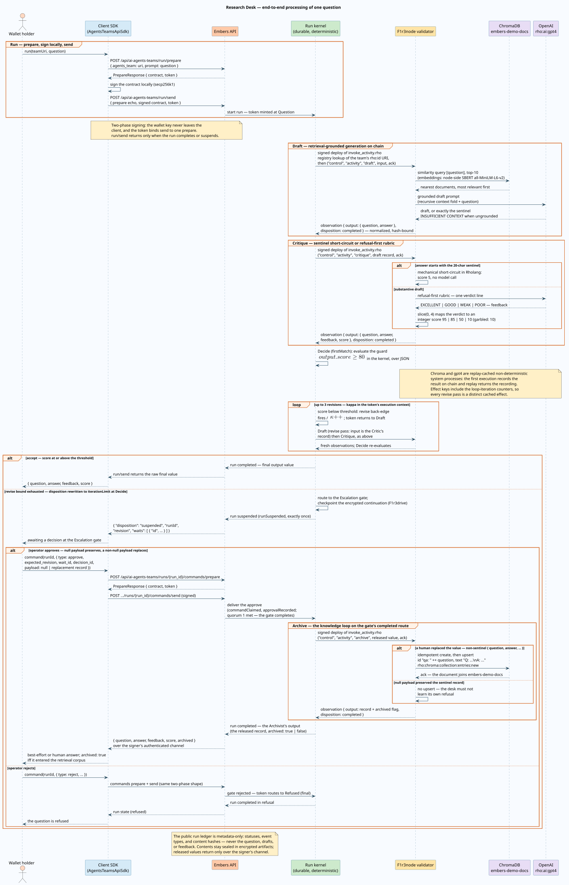

# Research Desk customer demo assets

Everything needed to stage and run the "chain that answers questions about itself" demo: an on-chain RAG research desk built as an Agent Teams v2 workflow with a bounded critique cycle, a human escalation gate, and a knowledge loop that archives human-approved answers back into the retrieval corpus.

The presenter-facing runbook (environment setup, minute-by-minute script, failure fallbacks) lives at [docs/agent-teams/usage/customer-demo-runbook.md](../../docs/agent-teams/usage/customer-demo-runbook.md). This directory holds the runnable assets it references. Three complementary views of the same team exist: the runbook links the component topology (who talks to whom), while this document presents the statechart (state and trigger semantics) and the run sequence (time-ordered messages), each with a textual walkthrough.

## Layout

| Path | Purpose |
|---|---|
| `diagrams/` | PlantUML sources and rendered SVGs for the statechart and run-sequence figures embedded below; regenerate per [Regenerating the diagrams](#regenerating-the-diagrams). |
| `corpus/corpus.md` | Human-readable corpus source: 13 platform-doc excerpts with ids, topics, and the demo question list. Kept verbatim-in-sync with the seed deploy. |
| `seed/seed-corpus.rho` | On-chain deploy that creates the `embers-demo-docs` ChromaDB collection and upserts the corpus. |
| `seed/seed.mjs` | Node seeder driving the Embers backend through the client SDK: smoke tests, corpus, agents, and the backup team. Run `node seed.mjs --all` after `./stack.sh up`. |
| `agents/researcher.rho` | Researcher agent (structured-v1): ChromaDB similarity query then a grounded gpt4 draft; distinct first-pass and revise prompts. |
| `agents/critic.rho` | Critic agent (structured-v1): strict gpt4 rubric with the fixed-token verdict protocol (EXCELLENT/GOOD/WEAK/POOR to integer scores 95/85/50/10). |
| `agents/archivist.rho` | Archivist agent (structured-v1): on the gate's completed route, files human-authored answers into `embers-demo-docs` (idempotent create plus per-id upsert); the sentinel and unrecognized payload shapes pass through unarchived. |
| `team/research-desk.workflow.json` | WorkflowDefinitionV2 fixture of the full team; `__..._AGENT_ID__`/`__..._AGENT_VERSION__` placeholders are substituted by `seed.mjs --team`. Serves as the rehearsal backup so the live graph build can be skipped if needed. |
| `smoke/00-chroma-live.rho` | Proves ChromaDB is live end to end (catches both the missing-feature and silent-NoOp failure modes). |
| `smoke/01-gpt4-live.rho` | Proves the OpenAI integration is live (a disabled service returns an empty string). |
| `smoke/02-rag-roundtrip.rho` | Proves the exact agent combination, ChromaDB query feeding gpt4, in a single deploy. |

## The team

The intuition: a Researcher drafts an answer from retrieved context, a Critic scores the draft, and a gateway either accepts the answer, bounces it back for revision, or — when the bounded revision budget runs out — escalates to a human who approves or rejects the best effort so far. When the human goes further and *answers* the question through the gate, an Archivist files that answer back into the retrieval corpus, so the desk never has to escalate the same question twice. The interesting engineering is that every step of this loop is a real on-chain execution, the loop itself is provably bounded, and the human gate is a durable suspension of the run rather than a polling hack.

The terms used by the figure and the rest of this document, defined up front (the full formal treatment lives in [the statechart semantics](../../docs/agent-teams/theory/statechart-semantics.md)):

| Term | Meaning |
|---|---|
| token | One pending unit of control plus its data: the current value and an execution context that travels with it. |
| disposition | A token-local label (for example `completed`, `rejected`, `iterationLimit`) matched against transition triggers *before* guards are evaluated; dispositions play the trigger role in this statechart. |
| trigger [guard] / action | Harel transition notation, used verbatim on the figure's arrows: the transition fires on the trigger, only if the bracketed guard holds, and performs the action after the slash. |
| $`\kappa`$ | The revise transition's iteration counter. It lives in the token's execution context, so concurrent runs and branches never share a budget, and it survives suspension and recovery. |
| firstMatch | A route-group mode: the group's transitions are tried in priority order and the first eligible one wins. |
| structured-v1 | The agent ABI used by both agents: an invocation record (input plus context) goes in; a record `{output, disposition}` comes out. |
| sentinel | The fixed 20-character string `INSUFFICIENT CONTEXT` with which the Researcher answers when retrieval finds no grounding. |
| archived | The flag the Archivist adds to recognized records on the gate's completed route: `true` iff a human-authored answer was filed into the retrieval corpus, `false` when the record passed through unfiled (the preserved sentinel, or an empty question or answer). |



Reading the figure: arrows carry `trigger [guard] / action` labels, so `#0 accept: completed [`$`\mathit{output.score} \geq 80`$`]` reads "on the `completed` disposition, if the score clears the threshold, take the accept route (priority 0)". The revise back-edge is unconditional in the workflow definition; the bracketed $`\kappa < 3`$ shows its declared `loop.maxIterations = 3` bound, whose exhaustion does not fire the transition at all — instead the token's disposition is rewritten to `iterationLimit` at Decide, which then routes to the Escalation gate like any other trigger. Note that the accept edge runs from Decide straight to Answer: only the gate's completed route crosses Archive, so accepted model output bypasses the Archivist by construction. ChromaDB and gpt4 are deliberately absent here: they are effects, not control states, and appear in the sequence diagram below.

### Design constraints

These constraints are baked into the assets and verified against the kernel:

- Scores are integers 0-100: floats are not portable across the activity boundary.
- The Critic emits `score` on every path, including the garbled-verdict fallback, because a missing compare-guard path fails the run.
- The verdict protocol matches on the first four characters (`slice(0, 4)`) because this Rholang has no string-to-int method.
- Ungrounded outputs are rejected mechanically, not by model judgment: when retrieval finds no grounding the Researcher replies with the sentinel, and the Critic short-circuits it in Rholang (score 5) without calling the model. LLM judges reliably misgrade honest refusals as excellent answers; the escalation path must not depend on that judgment. The trap question is likewise a fictional platform internal (`Zephyr-9`), unanswerable from model pretraining, because generally known questions leak confident answers past any rubric.
- The approval gate declares no timeout, so it needs no `timedOut` route and waits indefinitely for the live approve moment.
- Approving with a null payload preserves the token value, so the best-effort answer flows through the gate unchanged — and the Archivist passes it on with `archived: false`.
- Only human-authored answers are archived, enforced twice over: topology (the accept path routes Decide straight to Answer, so accepted model output never reaches Archive) and the sentinel check (a null-payload approve preserves the refusal record, which the Archivist recognizes mechanically and declines to file). Model output never re-enters retrieval, which precludes the self-reinforcement failure mode of feeding a RAG system its own generations.
- The archive node declares the team's only retry policy (3 attempts, backoff 10 s then 30 s) because ChromaDB is real infrastructure that can be down; and approve payload numbers must be integers — a float anywhere in the payload fails the run with `nonPortableActivityInput` before any deploy, with the approval already consumed.

## End-to-end behavior



A run begins with the platform's universal two-phase mutation protocol: the client asks the backend to *prepare* an unsigned run contract, signs it locally with the wallet key (secp256k1 over a blake2b digest — the key never leaves the client), and *sends* the signature; a token binds the send to exactly one prepare exchange. The `run/send` call then stays open until the run either completes or suspends, and its response carries the outcome directly.

Each activity node the token reaches becomes a real signed deploy on the validator. The kernel renders `invoke_activity.rho`, which looks the team up in the on-chain registry by its `rho:id:` URI and invokes `("control", "activity", nodeId, input, ack)`; the agent's Rholang — inlined into the team contract at deploy time — executes on chain, where `rho:chroma:collection:entries:query` and `rho:ai:gpt4` resolve to real services. Both are replay-cached non-deterministic system processes: the first execution records the observed result on chain, and replay validation returns the recording instead of re-calling the service. Effect identities include the loop-iteration counters, so each revise pass is a distinct cached effect rather than a stale replay of the previous one.

The activity's result is normalized into an observation `{output, disposition}` and bound to the hash of its input. Routing then happens in the kernel: Decide's compare guard ($`\mathit{output.score} \geq 80`$) is evaluated over the observation's JSON, not on chain. Below the threshold, the revise back-edge fires, $`\kappa`$ increments inside the token's context, and the Critic's full record — question, answer, feedback, score — becomes the Researcher's next input, so revision is feedback-driven rather than a blind retry.

If the revision budget exhausts, the disposition rewrite routes the token to the Escalation gate and the run suspends: a `runSuspended` event is recorded (exactly once per run), the continuation is encrypted and checkpointed to F1r3drive, and the suspended response returns the run id, its revision, and the open wait. The public run ledger holds only statuses, event types, and content hashes — never the question, the drafts, or the feedback.

Release is again a signed, two-phase command (`POST /api/ai-agents-teams/runs/{run_id}/commands/prepare` then `/send`) fenced by the expected revision and a globally unique decision id. An approve with a null payload preserves the token value that was waiting at the gate; a non-null payload replaces it — that is how a human answers the question through the gate. A reject routes the token to the Refused final node instead.

On the completed route the released token crosses one more activity before Answer: the Archivist. It files human-authored answers into the same ChromaDB collection the Researcher queries (the knowledge loop) and stamps recognized records with an `archived` flag, so the approve command's response is the *Archivist's* output — the released record plus that flag. If the archive deploy fails on infrastructure grounds (ChromaDB down on the validator), the approve response is instead a suspended run holding a `retry:` wait while the node's retry policy backs off; [Operating the escalation gate](#operating-the-escalation-gate) covers the recovery path.

A completed run's final value stays readable afterwards through the same signed two-phase shape: `POST /api/ai-agents-teams/runs/{run_id}/output/prepare` then `/send` deploys a `claimOutputReveal` the chain adjudicates against the run's recorded owner, and the inspector page offers it as "Reveal full response" to the signed-in owner. The public ledger records the occurrence (`outputRevealed`) and never the value — see [Reveal a run's output](../../../embers/docs/api/methods/ai-agents-teams/reveal-output.md).

## Worked example: a question the corpus answers

The question "What is the progress boundary rule for cycles?" is squarely inside the corpus (documents `cycles-01` and `cycles-02` state the rule).

| # | Where | What happens | Value carried forward |
|---|---|---|---|
| 1 | run/send | Two-phase prepare, local sign, send; token minted at Question | `"What is the progress boundary rule for cycles?"` |
| 2 | Draft (first pass) | ChromaDB top-10 retrieval surfaces `cycles-01`/`cycles-02`; recursive context fold; gpt4 drafts from the context | `{question, answer: "Every hot cycle must cross a wait, a bounded transition, or a durable yield."}` |
| 3 | Critique | Not the sentinel, so the rubric runs; verdict line `GOOD - grounded in the retrieved context.`; `slice(0, 4)` maps `GOOD` to 85 | `{question, answer, feedback, score: 85}` |
| 4 | Decide | firstMatch tries accept first: the kernel evaluates $`85 \geq 80`$ over the JSON observation — true; $`\kappa`$ stays 0 and the revise edge is never tried | unchanged |
| 5 | Answer | The run completes; run/send returns the final token value to the caller | `{question, answer, feedback, score: 85}` |

The answer string above is verbatim the hermetic choreography test's canned draft; a live run produces a fuller two-paragraph grounding of the same rule from the retrieved documents. Note what never happens on this path: no `runSuspended` event appears — the durable event trail is pure node and transition progress ending in run completion.

## Worked example: a question that cannot be answered

The question "What is the exact rotation schedule of the Zephyr-9 attestation committee?" is deliberately unanswerable from *both* the corpus and the model's pretraining, because it names a fictional platform internal. Both halves of that property earned their place empirically. An earlier trap ("what consensus algorithm does Bitcoin use?") failed as a trap: under revise pressure the model produced a confident answer from pretraining and the Critic accepted it. And before the sentinel existed, the Critic graded an honest refusal `EXCELLENT - The draft accurately identifies that the necessary information ... is not present` with score 95 — which is precisely why rejection of ungrounded output is mechanical rather than a model judgment.

| Round | Draft pass (input) | Answer | Critique path | Score | Decide (firstMatch) | $`\kappa`$ after |
|---|---|---|---|---|---|---|
| 1 | first (the prompt) | `INSUFFICIENT CONTEXT` | mechanical short-circuit, no model call | 5 | accept false; #1 revise fires | 1 |
| 2 | revise (Critic's record) | same | same | 5 | revise fires | 2 |
| 3 | revise | same | same | 5 | revise fires | 3 |
| 4 | revise | same | same | 5 | accept false; revise exhausted at $`\kappa = 3`$ — disposition rewritten to `iterationLimit` at Decide; escalate fires | 3 |

Exactly three revise traversals occur on this run; the exhaustion at the fourth Decide visit is not a traversal but the disposition rewrite. What follows, in order:

1. **Suspension.** The gate suspends the run — `runSuspended` is emitted exactly once and the encrypted continuation is checkpointed to F1r3drive — and `run/send` returns:

   ```json
   { "disposition": "suspended", "runId": "<uuidv7>", "revision": "<n>", "waits": [ { "id": "<wait id>" } ] }
   ```

2. **The approve command**, two-phase like every mutation:

   | Field | Value | Role |
   |---|---|---|
   | `type` | `approve` | the command kind |
   | `expected_revision` | the suspended response's `revision` | optimistic-concurrency fence |
   | `wait_id` | `waits[0].id` | names the exact wait being resumed |
   | `decision_id` | globally unique, e.g. `research-desk-approve-<runId>` | blocks replay of the decision |
   | `payload` | `null` | **null preserves the token value waiting at the gate** — see [Operating the escalation gate](#operating-the-escalation-gate) for the non-null form, with which the human answers the question |

3. **The approve response — the run's final value, produced by the Archivist.** The released record crosses the Archive activity on its way to Answer; the Archivist recognizes the preserved sentinel, files nothing, and stamps the record:

   ```json
   { "question": "What is the exact rotation schedule of the Zephyr-9 attestation committee?",
     "answer": "INSUFFICIENT CONTEXT",
     "feedback": "POOR - retrieval found no grounding for this question; escalating for human review",
     "score": 5,
     "archived": false }
   ```

   The gate releases the *best-effort* answer ($`\mathit{score} < 80`$), not an accepted one — the human decided it should flow — and `archived: false` records that the desk did not learn its own refusal.

4. **The event trail** on the completed run: `status` is `completed`; the events include `commandClaimed`, `approvalRecorded`, the archive node's `effectRequested`/`effectObserved` pair, and `runCompleted`, with `runSuspended` appearing exactly once.

5. **Rejecting instead**: the same command shape with `type` set to `reject` routes the gate's `rejected` disposition to Refused (a `final` node) — the run ends in refusal.

6. **Ledger privacy** holds throughout: the public run ledger records statuses, event types, and content hashes only; the question, drafts, and feedback stay sealed in encrypted artifacts, and released values travel only over the signer's channel.

## Operating the escalation gate

The operator's reference for resuming a suspended run from the run inspector (`/runs/{run_id}` in the Embers frontend, reachable from the run link in the deploy log or a F1r3sky reply). Every command here is the platform's signed two-phase mutation: the form *prepares* an unsigned contract, the wallet signs it locally (secp256k1 — the key never leaves the browser's memory), and the *send* submits the signature. `expected_revision` fences concurrent commands and `decision_id` blocks replays; the form manages both.

### The command form

Signed-in visitors with command authority see the command form on a suspended run's inspector page. For the gate decision:

| Field | What to enter | Role |
|---|---|---|
| `Command` | `approve` (or `reject`) | the command kind |
| `Exact wait` | the suspended run's open wait — `waits[0].id` from the suspended response, offered by the form | names the one wait being resumed |
| `JSON payload` | approve only: empty, or a JSON value | must parse as JSON or the form refuses to sign; leaving it empty and entering a literal `null` are equivalent |

### What the payload means

The payload decides *whose* answer flows out of the gate, and the Archivist reacts accordingly:

| Payload | The kernel | The Archivist then |
|---|---|---|
| empty / `null` | **preserves** the token value waiting at the gate — the team's best-effort record flows on | recognizes the preserved sentinel record; files nothing; returns it with `archived: false` |
| a record `{"question": ..., "answer": ..., "feedback": ..., "score": ...}` | **replaces** the released value — this is how a human answers the question through the gate | files `qa: <question>` into `embers-demo-docs` and returns the record with `archived: true` |
| any other valid JSON (a string, a list, another object shape) | replaces the value verbatim | passes it through unchanged and unfiled — only the recognized record shape can enter the corpus, so a malformed payload can neither poison retrieval nor error the deploy |

Payload rules:

- Numbers must be integers. A float anywhere in the payload (`"score": 82.5`) fails the run with `nonPortableActivityInput` before any deploy — and the approval is already consumed, so the run cannot be resumed again. Use `"score": 82`.
- `score` is documentation, not routing: the gate has already decided, so the number carried in a replacement record affects nothing downstream — it exists so the archived record and the response read like every other record in the pipeline.
- `question` and `answer` must be non-empty strings for the record to be filed; a recognized record with either empty comes back `archived: false`.
- Re-answering the same question later overwrites its archived document (the document id is derived from the question), so the corpus holds one canonical human answer per question.

### Rejecting

Same form, `Command` set to `reject`, no payload: the gate's `rejected` disposition routes to Refused (a `final` node) and the run ends in refusal. The Archivist sits only on the completed route and is never reached.

### After the send

The response renders in the inspector's **"Command result (visible only to you)"** block. It is the run's final output value — the Archivist's output, which equals the released record plus the `archived` flag (or the replacement payload verbatim on the pass-through path). The public run ledger stays metadata-only throughout: statuses, event types, and content hashes; the value itself travels only over the signer's authenticated channel.

### If the archive step fails

ChromaDB dying mid-session makes the archive deploy fail; the archive node's retry policy absorbs it:

- The approve send returns a *suspended* run holding a `retry:...` wait instead of a value, and `retryScheduled` appears in the event trail. Nothing is lost — the decision is recorded and the released value is safe in the token.
- Restart ChromaDB and wait: the recovery scheduler fires the retry wait itself (backoff 10 s, then 30 s). To expedite, send a signed `retry` command through the same form — `Command` `retry`, `Exact wait` the `retry:...` wait id.
- If all 3 attempts exhaust, the run fails honestly (there is deliberately no route that would emit an error record as the demo's final answer). Re-run the question and answer through the gate again.
- Two caveats. ChromaDB unreachable when the validator *started* is a different failure: the node degrades the service to NoOp, and an upsert then acks silently without storing anything — `smoke/00-chroma-live.rho` is the pre-flight that catches exactly this. And the upsert re-executes during replay validation (it is not replay-cached); it is idempotent per document id, so replay is safe by design.

## Sample queries by expectation band

Three bands of queries, from squarely-in-expectations to reliably-failing. One honesty note applies to the accepted side: band boundaries there ride the Critic's model rubric, so middle-band outcomes vary run to run; only the failure band is mechanical (sentinel to score 5, no model judgment involved).

**Aligned with the team's expectations** — retrieval hits the named corpus documents, the draft grounds cleanly, and the rubric returns EXCELLENT or GOOD ($`\mathit{score} \geq 80`$, accept):

| Query | Grounding | Expected path |
|---|---|---|
| What is the progress boundary rule for cycles? | `cycles-01`, `cycles-02` | grounded draft, GOOD/EXCELLENT, accept |
| How does the two-phase signing protocol keep wallet keys private? | `security-02` | grounded draft, GOOD/EXCELLENT, accept |
| Why can validators replay LLM calls deterministically? | `runtime-01` | grounded draft, GOOD/EXCELLENT, accept |
| What happens when a bounded loop exhausts its iterations? | `cycles-02`, `approvals-01` | grounded draft, GOOD/EXCELLENT, accept |

**Succeeds, but not exactly aligned** — the middle band exists, and one member was observed live. During a smoke run, the progress-rule query produced this one-sentence answer: *"In the Embers workflow model, an approval node requires an authorized quorum to either approve or reject, while ensuring that every decision is uniquely identified to prevent replay, with cycles between agents mandated to cross specific transition types for safety."* — corpus-faithful and plausibly GOOD, yet a blend of approvals, decision ids, and the cycle rule rather than the asked-for rule alone. Crafted members of the band:

| Query | Why it stretches | Expected path |
|---|---|---|
| How do approvals and signing interact? | cross-document synthesis of `approvals-01` + `security-02`; no single document holds the answer | accepted when the synthesis lands; WEAK and a revise pass when it wanders |
| Can a workflow loop forever? | answerable only by negation-inference from `cycles-01` | accepted when the model draws the inference; WEAK/revise when it hedges |

A WEAK verdict here is not a failure — it buys another revise pass, which is the critique cycle doing its job.

**Fails to yield a successful result** — retrieval finds no usable grounding, the Researcher answers with the sentinel, the Critic scores 5 mechanically, and after three revise passes the run escalates to the human gate:

| Query | Why it cannot ground | Route |
|---|---|---|
| What is the exact rotation schedule of the Zephyr-9 attestation committee? | fictional platform internal — the reliable trap class, absent from corpus *and* pretraining | sentinel, escalate |
| What is the exact phlo cost schedule of a deploy? | real platform concept, absent from this corpus | sentinel, escalate |
| What consensus algorithm does Bitcoin use? | out-of-domain world knowledge; flagged with the leak caveat — pretraining-known questions historically slipped a confident answer past the rubric, which is why the reliable trap is fictional | sentinel by instruction, escalate |
| What is today's FLT price? | current events; no grounding possible | sentinel, escalate |

The failure band is not terminal: once a human answers an escalated question through the gate ([Operating the escalation gate](#operating-the-escalation-gate)), the archived Q&A document makes that exact question retrievable, and on a re-ask it moves into the accepted band. This is the knowledge loop, and it is exactly what the localhost RAG test's final assertions machine-check.

## Machine-checked verification

Three layers, none of which touches any network beyond localhost or spends a model token.

The kernel tests pin the gate-into-activity mechanics the demo relies on — a non-null approve payload replacing the released value *inside the activity invocation*, the activity output becoming the run's final value, and an archive failure scheduling a bounded retry instead of faking an answer:

```sh
cd ../../../embers
cargo test -p embers -- approval_payload_replacement_flows_through_downstream_activity_to_output downstream_activity_failure_after_approval_schedules_retry_then_completes
```

The backend integration tests run against the local stack. The choreography test is hermetic — canned Researcher/Critic plus the *real* Archivist (whose legs all short-circuit before any Chroma call) drive the full routing: accept-at-threshold bypassing Archive by topology, three revise traversals exhausting into `iterationLimit`, a null-payload approve releasing the preserved value with `archived: false`, and a malformed approve payload passing through byte-identical. The localhost RAG test adds real retrieval and closes the knowledge loop: an unanswerable question escalates, a human record replaces the value at the gate (`archived: true`), and re-asking the same question retrieves the archived answer back through node-side SBERT into an accepted run:

```sh
cd ../../../embers/packages/embers
uv run pytest tests/api/agents_teams/test_research_desk_demo.py -v
```

Model-touching rehearsal (the real gpt4-backed agents) is a deliberate operator action described in the runbook — never a pytest.

The worked examples above are exactly the choreography test's assertions; the knowledge-loop paragraph closing [Sample queries](#sample-queries-by-expectation-band) is exactly the RAG test's final leg.

## Quick start

```sh
# 1. Stack up (see the runbook for the one-time node feature build and env)
cd ../../../embers-local-stack && ./stack.sh up

# 2. Build the client SDK once
cd ../embers-frontend && pnpm --filter @f1r3fly-io/embers-client-sdk build

# 3. Seed everything and verify the services are live
node demo/research-desk/seed/seed.mjs --all
```

`seed.mjs` reads the genesis-funded demo wallet from the stack profile's run directory (resolved from `--run-dir`, `EMBERS_STACK_RUN_DIR`, the stable profile at `/tmp/embers-agent-teams-stable-run`, or `embers-local-stack/run`, in that order) and never prints the key. It records deploy state (agent pins, team id and version, registry key, team URI) in `seed/.last-deploy.json`, which is gitignored because the registry private key allows re-deploying to the same `rho:id:` URI.

After updating the demo assets (for example, when the Archivist joined the team), re-seed with `node demo/research-desk/seed/seed.mjs --agents --team`: agent code drift saves new agent versions, and the team is saved and deployed as a new version under the same id and URI. Runs already suspended keep the definition they started with; new runs use the new topology.

## Regenerating the diagrams

```sh
JAVA_TOOL_OPTIONS=-Djava.awt.headless=true plantuml -tsvg demo/research-desk/diagrams/*.puml
```

The rendered SVGs are committed beside their sources. Headless mode is required because the `<latex>` labels are typeset by PlantUML's bundled JLaTeXMath.

## References

- David Harel, "Statecharts: A Visual Formalism for Complex Systems," *Science of Computer Programming* 8(3), 1987, [doi:10.1016/0167-6423(87)90035-9](https://doi.org/10.1016/0167-6423(87)90035-9).
- David Harel and Amnon Naamad, "The STATEMATE Semantics of Statecharts," *ACM Transactions on Software Engineering and Methodology* 5(4), 1996, [doi:10.1145/235321.235322](https://doi.org/10.1145/235321.235322). The run-to-completion sense in which the kernel drives each macrostep.
- Patrick Lewis et al., "Retrieval-Augmented Generation for Knowledge-Intensive NLP Tasks," *Advances in Neural Information Processing Systems* 33, 2020, [doi:10.48550/arXiv.2005.11401](https://doi.org/10.48550/arXiv.2005.11401). The retrieve-then-generate pattern the Researcher implements on chain.
- Nils Reimers and Iryna Gurevych, "Sentence-BERT: Sentence Embeddings using Siamese BERT-Networks," *EMNLP-IJCNLP*, 2019, [doi:10.18653/v1/D19-1410](https://doi.org/10.18653/v1/D19-1410). The lineage of the all-MiniLM-L6-v2 embedder the node runs for ChromaDB.
