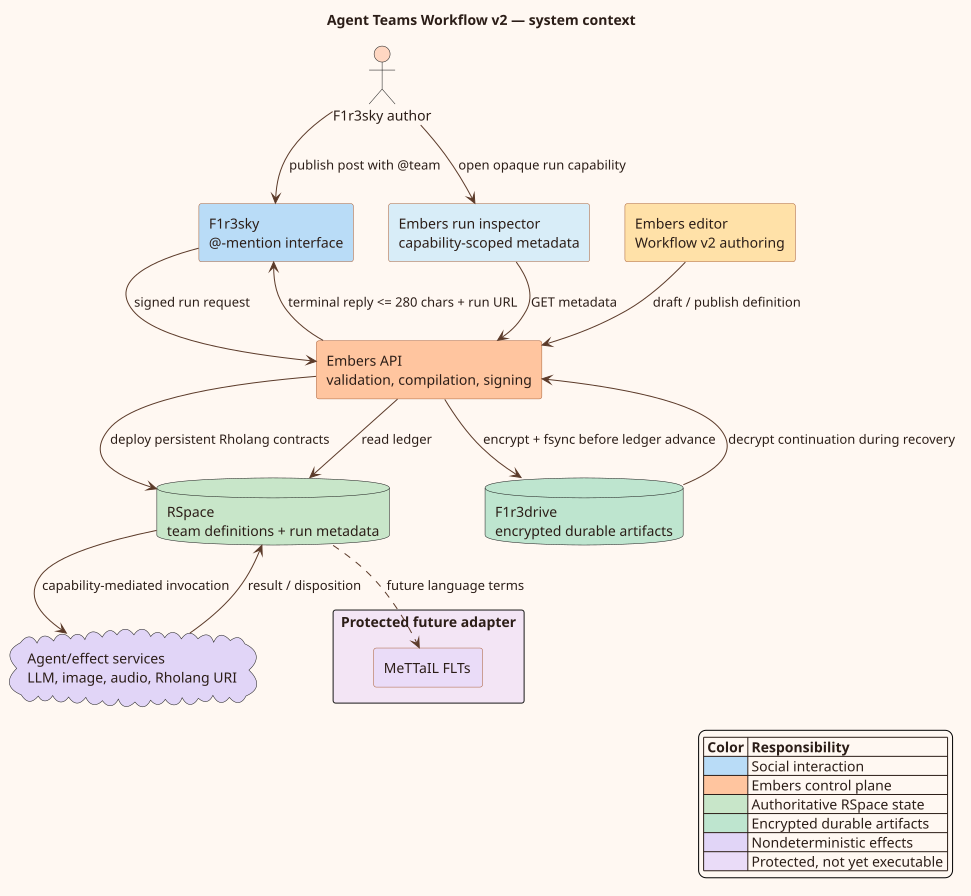

# Agent Teams Workflow v2

Agent Teams Workflow v2 is the typed, cyclic workflow layer for composing Embers agents. It combines a statechart-shaped authoring model with token-based workflow execution: statechart hierarchy organizes a large team, while tokens make parallel fan-out, joins, and arbitrary fan-in explicit. The deployed program is pure Rholang running atop F1r3node; no f1r3node or MeTTaIL modification is required by the current implementation.

## Start here

- [Red/blue live-build runbook](usage/red-blue-demo-runbook.md) walks through creating six agents, connecting their team, and presenting an engineering decision brief.

- [Research Desk demo runbook](usage/customer-demo-runbook.md) covers retrieval, bounded revisions, and human approval.
- [Red-team demo runbook](usage/red-team-demo-runbook.md) covers the six-agent critic committee, seeding, rehearsal, and integration tests.

- [Editor and operator guide](usage/editor-and-operations.md) explains how to build, validate, deploy, and invoke a team.
- [Workflow Definition v2](specification/workflow-definition-v2.md) specifies the portable JSON syntax and validation rules.
- [HTTP API and OpenAPI surface](../../../embers/docs/api/http-api.md) documents the served Swagger/OpenAPI endpoints, the universal two-phase prepare, sign, send protocol, the complete Agent Teams endpoint reference, and the pinned specification-to-SDK generation chain.
- [Runtime architecture](architecture/runtime-architecture.md) follows a definition from canvas to persistent Rholang contracts and durable run metadata.
- [Operational semantics and theory](theory/operational-semantics.md) defines tokens, routing, joins, cycles, and the exact progress-boundary theorem.
- [Statechart semantics](theory/statechart-semantics.md) formalizes the statechart half: configurations, entry closure, completion propagation, parallel-region token discipline, history, the fork-epoch algebra, and the run-to-completion relation, with the divergences from Harel/STATEMATE/UML/SCXML stated plainly.
- [SCXML correspondence](design/scxml-correspondence.md) maps every construct onto SCXML, analyzes the differences against the standard's interpretation algorithm, and works a schema-valid lossy projection example.
- [TOGL correspondence](design/togl-correspondence.md) states Meredith's Theory of Graphs Language precisely, shows that the graphl serialization is its concrete syntax in production, maps every construct three ways (v2, statechart, TOGL), works the same example into a graphl term, and proposes the design changes the unused algebra enables.
- [Rholang realization](design/rholang-realization.md) catalogs how each statechart operation is composed in Rholang, with parser-validated generated-contract and template excerpts.
- [Security model](security/threat-model.md) inventories authorities, trust boundaries, threats, and privacy constraints.
- [Object-capability model](security/capability-model.md) classifies every authority by mechanism — unforgeable name, write-attenuated bundle, bearer link, keyed-derivation capability, signature identity, identity-list grant — specifies the publication protocol, and states plainly which policy fields are enforced and which are only recorded.
- [External interfaces](architecture/external-interfaces.md) is the canonical three-channel connector architecture — F1r3sky, chat (F1R3BotGateway), and mail (F1R3Mail) — covering bindings, the chain-read-first rule, delivery transforms, and disconnect/resend semantics over the unchanged run/poll/reveal transport.
- [Channel grants](architecture/channel-grants.md) specifies the delegation model behind the connector layer: the grant record, the enforced-versus-recorded split, the UTC-epoch-day cap, the atomic adjudication clause in literate form, and delivery-only revocation.
- [Channel-grant trust model](security/channel-grant-trust.md) is the adversarial companion: grantor-owned runs, channel compromise radii, principal spoofing, and the mail channel's pre-authentication hardening.
- [Formal model](formal/README.md) maps the implementation to a small TLA+ transition system.
- [Conformance and verification](engineering/conformance-and-testing.md) maps every implementation surface to reproducible unit, static, live-stack, and formal evidence.
- [Durable and hierarchical execution](architecture/durable-execution.md) specifies F1r3drive storage, the on-chain ledger, recovery, authenticated commands, and nested teams.
- [Hierarchical continuation theory](theory/hierarchical-continuations.md) gives the composition, idempotence, and qualified-wait semantics.
- [rho-life correspondence](theory/rho-life-correspondence.md) maps the conserved-token learning-ecology corpus (the Mortal Scientist line) onto platform surfaces — OSLF documents, guards, budgets, composition, and the F1r3sky ecology — with an implemented/roadmap/absent status for every construct.
- [Feature roadmap](roadmap.md) separates implemented capabilities from the next product and research opportunities.

## Capability matrix

“Schema” means the construct has a stable representation. “Runtime” means the current compiler executes it. “Editor” means the current canvas exposes a direct control.

| Capability                           | Schema |        Runtime |               Editor | Notes                                                                                   |
| ------------------------------------ | -----: | -------------: | -------------------: | --------------------------------------------------------------------------------------- |
| Cyclic transition                    |    yes |            yes |                  yes | Every possible hot cycle must cross a wait, a bound, or a durable yield.                |
| Bounded loop                         |    yes |            yes |                  yes | Per-transition counters travel in the token context.                                    |
| Durable-yield loop                   |    yes | durable resume (scheduler) |          yes | Checkpoints to F1r3drive crash-safely; parks already due, so the recovery scheduler resumes it automatically. |
| First-match branch                   |    yes |            yes |                  yes | Priorities are unique and deterministic within a route group.                           |
| All-match branch                     |    yes |            yes |                  yes | Every true guard emits a token.                                                         |
| No-match policy                      |    yes |            yes |                  yes | Complete, skip, or fail.                                                                |
| Pure Rholang guard                   |    yes |            yes |                  yes | A deliberately restricted, effect-free expression subset.                               |
| `all`, `each`, `quorum`, `race` join |    yes |            yes |                  yes | Fan-in values are keyed by producing-node label. Quorum/race close per correlation epoch and re-arm for the next. |
| `reduce` join                        |    yes |            yes |                  yes | First, last, collect, sum, min, max, and conflict-detecting record merge.               |
| Wait / approval                      |    yes | durable resume |                  yes | Signals, events, exact-deadline timers, quorum approval, rejection, and retry.          |
| Compound / parallel scopes           |    yes |            yes |                  yes | Nested state containers, entry/exit activities, completion, and shallow/deep history. Editing uses scope fields and wrap-in-state-scope; a dedicated hierarchy canvas remains product work. |
| Pinned agent versions                |    yes |            yes | existing agent nodes | Publish validation rejects an unpinned agent.                                           |
| Simple and structured agent ABI      |    yes |            yes |       schema default | `simple-v1` sends one value; `structured-v1` carries output and disposition.            |
| Rholang URI activity                 |    yes |            yes |                  yes | The URI is validated before lowering to a registry lookup.                              |
| Nested workflow activity             |    yes |            yes |                  yes | Pinned child manifests, embedded continuations, qualified waits, and depth limit.       |
| MeTTaIL Foreign Language Term        |    yes |             no |               hidden | The node is hidden from the editor palette until its governing FIPS is accepted (it compiles to a deterministic "unavailable" failure today); the registry entry and schema remain, so an existing definition containing one still renders and round-trips. |
| Retry / timeout / compensation       |    yes |            yes |            policy UI | Deterministic backoff, effect deadlines, and reverse-order Saga compensation.           |
| Authenticated run commands           |    API |            yes |        run inspector | Owner/service authority plus wait-specific delegate approval grants.                    |
| Durable run metadata                 |    API |            yes |        run inspector | RSpace stores identities, hashes, revision, status, waits, grants, and event types.     |
| Encrypted artifact snapshots         |    yes |            yes |               opaque | F1r3drive stores encrypted requests, continuations, outboxes, observations, and output. |

## Compatibility contract

Workflow v2 is additive. Draft and team records retain the legacy GraphL projection so existing clients and previously deployed acyclic teams continue to work. A team with a `definition` deploys through Workflow v2; a team without one deploys through the legacy compiler. Saving a draft remains permissive, while deployment invokes strict validation.

The TypeScript and Rust implementations share the same field names and invariants. Object keys are sorted recursively before backend persistence to give stable bytes across equivalent definitions. This is an implementation-specific canonical form, not a claim of complete [RFC 8785 JSON Canonicalization Scheme](https://doi.org/10.17487/RFC8785) conformance; in particular, RFC 8785 also specifies number and string handling.

When a pure Rholang guard supplies `sourceHash`, both validators require the exact lowercase SHA-256 digest of the original UTF-8 source bytes. The hash pins reviewed source; it is not a substitute for the purity validator. Custom dispositions use `custom:<name>`, where the name starts with an ASCII letter and contains at most 128 ASCII letters, digits, dots, underscores, or hyphens.

## Architectural stance

The workflow definition is portable data, not executable JavaScript. Deterministic control decisions are compiled to Rholang. Nondeterministic agents and external effects are kept at explicit activity boundaries. This division lets the control plane be replayed and reasoned about without pretending that an LLM response is deterministic.

The runtime rejects only constructs whose honest implementation still depends on the protected Rholang 1.4/MeTTaIL FLT specification. Durable continuations, hierarchy, commands, timers, retries, compensation, and nested workflows are application-layer features and require no f1r3node or MeTTaIL modification. FLT work remains governed by the formal `../FIPS/` process.
