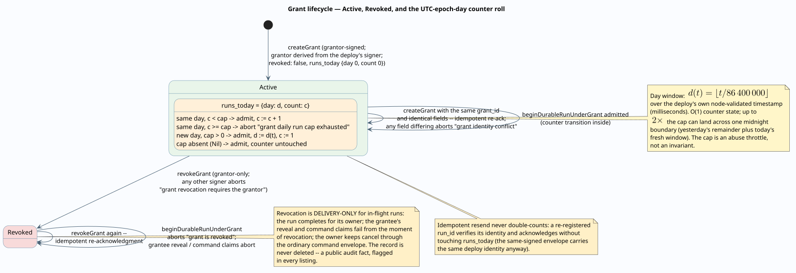
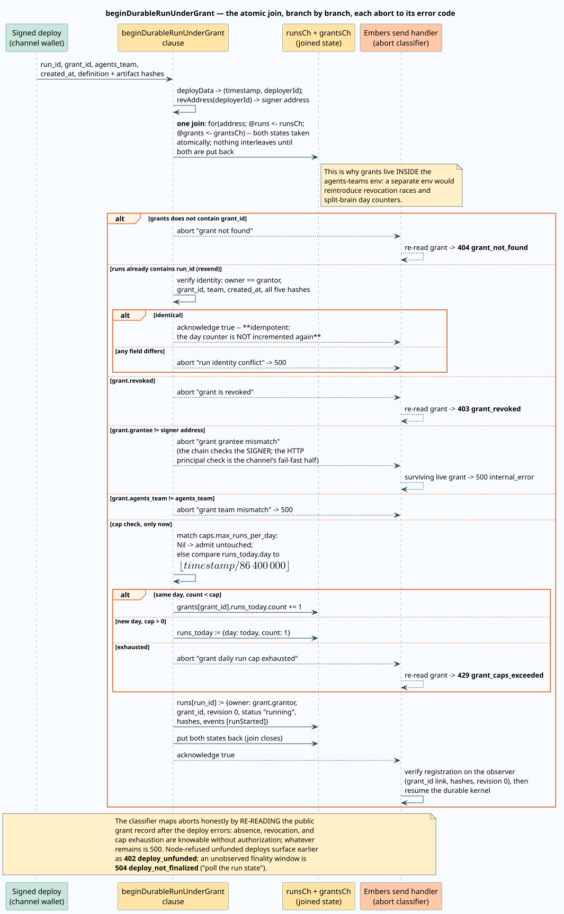

# Channel grants: the delegation model

A channel grant is the standing, revocable, on-chain authorization that lets a
channel service start team runs **owned by the granting user** while the service's
own wallet signs and pays the deploys. This document specifies the grant record
and its semantics, the split between what the chain enforces and what it merely
records, the daily cap's exact clock, the adjudicating clause in literate form,
revocation, the anonymity rule for the `grant_id` link, and the disposition of
second users. The surrounding architecture is
[external interfaces](external-interfaces.md); the adversarial analysis is the
[channel-grant trust model](../security/channel-grant-trust.md).

Terms `channel`, `channel service`, `principal`, `grantor`, `grantee`, and
`chain-read-first` are defined in
[external interfaces](external-interfaces.md#terms) and used here with those
meanings.

## Delegation theory: attenuation without key custody

The [object-capability model](../security/capability-model.md) classifies this
platform's authorities by mechanism and names its one deliberate hybrid: chain
identities (deploy signatures) checked against public records. A grant is a new
row in that taxonomy — an **identity-list authority with revocation**, the first
revocable authority in the system:

- It is **not** key custody. The alternative design — the channel service holding
  the user's wallet key, or a custodial service wallet owning the runs — would
  hand the channel the user's entire signing authority. A grant hands it a
  *subset*: initiate runs of one team, reveal their outputs, issue the listed
  command classes. This is attenuation in Miller's sense (deriving a weaker
  authority from a stronger one), realized through the platform's identity
  mechanism rather than through capability passing — the design's stated reasons
  are the same as for the delegated-approver ACL: deploy signatures already exist,
  and a public record is auditable on chain ([Miller, *Robust Composition*,
  2006](https://papers.agoric.com/assets/pdf/papers/robust-composition.pdf);
  Dennis and Van Horn,
  [doi:10.1145/365230.365252](https://doi.org/10.1145/365230.365252)).
- It **fills the empty Revoke column**. The capability model's lifecycle table
  records that nothing in the pre-grant system is revocable mid-flight; the grant
  is the first authority with a real revoke, and its precise scope (delivery,
  not compute) is specified below.
- It extends **two verified precedents** in the run ledger: the wait-level
  delegated-approver ACL (`approval_authority_grants`, `waitId|address` entries
  checked by `claimCommand`) and the owner-adjudicated output reveal
  (`claimOutputReveal`). The grant generalizes both to run scope: a grantee may
  reveal and command exactly the runs initiated under its own grant.

## The grant record

A grant is a plaintext record in the agents-teams env — a **public authorization
fact**. It contains no secret: the one secret ever involved (the optional subject
bearer token) exists on chain only as a digest. As the chain holds it
(`templates/agents_teams/init.rho`, `createGrant`):

| Field | Type | Semantics |
| --- | --- | --- |
| `grant_id` | UUIDv7 string | Grant identity, minted by embers at prepare. |
| `grantor` | REV address | The granting wallet. **Derived on chain from the creating deploy's signer, never accepted as a parameter** — a grant can only ever bind its author. Every run under the grant is registered with `owner = grantor`. |
| `grantee` | REV address | The channel service's wallet: the deploy signer the adjudication demands, and the payer of every granted run. |
| `channel` | `"chat"` or `"mail"` | The channel the grant serves. Chat platform disambiguation lives inside the principal (already platform- and workspace-scoped), not here. |
| `channel_principal` | opaque string | The channel-native identity the grant answers for: the gateway's author hash, or a mail sender address. Embers string-matches it and never interprets it. |
| `agents_team` | registry URI | The **deployment** the grant covers. Grants name a `rho:id:` URI, and every deploy mints a fresh one — a grant does not follow redeployments. |
| `caps.max_runs_per_day` | positive integer or `Nil` | The UTC-epoch-day run ceiling; `Nil` means uncapped. Validated positive at prepare. |
| `authority.reveal` | boolean | Whether the grantee may reveal outputs of runs initiated under this grant, for delivery. |
| `authority.commands` | list of classes | The command classes the grantee may issue on runs initiated under this grant. Delegable classes are exactly `approve, reject, cancel, signal, event, retry` — `timerFired` belongs to the service scheduler and `migrate` is administrative, so neither is delegable. |
| `require_token_hash` | hex string or `Nil` | blake2b-256 digest of the subject bearer token, when one was requested. The plaintext is minted from the process CSPRNG, returned **exactly once** in the prepare response, and never stored. |
| `min_auth` | `none, spf, dkim, dmarc` | The sender-authentication floor a mail grant requires. Recorded now, enforced by the mail bridge when SPF/DKIM/DMARC verdicts land on chain — the schema exists so grants never need migration. |
| `created_at` | epoch seconds | From the creating deploy's node-validated timestamp. |
| `revoked` | boolean | Never deleted, only flagged: a revoked grant remains a public audit fact. |
| `runs_today` | `{day, count}` | The chain-maintained day counter (below). |

Creation and revocation ride the standard two-phase protocol, signed by the
grantor in the environment where their key lives (the browser wallet). Both
mutations are idempotent on chain: re-creating an identical grant re-acknowledges
(any field differing aborts `grant identity conflict`), and revoking a revoked
grant re-acknowledges.

## Enforced versus recorded

Following the [capability model's precedent](../security/capability-model.md#recorded-but-unenforced)
of naming what is checked and what is merely written down, the grant's fields
split cleanly. The split is not a defect; it assigns each check to the party that
can actually perform it.

**The chain enforces** (inside `beginDurableRunUnderGrant`, `claimOutputReveal`,
`claimCommand` — always at claim time, against the current record):

- the deploy signer equals `grantee`;
- the grant is not `revoked`;
- the run's team equals `agents_team`;
- the day counter admits the run (`caps.max_runs_per_day`);
- at reveal: `authority.reveal`; at command: `authority.commands` contains the
  class, and the run was initiated under this very grant (`run.grant_id`).

**The channel enforces** (embers fails fast server-side where it can, but the
channel is the responsible party):

- **principal matching** — the chain cannot see who typed a message or sent a
  mail; binding the triggering human to `channel_principal` is channel-side by
  construction. Embers' `run-under-grant/prepare` re-checks the supplied
  `channelContext` against the grant (`grant_principal_mismatch`, HTTP 422) as
  the fail-fast half of the same duty.
- `min_auth` — SMTP-time verdicts exist only where SMTP happens.
- `require_token` — the channel proves subject possession by presenting the
  plaintext whose digest is on chain; embers only ever stores the digest.
- **its own spend ceilings** — the channel pays phlo, so phlo protection is the
  channel's admission control (the gateway's `SpendTracker` fixed-charge admit,
  the bridge's funding alerts), not the grantor's cap.

The grantor's protections are therefore exactly: the frequency cap, the scope
(one team deployment, listed authority), and revocation — **not** spend, which is
the grantee's money by design.

## The daily cap: UTC epoch-day, `O(1)` state

The cap's clock is the deploy's own timestamp $`t`$ in milliseconds, read from
the node-validated `rho:deploy:data` system channel — never a client-supplied
time. The day number is

```math
d(t) \;=\; \left\lfloor \frac{t}{86\,400\,000} \right\rfloor
```

and the counter state is the single pair `runs_today = {day, count}`. Admission
compares `runs_today.day` with $`d(t)`$: the same day increments `count` while
`count < max_runs_per_day`; a different day resets to `{day: d(t), count: 1}`.
State is $`O(1)`$ per grant regardless of traffic.

The documented boundary property: a window straddling one UTC midnight can admit
up to **twice** the cap — `count` can reach the cap just before the boundary and
a fresh window opens at it, so for any 24-hour interval $`W`$ the admitted count
obeys

```math
\mathrm{admitted}(W) \;\le\; 2 \cdot \mathtt{max\_runs\_per\_day}
```

with equality approachable only across a midnight. The cap is an **abuse
throttle, not an invariant**; anything needing a hard bound belongs in the
channel's own admission control. The server-side fail-fast check divides the
protocol timestamp in seconds by $`86\,400`$ — the same day number by
construction.



## `beginDurableRunUnderGrant`, literately

The clause is the connector layer's one nontrivial piece of on-chain logic, so it
is presented as a literate program (in Knuth's sense: the narrative order is the
explanation's order; the bracketed sections name the code they stand for). The
governing invariant: **grant adjudication, the day-counter update, and run
registration commit atomically, or nothing does.**

```text
beginDurableRunUnderGrant(run_id, grant_id, agents_team, created_at,
                          definition_hash, request hashes,
                          continuation hashes, acknowledged):

  <<Identify the signer>>
  Read (timestamp, deployerId) from the deploy's own rho:deploy:data;
  derive the signer's REV address. Nothing so far is contested: the node
  validated both.

  <<Take both states in ONE join>>
  for(address; @runs <- runsCh; @grants <- grantsCh) { ... }
  -- runsCh and grantsCh are consumed together and re-sent together.
  Between the take and the puts no other clause can read or write either
  map, so no revocation or concurrent run can interleave with what
  follows. This is why grants live INSIDE the agents-teams env: a
  separate env would reintroduce exactly that race.

  <<Unknown grant aborts first>>
  if grant_id not in grants: abort "grant not found".

  <<A replayed registration is verified, acknowledged, and NOT recounted>>
  if run_id in runs:
      verify the existing run against every argument AND against the
      grant: owner == grant.grantor, grant_id, team, created_at, and all
      five hashes. Identical -> put both maps back UNCHANGED and
      acknowledge true. Different -> abort "run identity conflict".
      -- The resend of a signed envelope re-executes this clause when its
      -- first deploy was lost; verifying instead of inserting keeps the
      -- retry safe, and putting grants back unchanged keeps the retry
      -- from burning a second unit of the daily cap.

  <<Only a live, matching grant proceeds>>
  if grant.revoked:                abort "grant is revoked"
  if grant.grantee != address:     abort "grant grantee mismatch"
  if grant.agents_team != team:    abort "grant team mismatch"

  <<Admit against the day counter>>
  match grant.caps.max_runs_per_day:
      Nil -> admitted with runs_today unchanged
      cap -> if runs_today.day == d(timestamp):
                 if runs_today.count < cap: admit {day, count+1}
                 else:                      abort "grant daily run cap exhausted"
             else:  -- a new day
                 if 0 < cap: admit {day: d(timestamp), count: 1}
                 else:       abort "grant daily run cap exhausted"

  <<Commit all three effects together>>
  grantsCh ! grants with the updated counter
  runsCh   ! runs with the new record:
      owner = grant.grantor      -- the grantor owns; the signer paid
      grant_id                   -- the link reveal/command claims check
      revision 0, status "running", the five hashes,
      events [ {sequence: 0, type: "runStarted"} ]
  acknowledged ! true
```

Every abort maps to a machine-readable HTTP code by an honest **re-read** of the
public grant record after the deploy errors (absence, revocation, and cap
exhaustion are knowable without authorization; what remains is internal):



## Revocation is delivery-only

`revokeGrant` (grantor-only, idempotent) flips `revoked` and cuts, from that
instant, everything the *grantee* can do: new runs abort `grant is revoked`, and
the grantee branches of `claimOutputReveal` and `claimCommand` check `revoked`
**at claim time**, so reveal and command claims fail immediately even for runs
already in flight.

What revocation deliberately does **not** do is touch the runs themselves. An
in-flight run completes for its owner — the grantor — who can reveal it with
their own wallet and retains `cancel` through the ordinary command envelope.
Channels treat a revoked-mid-run reveal (a bare HTTP 403) as an **expected
outcome with its own reply** ("output withheld; the owner can view it at
`Run: <url>`"), not a failure to retry. Cutting compute as well would hand the
channel-facing state machine a third party (the run) to reconcile and would
destroy grantor-owned work the grantor already paid nothing for; cutting
disclosure alone is exactly the grantor's interest.

## The `grant_id` anonymity rule

The run ledger scrubs `owner` from every read; grants would quietly undo that if
the link were public. Grant records are public and name their `grantor` — so a
public run enumeration carrying `grant_id` would link runs back to the owner the
ledger deliberately anonymizes. The rule, implemented in `init.rho`:

- **`listRuns` scrubs** both `owner` and `grant_id` from every record;
- **`getRun` keeps** `grant_id` (while still scrubbing `owner`): the read is
  capability-gated — possessing the `run_id` already is the read authority, and
  the channel that holds it needs the link to know which grant to reveal under.

The reveal event stays actor-less for the same reason: publishing the revealer
would de-anonymize the owner on the public timeline.

## Second users: initiator-only, with a designed escape hatch

In a chat channel, anyone can see a run's approval prompt; who may act on it is a
policy decision the layer makes conservatively. The gateway accepts
`team approve / reject / cancel` **only from the run's initiator** — the person
whose grant the run was started under. Accepting a bystander's approval would
launder the bystander's intent through the initiator's grant authority: on chain
the command would be signed by the gateway wallet and authorized by the
initiator's grant, misattributing the decision.

The escape hatch is already in the ledger: the **wait-level delegated-approver
ACL**. A workflow that wants a second person deciding names that person's wallet
as an approver on the wait; the run's `approval_authority_grants` then authorize
them directly, deciding with their own wallet in the embers UI — correctly
attributed, no channel in the loop. The gateway's refusal message points there.
Per-grant channel-member scope (a grant naming several principals) is a
documented future extension, not present in the schema.

## Environment v3 and the migration caveat

Grants and bindings live in the agents-teams env, whose version bumped
`2 -> 3` (`AGENTS_TEAMS_ENV_VERSION`, `domain/agents_teams.rs`). Bootstrap
redeploys the env per version through the existing `insertSigned` machinery — no
new deployment mechanism — but a version bump **empties env state**: development
stacks reset (`stack.sh reset`), and a production rollout requires an explicit
v2-to-v3 state-migration deploy carrying forward teams, runs, and f1r3sky tokens
before the old env is abandoned. Grant-initiated runs also move the encrypted
run-request artifact to schema `embers-agent-team-run-request-v3`, which adds the
`channel_context` field; plain runs continue to write v2, and v3 is additive, so
no artifact migration is needed.

## Related documents

- [External interfaces](external-interfaces.md) — the architecture around this
  model.
- [Channel-grant trust model](../security/channel-grant-trust.md) — spoofing,
  revocation races, and the mail-specific analysis.
- [Object-capability model](../security/capability-model.md) — where the grant
  sits in the mechanism taxonomy.
- [Run under grant](../../../../embers/docs/api/methods/ai-agents-teams/run-under-grant.md),
  [grants create](../../../../embers/docs/api/methods/ai-agents-teams/grants-create.md),
  [grants revoke](../../../../embers/docs/api/methods/ai-agents-teams/grants-revoke.md)
  — the operation reference.
