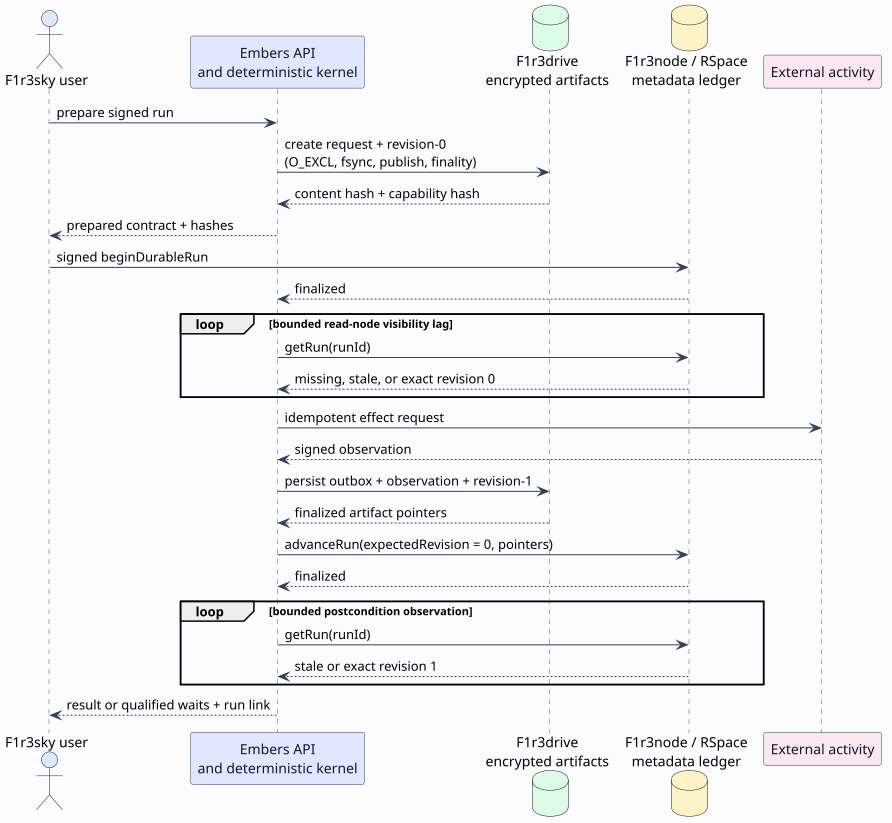

# Durable and hierarchical execution

This document specifies the implemented boundary between deterministic workflow control, encrypted durable artifacts, public metadata, and external effects. It complements the portable [Workflow Definition v2](../specification/workflow-definition-v2.md); it does not change that syntax.

## Terms and trust domains

A **continuation** is the complete private state required to resume a workflow: token queue, joins, scope instances and history, counters, pending effects and waits, compensations, observations, and nested child continuations. A **revision** is the monotonically increasing checkpoint number of a root run. An **artifact pointer** is a content hash plus a keyed capability hash; it identifies encrypted bytes without exposing them. An **observation** is the durable result of one nondeterministic activity or guard. An **outbox** is a persisted, signed external request that can be resubmitted with the same operation identity.

The storage split is intentional:

| Domain            | Stores                                                                                                                                                    | Must not store                                    |
| ----------------- | --------------------------------------------------------------------------------------------------------------------------------------------------------- | ------------------------------------------------- |
| F1r3drive         | AES-GCM encrypted requests, continuations, outboxes, observations, outputs                                                                                | plaintext private payloads                        |
| F1r3node / RSpace | run identity, owner internally, team, protocol-second timestamp, definition and artifact hashes, revision, status, wait IDs, approval grants, event types | prompts, outputs, credentials, continuation state |
| Embers memory     | per-run mutexes, connected F1r3sky sessions, transient decoded values                                                                                     | authoritative durable state                       |
| F1r3sky           | the initiating post and a terminal reply of at most 280 characters, including a run link                                                                  | private continuation artifacts                    |



## Commit protocol

The protocol is a deliberately ordered composition of an encrypted artifact publication and a metadata compare-and-set. It does not claim a distributed transaction across F1r3drive and RSpace. Instead, it makes every intermediate state safe to retry.

1. Preparation writes the encrypted request and initial continuation to F1r3drive. File creation is exclusive, permissions are private, file data is synchronized, the F1r3drive dispatcher is flushed, and publication waits for observer inclusion and finality.
2. The user signs a `beginDurableRun` contract committing the immutable request, team, time, definition hash, and initial artifact pointers.
3. After validator finality, Embers repeatedly reads the ledger until the exact signed postcondition is visible. No effect executes before that equality check succeeds.
4. Each activity request has a stable effect key. Its signed contract is written to an encrypted outbox before submission. The resulting observation is encrypted under the same key.
5. A new continuation revision is published to F1r3drive before `advanceRun` commits its pointers and public status.
6. After advancement finality, Embers polls through missing or stale read-node views until the exact next revision, hashes, waits, grants, status, output, command clearing, and event are visible.

### Literate checkpoint algorithm

The comments state the invariant established by each operation; the following operations implement that invariant.

```text
CHECKPOINT-AND-ADVANCE(run, continuation, publicMetadata):
  # The private next state must be recoverable before public metadata can name it.
  expectedRevision <- continuation.revision
  continuation.revision <- expectedRevision + 1
  pointer <- F1R3DRIVE-PUT-ENCRYPTED(
      run.id, "revision-" + continuation.revision, continuation)

  # RSpace is the single public linearization point for revision ownership.
  deploy <- ADVANCE-RUN(
      run.id, expectedRevision, pointer, publicMetadata)
  REQUIRE-FINALIZED-WITHOUT-ERROR(deploy)

  # Finality and read-node visibility are separate facts; accept only equality.
  observed <- POLL-RUN-UNTIL(run.id,
      state -> EXACT-POSTCONDITION(state, continuation, pointer, publicMetadata))
  return observed
```

If Embers stops after F1r3drive publication but before RSpace advancement, the encrypted artifact is an unreachable orphan and may be garbage-collected after a retention interval. If it stops after RSpace advancement, recovery follows the committed pointer. Neither case exposes plaintext or repeats a visible state transition.

## On-chain run register

The registry uses one private persistent map token, `runsCh!({})`. A mutation consumes that token, verifies identity, authority, and revision, and emits exactly one replacement token. This receive–validate–send critical section is the linearization point for `beginDurableRun`, `claimCommand`, `advanceRun`, `clearCommand`, and legacy `finishRun`. Persistent `getRun` and `listRuns` reads do not consume it.

For run $`r`$, let $`\nu(r)`$ be its revision. A successful advancement satisfies:

```math
\nu'(r) = \nu(r) + 1.
```

An idempotent retry may acknowledge an already committed state only when all public postcondition fields match. Equality of revision and one content hash is insufficient: status, definition, continuation capability, waits, deadline, approval grants, and output pointer are also compared.

The registry schema version is `1`. Bootstrap uses signed registry replacement when it observes an older version under the configured environment key.

## Commands and authorization

One encrypted command envelope supports `signal`, `event`, `timerFired`, `approve`, `reject`, `cancel`, `retry`, and `migrate`. Preparation fixes the command ID, class, target wait, payload artifact hashes, expected revision, and protocol-second issuance time. The command claim is a compare-and-set against the expected revision.

The owner and the configured Embers service may issue every command. A delegate may issue only `approve` or `reject`, only for the exact pending wait whose grant is encoded as `waitId|address`. The encrypted command remains authoritative for payload and semantics; the public class and wait ID exist only to narrow on-chain authority.

Timers compare the expected absolute deadline with the stored deadline and reject early firing. Retry waits use deterministic bounded exponential backoff with optional deterministic jitter. Cancellation clears active tokens, waits, effects, and nested continuations, then executes the compensation stack in reverse completion order. A compensation is a new effect, not a rollback.

## Hierarchical Agent Teams

An activity reference of kind `workflow` pins a deployed child team URI and definition hash. The orchestrator fetches and validates that manifest, creates a child continuation, and embeds it under the parent effect key. Effect and guard identities include the child execution ID, preventing two teams with identical node IDs from sharing an outbox or observation.


Children use the root run ID but have distinct execution IDs. A nested wait is exposed as:

```text
nested:<parent-effect-key>:nested:<child-effect-key>:<local-wait-id>
```

Each continuation strips exactly one prefix before delegating a command to its child. Thus public approval grants and timer identities remain exact at arbitrary depth. The whole tree is serialized in one encrypted root checkpoint, making parent and child control state crash-consistent. External child effects still use separately encrypted, idempotent outboxes and observations, so replay after a crash reuses completed observations.

Nesting is capped at 32 active workflow calls. This bounds memory and recursion for pathological self-delegation without restricting cycles inside a workflow graph; graph cycles remain governed by explicit progress boundaries.

## Recovery and failure classification

The recovery scheduler lists metadata records and acquires a non-blocking per-run mutex. It resumes `running` and `resuming` runs, recursively finds the earliest due root or path-qualified child timer, fires it through the same authenticated command path, and leaves terminal records immutable. The scheduler verifies that the encrypted timer deadline exactly equals the public ledger deadline before preparing the command.

One asymmetry deserves emphasis: the timer search fires only timer and retry suspensions, while the ledger's published `dueAt` is the minimum deadline over *all* waits, approvals included. An expired approval deadline therefore produces no `timedOut` disposition and makes each recovery scan report "run due_at does not correspond to a pending timer" until the approval resolves — a tracked [known gap](../roadmap.md#known-gaps). The complete run status machine, with every ledger transition and event, is the [run lifecycle diagram](../diagrams/09-run-lifecycle.svg); the wait-level view is the [wait and approval lifecycle](../diagrams/10-wait-approval-lifecycle.svg).

| Failure                                                   | Classification                          | Behavior                                                 |
| --------------------------------------------------------- | --------------------------------------- | -------------------------------------------------------- |
| validator or observer timeout                             | transient                               | retain outbox/checkpoint and retry                       |
| finalized deploy reports error                            | deterministic or authorization conflict | do not infer success; surface/fail according to boundary |
| read node returns missing or prior revision               | visibility lag                          | bounded poll for exact postcondition                     |
| activity returns `failed` or `timedOut` disposition       | workflow observation                    | route by disposition and policy                          |
| kernel rejects restored state                             | deterministic terminal failure          | encrypt failed output and commit `runFailed`             |
| missing/corrupt encrypted artifact or capability mismatch | integrity failure                       | stop recovery; never substitute another artifact         |
| duplicate command or effect                               | idempotent retry                        | acknowledge only exact identity/postcondition            |
| recovery scan repeats a `due_at` timer mismatch error     | expired approval deadline (unenforced)  | resolve the approval; deadline enforcement is a tracked known gap |

The distinction between safety and liveness matters. The protocol guarantees that Embers does not execute an effect before the run registration is observed and does not claim an advancement before its exact readback. It cannot guarantee progress when validators, F1r3drive, an external provider, or an approver remain unavailable forever.

## Operational configuration

`../embers-local-stack/stack.sh` exposes an explicit `drive` lifecycle and configures the continuation mount, encryption key, capability key, object-size limit, recovery interval, and public run URL. The canonical run-directory hash scopes the F1r3drive and Embers systemd unit names, preventing cross-profile ownership confusion. The drive unit restarts on failure and removes a stale FUSE registration before remounting. Embers has `Requires`, `After`, and `BindsTo` relations to that exact drive, while the drive's `Upholds` relation restores Embers after storage recovery. The continuation store refuses an ordinary directory in production; it verifies that the resolved path is an owner-isolated F1r3drive FUSE mount. Test constructors are deliberately separate.

The F1r3drive writer prefers the modern proposal service. Against a legacy node that returns gRPC `UNIMPLEMENTED`, it falls back to heartbeat/autopropose, but still waits for observer inclusion and finality. `flushFile` and FUSE `fsync` wait for the dispatcher queue to empty; they are durability barriers, not best-effort hints.

## Theoretical lineage

The design combines persistent communication from the reflective higher-order calculus with write-ahead/outbox recovery and Saga compensation. See Meredith and Radestock, “A Reflective Higher-order Calculus,” [doi:10.1016/j.entcs.2005.05.016](https://doi.org/10.1016/j.entcs.2005.05.016), and Garcia-Molina and Salem, “Sagas,” [doi:10.1145/38713.38742](https://doi.org/10.1145/38713.38742). The revision/event relation uses Lamport’s happens-before discipline rather than physical-clock ordering; see “Time, Clocks, and the Ordering of Events in a Distributed System,” [doi:10.1145/359545.359563](https://doi.org/10.1145/359545.359563).
