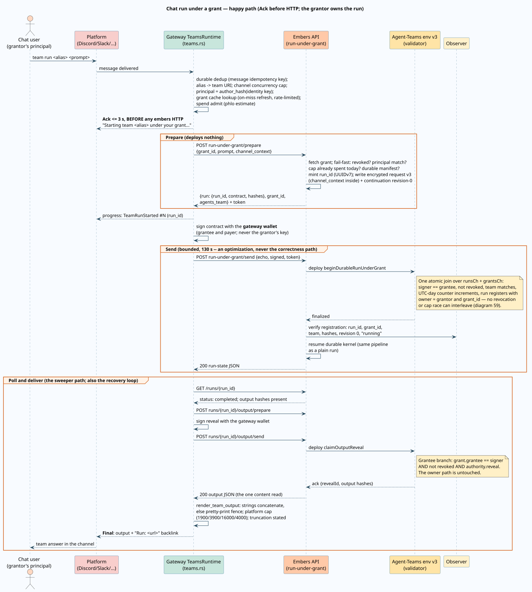
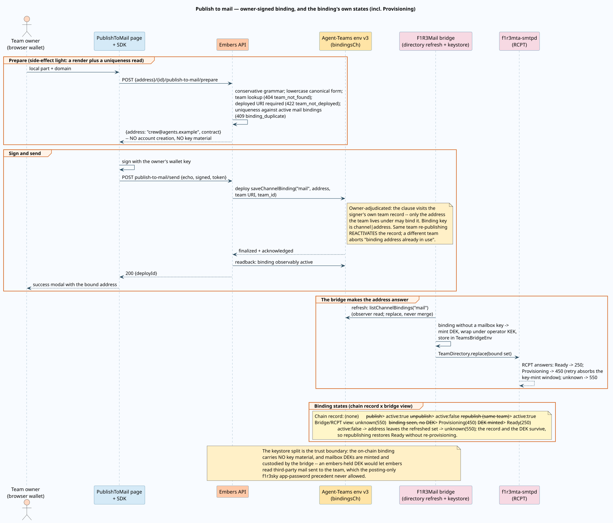
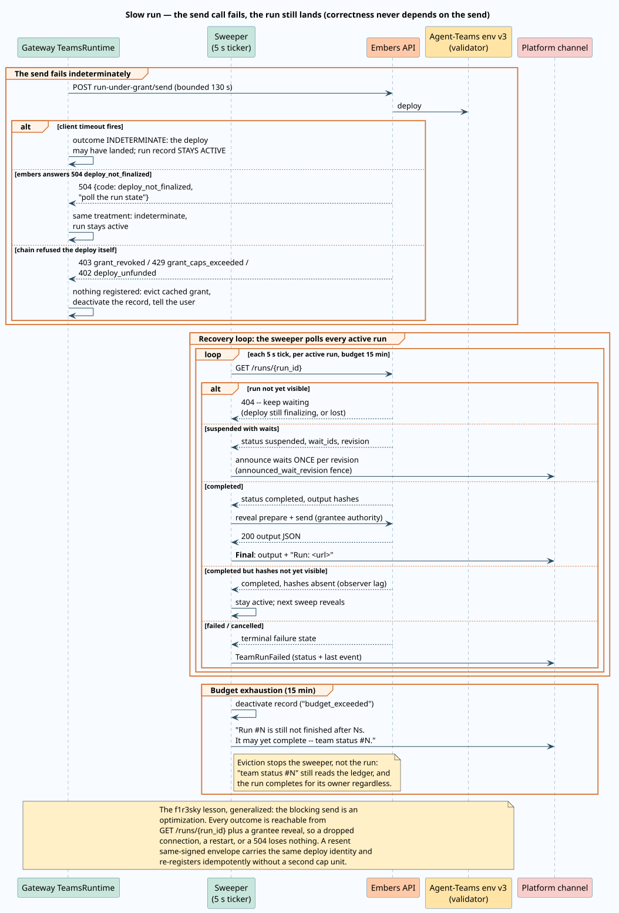
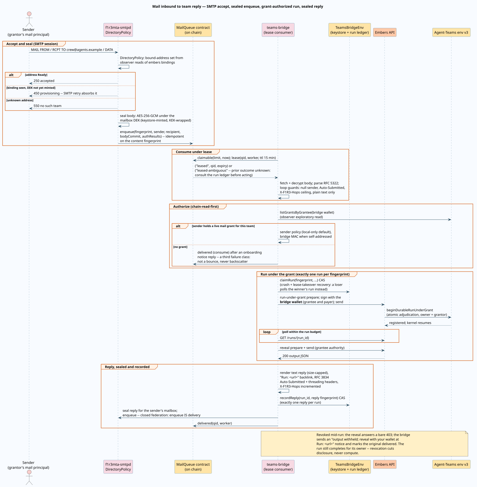

# External interfaces: the channel-connector architecture

Agent Teams are reachable from three external channels: **F1r3sky** (the AT-Protocol
social layer), **chat** (Discord, Slack, Mattermost, and Telegram through
F1R3BotGateway), and **mail** (chain-backed SMTP through F1R3Mail). This document is
the canonical architecture of that connector layer: what a channel is, how a team
becomes reachable on one, who owns and who pays for the runs a channel starts, and
the one transport every channel shares. The delegation model itself — the grant
record, its caps, and its adjudication — is specified in
[channel grants](channel-grants.md); the adversarial view is in the
[channel-grant trust model](../security/channel-grant-trust.md); the decision record
is [ADR-004](../../architecture/decisions/004-grant-based-channel-connectors.md).

## Terms

Every term is defined before it is used elsewhere in this document.

| Term | Definition |
| --- | --- |
| Channel | An external medium through which a human reaches a team: `"chat"` or `"mail"` in the grant model, plus the pre-existing F1r3sky integration. The legal grant vocabulary is exactly `["chat", "mail"]` (`domain/agents_teams/grants.rs`, `GRANT_CHANNELS`); F1r3sky predates the layer and connects through its own adapter. |
| Channel service | The long-running process that fronts a channel: the F1R3BotGateway `botd` for chat, the F1R3Mail teams-bridge for mail. Each holds an ordinary funded wallet — never the Embers service key. |
| Principal | The channel-native identity of the human on the far side, opaque to embers: the gateway's domain-separated author hash (`custody::author_hash`, workspace-scoped on Discord/Slack/Mattermost, platform-global on Telegram) for chat; the sender's mail address for mail. Embers string-matches principals and never interprets them. |
| Grant | A standing, revocable, on-chain delegation signed by a team user: "channel wallet C may initiate runs of team T owned by me, within caps, and may reveal outputs and issue the listed command classes for delivery". Fully specified in [channel grants](channel-grants.md). |
| Grantor | The wallet that signed the grant. Every run initiated under the grant is **owned** by the grantor. |
| Grantee | The channel service's wallet named in the grant. It **signs and pays** the run deploys and holds delivery authority, never ownership. |
| Binding | A public, owner-signed record connecting a team to a channel-native address. For mail it is an on-chain record in the agents-teams env (`saveChannelBinding`); for chat it is a workspace-local alias in the gateway's store; for F1r3sky it is a PDS record plus encrypted chain credentials. |
| Chain-read-first | The consumption rule for channel services: authorization state (grants, bindings) is read from the chain through an observer, not from the embers HTTP service; the HTTP `GET` mirrors exist for UI and operations only. |
| Observer | A non-proposing f1r3node that serves exploratory reads; the read half of the validator/observer split. |
| Run capability | The UUIDv7 run identifier; possession of `GET /runs/{run_id}` is the read authority for the run's metadata ledger. |

## One transport, three front doors

The connector layer deliberately adds **no new execution transport**. A channel run
is a plain durable run with a different authorization path in front of it:

1. **Prepare** — the channel service posts
   `{grantId, prompt, channelContext}` to `run-under-grant/prepare`; embers
   resolves the team **from the grant** (the request never names one), fails fast
   on revocation, principal mismatch, exhausted caps, or a non-durable team, and
   returns the same `RunResp` shape a plain run prepare returns.
2. **Sign** — the channel service signs the prepared bytes with its own wallet
   (secp256k1 over the blake2b-256 of the contract, exactly as every other
   mutation).
3. **Send** — the deploy runs `beginDurableRunUnderGrant`, which adjudicates the
   grant **atomically with run registration** in one Rholang join, registers the
   run with `owner = grantor` and the `grant_id` link, and hands off to the same
   deploy-finality-verify-resume pipeline as `run/send`.
4. **Poll** — `GET /runs/{run_id}`, the unchanged capability read.
5. **Reveal** — `runs/{run_id}/output/prepare` + `/send`; the on-chain
   `claimOutputReveal` clause now accepts the **owner or** a live grantee with
   `authority.reveal`, so the channel can fetch the value for delivery.
6. **Command** — the unchanged command envelope; `claimCommand` accepts the
   grantee for exactly the command classes the grant delegates, on runs initiated
   under that same grant.

Everything from step 4 on is byte-identical to the pre-connector surface. This is
the architectural core: channels differ only in **who fronts the human** and **how
the answer is delivered back**; ownership, artifacts, privacy scrubbing, and the
durable kernel are untouched. The full happy path:

## The chain-read-first rule

Channel services discover their authority by reading the chain, not by asking
embers:

- the gateway refreshes its grant cache from the observer-readable
  `listGrantsByGrantee` clause (periodic 60 s sync plus an on-miss refresh
  rate-limited to at least 5 s apart, with eviction on failure);
- the mail bridge builds its RCPT-time bound-address set from
  `listChannelBindings("mail")` and its sender authorization from
  `listGrantsByGrantee`, both observer exploratory reads — the embers HTTP
  service never sits in the mail consume path.

The rule buys two properties. **Availability**: a channel keeps routing while the
embers HTTP service restarts, because chain reads and the two-phase deploy surface
are independent. **Safety under staleness**: every cached grant is a routing
artifact only — the chain re-adjudicates `signer == grantee`, revocation, team,
and caps at deploy time inside the atomic join, so a stale cache costs one failed
*paid* deploy and never a wrong authorization. The HTTP mirrors
(`GET grants/by-grantor`, `grants/by-grantee`, `bindings/by-channel`,
`published-channels`) exist for the management UI and diagnostics.

## Binding ownership per channel

Reachability is established differently per channel, and the differences are
load-bearing — each row names who signs, where the record lives, and what secret
(if any) exists:

| Channel | Binding record | Who signs it | Key material | Reversal |
| --- | --- | --- | --- | --- |
| F1r3sky | PDS account + config record naming the team, plus the minted app-password stored **encrypted on chain** (`saveFireskyToken` nonce + ciphertext) | Team owner (publish-to-firesky) | Posting-only app-password, encrypted under an embers key | Unpublish removes the PDS record, keeps the account |
| Chat | Workspace-scoped alias `team link <rho:id:...> as <alias>` in the gateway's SQLite (`team_aliases`), validated against the registry at link time | Nobody — an alias is a naming convenience, not an authority; the **grant** is the authority | None | `team unlink <alias>` |
| Mail | On-chain `ChannelBinding` in the agents-teams env: `{channel: "mail", address, agents_team, team_id, owner, active, created_at}` | Team owner (publish-to-mail, two-phase) | **None** — deliberately; mailbox content keys are minted and custodied by the mail bridge, wrapped under its operator KEK, never held by embers | `unpublish-mail` flips `active` off, reversibly; re-publishing the same team reactivates the same address |

The mail row's empty key column is a design decision with a precedent behind it:
the f1r3sky app-password is posting-only, so embers holding it cannot read anyone's
messages — but a mailbox decryption key would let embers read third-party mail sent
to the team. The prepare phase of publish-to-mail is correspondingly
**side-effect light** (a pure render plus an address-uniqueness read; no account,
no key), the lesson of the f1r3sky publish path's prepare-time irreversibility.

An address can serve one team at a time: the binding key on chain is
`channel|address`, re-publishing the *same* team reactivates the record, and a
*different* team is refused (`binding_duplicate`, HTTP 409) both at prepare (a
fail-fast read) and at deploy (the clause's own check). The full mail-binding
flow — owner signature, chain adjudication, the bridge's key provisioning, and
the binding's chain-record and RCPT-view states — is one sequence:

## Delivery transforms and length policies

The run's output artifact is JSON; each channel renders it to its native shape,
always with a `Run: <url>` backlink so the full record is one click away:

| Channel | Transform | Length policy | Backlink |
| --- | --- | --- | --- |
| F1r3sky | Text or image-embed post, threaded as a reply | At most 280 characters, truncated by Unicode scalar value with the URL suffix reserved first | Always inside the 280 budget |
| Chat | `render_team_output`: string leaves concatenate in order; a stringless value pretty-prints in a code fence | Per-platform caps (defaults: Discord 1900, Slack 3900, Mattermost 16000, Telegram 4000, local adapter 16000 characters), truncation **stated, never silent** | Appended as a message field when `EMBERS_PUBLIC_RUN_URL` is configured |
| Mail | Plain-text reply body with provenance headers (RFC 3834 `Auto-Submitted`, threading via `In-Reply-To`, `X-F1R3-Hops` incremented) | 64 KiB default (`BRIDGE__REPLY_MAX_BYTES`) | `Run: <url>` line in the body |

Citations: RFC 5322 (Internet Message Format,
[doi:10.17487/RFC5322](https://doi.org/10.17487/RFC5322)); RFC 3834 (recommendations
for automatic responses, [doi:10.17487/RFC3834](https://doi.org/10.17487/RFC3834));
RFC 5321 (SMTP, [doi:10.17487/RFC5321](https://doi.org/10.17487/RFC5321)).

## The legacy-GraphL caveat

Only **durable** (Workflow v2) teams are runnable under a grant. A legacy
GraphL-only deployment runs on the pre-ledger path and never records an output
artifact, so there is nothing a reveal could ever release — a channel that started
one could never deliver its answer. `run-under-grant/prepare` therefore refuses
such teams with `team_not_durable` (HTTP 422) instead of accepting a run whose
output would be silently unreachable. The refusal is honest UX: the gateway
translates it to "deploy it as a Workflow v2 team first".

## Disconnect and resend semantics

Channels are long-lived processes talking to a chain through a bounded HTTP call,
so the layer is explicit about what a lost connection means. The rule, generalized
from the f1r3sky integration's hardest lesson: **the blocking send is an
optimization; correctness never depends on it.**

- A send that times out client-side, or answers `504 deploy_not_finalized`, is
  **indeterminate** — the deploy may still land. The channel keeps the run record
  active and its sweeper polls `GET /runs/{run_id}` until the run appears and
  completes (gateway: 5 s cadence, 15 min budget; mail bridge: 5 s poll interval,
  30 min run budget). Eviction at budget stops the sweeper, not the run — the run
  completes for its owner regardless, and `team status` still reads the ledger.
- A **resend of the same signed envelope** carries the same signature and
  therefore the same deploy identity, so it cannot land twice; and if the first
  deploy was lost, the re-registration path in `beginDurableRunUnderGrant`
  verifies the run's full identity and acknowledges **idempotently, without
  consuming a second unit of the daily cap**.
- Only a *chain refusal* of the deploy itself (`grant_revoked`,
  `grant_caps_exceeded`, `deploy_unfunded`) means nothing registered; the channel
  evicts its cached grant, tells the user, and stops tracking.
- Restart recovery is store-driven: the gateway rehydrates its tracker from
  `RunStore::active_runs()`; the mail bridge re-acquires expired leases and
  resolves the `leased-ambiguous` case against its fingerprint-keyed run ledger
  (`lookupRun`) before acting, so a crash between deploy and delivery never
  produces a second run for the same message.

The mail channel runs the same discipline end-to-end, with SMTP's own retry
semantics absorbing the windows a chat platform would surface as latency:

## Reachability reporting is three-valued

`GET {address}/{id}/published-channels` aggregates the three channels for the
Interfaces panel, under the established `published_state` discipline: `true` is
verified reachable, `false` is a verified divergence, and an absent answer means
"could not be determined" and must never be rendered as "missing". Mail
reachability is absent **by design** (embers does not probe SMTP); the chat row is
derived from active-grant presence across all of the team's deployed version URIs
(each deploy mints a fresh URI, so the aggregation walks all of them), because the
gateway dials out and exposes no status surface. The frontend's
`lib/interfaces.ts` centralizes the collapse to `reachable | unknown | unreachable`
so no call site can quietly render `null` as an absence.

## What f1r3sky is, relative to the layer

The f1r3sky integration predates the connector layer and still runs its bespoke
in-backend adapter (`run_on_firesky.rs`): the mentioning user's own wallet signs
the run client-side, so ownership was already correct there. The grant layer
generalizes exactly the two things f1r3sky could not: a channel service that
**cannot** hold the user's key can still start user-owned runs (grants), and
delivery authority is now explicit and revocable rather than implied by the
signing identity. Migrating f1r3sky onto the connector layer is a documented
follow-on, not part of this change
([ADR-004](../../architecture/decisions/004-grant-based-channel-connectors.md)).

## Related documents

- [Channel grants](channel-grants.md) — the delegation model this architecture
  stands on.
- [Channel-grant trust model](../security/channel-grant-trust.md) — the
  adversarial analysis.
- [Durable and hierarchical execution](durable-execution.md) — the run ledger and
  kernel the transport reuses.
- [F1R3BotGateway integration](../../../../embers/docs/integrations/f1r3botgateway.md)
  and [F1R3Mail integration](../../../../embers/docs/integrations/f1r3mail.md) —
  the per-channel operational views.
- [HTTP API](../../../../embers/docs/api/http-api.md#channel-connectors-and-grants)
  — the operation family and error-code taxonomy.
