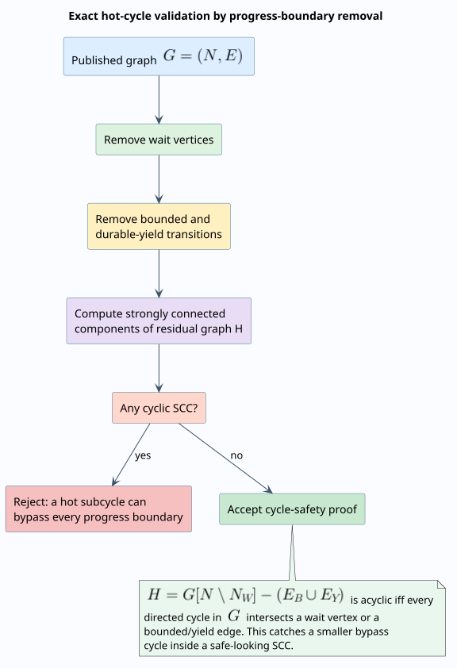
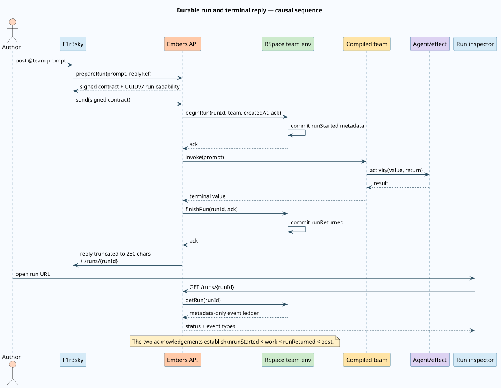

# Runtime architecture

Agent Teams Workflow v2 separates authoring, portable semantics, deterministic control, nondeterministic activities, and public interaction. This separation is the central engineering decision: a visual edge is never itself runtime state, and an LLM response is never mistaken for a deterministic transition.


## Component responsibilities

| Layer               | Repository and module                                                              | Responsibility                                                                   |
| ------------------- | ---------------------------------------------------------------------------------- | -------------------------------------------------------------------------------- |
| Canvas              | `embers-frontend/apps/embers/src/lib/components/GraphEditor/`                      | Edit nodes, joins, guards, routing modes, and loop policies.                     |
| Portable kernel     | `embers-frontend/apps/embers/src/lib/workflow/`                                    | Typed definition, React Flow projection, publish diagnostics, exact cycle proof. |
| API transport       | `embers/packages/embers/src/api/agents_teams/`                                     | Additive `definition`, run capability response, metadata inspector endpoint.     |
| Domain schema       | `embers/packages/embers/src/domain/agents_teams/workflow.rs`                       | Serde contract, canonical persistence, strict backend validation.                |
| Compiler            | `embers/packages/embers/src/domain/agents_teams/compilation/workflow_rendering.rs` | Lower typed nodes, routers, joins, guards, counters, and agent ABIs to Rholang.  |
| Durable kernel      | `embers/packages/embers/src/domain/agents_teams/runtime.rs`                        | Deterministic tokens, epochs, scopes, waits, retries, compensation, hierarchy.   |
| Orchestrator        | `embers/packages/embers/src/domain/agents_teams/orchestration.rs`                  | Effect outbox, observations, checkpoints, nested execution, exact advancement.   |
| Artifact store      | Embers `continuation_store.rs` plus F1r3drive                                      | Owner-isolated encrypted requests, continuations, effects, and outputs.          |
| RSpace environments | `embers/packages/embers/templates/agents_teams/`                                   | Persist definitions, compiled team contracts, and metadata-only run ledgers.     |
| Social adapter      | Embers `run_on_firesky.rs` plus F1r3sky query/polling state                        | Invoke a mentioned team, track pending replies, post bounded terminal text.      |
| Local operations    | `embers-local-stack/stack.sh`                                                      | Idempotent startup and explicit destructive reset.                               |

No implementation file in f1r3node or MeTTaIL changes. The current Rholang surface already provides persistent contracts, unforgeable names, maps, registry lookup, and deployed return channels.

## Authoring and persistence flow

The editor uses React Flow as a presentation projection. `toWorkflowDefinition` constructs stable semantic identities, route groups, transitions, pinned activity references, scopes, and presentation coordinates. `fromWorkflowDefinition` recreates the supported canvas without interpreting geometry as control flow.

Save sends both:

- `definition`, the authoritative Workflow v2 document for new clients and the new compiler;
- `graph`, a legacy GraphL compatibility projection for old records and clients.

The backend parses `definition` into a closed Rust type and sorts object keys recursively before storage. List APIs omit both graph bodies from headers. Get APIs return them. A missing definition selects the legacy GraphL compiler; a present definition selects the Workflow v2 compiler.

## Direct and durable execution

Workflow v2 has two compatible execution surfaces. A deployed team exposes persistent Rholang activity and guard contracts, which remain useful for direct invocation and as the effect host. A team whose control manifest is discovered during run preparation uses the durable Rust kernel. The kernel treats Rholang agents, builtins, URI calls, and guards as explicit effects; it checkpoints between observations and uses the RSpace run register as its public revision authority.

This split keeps portable workflow semantics independent of one implementation language while avoiding the false claim that an LLM or network effect is a consensus-deterministic reduction.

## Rholang compilation strategy

Legacy GraphL lowering used one-shot consumers and was therefore naturally acyclic. Workflow v2 emits one persistent node contract and one persistent router contract per node. Revisiting a node is an ordinary send to the same contract.

Each invocation creates fresh private runtime channels, which isolates simultaneous runs even when they use the same deployed team. A token consists operationally of:

```text
value      current portable value
context    immutable input + portable state + transition counters
source     producing-node label used by fan-in maps
```

The original invocation input is retained under `context.input`. Loop counters live under `context.iterations` and are updated functionally. This prevents shared mutable loop state and makes two parallel tokens independent.

### Literate lowering algorithm

The algorithm below is written in literate form: prose states the invariant each step establishes, followed by the operation that establishes it.

```text
COMPILE(definition, pinnedAgentCode):
  # Identity comes first. Every semantic node receives stable private channel names;
  # labels remain data and may be edited without rewiring the runtime.
  names <- ASSIGN-CHANNEL-NAMES(definition.nodes ordered by id)

  # A join owns exactly one private state cell per invocation. Non-join nodes need
  # no cell, so the generated process contains no accidental global coordination.
  for node in definition.nodes ordered by id:
    if node.join exists:
      DECLARE(node.joinChannel)
      INITIALIZE(node.joinChannel, EMPTY-JOIN-STATE(node.join))

  # Persistent contracts are the mechanism that makes feedback edges executable.
  # A one-shot receive here would silently turn a cycle into a dead end.
  for node in definition.nodes ordered by id:
    EMIT-PERSISTENT-NODE-CONTRACT(node, pinnedAgentCode)
    EMIT-PERSISTENT-ROUTER-CONTRACT(node, outgoing route groups)

  # Initial tokens share the same immutable input but receive fresh context maps.
  for nodeId in definition.entryScope.initialNodeIds:
    SEND(names[nodeId].node, input, INITIAL-CONTEXT(input), "entry")
```

The compiler iterates sorted maps and uses transition `(priority, id)` ordering, so generated source is stable for the same typed definition and pinned agent code.

## Routing and joins

A node reports `(value, disposition, context)` to its router. The router selects only route groups whose trigger equals the disposition. First-match groups lower to nested Rholang `if/else`; all-match groups lower to parallel guarded sends plus one no-match check.

An `all` or `quorum` join consumes its state cell, functionally inserts `source -> value`, and re-emits either the updated state or an empty state after firing. `each` bypasses accumulation. `race` uses a boolean cell and applies its late-arrival policy after the first winner. Fan-in maps use producer labels rather than canvas vertex IDs, preserving the existing agent-facing contract.

The durable kernel carries fork generations, correlation maps, and an epoch stack in each token. Overlapping loop generations therefore occupy independent join states. The Rholang direct-execution compiler retains the simpler invocation-local join cells; durable execution is the authoritative path for recovery-sensitive overlapping epochs.

## Cycles and progress

Bounded edges update only their own counter and return an `iterationLimit` disposition when exhausted. Wait nodes and durable-yield edges terminate the current reduction with a structured suspension value. They are therefore real progress boundaries: the workflow cannot spin indefinitely inside one hot execution.



The frontend and backend implement the same exact check: remove every wait vertex and every bounded or durable-yield edge, then require the residual graph to be acyclic. See the [theoretical proof](../theory/operational-semantics.md#progress-boundary-theorem).

## Agent and effect boundary

Pinned agent source is resolved before compilation and embedded under a fresh `main` name. `simple-v1` sends the current value and treats the returned term as a completed value. `structured-v1` sends an invocation record and reads `output` and `disposition` from the result.

Builtins bind only the system channels they need. A Rholang activity resolves an explicitly validated URI. These operations may be nondeterministic; deterministic control resumes only from a durable observation. Each observation signs the effect identity, input and output hashes, provider identity, implementation hash, disposition, cost, deploy identity, and observation time. This proves which result the kernel consumed without claiming that the external effect itself is reproducible.

The channel-based lowering is grounded in the reflective higher-order calculus underlying Rholang: names and processes can represent both communication structure and executable behavior. See Meredith and Radestock, “A Reflective Higher-order Calculus,” _Electronic Notes in Theoretical Computer Science_ 141(5), 2005, [doi:10.1016/j.entcs.2005.05.016](https://doi.org/10.1016/j.entcs.2005.05.016).

## Durable run ledger

Run preparation allocates a UUIDv7 and includes it in the signed request envelope. It is both a correlation identifier and a bearer capability for the metadata inspector; possession grants read access to that run’s public metadata.



The legacy run template uses acknowledgements to enforce:

```math
\operatorname{runStarted} \prec \operatorname{teamWork} \prec
\operatorname{runReturned} \prec \operatorname{socialReply}.
```

The durable RSpace register stores owner address internally and returns the run ID, team URI, creation time, definition/artifact hashes, revision, status, qualified wait IDs, narrowed approval grants, deadlines, and an append-only sequence of external coordination and checkpoint event types. Prompt, output value, credentials, continuation values, capabilities, event payloads, and artifact bytes are excluded. One serialized private map token gives every mutation a clear linearization point. Embers verifies the exact expected record after finality before dispatching effects or reporting advancement.

### Canonical event journal

Every encrypted continuation contains the complete ordered public kernel journal at its checkpoint. The inspector verifies the continuation content hash and capability hash, decrypts the exact `revision-N` object from F1r3drive, and validates its run ID, team URI, and definition hash before using any event. It then performs an order-preserving merge with the RSpace coordination sequence. Repeated event names align with their rightmost compatible ledger occurrence, so an earlier rejected command remains before the later claim that actually resumed the continuation. The inspector adds a missing terminal marker only when status proves the outcome, then assigns contiguous sequence numbers.

This split gives RSpace an independently ordered record of public commands and checkpoint commits while retaining finer kernel events—approval decisions, retries, scope transitions, and compensation—in authenticated encrypted storage. A missing, tampered, or identity-mismatched continuation makes the inspector fail; it never silently substitutes the coarser ledger sequence.

The terminal F1r3sky adapter recursively extracts the existing result representation, then reserves room for `Run: <url>`. It truncates by Unicode scalar values and appends an ellipsis when needed. The final post is at most 280 characters and still identifies its durable run.

## Finality and transport policy

Consensus finality and observer visibility are distinct conditions. Embers first waits for the submitted deploy to finalize without an on-chain error, then polls until the read node returns the exact expected record. Named Agent Team deployment returns the final system-metadata deploy identity, so a caller that waits for synchronization cannot outrun URI and `lastDeploy` publication.

All implicit finalized-deploy waits share the validated `finalization.deploy_timeout_millis` configuration value. The default and local-stack setting are 120,000 milliseconds. An activity's explicit timeout remains its semantic deadline and may be smaller. The Python integration client's 180-second outer timeout leaves room for response transport and post-finality observer reads.

The gRPC write client keeps a hard 30-second deadline per RPC and TCP keepalive, but disables application-level HTTP/2 PING because a long-lived healthy local connection can otherwise be closed during sustained node work. Read-only head-block lookup has three bounded attempts with a 250-millisecond base delay. Mutation submission is never retried automatically because a lost response does not prove that the deploy was rejected. See [Conformance and verification](../engineering/conformance-and-testing.md#finality-and-read-visibility-protocol) for the executable evidence.

## Durable suspension and hierarchy

Wait, approval, retry, timer, and durable-yield constructs commit an encrypted continuation to F1r3drive and publish only qualified wait metadata. The command API supports signal, event, exact-deadline timer, approval, rejection, cancel, retry, and explicit migration. Commands are encrypted artifacts and must atomically claim the expected revision before recovery.

Nested workflow activities pin a child team URI and definition hash. Each child receives an execution ID derived from its parent effect, and its continuation is embedded in the root checkpoint. Qualified wait prefixes route commands through the continuation tree. A depth limit of 32 bounds pathological recursive delegation while leaving ordinary graph cycles governed by the progress-boundary proof. See [Durable and hierarchical execution](durable-execution.md).

All of these are application-layer additions. They required no f1r3node or MeTTaIL change.

## Versioning and migration

Definitions are immutable at deployment time. Existing runs remain pinned to their deployed team version. Migration is an explicit authenticated command from an exact old definition hash to a new team URI/hash plus a pure sequence of state-patch operations; the kernel records `runMigrated`. Silent “latest version” rebinding is forbidden because it destroys replayability and makes suspended continuations ambiguous.
