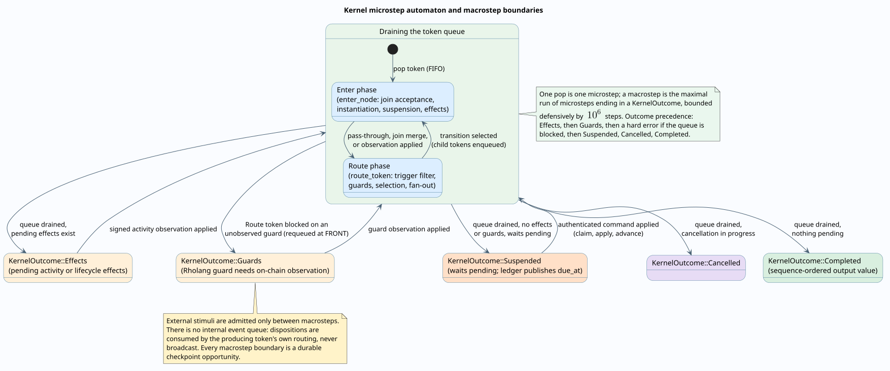
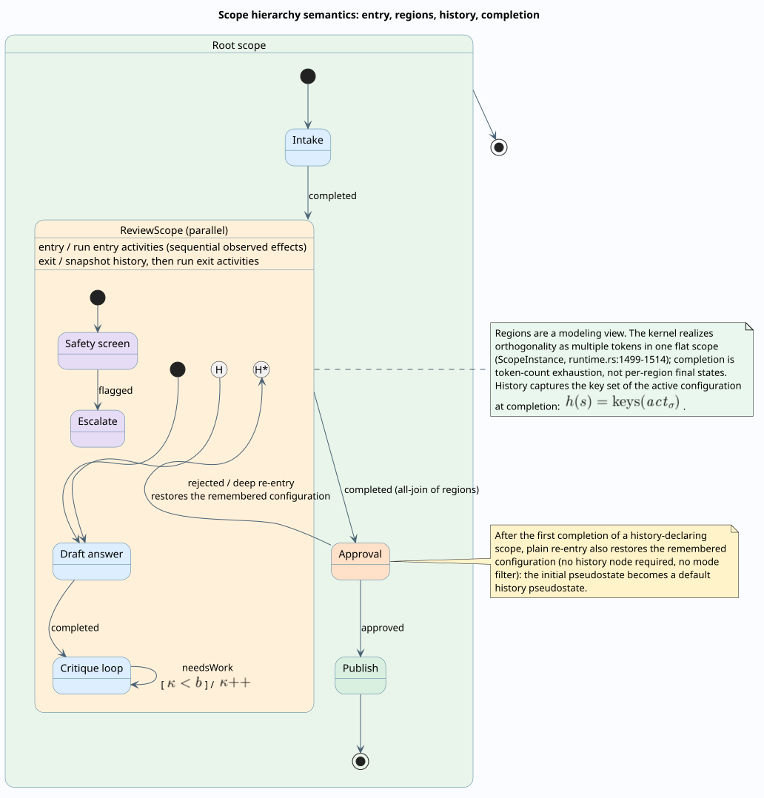
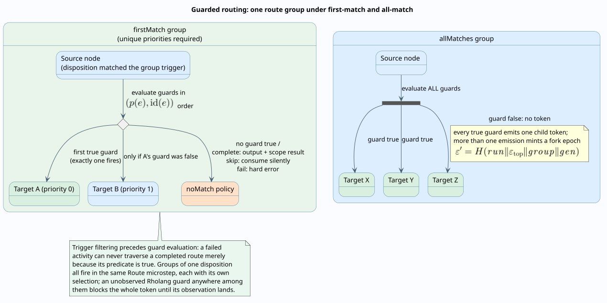
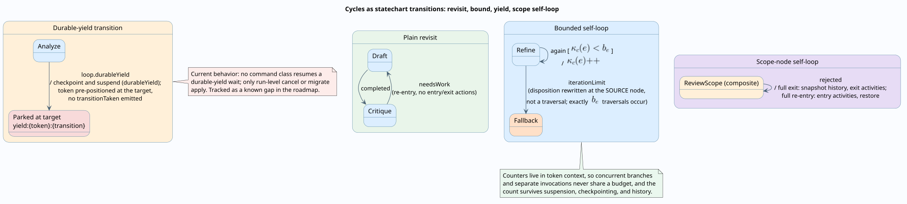
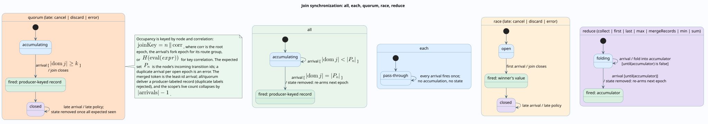
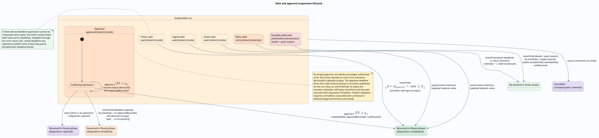
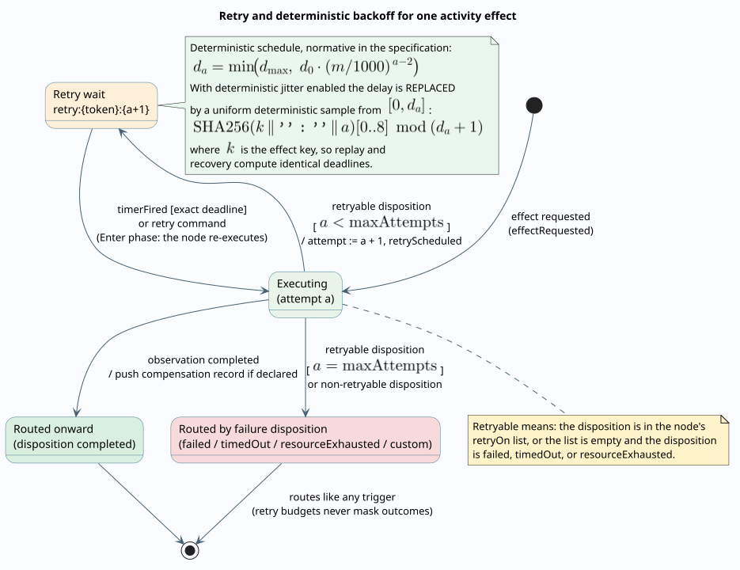
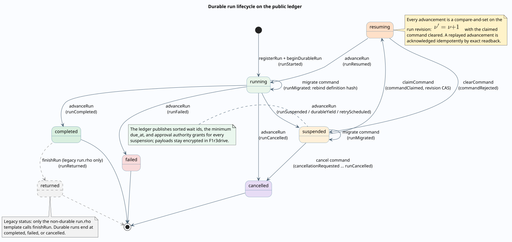
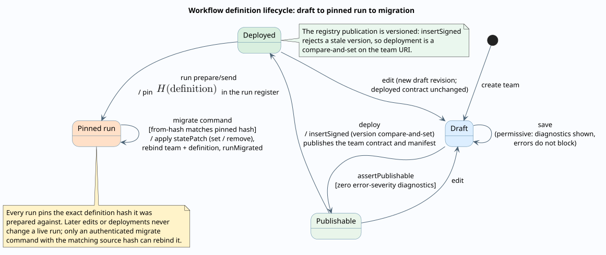
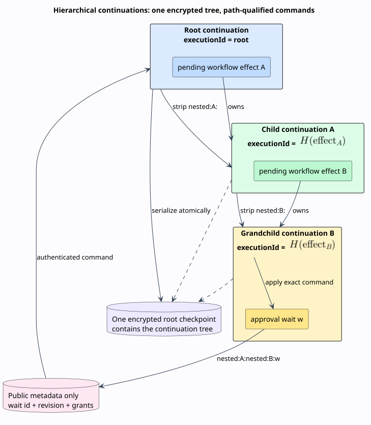

# Rholang realization of the statechart operations

This design document catalogs how every statechart operation of Agent Teams Workflow v2 is implemented, composably, in Rholang. It is the realization companion to the [statechart semantics](../theory/statechart-semantics.md): each section here realizes a section there, pairs its mechanism with the statechart fragment diagram that illustrates the operation, and embeds the Rholang that actually runs. The standard-relationship companion is the [SCXML correspondence](scxml-correspondence.md); the compiler internals live in the [runtime architecture](../architecture/runtime-architecture.md).

Every embedded snippet in this document is **parser-validated**: it was parsed successfully by the Rholang tree-sitter parser (`rholang-parser`, run read-only from its repository with its pinned toolchain) before inclusion. Snippets carry one of three provenance labels:

- **generated form** — the exact shape emitted by the workflow compiler (`packages/embers/src/domain/agents_teams/compilation/workflow_rendering.rs` in the Embers backend), with placeholders already substituted the way the generator substitutes them;
- **template with example bindings** — a deploy template from `packages/embers/templates/`, shown with documented example values in place of its `{{ ... }}` bindings;
- **verbatim template region** — a marker-free region of a template file, byte-identical to the source, wrapped only in the `new ... in` binders that its enclosing file provides.

Line anchors refer to branch `dylon/embers-demo-fixes` (backend commit `d9a9e41`).

## Two execution layers, one semantics

A Workflow v2 team executes across two cooperating layers, and knowing which layer realizes which operation is the key to reading everything below.

**Layer 1 — the compiled team contract.** The compiler (`workflow_rendering.rs`) lowers a validated definition into one pure-Rholang process, published through the versioned registry envelope. Its doc comment states the central design decision verbatim (`workflow_rendering.rs:59-64`):

> Every node and router is a persistent contract, so a token may revisit it. Loop counters travel with the token and are incremented on the bounded transition itself. This is intentionally unlike the legacy `GraphL` lowering, whose one-shot consumers are correct only for DAGs.

The compiled contract realizes on-chain everything that is *hot control flow*: node dispatch, guarded routing with first-match and all-match groups, bounded-loop counters, and the all/quorum/race/each join accumulators. For every *durable* construct — waits, approvals, durable yields, reduce joins — it does not pretend: it returns a **suspension record** to its caller and lets the durable layer own the state.

**Layer 2 — the durable kernel and the coordination ledger.** A run of a team that carries a v2 `definition` is durable by construction — the dispatch is exactly `durable: definition_hash.is_some()` (`run_agents_team.rs:164`); only definitionless legacy teams run through the one-shot `run.rho` path (which is also the only caller of the ledger's `finishRun`). The durable kernel (`runtime.rs`) interprets the definition deterministically and uses the chain for three things: activity observations (one-shot deploys of `invoke_activity.rho` against the compiled contract's control head), guard observations (`invoke_guard.rho`), and the run ledger's compare-and-set lifecycle (`init.rho`: `claimCommand`, `advanceRun`, `clearCommand`). The kernel's semantics are normative — where the compiled joins and the kernel joins differ (correlation epochs, below), the kernel's behavior is the specified one.



## The composability primitives

Four rho-calculus primitives carry the whole construction ([statechart semantics, "Statechart operations as rho-calculus processes"](../theory/statechart-semantics.md#statechart-operations-as-rho-calculus-processes); [Meredith and Radestock 2005](https://doi.org/10.1016/j.entcs.2005.05.016)):

| Primitive | Rholang form | What it realizes |
| --------- | ------------ | ---------------- |
| Name restriction | `new x in { ... }` | unforgeable per-node channels; capability discipline |
| Replicated input | `contract x(...) = { ... }` | re-enterable states — cycles revisit the same contract |
| Parallel composition | `P \| Q` | fan-out; every all-match emission |
| Joined input | `for (@a <- x & @b <- y) { ... }` | synchronization pseudostates; fan-in |

Composition is uniform at every level: node contracts compose in parallel inside the team contract; team contracts compose through the registry (`insertSigned`); teams compose into nested workflows by calling one another's published entry capability. Nothing is linked or patched — each level only *sends to names* the level below exported.

## Realization map

| Statechart operation | Layer | Rholang mechanism | Generator / template anchor | Section |
| -------------------- | ----- | ----------------- | --------------------------- | ------- |
| State / activity node | 1 | persistent `workflowNode{i}` contract | `workflow_rendering.rs:209-292` | States and activities |
| Transition selection | 1 | persistent `workflowRoute{i}` contract; trigger filter outermost | `:597-698` | Guarded routing |
| First-match branch | 1 | right-folded `if/else` in `(priority, id)` order | `:669-675` | Guarded routing |
| All-match branch | 1 | parallel guarded sends under an `or`-disjunction | `:676-691` | Guarded routing |
| No-match policy | 1 | `return!(value)` / `devNull!(Nil)` / failure record | `:650-658` | Guarded routing |
| Guard expressions | 1 | `and`/`or`/`not`, comparisons over `getOrElse` paths; `$name` substitution longest-first | `:728-791`, `:443-466` | Guarded routing |
| Bounded cycle | 1 | counter in the traveling `context.iterations` map, incremented on the transition | `:709-716` | Cycles |
| Durable-yield cycle | 2 (via 1's record) | `durableYield` suspension record; kernel wait `yield:{token}:{transition}` | `:717-723`; `runtime.rs:1334-1358` | Cycles |
| Join all / quorum | 1 (hot) / 2 (normative) | `workflowJoin{i}` state channel, source-keyed map, size threshold | `:224-262` | Joins |
| Join race + late policy | 1 (hot) / 2 (normative) | boolean won-flag channel; late action | `:263-284` | Joins |
| Join each | 1 | plain contract, no state | `:219-223` | Joins |
| Join reduce | 2 only | `durableReduce` suspension record; kernel fold | `:285-289`; `runtime.rs:1152-1157` | Joins |
| Wait / timer | 2 (via 1's record) | `suspended` record; ledger `wait_ids` + `due_at` | `:315-323` | Waits and approvals |
| Approval | 2 (via 1's record) | `approvalRequired` record; on-chain grant authorization | `:324-328`; `init.rho:379-395` | Waits and approvals |
| Compound / parallel scope | 2 (lifecycle) / 1 (seeding) | parallel sends to child initials; entry/exit/completion/history kernel-only | `:330-359`; `runtime.rs:601-686` | Scopes and history |
| History | 2 only | on-chain pass-through; kernel capture/restore | `:329`; `runtime.rs:997-1026` | Scopes and history |
| Retry / compensation | 2 only | kernel waits + effect re-deploys through `invoke_activity.rho` | `runtime.rs:282-311`, `:558-588` | Retry and compensation |
| Run-ledger lifecycle | chain | serialized map with revision CAS | `init.rho:344-508` | The run ledger |
| Registry composability | chain | version-gated `insertSigned` envelope + control heads | `deploy_workflow.rho`, `common/insert_signed.rho` | The team envelope |
| Nested workflow call | 1 + 2 | manifest hash check, then entry-capability call | `:571-584` | Nested workflows |
| Agent fan-in | 1 | joined input over labeled producer channels | `templates/agents_teams/nodes/agent.rho` | States and activities |

The rest of the document walks the map in the statechart semantics' section order.

## States and activities



Every node lowers to a persistent contract on a private channel, taking the token as three arguments — value, context, producing source label — and every node has a sibling router contract. An agent activity wraps the pinned agent code behind fresh `main`/`agentReturn` names, so each invocation is isolated by construction and the agent can only answer through the return name it was handed (**generated form**, `workflow_rendering.rs:360-394`; the stub `contract main(...) = { ret!(input) }` stands in for resolved agent code):

```rholang
new workflowNode12, workflowRoute12, devNull(`rho:io:devNull`)
in {
    contract workflowNode12(@value, @context, @source) = {
        new main, agentReturn in {
            contract main(@input, ret) = { ret!(input) }
            | main!(value, *agentReturn)
            | for(@agentResult <- agentReturn) { workflowRoute12!(agentResult, "completed", context) }
        }
    } |
    contract workflowRoute12(@value, @disposition, @context) = { devNull!(Nil) }
}
```

The structured protocol (`structured-v1`) differs only in the payload — an `{"kind":"invoke", "input": ..., "context": {...}}` record — and in the completion, which extracts `output` and `disposition` from the agent's answer instead of assuming `completed` (`workflow_rendering.rs:376-388`): this is how a user-defined agent participates in disposition-triggered routing.

Standalone user-defined agents that join a team as nodes are spliced through the `nodes/agent.rho` template, whose fan-in form is a joined input over the labeled producer channels — the process-calculus synchronization pseudostate (**template with example bindings**, `templates/agents_teams/nodes/agent.rho`):

```rholang
new alpha, beta, output
in {
    for(
        @alphaValue <- alpha &
        @betaValue <- beta
    ) {
        alpha!(alphaValue) |
        beta!(betaValue) |
        new main, agentReturn in {
            contract main(@input, ret) = { ret!(input) }
            |
            main!({"alpha": alphaValue, "beta": betaValue}, *agentReturn) |
            for(@agentResult <- agentReturn) { output!(agentResult) }
        }
    }
}
```

The consumed producer values are immediately re-published (`alpha!(alphaValue)`), preserving them for any other consumer — a peek realized by consume-and-republish.

## Guarded routing and conflict resolution



A router contract filters by trigger disposition first, then dispatches its route groups. First-match lowers to a right-folded `if/else` chain in `(priority, id)` order, so the chain's textual order *is* the priority order; the innermost `else` is the group's no-match policy (**generated form**, `workflow_rendering.rs:597-698`; two-transition first-match group with a compare guard on `output.urgent` and no-match `fail`):

```rholang
new workflowNode0, workflowRoute0, workflowNode1, workflowNode2,
    return, devNull(`rho:io:devNull`)
in {
    contract workflowNode0(@value, @context, @source) = {
        workflowRoute0!(value, "completed", context)
    } |
    contract workflowRoute0(@value, @disposition, @context) = {
        if (disposition == "completed") {
            if (value.getOrElse("urgent", Nil) == true) { workflowNode2!(value, context, "classify") } else { if (true) { workflowNode1!(value, context, "classify") } else { return!({"disposition":"failed","nodeId":"classify","error":"route group route:classify:completed matched no transition"}) } }
        } else { devNull!(Nil) }
    } |
    contract workflowNode1(@value, @context, @source) = { devNull!(Nil) } |
    contract workflowNode2(@value, @context, @source) = { devNull!(Nil) }
}
```

All-match groups lower to parallel guarded sends — one `if (guard) { send } else { devNull!(Nil) }` per transition, composed with `|` — under an outer `or`-disjunction that triggers the no-match action exactly once when every guard is false (`workflow_rendering.rs:676-691`).

Pure structural guards compile to Rholang boolean expressions: conditions become `and`/`or`/`not` and comparison operators; value paths become `getOrElse` chains rooted at `value` (output/error), `context.getOrElse("input", Nil)` (input), or `context.getOrElse("state", {})` (state) (`workflow_rendering.rs:728-791`). Pure *Rholang* guards are inlined by substituting each declared `$name` with its compiled path — longest name first, so `$a` can never clobber `$ab` (`:766`). The same guards are also exported behind the team's control head for the durable kernel's two-phase evaluation, dispatched by transition identifier (**generated form**, guard dispatch, `workflow_rendering.rs:443-466`):

```rholang
new agentsTeam
in {
    contract agentsTeam(@"control", @"guard", @transitionId, @value, @input, @state, return) = {
        if (transitionId == "t-approve") {
            return!(value.getOrElse("score", Nil) >= 7)
        } else {
            return!({"error":"unknown Rholang guard transition"})
        }
    }
}
```

## Cycles: bounded and durable



Because node and router contracts are persistent, a cyclic send is just another send. What makes the cycle *safe* is carried by the token itself: the bounded transition reads and increments its own counter inside the traveling `context.iterations` map, and exhaustion returns an `iterationLimit` record instead of traversing (**generated form**, `workflow_rendering.rs:709-716`; bound of 3 on transition `t-critique`):

```rholang
new workflowNode13, workflowRoute13, return, devNull(`rho:io:devNull`)
in {
    contract workflowRoute13(@value, @disposition, @context) = {
        if (disposition == "needsWork") {
            if (true) { if (context.getOrElse("iterations", {}).getOrElse("t-critique", 0) < 3) { workflowNode13!(value, context.set("iterations", context.getOrElse("iterations", {}).set("t-critique", context.getOrElse("iterations", {}).getOrElse("t-critique", 0) + 1)), "draft") } else { return!({"disposition":"iterationLimit","transitionId":"t-critique","value":value}) } } else { return!({"disposition":"failed","nodeId":"draft","error":"route group route:draft:needsWork matched no transition"}) }
        } else { devNull!(Nil) }
    } |
    contract workflowNode13(@value, @context, @source) = { devNull!(Nil) }
}
```

Token-local counters are what make budgets safe under fan-out and concurrent invocations — two tokens each get the full bound, exactly as the kernel rule specifies ([bounded transition rule](../theory/operational-semantics.md#bounded-transition-rule)).

A durable-yield transition does not traverse on chain at all: it returns a suspension record naming the transition and the resume target, and the durable kernel parks the pre-positioned token (**generated form**, `workflow_rendering.rs:717-723`):

```rholang
new workflowRoute14, return, devNull(`rho:io:devNull`)
in {
    contract workflowRoute14(@value, @disposition, @context) = {
        if (disposition == "completed") {
            if (true) { return!({"disposition":"suspended","reason":"durableYield","transitionId":"t-loop","resumeAtNodeId":"analyze","value":value}) } else { devNull!(Nil) }
        } else { devNull!(Nil) }
    }
}
```

Current behavior: the kernel records the wait crash-safely, but no command class resumes a durable-yield suspension yet ([statechart semantics, current behavior](../theory/statechart-semantics.md#current-behavior-durable-yield-resumption)); the gap is tracked in the [roadmap](../roadmap.md).

## Joins



Each join node owns a `workflowJoin{i}` state channel, initialized once inside the team body — `{}` for accumulating joins, `false` for race. The hot lowering of an **all** join folds arrivals into a source-labeled map and fires at the incoming count, resetting the accumulator so the join re-arms (**generated form**, `workflow_rendering.rs:224-240`; two incoming transitions):

```rholang
new workflowNode3, workflowJoin3, workflowRoute3, devNull(`rho:io:devNull`)
in {
    workflowJoin3!({}) |
    contract workflowNode3(@value, @context, @source) = {
        for(@state <- workflowJoin3) {
            if (state.set(source, value).size() >= 2) {
                workflowJoin3!({}) |
                workflowRoute3!(state.set(source, value), "completed", context)
            } else {
                workflowJoin3!(state.set(source, value))
            }
        }
    } |
    contract workflowRoute3(@value, @disposition, @context) = { devNull!(Nil) }
}
```

A **quorum** join is the same shape with the threshold at $`k`$ instead of the incoming count (**generated form**, `workflow_rendering.rs:241-262`, threshold 2-of-3 shown with the same structure). A **race** join guards a boolean won-flag: the first arrival flips it and proceeds, later arrivals take the late action — `devNull!(Nil)` for discard, a `cancelled` record for cancel, a failure record for error (**generated form**, `workflow_rendering.rs:263-284`, late discard):

```rholang
new workflowNode5, workflowJoin5, workflowRoute5, devNull(`rho:io:devNull`)
in {
    workflowJoin5!(false) |
    contract workflowNode5(@value, @context, @source) = {
        for(@won <- workflowJoin5) {
            if (won) {
                workflowJoin5!(true) |
                devNull!(Nil)
            } else {
                workflowJoin5!(true) |
                workflowRoute5!(value, "completed", context)
            }
        }
    } |
    contract workflowRoute5(@value, @disposition, @context) = { devNull!(Nil) }
}
```

An **each** join needs no state at all — the plain node contract fires per arrival. A **reduce** join is durable-kernel-only: the hot lowering is an honest one-line suspension (**generated form**, `workflow_rendering.rs:285-289`):

```rholang
new workflowNode6, return
in {
    contract workflowNode6(@value, @context, @source) = { return!({"disposition":"suspended","reason":"durableReduce","nodeId":"collect-reviews","value":value}) }
}
```

**Normative divergence, stated plainly:** the compiled joins key arrivals by producing-source *label* and know nothing of correlation epochs; the durable kernel keys join state by incoming transition identifier and correlation epoch, which is what makes overlapping loop generations non-interfering ([statechart semantics, joins](../theory/statechart-semantics.md#joins-as-synchronization-pseudostates)). The kernel is normative; the compiled accumulators serve the hot single-epoch path.

## Scopes and history on chain


The on-chain footprint of hierarchy is deliberately thin. A scope node lowers to parallel sends seeding the child scope's initial nodes (**generated form**, `workflow_rendering.rs:330-359`):

```rholang
new workflowNode9, workflowNode10, workflowNode11, devNull(`rho:io:devNull`)
in {
    contract workflowNode9(@value, @context, @source) = {
        workflowNode10!(value, context, "review-scope") |
        workflowNode11!(value, context, "review-scope")
    } |
    contract workflowNode10(@value, @context, @source) = { devNull!(Nil) } |
    contract workflowNode11(@value, @context, @source) = { devNull!(Nil) }
}
```

A history node lowers to a `completed` pass-through (`workflow_rendering.rs:329`). Everything stateful about hierarchy is realized only by the durable kernel:

| Hierarchy feature | Compiled Rholang | Durable kernel |
| ----------------- | ---------------- | -------------- |
| Seeding child initials | yes (parallel sends) | yes (`start_scope_initials`) |
| Entry / exit activities | no | yes (`advance_scope_lifecycle`, `runtime.rs:601-633`) |
| Completion propagation | no | yes (`consume_scope_token` / `finish_scope_instance`, `runtime.rs:1054-1086`, `:669-686`) |
| Active-configuration tracking | no | yes (`record_active_node`, `runtime.rs:1028-1052`) |
| Shallow / deep history | pass-through only | yes (`restore_history`, `runtime.rs:997-1026`) |

## Waits and approvals



Wait and approval nodes return suspension records — the compiled contract's way of saying "the durable layer owns this token now" (**generated forms**, `workflow_rendering.rs:315-328`):

```rholang
new workflowNode7, return
in {
    contract workflowNode7(@value, @context, @source) = {
        return!({"disposition":"suspended","nodeId":"await-editor","waitFor":"signal","value":value})
    }
}
```

```rholang
new workflowNode8, return
in {
    contract workflowNode8(@value, @context, @source) = {
        return!({"disposition":"approvalRequired","nodeId":"editor-gate","policyId":"owner","value":value})
    }
}
```

The kernel turns these into pending waits with qualified identities and publishes only identities, deadlines, and grants to the ledger; the approval's decision map, quorum discipline, and the `rejected` disposition live in `apply_command` ([statechart semantics, waits and approvals](../theory/statechart-semantics.md#waits-approvals-and-dispositions-as-triggers)).

## Retry, compensation, and effect observation



Retry and Saga compensation are kernel-only ([statechart semantics, retry and cancellation](../theory/statechart-semantics.md#retry-and-structured-cancellation)); their on-chain footprint is the *observation deploy*. Every activity execution — first attempt, retry, or compensation — is one deploy of `invoke_activity.rho` against the team's control head, publishing the result at the deploy identity so the orchestrator can read it back exactly once (**template with example bindings**, `templates/agents_teams/invoke_activity.rho`):

```rholang
new deployId(`rho:rchain:deployId`), rl(`rho:registry:lookup`),
    agentsTeamCh, activityReturn
in {
    rl!(`rho:id:exampleteamuri22222222222222222222222222222`, *agentsTeamCh) |
    for(@(_, agentsTeam) <- agentsTeamCh) {
        @agentsTeam!("control", "activity", "draft", {"topic": "release notes"}, *activityReturn) |
        for(@result <- activityReturn) {
            @(*deployId).toString()!(result)
        }
    }
}
```

`invoke_guard.rho` is the same pattern against the guard head. The observation is then signed and applied atomically by the kernel; the transactional outbox re-deploys the identical signed deploy after a crash ([hierarchical continuations](../theory/hierarchical-continuations.md)).

## The run ledger: claim, advance, clear



Durable commands are two-phase against the serialized run ledger in `init.rho`. The client-signed claim deploy is small — a registry lookup and one send (**template with example bindings**, `templates/agents_teams/claim_command.rho`):

```rholang
new rl(`rho:registry:lookup`), agentsTeamsCh, acknowledged in {
    rl!(`rho:id:exampleenvuri111111111111111111111111111111`, *agentsTeamsCh) |
    for(@(_, agentsTeams) <- agentsTeamsCh) {
        @agentsTeams!("claimCommand",
            "0198a3f1-4b2c-7d3e-8f90-a1b2c3d4e5f6",
            4,
            "0198a3f1-9999-7d3e-8f90-a1b2c3d4e5f6",
            "approve",
            "approval:token:3:editor-gate",
            "9b1a7c5e2f8d4a6b0c3e5f7a9b1d3f5a7c9e1b3d5f7a9c1e3b5d7f9a1c3e5b7d",
            "1c3e5b7d9a1c3e5f7a9b1d3f5a7c9e1b3d5f7a9c1e3b5d7f9a1b3d5e2f8d4a6b",
            *acknowledged)
    }
}
```

The ledger side is the heart of the authorization model — idempotent replay acknowledgement, revision compare-and-set, owner-or-service authority, and the wait-scoped delegate grant path for `approve`/`reject` in which the actor's chain-derived address must appear as `waitId|address` among the published grants (**verbatim template region**, `templates/agents_teams/init.rho:344-430`, wrapped in its enclosing binders):

```rholang
new agentsTeams, deployData, revAddress, runsCh, serviceAddressCh, all, any,
    abort(`rho:execution:abort`)
in {
    contract agentsTeams(@"claimCommand", @run_id, @expected_revision, @command_id,
                         @command_class, @command_wait_id,
                         @command_content_hash, @command_capability_hash, acknowledged) = {
        new deployDataCh, deployerAddressCh in {
            deployData!(*deployDataCh) |
            for(_, @deployerId, _ <- deployDataCh) {
                revAddress!("fromDeployerId", deployerId, *deployerAddressCh)
            } |
            for(@address <- deployerAddressCh; @runs <- runsCh; @serviceAddress <<- serviceAddressCh) {
                if (runs.contains(run_id)) {
                    new runCh in {
                        runCh!(runs.get(run_id)) |
                        for(@run <- runCh) {
                    new idempotentCh in {
                        all!([
                            run.get("command_id") == command_id,
                            run.get("command_class") == command_class,
                            run.get("command_wait_id") == command_wait_id,
                            run.get("command_content_hash") == command_content_hash,
                            run.get("command_capability_hash") == command_capability_hash
                        ], *idempotentCh) |
                        for(@idempotent <- idempotentCh) {
                            if (idempotent) {
                                runsCh!(runs) |
                                acknowledged!(true)
                            } else if (run.get("revision") == expected_revision) {
                                new ownerOrServiceCh, authorizedCh in {
                                    any!([
                                        run.get("owner") == address,
                                        address == serviceAddress
                                    ], *ownerOrServiceCh) |
                                    for(@ownerOrService <- ownerOrServiceCh) {
                                        if (ownerOrService) {
                                            authorizedCh!(true)
                                        } else {
                                            new approvalClassCh in {
                                                any!([
                                                    command_class == "approve",
                                                    command_class == "reject"
                                                ], *approvalClassCh) |
                                                for(@approvalClass <- approvalClassCh) {
                                                    if (approvalClass) {
                                                        all!([
                                                            run.get("wait_ids").contains(command_wait_id),
                                                            run.get("approval_authority_grants").contains(command_wait_id ++ "|" ++ address)
                                                        ], *authorizedCh)
                                                    } else {
                                                        authorizedCh!(false)
                                                    }
                                                }
                                            }
                                        } |
                                        for(@authorized <- authorizedCh) {
                                            if (authorized) {
                                                runsCh!(runs.set(run_id,
                                                    run.set("status", "resuming")
                                                       .set("command_id", command_id)
                                                       .set("command_content_hash", command_content_hash)
                                                       .set("command_capability_hash", command_capability_hash)
                                                       .set("command_actor", address)
                                                       .set("command_class", command_class)
                                                       .set("command_wait_id", command_wait_id)
                                                       .set("events", run.get("events") ++ [{
                                                           "sequence": run.get("events").length(),
                                                           "type": "commandClaimed"
                                                       }])
                                                )) |
                                                acknowledged!(true)
                                            } else {
                                                abort!("command actor is unauthorized")
                                            }
                                        }
                                    }
                                }
                            } else {
                                abort!("command revision is stale")
                            }
                        }
                    }
                        }
                    }
                } else {
                    abort!("run capability not found")
                }
            }
        }
    }
}
```

Note the receive discipline: `runsCh` is taken linearly (serializing every mutation of the run map) while `serviceAddressCh` is peeked (`<<-`), and the actor identity is derived on chain from the deployer — the ledger, not the client, decides who acted.

The service-only advancement is symmetric: revision $`\nu`$ moves to $`\nu + 1`$, the claimed command clears, and a replayed advancement is acknowledged idempotently by exact readback of every published field (`init.rho:432-508`). Its deploy template (**template with example bindings**, `templates/agents_teams/advance_run.rho`):

```rholang
new rl(`rho:registry:lookup`), agentsTeamsCh, acknowledged in {
    rl!(`rho:id:exampleenvuri111111111111111111111111111111`, *agentsTeamsCh) |
    for(@(_, agentsTeams) <- agentsTeamsCh) {
        @agentsTeams!("advanceRun",
            "0198a3f1-4b2c-7d3e-8f90-a1b2c3d4e5f6",
            4,
            "suspended",
            "0f2a44e015ad639e802e2b01e49132beed9c4bb45cbbdc73f2f0d90ee2f00e0a",
            "5d7f9a1c3e5b7d9a1c3e5f7a9b1d3f5a7c9e1b3d5f7a9c1e3b5d7f9a1c3e5b7d",
            "7a9c1e3b5d7f9a1b3d5e2f8d4a6b0c3e5f7a9b1d3f5a7c9e1b3d5f7a9c1e3b5d",
            ["approval:token:3:editor-gate", "wait:token:5:await-editor"],
            "2026-08-03T04:15:00Z",
            ["approval:token:3:editor-gate|1111AbCdEfGh2222"],
            Nil,
            Nil,
            "runSuspended",
            *acknowledged)
    }
}
```

A rejected recovery goes through `clearCommand` (`init.rho:510-563`), which appends `commandRejected` and restores `suspended` — the transition drawn in the [run lifecycle](../diagrams/09-run-lifecycle.svg).

## The team envelope and registry composability



The compiled team ships inside the shared `insertSigned` envelope: a version-gated, signature-checked registry publication that exports exactly one bundled write capability. The team binds four contract heads on that name — the manifest (definition and hash under protocol `embers-agent-team-control-v1`), the guard head, the activity head, and the team entry itself, whose body composes the private channels, join initializers, node and router contracts, and entry sends (**template with example bindings**, `templates/agents_teams/deploy_workflow.rho` over `templates/common/insert_signed.rho`; minimal single-node team, illustrative key/signature literals):

```rholang
new rl(`rho:registry:lookup`),
    rs(`rho:registry:insertSigned:secp256k1`),
    abort(`rho:execution:abort`),
    prevEnvCh,
    initEnv,
    contractDeployer(`rho:rchain:deployerId`),
    agentsTeam,
    uriCh
in {
    rl!(`rho:id:exampleenvuri111111111111111111111111111111`, *prevEnvCh) |

    for(@Nil <- prevEnvCh) {
        initEnv!()
    } |

    for(@(version, _) <- prevEnvCh) {
        if (version < 3) {
            initEnv!()
        }
    } |

    for(<- initEnv) {
        new devNull(`rho:io:devNull`)
        in {
            contract agentsTeam(@"control", @"manifest", return) = {
                return!({
                    "definition": "{\"schemaVersion\":\"2.0\"}",
                    "definitionHash": "0f2a44e015ad639e802e2b01e49132beed9c4bb45cbbdc73f2f0d90ee2f00e0a",
                    "protocol": "embers-agent-team-control-v1"
                })
            } |
            contract agentsTeam(@"control", @"guard", @transitionId, @value, @input, @state, return) = {
                return!({"error":"unknown Rholang guard transition"})
            } |
            contract agentsTeam(@"control", @"activity", @nodeId, @input, return) = {
                return!({"disposition":"failed","error":"unknown activity node"})
            } |
            contract agentsTeam(@input, return) = {
                new workflowNode0,
                    workflowRoute0
                in {
                    contract workflowNode0(@value, @context, @source) = {
                        return!(value)
                    } |
                    contract workflowRoute0(@value, @disposition, @context) = {
                        devNull!(Nil)
                    } |
                    workflowNode0!(input, {"input": input, "state": {}, "iterations": {}}, "entry")
                }
            }
        } |

        rs!(
            "04a1b2c3d4e5f60718293a4b5c6d7e8f90a1b2c3d4e5f60718293a4b5c6d7e8f90a1b2c3d4e5f60718293a4b5c6d7e8f90".hexToBytes(),
            (3, bundle+{*agentsTeam}),
            "3045022100e5f60718293a4b5c6d7e8f90a1b2c3d4e5f60718293a4b5c6d7e8f90a1b2c3d40220718293a4b5c6d7e8f90a1b2c3d4e5f60718293a4b5c6d7e8f90a1b2c3d4e5f6".hexToBytes(),
            *uriCh
        ) |

        for(@Nil <- uriCh) {
            abort!("failed to insert env")
        }
    }
}
```

The entry send carries the initial token context `{"input": input, "state": {}, "iterations": {}}` (`workflow_rendering.rs:120-134`) — the on-chain birth of the token the statechart semantics reasons about.

## Nested workflows



A nested workflow activity composes teams through the registry: look up the child team, read its manifest, verify the **pinned definition hash**, and only then call its entry capability (**generated form**, `workflow_rendering.rs:571-584`):

```rholang
new return, nestedTeamCh, manifestReturn, nestedReturn, rl(`rho:registry:lookup`)
in {
    rl!(`rho:id:exampleteamuri22222222222222222222222222222`, *nestedTeamCh) |
    for(@(_, nestedTeam) <- nestedTeamCh) {
        @nestedTeam!("control", "manifest", *manifestReturn) |
        for(@manifest <- manifestReturn) {
            if (manifest.get("definitionHash") == "0f2a44e015ad639e802e2b01e49132beed9c4bb45cbbdc73f2f0d90ee2f00e0a") {
                @nestedTeam!({"question": "summarize"}, *nestedReturn) |
                for(@result <- nestedReturn) { return!(result) }
            } else {
                return!({"disposition":"failed","error":"nested workflow definition hash mismatch"})
            }
        }
    }
}
```

In the durable path the same composition happens kernel-side — a child `ContinuationEnvelope` embedded under the parent's effect key, with `nested:`-qualified waits — and the hash check is the same pin ([hierarchical continuations](../theory/hierarchical-continuations.md)).

## Snippet validation protocol

Every fenced Rholang block above was validated as follows, and must be re-validated whenever this document or the generator changes:

1. Each block is stored as one file and parsed by `rholang-parser` (the tree-sitter-based parser at `rholang-rs/rholang-parser`, used read-only) through a minimal harness crate that reports `Validated::Good` per file; the parser's pinned toolchain (`nightly-2025-09-14`) is used.
2. **Generated forms** were transcribed from the generator's format strings at the cited anchors with placeholders substituted exactly as the generator substitutes them (`$value` to `value`, node channels to `workflowNode{i}`, string literals through `rho_string`); they parse as-is.
3. **Templates with example bindings** replace each `{{ ... }}` marker with a documented example value of the correct shape (registry URIs, UUIDv7 identifiers, lowercase SHA-256 hex, RFC 3339 timestamps).
4. The **verbatim template region** (`init.rho:344-430`) is byte-identical to the source except for the enclosing `new ... in { ... }` binder wrapper that its own file provides at a wider scope, and the removal of the trailing parallel-composition bar that connects it to the next contract in the file.
5. Validation transcript: 19 snippets, 19 `OK`, zero failures — recorded in the [conformance evidence](../engineering/conformance-and-testing.md).

## References

- L. Gregory Meredith and Matthias Radestock, "A Reflective Higher-order Calculus," *Electronic Notes in Theoretical Computer Science* 141(3), 2005, [doi:10.1016/j.entcs.2005.05.016](https://doi.org/10.1016/j.entcs.2005.05.016).
- Hector Garcia-Molina and Kenneth Salem, "Sagas," *SIGMOD 1987*, [doi:10.1145/38713.38742](https://doi.org/10.1145/38713.38742) — the compensation discipline realized kernel-side.
- [Statechart semantics](../theory/statechart-semantics.md), [operational semantics](../theory/operational-semantics.md), and [hierarchical continuation theory](../theory/hierarchical-continuations.md) — the rules this document realizes.
