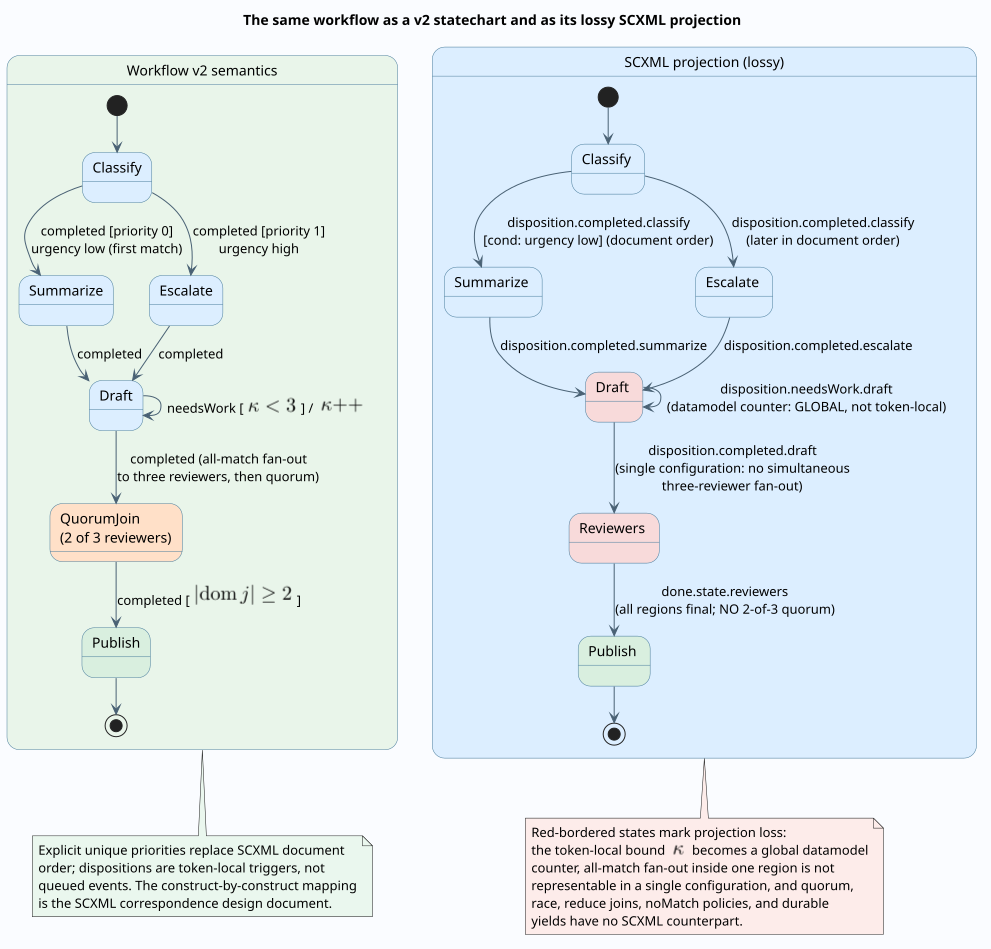

# SCXML correspondence

This design document records the relationship between Agent Teams Workflow v2 and [W3C State Chart XML (SCXML) 1.0](https://www.w3.org/TR/scxml/), the standardized state-machine execution vocabulary the corpus has cited since its first revision. It maps every v2 construct onto its nearest SCXML counterpart, analyzes the semantic differences against SCXML's normative interpretation algorithm, states which SCXML behaviors the kernel deliberately does not adopt and why, and works one definition through a mechanical — and lossy — projection into a schema-valid SCXML document.

**This is a documented relationship, not a conformance claim.** Embers does not implement SCXML, does not aim to, and several load-bearing v2 constructs have no SCXML representation at all. The value of the correspondence is orientation: readers who know SCXML (or UML state machines) can locate every v2 concept relative to ground they already know, and see exactly where the durable, deterministic design departs from the standard.

Companions: the [statechart semantics](../theory/statechart-semantics.md) owns the formal rules referenced throughout; the [Rholang realization](rholang-realization.md) owns how the same operations execute; the [specification](../specification/workflow-definition-v2.md) owns the v2 syntax; the [TOGL correspondence](togl-correspondence.md) maps the same constructs onto the structural graph algebra behind the graphl serialization. SCXML citations use the recommendation's section numbers (verified against the 1 September 2015 Recommendation).

## Reading guide: SCXML in five sentences

For readers coming from the v2 side, the SCXML terms used below, each defined by the recommendation: a **session** is one running interpretation of one SCXML document. The **configuration** is the set of states the session is in — exactly one active child per `<state>`, every child active in a `<parallel>`. **Events** arrive on two queues — an **internal** queue fed by the machine itself (`<raise>`, `done.*` events) and an **external** queue fed from outside (`<send>`, invoked children) — and the interpreter drains all internal consequences of one event before taking the next: the **macrostep**, composed of **microsteps** (SCXML Appendix D, `mainEventLoop`). **Transition selection** matches an event descriptor and a `cond` guard, resolving conflicts by child priority and document order (SCXML 3.13). A **final state** raises `done.state.{parent}` when reached, and a `<parallel>` completes when every region is in a final state (SCXML 3.4, 3.7).

## Construct-by-construct correspondence

Correspondence classes: **exact** (same meaning, cosmetic differences), **partial** (same intent, materially different semantics), **divergent** (same slot in the design, deliberately different behavior), **absent in SCXML**, **absent in v2**.

| Workflow v2 construct | SCXML counterpart | Class | The difference that matters |
| --------------------- | ----------------- | ----- | --------------------------- |
| `entryScopeId` + root scope | `<scxml initial="...">` (3.2) | partial | One document, one root; v2 additionally pins the definition by hash per run |
| Compound scope | `<state>` with children (3.3) | partial | "One active child" is publish-time validation of initials only; runtime discipline is token counting ([statechart semantics, parallel regions](../theory/statechart-semantics.md#parallel-regions-and-token-discipline)) |
| Parallel scope | `<parallel>` (3.4) | partial | Regions are token trajectories from multiple initials in one flat scope, not syntactic sub-state partitions |
| `initialNodeIds` | `initial` attribute / `<initial>` (3.6) | exact for compound; partial for parallel | Parallel initials seed tokens, not per-region defaults |
| `entryActivities` / `exitActivities` | `<onentry>` / `<onexit>` (3.8, 3.9) | divergent | v2 lifecycle activities are durable observed effects crossing macrosteps, with a routable failure escape; SCXML executable content is conceptually instantaneous and errors raise `error.execution` |
| Scope `history` mode + history nodes | `<history type="shallow\|deep">` + its default transition (3.10) | divergent | Capture happens only at completion; nonempty history overrides default entry with no mode filter on re-entry; a shallow node refuses deep-recorded snapshots; deepness composes lazily per scope — see the [history rules](../theory/statechart-semantics.md#history-capture-and-restoration). The fallback-to-initials is the one exact bit (the history default transition) |
| `final` node | `<final>` (3.7) | partial | Ends the run at the root or completes the scope; no `done.state.*` event is raised |
| Scope completion | `done.state.{id}` (3.4, 3.7) | divergent | Completion is live-token-count exhaustion with a synthesized `completed` disposition on the returned token — no event, no per-region final requirement |
| `output` node / output assembly | `<donedata>` (5.5) | partial | Multiple sequence-ordered outputs versus one donedata payload |
| Transition `trigger` dispositions | `<transition event="..." cond="..." target="...">` (3.5) | divergent | Dispositions are token-local labels consumed by the producing token's own routing, closest to `done.*`/`error.*` descriptors — never queued, never broadcast |
| `custom:<name>` dispositions | event name tokens (3.12.1) | partial | Same dotted-name spirit; v2 constrains the alphabet and length |
| Guards (`Condition`) | `cond` (3.5; 3.12.1) | partial | v2 guards are total and effect-free by construction; on-chain Rholang guards become durable observations that can end a macrostep — no SCXML analogue |
| Route groups + explicit priorities | document order (3.13) | divergent | Deterministic unique priorities with an identifier tie-break replace document order; several groups of one disposition fire in one microstep |
| Route-group `noMatch` (complete / skip / fail) | — | absent in SCXML | SCXML silently discards an event no transition matches; v2 makes the outcome an explicit policy |
| Joins: all, each, quorum, race, reduce | — | absent in SCXML | UML's join pseudostate covers only AND-synchronization of regions; quorum, race, and reduce come from the workflow-pattern lineage ([van der Aalst et al. 2003](https://doi.org/10.1023/A:1022883727209)) |
| Loop bounds / durable yield | — | absent in SCXML | No counter semantics, no cross-session suspension; a datamodel counter can imitate a bound but is global where $`\kappa`$ is token-local (see the projection loss table) |
| Wait nodes (signal / event / timer) | a state whose only exit awaits an external event (3.5); `<send delay="...">` for timers (6.2) | partial | v2 waits are durable, individually addressed by qualified wait identity, and authenticated; `timerFired` demands the exact recorded deadline |
| Approval nodes | — | absent in SCXML | Quorum counting, per-actor decision uniqueness, chain-derived actor identity, and the `rejected` disposition have no SCXML footing (external events plus datamodel counting would lose the authorization semantics) |
| Nested workflow activity | `<invoke>` + `done.invoke` / `<finalize>` (6.4) | partial | The child is a pinned continuation under the parent's effect key with `nested:`-qualified waits; completion is a signed observation; there is no cancel-on-exit because the parent cannot exit while the effect is pending |
| `interface.inputs/outputs`, `types` | `<datamodel>` / `<data>` (5.2, 5.3) | partial | Portable value algebra with validation versus platform datamodel languages |
| `migrate` with `statePatch` (set / remove) | `<assign>` (5.4) | loosely partial | An authenticated, hash-checked command versus executable content |
| Run commands (signal, event, timerFired, approve, reject, cancel, retry, migrate) | external event queue + Event I/O processors (6.2, Appendix D) | divergent | Revision-fenced compare-and-set claims on a public ledger; exact wait addressing; an unmatched command fails loudly instead of being consumed |

## Against the interpretation algorithm (Appendix D)

SCXML's Appendix D is the normative interpreter — `mainEventLoop`, `selectTransitions`, `removeConflictingTransitions`, `computeExitSet`, `enterStates`, `isInFinalState`. The kernel's counterpart is `run_until_blocked` with its Enter/Route token phases ([statechart semantics, run-to-completion](../theory/statechart-semantics.md#run-to-completion-microsteps-macrosteps-and-the-command-boundary)). Five axes carry all the differences.

**Configuration and multiplicity.** The SCXML configuration is a set of states, downward-closed, one active child per compound state. The kernel's dynamic state is a forest of multisets — token positions per live scope instance — plus the in-flight queue. All-match fan-out can put two tokens on one node; SCXML cannot represent that at all. A v2 definition that never fans out inside a scope and uses only compound scopes projects onto a classical configuration; anything else does not.

**Events.** SCXML machines talk to themselves: `<raise>` feeds an internal queue drained before the next external event, and `done.*` events broadcast completion to any listener. The kernel has **no internal event queue and no broadcast**: a disposition is consumed by the producing token's own routing in the same microstep chain, and nothing else can observe it. The external queue's counterpart is the authenticated command channel — but delivery is addressed to one exact qualified wait, authorization is checked on chain, and an unmatched command is an error, not a dequeue-and-ignore.

**Selection and conflicts.** SCXML selects the optimal transition set per event using child priority and document order, then prunes conflicts (`removeConflictingTransitions`). The kernel needs neither: transitions fire per token at exactly one node, scopes are never transition sources, so cross-level conflict cannot arise; within a route group, explicit unique priorities plus the $`(p(e), \operatorname{id}(e))`$ tie-break make selection a total order the author wrote down. What SCXML resolves by rule, v2 resolves by construction.

**Microsteps, macrosteps, and durability.** Both models run to completion. The difference is what a macrostep boundary *is*: in SCXML it is an in-memory quiescence point; in the kernel it is a **durable suspension opportunity** — `Effects`, `Guards`, or `Suspended` outcomes checkpoint the entire continuation before anything external is admitted. Guard evaluation itself can end a macrostep (an on-chain observation), which SCXML's side-effect-free `cond` never does. The kernel also bounds any single macrostep defensively ($`10^6`$ steps) beneath the semantic guarantee of the [progress-boundary theorem](../theory/operational-semantics.md#progress-boundary-theorem).

**Parallel completion and history.** SCXML completes a `<parallel>` when `isInFinalState` holds for every region and then raises `done.state.{id}`. The kernel completes a scope when its live-token count reaches zero — no per-region final states, no event; the completion token itself carries the result. For history, SCXML records the configuration in `exitStates` before running `<onexit>` handlers; the kernel also snapshots before exit activities run — the one place the kernel matches SCXML more closely than UML — but only at completion, and its re-entry consults history implicitly, which SCXML never does.



## Deliberately not adopted, and one extension

| SCXML behavior | Why the kernel does not adopt it |
| -------------- | -------------------------------- |
| Event broadcast between regions | Breaks confluence of independent reductions — the [determinism envelope](../theory/operational-semantics.md#determinism-envelope) requires routing to be a function of the token alone |
| Internal event queue and eventless-transition cascade | Replay determinism: disposition-triggered routing has no hidden queue state to reconstruct after a crash |
| In-memory external queue | [Crash equivalence](../theory/hierarchical-continuations.md) requires commands to be durable, revision-fenced, and exactly-once-claimed on the public ledger |
| Single active configuration | Fan-out, producer-keyed fan-in, and quorum joins are first-class; the token multiset is the point of the hybrid ([why a hybrid?](../theory/operational-semantics.md#why-a-hybrid-statechart-and-token-model)) |
| Document-order conflict resolution | Explicit unique priorities are reviewable in the definition and survive serialization-order changes |
| Silent discard of unmatched events | Every no-match outcome is a declared policy; every unmatched command is a loud failure |

One behavior goes **beyond** the standard rather than falling short of it: after the first completion of a history-declaring scope, plain re-entry restores the remembered configuration with no history pseudostate involved and no mode filter (`start_scope_initials`, pinned by the kernel's history test). SCXML restores only through an explicit `<history>` child. The extension makes "resume where it left off" the default reading of re-entering a remembering scope — the natural durable-first choice.

## Mechanical projection, and what it loses

A v2 definition can be mechanically projected onto an SCXML skeleton. The projection is useful for orientation and for feeding SCXML-aware tooling; it is **not** an execution vehicle, because the loss table below is load-bearing.

```text
PROJECT-TO-SCXML(definition):
  # Scope tree -> state tree. The projection is structure-faithful and
  # semantics-lossy; every loss is enumerated after the algorithm.
  emit <scxml initial = definition.entryScope's projection, datamodel="ecmascript">
  for scope in definition.scopes (tree order):
    emit <state id=scope.id>            if scope.kind = compound
    emit <parallel id=scope.id>         if scope.kind = parallel
    emit initial attribute from scope.initialNodeIds (first, for compound)
    emit <onentry><log/></onentry>      per entryActivity   # placeholder: real
    emit <onexit><log/></onexit>        per exitActivity    # activities are effects
    emit <history type=scope.history>   if scope.history != none
  for node in definition.nodes:
    emit <state id=node.id>             (activity, gateway, wait, approval)
    emit <final id=node.id>             (final, output)
  for transition in definition.transitions (per group, priority order):
    # Dispositions become dotted event descriptors; priority order becomes
    # document order, which is exactly the fidelity loss of axis 3 above.
    emit <transition event="disposition." + trigger + "." + sourceNodeId
                     cond=compile(guard)        # structural guards only
                     target=targetNodeId>
    emit <assign> counter increment inside the transition   if loop.maxIterations
  # Joins, quorum, race, reduce, noMatch policies, durable yields, approvals,
  # correlation epochs: NO EMISSION. Record each in the loss report.
```

**Loss table** — constructs the projection cannot carry:

| Lost construct | Nearest imitation | Why the imitation is wrong |
| -------------- | ----------------- | -------------------------- |
| Loop bound $`\kappa_c(e) < b_e`$ | datamodel counter + `cond` | The counter is session-global; the kernel's is token-local, so two concurrent branches would share one budget |
| All-match fan-out in one scope | — | Needs two tokens on one path; a single configuration cannot hold it |
| Quorum join ($`k`$-of-$`n`$) | `<parallel>` + `done.state` | Fires at *all* regions final, never at $`k`$ |
| Race join + late policy | first `done.*` listener | No closure, no late-arrival policy, no per-epoch re-arming |
| Reduce join | datamodel accumulation | Loses the typed fold operations and the `until` release |
| `noMatch` complete / skip / fail | silent discard | The policy is the semantics |
| Durable yield | — | No cross-session suspension exists |
| Approvals | external events + counting | Loses per-actor uniqueness, grants, and chain-derived identity |
| Correlation epochs | — | No overlapping-generation discipline exists |
| Durable waits and exact-deadline timers | `<send delay>` | Timers are session-local and unauthenticated |

**Worked example.** The workflow drawn in the [projection diagram](../diagrams/17-scxml-projection.svg) — classify with a first-match urgency branch, a bounded critique loop on draft, a 2-of-3 reviewer quorum, publish — projects onto the following complete SCXML document. It was validated against the W3C SCXML schema (`xmllint --schema scxml.xsd`: "validates"). The two v2 fragments that the projection maims are shown first, as they appear in the definition:

```json
{
  "id": "t-critique",
  "sourceNodeId": "draft",
  "targetNodeId": "draft",
  "priority": 0,
  "routeGroupId": "route:draft:needsWork",
  "trigger": "needsWork",
  "loop": { "maxIterations": 3 }
}
```

```json
{
  "id": "reviewers",
  "kind": "gateway",
  "label": "Reviewers",
  "scopeId": "scope:root",
  "join": {
    "mode": "quorum",
    "quorum": 2,
    "late": "discard",
    "correlation": { "kind": "routeGroup", "routeGroupId": "route:draft:completed" }
  }
}
```

```xml
<?xml version="1.0" encoding="UTF-8"?>
<scxml xmlns="http://www.w3.org/2005/07/scxml" version="1.0"
       datamodel="ecmascript" initial="classify">
  <datamodel>
    <data id="iterations" expr="0"/>
    <data id="urgency" expr="'low'"/>
  </datamodel>
  <state id="classify">
    <onentry>
      <log label="activity" expr="'classify runs here'"/>
    </onentry>
    <transition event="disposition.completed.classify" cond="urgency == 'low'" target="summarize"/>
    <transition event="disposition.completed.classify" target="escalate"/>
  </state>
  <state id="summarize">
    <transition event="disposition.completed.summarize" target="draft"/>
  </state>
  <state id="escalate">
    <transition event="disposition.completed.escalate" target="draft"/>
  </state>
  <state id="draft">
    <transition event="disposition.needsWork.draft" cond="iterations &lt; 3" target="draft">
      <assign location="iterations" expr="iterations + 1"/>
    </transition>
    <transition event="disposition.completed.draft" target="reviewers"/>
  </state>
  <parallel id="reviewers">
    <state id="reviewA" initial="reviewingA">
      <state id="reviewingA">
        <transition event="disposition.completed.reviewerA" target="doneA"/>
      </state>
      <final id="doneA"/>
    </state>
    <state id="reviewB" initial="reviewingB">
      <state id="reviewingB">
        <transition event="disposition.completed.reviewerB" target="doneB"/>
      </state>
      <final id="doneB"/>
    </state>
    <state id="reviewC" initial="reviewingC">
      <state id="reviewingC">
        <transition event="disposition.completed.reviewerC" target="doneC"/>
      </state>
      <final id="doneC"/>
    </state>
    <transition event="done.state.reviewers" target="publish"/>
  </parallel>
  <final id="publish">
    <donedata>
      <content expr="'published'"/>
    </donedata>
  </final>
</scxml>
```

Reading the losses off the document: the first-match priority pair became two transitions distinguished only by document order; the bounded loop became a global `iterations` variable; the 2-of-3 quorum became a `<parallel>` that cannot fire before all three reviewers finish (`done.state.reviewers` requires every region final); the late-arrival policy, the correlation epoch, the durable suspension of each reviewer wait, and the `rejected` disposition path are simply gone.

## References

- W3C, *State Chart XML (SCXML): State Machine Notation for Control Abstraction*, W3C Recommendation, 1 September 2015, [w3.org/TR/scxml](https://www.w3.org/TR/scxml/) — sections 3.2-3.13, 5.2-5.5, 6.2, 6.4, and Appendix D as cited inline.
- David Harel and Amnon Naamad, "The STATEMATE Semantics of Statecharts," *ACM Transactions on Software Engineering and Methodology* 5(4), 1996, [doi:10.1145/235321.235322](https://doi.org/10.1145/235321.235322) — the asynchronous-time contrast axis.
- Object Management Group, *Unified Modeling Language Specification*, version 2.5.1, clause 14, [omg.org/spec/UML/2.5.1](https://www.omg.org/spec/UML/2.5.1/) — the third dialect where its choices differ from SCXML's.
- David Harel, "Statecharts: A Visual Formalism for Complex Systems," *Science of Computer Programming* 8(3), 1987, [doi:10.1016/0167-6423(87)90035-9](https://doi.org/10.1016/0167-6423(87)90035-9).
- Michael von der Beeck, "A Comparison of Statecharts Variants," LNCS 863, 1994, [doi:10.1007/3-540-58468-4_163](https://doi.org/10.1007/3-540-58468-4_163) — the variant-criteria frame for the divergence analysis.
- Wil M. P. van der Aalst, Arthur H. M. ter Hofstede, Bartek Kiepuszewski, and Alistair P. Barros, "Workflow Patterns," *Distributed and Parallel Databases* 14(1), 2003, [doi:10.1023/A:1022883727209](https://doi.org/10.1023/A:1022883727209) — the true lineage of quorum, race, and reduce.
- [Statechart semantics](../theory/statechart-semantics.md) — the formal rules every comparison above references.
