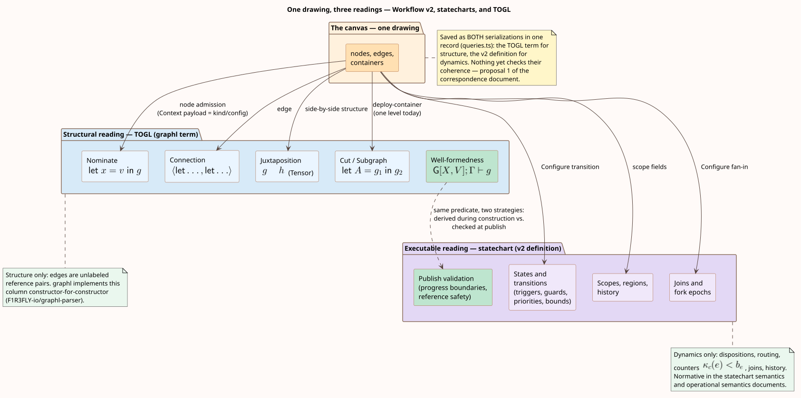
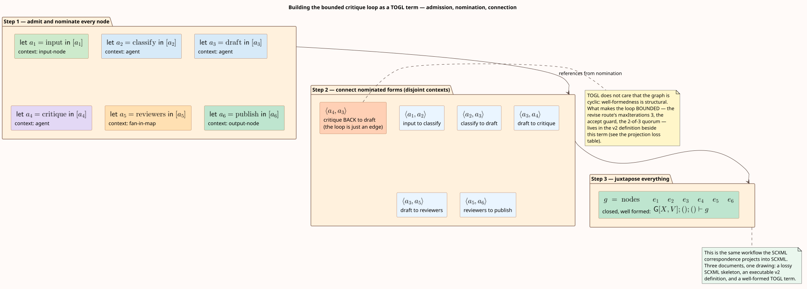

# TOGL correspondence

This design document records the relationship between Agent Teams Workflow v2 and **TOGL**
— the Theory of Graphs Language, L. G. Meredith's algebraic theory of graphs — and between
both of them and the statechart reading of the kernel. It states the theory precisely,
shows that the platform's `graphl` serialization is TOGL's concrete syntax in production,
maps every v2 construct onto its TOGL counterpart with the same fidelity classes the
[SCXML correspondence](scxml-correspondence.md) uses, works one definition through a
mechanical projection into a graphl term, and closes with the design changes that adopting
the rest of the theory would enable.

**This correspondence is partly a fact of the codebase and partly new synthesis, and the
document keeps the two apart.** That graphl implements TOGL is a fact: the parser's
constructors mirror the paper's one for one, and the editor emits a graphl term on every
save. That TOGL relates to *statecharts* is a synthesis made here: no published source
connects them, and the bridge below is argued from Harel's own graph-theoretic reading of
statecharts as higraphs ([Harel 1988](https://doi.org/10.1145/42411.42414)), from the
paper's rewrite-system construction, and from a machine-checked equivalence between TOGL
edge semantics and OSLF modal types. Where a claim rests on synthesis rather than a
source, the text says so.

Companions: the [statechart semantics](../theory/statechart-semantics.md) owns the formal
rules of the executable half; the [SCXML correspondence](scxml-correspondence.md) maps the
same constructs onto the W3C standard and is this document's structural template; the
[specification](../specification/workflow-definition-v2.md) owns the v2 syntax; the
[operational semantics](../theory/operational-semantics.md) owns tokens, routing, and
joins; the [HTTP API reference](../../../../embers/docs/api/methods/ai-agents-teams/deploy.md) owns how
graphl terms and definitions travel over the wire.

## Reading guide: TOGL in five sentences

TOGL is an algebraic theory of graphs $`\mathsf{G}[X,V]`$, parameterized by a theory of
variables $`X`$ and a theory of vertices $`V`$, each required to provide decidable
membership and equality. Its motivating observation is that graphs are used in
*computations* yet are conventionally presented as vertex-and-edge *sets* — the one shape
of data we do not specify recursively — so the theory instead builds graphs from graphs by
constructors, the way $`\mathsf{List}[A] = 1 + A \times \mathsf{List}[A]`$ builds lists
from lists. Its distinctive rule is that **references, not vertices, form edges**:
variables supply references, a $`\mathsf{let}`$ binding ("nomination") names a vertex, and
an edge is admissible only between two graphs in nominated form with disjoint dependency
contexts. Well-formedness is a typing judgment $`\mathsf{G}[X,V]; \Gamma \vdash g`$
derived by rules, so whether a graph is well formed is *proved*, not checked after the
fact. A second-order layer adds graph references (wires, bundles, and a cut rule), which
gives contexts with holes, recursion, and — because $`\mathsf{G}[X,V]`$ itself qualifies
as a theory of vertices — reflection: graphs whose vertices are whole graphs.

## The theory, precisely

The primary source is the paper — L. G. Meredith, *Notes on a formal theory of graphs*
(unpublished manuscript; local copy at `~/Workspace/f1r3fly.io/publications/togl/`,
canonical source the author's `leithaus/rho4u` repository, `togl/`). Everything in this
section restates the paper; nothing is added.

**Grammar.** Graph expressions are generated by

```math
g,h \;::=\; 0 \;\mid\; v{\mid}g \;\mid\; x{\mid}g \;\mid\; g \otimes h
\;\mid\; \mathsf{let}\; x = v \;\mathsf{in}\; g
\;\mid\; \langle \mathsf{let}\; x_1 = v_1 \;\mathsf{in}\; g_1,\;
         \mathsf{let}\; x_2 = v_2 \;\mathsf{in}\; g_2 \rangle
```

pronounced: the empty graph; adjoin the vertex $`v`$ to $`g`$; adjoin the variable $`x`$;
juxtapose $`g`$ and $`h`$; let $`x`$ stand for $`v`$ in $`g`$ (**nomination** — a graph of
this shape is *in nominated form*); and connect $`g_1`$ to $`g_2`$ with an edge from
$`x_1`$ to $`x_2`$ (**connection**). $`[v]`$ abbreviates $`v{\mid}0`$.

**Judgments and rules.** Well-formedness is the judgment
$`\mathsf{G}[X,V]; \Gamma \vdash g`$ with $`\Gamma`$ a sequence of variables (the
dependencies). The rules are *Foundation* (the empty graph is well formed with no
dependencies), *Verticity* and *Variation* (admissibility comes from the parameter
theories' membership), *Participation* and *Dependence* (adjoining an admissible vertex,
or a variable that extends $`\Gamma`$), *Juxtaposition* with the side condition
$`\Gamma_1 \cap \Gamma_2 = \emptyset`$, *Nomination* — which the paper identifies as "a
kind of cut rule … like $`\beta`$-reduction with an explicit substitution", with the
freshness side condition — and *Connection*:

```math
\frac{\mathsf{G}[X,V];\Gamma_1 \vdash \mathsf{let}\;x_1{=}v_1\;\mathsf{in}\;g_1
      \qquad
      \mathsf{G}[X,V];\Gamma_2 \vdash \mathsf{let}\;x_2{=}v_2\;\mathsf{in}\;g_2}
     {\mathsf{G}[X,V];\Gamma_1,\Gamma_2 \vdash
      \langle \mathsf{let}\;x_1{=}v_1\;\mathsf{in}\;g_1,\;
              \mathsf{let}\;x_2{=}v_2\;\mathsf{in}\;g_2\rangle}
\;[\Gamma_1 \cap \Gamma_2 = \emptyset]
```

"an edge is only admissible between two well formed graphs in nominated form and then only
when the dependencies are disjoint."

**Equations.** The syntax is quotiented so it matches graphs: $`\otimes`$ is a commutative
monoid with unit $`0`$ (*Identity*, *Symmetry*, *Associativity*); adjoin order is
irrelevant (*Permutation*); duplicate nomination of one vertex collapses (*Conservation*);
and *Extrusion* —

```math
(\mathsf{let}\; x = v \;\mathsf{in}\; g_1) \otimes g_2
\;=\;
\mathsf{let}\; x = v \;\mathsf{in}\; (g_1 \otimes g_2)
\qquad [x \notin g_2]
```

— is scope extrusion, the same mobility law that governs new names in the
$`\pi`$- and rho-calculi ([Meredith & Radestock 2005](https://doi.org/10.1016/j.entcs.2005.05.016)).

**Expressive economy.** The paper's examples build the discrete graph, the chain, the
cycle, and the complete graph as one-line recursive specifications — e.g.
$`\mathsf{cycle}(n) = \langle \mathsf{chain}(n), \mathsf{chain}(1)\rangle`$ — against the
"nearly overwhelming complexity" of vertex/edge-list tools (its example is GraphViz's dot
for $`K_{100}`$). Each family is simultaneously a *subdomain* — a subtype — of its
container domain, carved out by constraints on edge formation.

**The second-order layer.** Splitting variables $`X = X_v + X_g`$ (lowercase for vertex
variables, uppercase for graph variables) extends the judgment with graph dependencies and
adds *Wire* ($`\mathsf{G}[X,V];\Gamma;A \vdash A`$ — "graphs that have holes in them"),
*Bundle* (multi-hole contexts), and *Cut*
($`\mathsf{let}\; B = g_1 \;\mathsf{in}\; g_2`$), which admits recursive, even infinitary,
graph description. **Rewrite systems** are then representable by edge filtration: lift
terms to nominated singleton graphs and admit an edge $`\langle{\uparrow}t,{\uparrow}u\rangle`$
exactly when $`t \to u`$ — the paper works the $`\lambda`$-calculus reduction graph
$`\mathsf{red}(t)`$. **Reflection** closes the loop:
$`\mathcal{D}[X,V] = \mathsf{G}[X + \mathcal{D}[X,V],\, V + \mathcal{D}[X,V]]`$ mixes
plain vertices with vertices that are whole graphs, and the syntax of a graph is itself
computable as a graph. Finally, applying **OSLF** — Operational Semantics in Logical Form
(Meredith & Stay; see also [Stay & Meredith 2017](https://arxiv.org/abs/1704.03080) and
its categorical maturation, [Williams & Stay 2021](https://arxiv.org/abs/2102.04672)) —
to the theory generates a spatial type language whose formulas mirror the constructors,
so subdomains of $`\mathsf{G}[X,V]`$ become *types*; the paper's running title is, in
fact, "oslf".

## graphl is TOGL's concrete syntax, in production

This section is fact, not synthesis. The team-graph wire format `graphl` — the OpenAPI
string format behind `DeployGraph` and the `graph` field of every team record — is
implemented by [`F1R3FLY-io/graphl-parser`](https://github.com/F1R3FLY-io/graphl-parser)
(Rust, with a WASM build the SDK loads; pinned at v0.0.40 by both the backend and
`packages/client`). Its AST is the paper's grammar plus four pragmatic extensions:

| graphl constructor | TOGL construct | Notes |
| --- | --- | --- |
| `Nil` | $`0`$ | The empty graph. |
| `Vertex` (`< name >`) | $`v{\mid}g`$ | Vertex adjunction. |
| `Var` | $`x{\mid}g`$ | Variable adjunction. |
| `Nominate` (`let x = < v > in g`) | $`\mathsf{let}\;x{=}v\;\mathsf{in}\;g`$ | Nomination. |
| `EdgeAnon` (`(let …, let …)`) | $`\langle\mathsf{let}\ldots,\mathsf{let}\ldots\rangle`$ | Connection. |
| `Tensor` (`g * h`) | $`g \otimes h`$ | Juxtaposition. |
| `Subgraph` (`let A = g1 in g2`) | second-order *Cut* | Graph references; uppercase variables. |
| `Wildcard`, `QuoteGraph`, `QuoteVertex` names | $`\ulcorner\cdot\urcorner`$ | The paper's quotation/reflection devices. |
| `EdgeNamed`, `RuleAnon`, `RuleNamed`, `Context` | extensions | Named edges; rewrite rules (the *Rewrite systems* section made syntax); `Context` attaches a string payload to a name. |

The correspondence goes down to the variable convention: the editor mints lowercase
`a…`-prefixed identifiers for vertex variables and uppercase `A…`-prefixed identifiers for
subgraph variables (`makeNodeId`/`makeSubgraphId`, `apps/embers/src/lib/graph.ts`) —
exactly the paper's $`X_v`$/$`X_g`$ split.

A real editor-emitted term (the shape appears verbatim in the backend compiler's tests,
`packages/embers/src/domain/agents_teams/compilation/graphl_parsing.rs` in the Embers
backend): a three-node team is

```text
0 * {context "{\"type\":\"input-node\"}"  for input1  in let input1  = < input1 >  in < input1 >  |
    {context "{\"type\":\"text-model\"}"  for model1  in let model1  = < model1 >  in < model1 >  |
    {context "{\"type\":\"output-node\"}" for output1 in let output1 = < output1 > in < output1 > | 0}}}
  * {(let input1 = < input1 > in 0, let model1  = < model1 >  in 0)
  * {(let model1 = < model1 > in 0, let output1 = < output1 > in 0) * 0}}
```

— a `Tensor` of (i) a right-nested `Context`/`Nominate` chain that admits each vertex and
names it, and (ii) a chain of `EdgeAnon` connections between nominated singletons. Every
node's *kind and configuration* ride in the `Context` payload as JSON; the term itself
carries pure structure.

Who touches what: the editor serializes the canvas with `toApiGraph` and re-hydrates with
`fromApiGraph` (dropping dangling edges loudly — the discipline installed after the
[graph-corruption post-mortem](../../post-mortems/AGENT_TEAM_EDITOR_GRAPH_CORRUPTION.md));
the SDK transports graphl as text inside JSON and exposes the typed AST
(`api-client/models/Graph.ts`); the backend wraps the same parser
(`domain/agents_teams/models.rs`) and compiles terms by folding the AST into a flat
vertex/binding/edge view whose `Context` payloads become typed nodes
(`graphl_parsing.rs`). The editor and backend both **reject** `Rule*` constructors and
`Wildcard`/`Quote*` names today — parsed, never accepted — which is exactly the unused
head-room the proposals below spend.

**Dual serialization.** Since Workflow v2, one canvas is saved as **two** documents in one
record (`useSaveAgentsTeamMutation`, `apps/embers/src/lib/queries.ts`): the graphl term
(structure, this correspondence's subject) and the v2 definition (dynamics — dispositions,
guards, priorities, bounds, joins, scopes, history). Deploy prefers the definition and
falls back to the term
([team deploy](../../../../embers/docs/api/methods/ai-agents-teams/deploy.md)). This split is the load-bearing
observation of the whole document: **TOGL supplies well-formedness and composition;
statecharts supply execution; the platform already runs both, about the same drawing.**

## Construct-by-construct correspondence

Fidelity classes as in the [SCXML correspondence](scxml-correspondence.md): **exact**,
**partial**, **divergent**, **absent**. Statechart column terms are the
[statechart semantics](../theory/statechart-semantics.md)'s. Rows below the double rule
are honest-gap rows: constructs one side simply does not have.

| Workflow v2 construct | Statechart reading | TOGL / graphl construct | Class | The difference that matters |
| --- | --- | --- | --- | --- |
| Node (`nodes[]` entry) | State | Admitted vertex in nominated form, `Context` carrying kind/config | exact (structure) | TOGL admits the vertex; the *meaning* of the node is entirely in the payload. |
| Node identifier + reference-safety invariant | Named state | Nomination + the $`\Gamma`$ discipline | partial | v2 enforces "every edge names existing nodes" by publish-time validation; TOGL makes the same property a typing derivation — an ill-referenced edge is not expressible. |
| Transition (`transitions[]` entry) | Labeled transition | *Connection* (`EdgeAnon`) | partial | TOGL edges are unlabeled reference pairs: no trigger, guard, priority, or bound. The definition layer carries all of that. |
| Parallel fan-out / regions | AND-composition, fork epochs | $`\otimes`$ with disjoint $`\Gamma`$ (`Tensor`) | partial | Juxtaposition is static disjointness; fan-out epochs and token multiplicity are runtime notions with no term-level counterpart. |
| Scope tree, deploy-container, nested teams | Compound states, `<invoke>` analogue | *Cut* (`Subgraph`), reflection $`\mathcal{D}[X,V]`$ | partial | The editor uses exactly one nesting level (`deploy-container` → `Subgraph`); TOGL's layer is arbitrarily deep and reflective. |
| Publish-time validation (progress-boundary theorem, ADR-003 invariants) | Well-formed statechart | Subdomain membership; OSLF types | divergent | v2 *checks* a candidate after construction; TOGL *derives* membership during it. The validator's rule catalog is, in TOGL terms, the definition of a subdomain of the container graph domain. |
| Run / event sequence | LTS of the kernel | Rewrite-system graph via edge filtration ($`\mathsf{red}(t)`$ pattern) | partial (synthesis) | The kernel's reachable-configuration graph is an edge-filtered graph domain; TOGL can *state* it, the kernel *walks* it. This row is the honest formal content of "TOGL is compatible with statecharts". |
| Statechart hierarchy as drawing | Higraph blobs (Harel 1988) | Nesting via *Cut*; $`\otimes`$ for orthogonality | partial (synthesis) | Harel's own graph-theoretic reading of statecharts is the bridge from the statechart side; TOGL supplies the algebra the higraph picture lacks. |
| Team graphl record (`graph` field) | — | Closed graph expression | exact | The wire format *is* the term. |
| Dispositions, route groups, guards, bounds ($`\kappa_c(e) < b_e`$), joins, history, waits, approvals | The executable half | **absent in TOGL** | absent | Dynamics live in the definition (and, for legacy records, in `Context` payloads). TOGL is a theory of graph *formation*, not execution. |
| Token markings, epochs, revisions, run ledger | Dynamic configurations | **absent in TOGL** | absent | Same boundary, runtime side. |
| `RuleAnon` / `RuleNamed` rewrite rules | — | The paper's *Rewrite systems* section, as syntax | absent in v2 | Parsed by graphl, rejected by editor and backend — reserved head-room. |
| Quotation names (`Quote*`), `Wildcard` | — | $`\ulcorner\cdot\urcorner`$ reflection | absent in v2 | Same status. |
| $`\otimes`$-composition of whole teams | — | Juxtaposition of closed graphs | absent in v2 | Nothing composes two *teams* today; see proposals. |



## The axes that carry the differences

**Term algebra versus vertex/edge lists.** The v2 definition is a vertex/edge-list
document — `nodes[]` and `transitions[]` with identifier references — which is precisely
the presentation style the TOGL paper critiques. The consequence is recorded in this
repo's own history: ill-formed graphs are *representable*, so they must be caught by
validation, and when validation missed, the
[editor corruption post-mortem](../../post-mortems/AGENT_TEAM_EDITOR_GRAPH_CORRUPTION.md)
and [ADR-003](../../architecture/decisions/003-graph-invariants-and-unbounded-lists.md)
were the cost. The graphl term, by contrast, cannot express a dangling edge at all:
*Connection* requires both endpoints in nominated form. The codec makes the difference
observable — `fromApiGraph` must *drop* dangling edges arriving from the list side, while
`toApiGraph` cannot *produce* them on the term side.

**Well-formedness by typing versus by checking.** These are two evaluation strategies for
the same predicate. TOGL derives $`\Gamma \vdash g`$ during construction; the v2 validator
re-derives an equivalent property after construction (reference safety, root-scope shape,
acyclic parent chains — the [statechart semantics](../theory/statechart-semantics.md)
enumerates them). The practical difference is *when* an error exists: at edit time as an
unconstructable state, or at publish time as a diagnostic.

**Structure versus dynamics.** TOGL edges carry no triggers, guards, priorities, or
bounds; there is no configuration, no event, no run-to-completion. This is not a defect
but the boundary of the theory: everything dynamic belongs to the statechart half, which
is why the dual serialization is the right architecture rather than a transitional
artifact. What the split *demands* is coherence — the two documents must describe the same
drawing — and today nothing checks that (see proposal 1).

**Composition.** For statecharts, composing two machines is a design exercise; for TOGL
terms it is an operator: $`g_1 \otimes g_2`$ is well formed whenever the dependency
contexts are disjoint, and *Connection* wires composites together by nominating interface
vertices. Nothing in the platform composes two *teams* today — the unit of deployment is
one term — but on the term side the operator is already there.

## Mechanical projection, and what it loses

The projection below is the specification of what the editor's `toApiGraph` codec already
does, stated in the paper's vocabulary. It is structure-faithful and dynamics-lossy in one
direction, and structure-only in the other — the loss tables follow.

```text
PROJECT-TO-GRAPHL(definition):
  # nodes[] -> a right-nested admission chain; transitions[] -> a connection chain.
  term := 0
  chain := 0
  for node in definition.nodes (reverse order):
    payload := json({type: kind(node), ...node-specific config})
    chain := Context(payload, for x_node in
               Nominate(x_node, Vertex(node.id), Var(x_node) | chain))
    # x_node is the lowercase vertex variable minted for node.id;
    # deploy-containers instead wrap their members via Subgraph (uppercase Cut).
  edges := 0
  for t in definition.transitions (reverse order):
    edges := Tensor(EdgeAnon(Nominate(x_source, Vertex(source(t)), 0),
                             Nominate(x_target, Vertex(target(t)), 0)),
                    edges)
    # t.trigger, t.guard, t.priority, t.loop: NO EMISSION -> loss table.
  return Tensor(term, Tensor(chain, edges))
```

**Loss table, definition → term** (dynamics the term cannot carry):

| Lost construct | Where it actually lives |
| --- | --- |
| Trigger dispositions, route groups, priorities | definition `transitions[]`/`routeGroups[]` |
| Guards (incl. pure Rholang, `sourceHash`) | definition `guard` trees |
| Loop bounds $`\kappa_c(e) < b_e`$ and durable yields | definition `loop` |
| Join modes (`all`/`each`/`quorum`/`race`/`reduce`), correlation | definition `joins[]` |
| Scope entry/exit activities, history modes | definition `scopes[]` |
| Interface types, value algebra | definition `interface`/`types` |

**Loss table, term → definition** (algebra the list document cannot carry):

| Lost construct | What it would give |
| --- | --- |
| Well-formedness by construction | No dangling references representable |
| $`\otimes`$ and *Connection* as operators | Team composition without rewiring |
| *Cut*/reflection beyond one level | Nested teams as ordinary terms |
| Recursive families ($`\mathsf{cycle}(n)`$-style) | One-line parametric team families |
| `Rule*` rewrite syntax | Transition rules as first-class terms |
| OSLF-generated subtypes | Validation as type membership |

**Worked example.** The same definition the SCXML correspondence projects — classify,
a bounded critique loop on `draft`, a 2-of-3 reviewer quorum, publish — projects onto the
following graphl term (whitespace added; payloads abbreviated to their `type`):

```text
0 * {context "{\"type\":\"input-node\"}"    for a1 in let a1 = < input1 >    in < a1 > |
    {context "{\"type\":\"agent\"}"         for a2 in let a2 = < classify1 > in < a2 > |
    {context "{\"type\":\"agent\"}"         for a3 in let a3 = < draft1 >    in < a3 > |
    {context "{\"type\":\"agent\"}"         for a4 in let a4 = < critique1 > in < a4 > |
    {context "{\"type\":\"fan-in-map\"}"    for a5 in let a5 = < reviewers1 > in < a5 > |
    {context "{\"type\":\"output-node\"}"   for a6 in let a6 = < publish1 >  in < a6 > | 0}}}}}}
  * {(let a1 = < input1 >    in 0, let a2 = < classify1 > in 0)
  * {(let a2 = < classify1 > in 0, let a3 = < draft1 >    in 0)
  * {(let a3 = < draft1 >    in 0, let a4 = < critique1 > in 0)
  * {(let a4 = < critique1 > in 0, let a3 = < draft1 >    in 0)
  * {(let a3 = < draft1 >    in 0, let a5 = < reviewers1 > in 0)
  * {(let a5 = < reviewers1 > in 0, let a6 = < publish1 >  in 0) * 0}}}}}}
```

Read the fourth connection: the critique-loop back-edge `critique1 → draft1` is just
another *Connection* — TOGL does not care that the graph is cyclic, because
well-formedness is structural. Everything that makes the loop *bounded* — the `revise`
route's `maxIterations: 3`, the `accept` guard `output.score >= 0.8`, the 2-of-3 quorum —
lives in the definition document beside this term, exactly as the loss table states.



## What adopting the rest of TOGL would change

The kernel's semantics need no change; every proposal below is additive, in the corpus's
proposal register (the [authority-enforcement proposal](authority-enforcement.md) is the
pattern). They are ordered by nearness.

1. **Check the dual-serialization coherence invariant.** One record stores two documents
   about one drawing, and nothing verifies they agree. The check is mechanical: project
   the definition with `PROJECT-TO-GRAPHL` (above) and compare terms up to the paper's
   equations — $`\otimes`$ commutativity/associativity, adjoin permutation — which the
   quotient makes a normal-form comparison. Publish-time is the natural gate, beside the
   existing validators.
2. **Recast publish validation as subdomain membership.** The validator's reference and
   shape rules are, in TOGL terms, the definition of a subdomain of
   $`\mathsf{G}[X,V]`$ — the paper's $`\mathsf{chain}/\mathsf{cycle}`$ examples show
   subdomains carved exactly this way, and OSLF makes such subdomains *types*. A
   machine-checked bridge already exists in this direction: the local Lean development
   proves TOGL-style edge semantics equivalent to OSLF $`\Diamond/\Box`$ modal semantics
   (`mettapedia`, `OSLF/Framework/ToposTOGLBridge.lean`; the theory itself is formalized
   in `CategoryTheory/TOGL.lean`, and independently in Idris at
   [dckc/togl](https://github.com/dckc/togl)). This reframing costs a paragraph in the
   validator's documentation now and opens a typed-validator refactor later.
3. **Admit `RuleAnon`/`RuleNamed` as transition rules.** The parser already speaks the
   paper's rewrite-system syntax; editor and backend reject it. Accepting rules would let
   a team's *transition relation* be stated in the term language itself — the paper's
   $`\mathsf{red}(t)`$ construction made available to authors — with the definition layer
   still owning guards and bounds.
4. **Deepen nesting and reflection for nested teams.** The editor's single
   `deploy-container` level uses one *Cut*; the durable kernel already executes nested
   workflows. Aligning the term language with the runtime — arbitrary `Subgraph` depth,
   quotation for teams-as-vertices per $`\mathcal{D}[X,V]`$ — makes the hierarchy the
   [hierarchical continuation theory](../theory/hierarchical-continuations.md) executes
   expressible as one term.
5. **OSLF-typed guards.** The platform stores OSLF documents as first-class records
   ([Oslfs API](../../../../embers/docs/api/methods/oslfs/list.md)) and guards already admit a pure Rholang
   subset; an OSLF-formula guard kind — a guard that *is* a stored, versioned OSLF query —
   would connect the two ends of the platform that this correspondence and the
   [rho-life correspondence](../theory/rho-life-correspondence.md) both point at.
6. **Team composition by $`\otimes`$.** With coherence (1) and deeper nesting (4), two
   deployed teams compose as $`g_1 \otimes g_2`$ plus explicit *Connection* wiring at
   nominated interface vertices — composition without redrawing, which is the capability
   the theory was built to provide.

## References

- L. G. Meredith, *Notes on a formal theory of graphs*, unpublished manuscript. Canonical
  source: [github.com/leithaus/rho4u](https://github.com/leithaus/rho4u) (`togl/`);
  mirrored locally at `~/Workspace/f1r3fly.io/publications/togl/` (PDF, LaTeX, and
  Markdown renditions). The name "Theory of Graphs Language" follows RChain usage
  (*RCast 32: TOGL*, [blog.rchain.coop](https://blog.rchain.coop/2019/06/17/rcast-32-togl-theory-of-graphs-language/),
  17 June 2019; host intermittently unreachable at the time of writing).
- D. Connolly, *togl: a Theory of Graphs (by Meredith)* — an Idris formalization,
  [github.com/dckc/togl](https://github.com/dckc/togl).
- Local Lean 4 formalizations: `Mettapedia/CategoryTheory/TOGL.lean` (the theory) and
  `Mettapedia/OSLF/Framework/ToposTOGLBridge.lean` (TOGL edge semantics ≡ OSLF modal
  semantics), in `~/Workspace/f1r3fly.io/ai-agents/lean-projects/mettapedia/`.
- A. Bagchi and C. Wells, "Graph-based Logic and Sketches",
  [arXiv:0809.3023](https://arxiv.org/abs/0809.3023) (2008) — cited by the paper.
- A. Dawar, P. Gardner, and G. Ghelli, "Expressiveness and complexity of graph logic",
  *Information and Computation* 205(3), 2007,
  [doi:10.1016/j.ic.2006.10.006](https://doi.org/10.1016/j.ic.2006.10.006).
- L. Cardelli, P. Gardner, and G. Ghelli, "A Spatial Logic for Querying Graphs",
  ICALP 2002, LNCS 2380,
  [doi:10.1007/3-540-45465-9_51](https://doi.org/10.1007/3-540-45465-9_51).
- C. Godsil and G. Royle, *Algebraic Graph Theory*, Graduate Texts in Mathematics 207,
  Springer, [doi:10.1007/978-1-4613-0163-9](https://doi.org/10.1007/978-1-4613-0163-9).
- J. H. Holland, *Adaptation in Natural and Artificial Systems*, University of Michigan
  Press, 1975 — the sense in which the paper's crossover operations are "evolutionary".
- L. G. Meredith and M. Radestock, "A Reflective Higher-order Calculus", ENTCS 141(5),
  2005, [doi:10.1016/j.entcs.2005.05.016](https://doi.org/10.1016/j.entcs.2005.05.016);
  and "Namespace Logic", TGC 2005,
  [doi:10.1007/11580850_19](https://doi.org/10.1007/11580850_19) — the rho-calculus and
  its logic, whose reflection and extrusion TOGL mirrors.
- M. Stay and L. G. Meredith, "Representing operational semantics with enriched Lawvere
  theories", [arXiv:1704.03080](https://arxiv.org/abs/1704.03080); C. Williams and
  M. Stay, "Native Type Theory", ACT 2021,
  [arXiv:2102.04672](https://arxiv.org/abs/2102.04672) — the OSLF line the paper's final
  section applies to graphs.
- D. Harel, "Statecharts: A Visual Formalism for Complex Systems", *Science of Computer
  Programming* 8(3), 1987,
  [doi:10.1016/0167-6423(87)90035-9](https://doi.org/10.1016/0167-6423(87)90035-9); and
  "On Visual Formalisms", *CACM* 31(5), 1988,
  [doi:10.1145/42411.42414](https://doi.org/10.1145/42411.42414) — statecharts, and their
  graph-theoretic reading as higraphs, the statechart-side anchor of the synthesis rows.
- W3C, *State Chart XML (SCXML)*, Recommendation, 1 September 2015,
  [w3.org/TR/scxml](https://www.w3.org/TR/scxml/) — via the
  [SCXML correspondence](scxml-correspondence.md).
