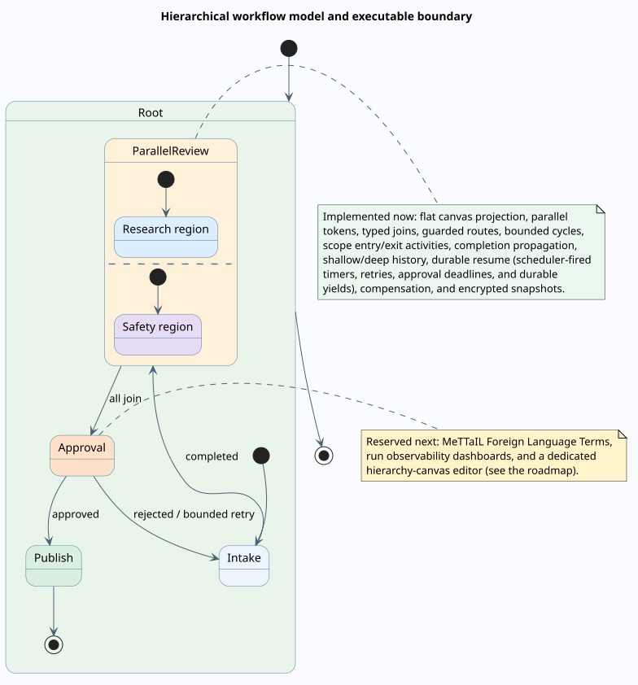

# Feature roadmap and design backlog

This roadmap distinguishes the delivered execution foundation from useful product extensions and protected-runtime proposals. Priority reflects architectural leverage, not a delivery commitment.

## Delivered — durable workflow boundary

### Commands, encrypted continuations, and resume

One authenticated command API implements `signal`, `event`, `timerFired`, `approve`, `reject`, `cancel`, `retry`, and `migrate`. A suspension writes an encrypted continuation through F1r3drive and records only hash/capability metadata in RSpace. A command atomically claims the expected revision and identity, restores the pinned definition and context, and emits a resume event.

The same command envelope should serve every wait-like feature; separate ad hoc endpoints would create inconsistent authorization and idempotency.

### Idempotent effect ledger and outbox

Every effect has a stable key derived from run, execution, node, correlation epoch, and attempt. The kernel records `effectRequested` before dispatch and persists a signed `effectObserved` envelope after return. An encrypted outbox makes requests safely resubmittable. Providers should use the effect key as their own idempotency key when physical duplication is unacceptable.

Exactly-once execution is generally unattainable across independent systems; the engineered goal is idempotent request handling and exactly-once-visible state transition.

### Timers and deadlines

Deadlines are absolute timestamps. The scheduler submits an authenticated `timerFired` command; the deterministic kernel verifies timer identity and expected deadline. Activity timeout produces an explicit `timedOut` disposition.

This can be implemented in Embers without modifying f1r3node. A FIPS is needed only if the chosen design requires a new privileged Rholang clock/timer primitive.

### Correlation epochs

Tokens carry fresh fork epochs. Fan-out pushes an epoch; the matching join keys accumulation by that epoch and consumes the branch context on completion. Nested parallelism, loop re-entry, root correlation, route-group correlation, and expression-key correlation are implemented.

## Delivered — statechart recovery semantics

### Compound/parallel exit and history

The kernel implements entry closure, completion propagation, exit activities, shallow history, and deep history while preserving token-based joins. A visual hierarchy editor and live active-configuration inspector remain product work.

### Error boundaries, retry, and compensation

Typed node policies implement:

- retry with attempt cap, backoff, jitter policy, and retryable dispositions;
- catch routes scoped to node, compound state, and root;
- finally/exit activities;
- Saga-style compensation stack with explicit forward and compensating effects;
- dead-letter disposition for operator intervention.

Compensation is not rollback. Documentation and UI must show that it is a new effect intended to semantically counter an earlier effect.

### Run migration and cancellation

Active runs are pinned by default. An explicit migration names old/new definition hashes and a target team URI, then applies pure typed state-patch operations. Cancellation clears the structured continuation tree and schedules compensation in reverse order. Further static migration-compatibility analysis remains useful.

### Hierarchical workflow calls

Pinned workflow activities execute as embedded child continuations. Qualified wait IDs route commands through arbitrary depth, child effect identities are isolated, and root cancellation clears the hierarchy. The next authoring step is a collapsible statechart-style canvas with explicit child interfaces and budget delegation.

## Resolved review findings

The statechart documentation review surfaced three verified kernel defects and two sharp edges; all five are now fixed, tested, and reflected throughout the theory, specification, and usage documents:

- **Durable-yield resumption — delivered.** Durable-yield waits park with `dueAt` equal to the park instant and the recovery scheduler resumes them automatically through the standard self-signed `timerFired` path, re-entering the target in Enter phase ([statechart semantics](theory/statechart-semantics.md#durable-yield-as-a-scheduling-point)). Pre-fix parked yields (no `dueAt`) still require `cancel` or `migrate`. Work item `provide-a-resume-command-path-for-durable-yield-suspensions-b0684d`.
- **History-node multi-target restoration accounting — delivered.** `restore_history` now applies the same fan-out accounting as routing, pinned by a kernel test and by the `RestoreHistoryNode` action of the StatechartScopes TLA+ model, whose `CounterFaithful` invariant refutes the pre-fix semantics ([statechart semantics](theory/statechart-semantics.md#history-capture-and-restoration)). The single-noded authoring guidance is withdrawn. Work item `adjust-scope-token-accounting-when-a-history-node-restores-multiple-targets-fbdeca`.
- **Approval-deadline enforcement — delivered.** Approvals are in the scheduler-fireable set: expiry resumes the wait with disposition `timedOut`, late decisions are cleanly rejected, and the recovery-scan error churn is gone. Publish validation now requires a `timedOut` route wherever a timeout is declared (`approval-timeout-unrouted`, both validators). Work item `enforce-approval-deadlines-instead-of-erroring-the-recovery-scan-7d51d6`.
- **Invalid timer deadlines fail loudly — delivered.** A literal deadline that the kernel's parser rejects is unpublishable (`invalid-timer-deadline-literal`, both validators); a computed deadline that fails at runtime routes `failed` with a structured `{error, deadline}` record instead of parking an unresumable wait.
- **Lifecycle-route validation — delivered.** Every transition sourced at a scope's entry or exit lifecycle activity must target an activity node, regardless of trigger (`invalid-lifecycle-route-target`, both validators), closing the hard-kernel-error path for lifecycle failure routing.

## P1 — observability and assurance

### Trace, replay, and time-travel inspector

Expand the run page into a hierarchical timeline showing node activation, route decisions, join occupancy, counters, effect receipts, cost, and suspension. Private payloads are fetched only with separate artifact authority. Replay deterministic control from signed effect observations and compare the derived trace hash with the ledger.

### Cost, token, and authority budgets

Add policies for maximum cost-accounted communication, wall-clock deadline, model tokens, monetary spend, active workflow tokens, artifact bytes, retries, and effect count. Treat budget exhaustion as a disposition so a team can degrade, request approval, or terminate cleanly. The design basis is the conserved-token learning economy of the rho-life corpus — budgets as conserved quantities carried in token context, probes priced per access grade, exhaustion as a routable outcome — as mapped in the [rho-life correspondence](theory/rho-life-correspondence.md).

### Static analysis and model checking

Beyond hot-cycle safety, analyze unreachable nodes, shadowed first-match routes, unsatisfiable guards, joins that cannot reach quorum, uncontrolled token growth, scope exit completeness, missing compensation, and authority flow. Generate a bounded TLA+/Apalache or Petri-net abstraction from each published definition and attach verification evidence to its version.

### Signed observation envelopes

External observations should include canonical input/output hashes, provider and model identity, code/artifact hash, timestamp, cost, nonce, and signature. This verifies provenance and replay input without claiming that the provider is deterministic.

## P2 — authoring and collaboration

### Hierarchical statechart canvas

Add collapsible compound and parallel regions, orthogonal lanes, ports, entry/exit points, history markers, mini-map breadcrumbs, and semantic zoom. Keep one normalized definition underneath all views; do not serialize layout nesting as execution meaning.

### Simulation and property-based test bench

Allow authors to inject deterministic mock observations, step tokens, inspect joins, force dispositions, advance virtual time, and assert trace properties. Generate cases across branches and loop bounds. Export failing seeds as fixtures for the Rust compiler and TypeScript validator.

### Reusable typed subworkflow authoring

The runtime can call a deployed workflow by immutable URI/hash and preserve child waits durably. Add editor selection, interface compatibility checks, input/output mapping controls, a reusable library, and templates for review committees, red teams, research swarms, content pipelines, incident response, and approval gates.

### Collaborative editing

Use operation-based collaboration or a CRDT over normalized identity maps, with semantic conflict diagnostics for concurrent rewiring. Presentation coordinates can merge independently; a conflict in a route group or scope membership must be surfaced rather than resolved by last writer wins.

### Natural-language copilot with proof obligations

Let an agent propose a workflow diff from prose, but require the same validator, capability manifest, cost estimate, and simulation suite before application. Generated control flow receives no privileged bypass.

## P2 — agent platform features

### Policy and evaluation nodes

First-class evaluators can score quality, safety, factuality, style, and goal completion, producing typed observations used by guards. Support ensembles, confidence calibration, adversarial review, and human escalation.

### Memory with explicit lifetimes

Separate invocation context, run memory, team-version memory, and user-authorized long-term memory. Every memory read/write is an activity with retention, provenance, encryption, and deletion policy. Do not hide ambient vector-store access inside agents.

### Dynamic team spawning

An authorized supervisor can instantiate a pinned subteam, delegate a bounded capability and budget, await its typed result, then revoke it. This generalizes OpenClaw-style team behavior while retaining Rholang object-capability boundaries.

### Scheduling, subscriptions, and event streams

Start teams from cron-like schedules, F1r3sky feed events, webhooks, blockchain events, or artifact changes. Normalize all triggers into authenticated command envelopes so interactive and background runs share one execution model.

The **authorization half of this item is delivered**: on-chain channel grants now normalize external triggers from chat (F1R3BotGateway) and mail (F1R3Mail) into the standard run/poll/reveal transport, with the triggering human's wallet owning every run while the channel wallet signs and pays under explicit, capped, revocable authority ([ADR-004](../architecture/decisions/004-grant-based-channel-connectors.md), [channel grants](architecture/channel-grants.md)). Webhooks, push delivery, and schedules deliberately remain future work — the connector layer ships poll-based on purpose (correctness never depends on a delivery call surviving), and a push surface would add its own callback authentication and retry semantics on top of, not instead of, the grant model.

### Process mining and optimization

Use privacy-preserving event metadata to discover bottlenecks, common failure routes, excess retries, and effective agent combinations. Proposed graph optimizations remain versioned diffs with simulation evidence, never self-modifying deployed code.

## P3 — MeTTaIL and arbitrary-language agents

Once the Rholang 1.4/MeTTaIL language-specification and Foreign Language Term contracts stabilize:

1. pin the language specification by content hash;
2. pin the agent artifact and dependency closure;
3. declare ABI version, entry point, portable input/output types, required authorities, and resource limits;
4. compile or interpret the FLT inside the defined sandbox;
5. return a structured observation envelope to the same control kernel.

JavaScript/TypeScript, Python, MeTTa, and other languages then become activity implementations, not alternate workflow semantics. Routing, joins, cycles, budgets, authorization, and audit stay language-independent.

No MeTTaIL or f1r3node changes are part of the current implementation. If integration exposes a missing protected-runtime feature, create a FIPS under `../FIPS/` using the pgmcp documentation rules, with theory, syntax, semantics, security, alternatives, colored PlantUML/SVG diagrams, migration, and verification evidence before any code change.

## Features deliberately rejected

- **Silent latest-version upgrades:** incompatible with replay and suspended runs.
- **Arbitrary JavaScript guards in the browser:** inconsistent, effectful, and not consensus-portable.
- **Prompt/output data in public run records:** violates the privacy boundary.
- **Implicit unbounded cycles:** converts a modeling error into resource exhaustion.
- **Ambient tool access for every agent:** defeats capability confinement.
- **Pretending compensation is rollback or LLM execution is deterministic:** obscures the true semantics and failure modes.
