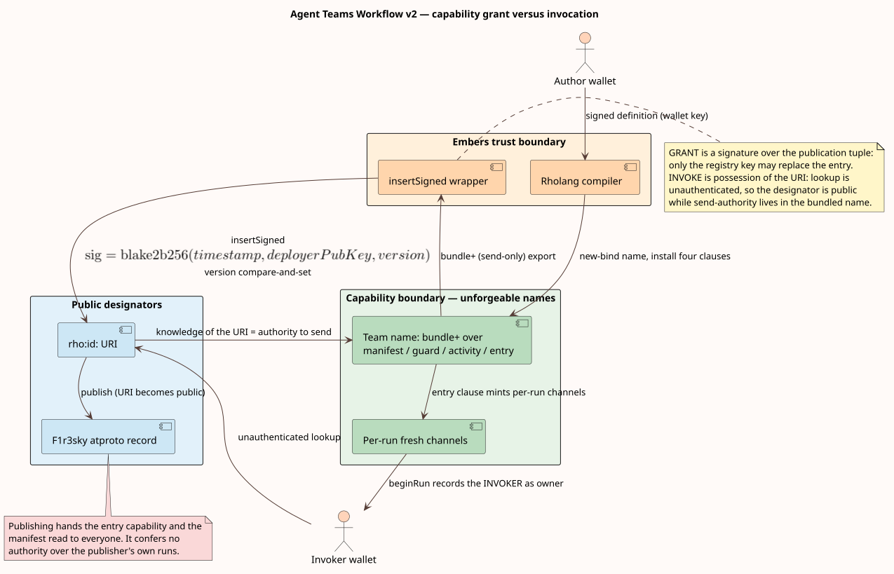
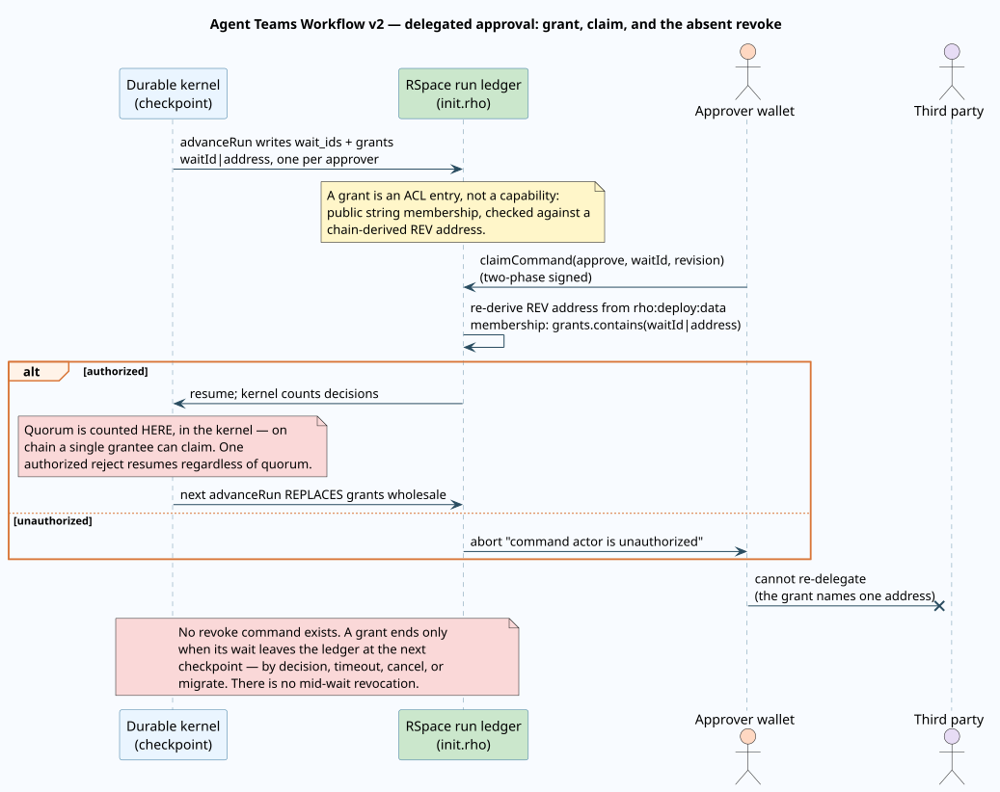
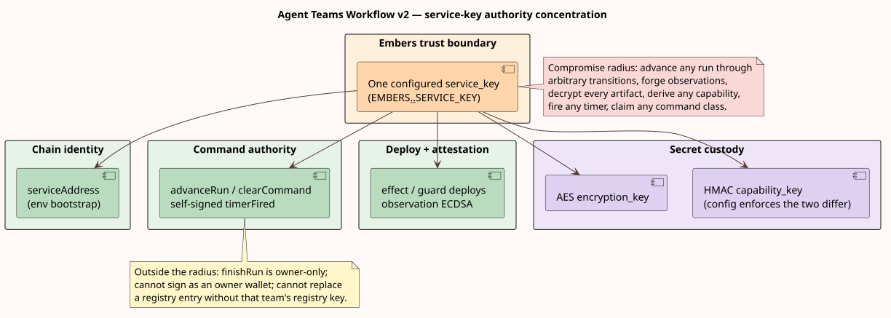

# Object-capability model

This document classifies every authority in Agent Teams Workflow v2 by mechanism — what kind of
thing it is, how it is minted, transferred, attenuated, and revoked — and states plainly which
authorities are true object capabilities, which are identity checks, and which are neither. It is
the constructive companion to the [threat model](threat-model.md): where that document inventories
assets and adversaries, this one specifies the machinery each authority is built from and follows
it through its lifecycle. It reads the deployed Rholang and the durable kernel as an
object-capability system and marks, without euphemism, the places where the system is a deliberate
hybrid.

Ownership is split across the corpus so no rule is stated twice. The [threat
model](threat-model.md) owns assets, trust boundaries, threats, and the redaction policies. The
[statechart semantics](../theory/statechart-semantics.md#statechart-operations-as-rho-calculus-processes)
own the reading of nu-restriction as capability creation. The [HTTP
API](../specification/http-api.md#authentication-and-authorization) owns the three-authority
endpoint composition. [Durable and hierarchical
execution](../architecture/durable-execution.md#commands-and-authorization) owns the command
envelope and its authorization. The [Rholang
realization](../design/rholang-realization.md#the-team-envelope-and-registry-composability) owns
the template and contract text. [Hierarchical continuation
theory](../theory/hierarchical-continuations.md) owns the qualified-grant invariant. **This
document owns the mechanism classification, the capability lifecycle, the ACL-hybrid analysis, the
service-key concentration analysis, and the ledger of controls that are declared but not
enforced.** It cites those siblings rather than restating them.

Line anchors refer to branch `dylon/embers-demo-fixes` (backend commit `4a8b791`); backend paths
are into the `embers` repository, frontend paths into this one. Where a formula appears it is
written in GitHub math delimiters.

## Terms

Every term is defined before it is used elsewhere in this document.

| Term | Definition |
| --- | --- |
| Object capability (ocap) | A single unforgeable value that both designates a resource and conveys the authority to use it. Holding it is permission; not holding it is prohibition. |
| Designation | Naming a resource. In an ocap system designation and authority are fused; in an access-control-list system they are separate (you name a resource, then a check decides if you may use it). |
| Ambient authority | Authority a component has by virtue of where it runs rather than by holding a capability. The anti-pattern object capabilities exist to eliminate. |
| Attenuation | Deriving a weaker capability from a stronger one — for example, a read-only view of a read-write resource. |
| Bearer token | A secret whose mere possession authorizes an action, transferable by copying, with no bound identity. Unguessability is its only protection. |
| Access-control list (ACL) | A per-resource list of identities permitted to act on it; authorization is a membership test against the caller's authenticated identity. |
| Confused deputy | A privileged component tricked into misusing its authority on behalf of a less privileged caller. |
| Unforgeable name | A Rholang channel introduced by `new` (a `$`\nu`$`-restriction): no process can fabricate a reference to it; the only way to hold it is to be handed it. |
| Bundle | A Rholang wrapper that attenuates a name. `bundle+{x}` yields a send-only (write-only) view: the holder may send on `$`x`$` but not receive on it, and cannot deconstruct the name. |
| Registry URI | A `rho:id:` string that resolves, through an unauthenticated registry lookup, to a published value. A public designator. |
| Grant | A `waitId|address` string on the run ledger recording that one address may decide one approval wait. |
| Exchange binding | A token that ties two halves of a protocol exchange together without itself conveying any authority. |
| Keyed derivation | Computing a capability as the output of a keyed hash over public inputs, so it is unguessable without the key. |

## The object-capability discipline

An object capability, in the sense of Dennis and Van Horn, is a value that *is* both the name of a
resource and the right to use it ([doi:10.1145/365230.365252](https://doi.org/10.1145/365230.365252)).
This fuses two things an access-control-list system keeps apart: in an ACL system a caller names a
resource and a separate check consults a list to decide whether that caller's identity may act;
in an ocap system there is no list and no ambient identity — authority travels only as
possessable references, and a component can affect only what it has been handed. Lampson's
access matrix makes the duality precise: an ACL is a column (per resource, who may act), a
capability is a row (per subject, what it holds) ([doi:10.1145/775265.775268](https://doi.org/10.1145/775265.775268)).
Miller's ocap discipline adds the dynamic rule that authority propagates only by introduction —
parenthood, endowment, or being passed a reference — never by ambient acquisition (Miller, *Robust
Composition*, 2006).

This system's native capability primitive is the reflective higher-order rho-calculus that Rholang
derives from ([Meredith and Radestock 2005](https://doi.org/10.1016/j.entcs.2005.05.016)): a name
introduced by `new` is a `$`\nu`$`-restriction, unforgeable and reachable only by those handed it.
The [statechart
semantics](../theory/statechart-semantics.md#statechart-operations-as-rho-calculus-processes)
develop that reading; this document takes it as given and classifies every authority against four
properties an object capability must have:

1. **Unforgeable** — it cannot be fabricated, only held.
2. **Designation conveys authority** — holding it is sufficient; there is no separate identity check.
3. **Transferable** — it moves by message, as a value.
4. **Attenuable** — a weaker form can be derived from it.

The thesis this document defends, stated once so the rest can be read against it: **the chain layer
is a genuine object-capability system; the run-command layer is a deliberate hybrid that authorizes
by signature identity and a public identity-list grant; the read layer is a bearer capability; and
nothing in the system is revocable mid-flight.** This is neither an accident nor a flaw to hide —
it is a set of engineering choices, and naming each one is what lets an operator reason about it.



## The mechanism taxonomy

The [threat model's authority table](threat-model.md#authorities) is an *asset* inventory: eight
rows naming who holds what. This table is the *mechanism* view of the same eight authorities, adding
the class each is built from and a verdict on whether it is a true object capability. No row
restates the threat model; each refines one of its rows.

| Authority (threat-model row) | Mechanism class | True ocap? | Where it qualifies or fails |
| --- | --- | --- | --- |
| Deployed team unforgeable name | Unforgeable rho name, exported write-attenuated | Yes | Nu-bound name behind `bundle+`; the exemplar. |
| Agent / effect return channel | Unforgeable rho name (fresh per invocation) | Yes | An activity can answer only through the return name it was handed. |
| RSpace environment capability | Unforgeable rho name (ledger state channels) | Yes | Reachable only through the team's control heads. |
| Artifact derivation secret | Keyed-derivation capability | Yes, sealed | The HMAC output is the artifact's true name; it never leaves the store. |
| Run UUIDv7 | Bearer token | Partial | Possession-based and unguessable, but read-only, non-attenuable, non-revocable. |
| Wallet private key | Signature / chain identity | No | Authorizes by identity, not possession of a resource reference. |
| Embers service key | Signature / chain identity, multi-role | No | Identity-based and heavily concentrated — see below. |
| Approval grant | Identity-list ACL entry | No | Public `waitId|address` membership against a chain-derived address. |

Two non-authority artifacts recur and are classified here so the table is exhaustive: the two-phase
**JWT** is an *exchange binding*, deliberately carrying no authority (analyzed below), and the
`authorities` **policy field** is a *declared annotation* with no runtime effect (the [recorded but
unenforced](#recorded-but-unenforced) ledger). The `content_hash` and `capability_hash` on an
artifact pointer are *commitments*, not authority — knowing them authorizes nothing.

## One name, four clauses

A deployed team's contract name, `agentsTeam`, is bound by `new` in the shared publication wrapper
(the binder slot at `templates/common/insert_signed.rho:1-9`, filled by
`templates/agents_teams/deploy_workflow.rho:3`). Because it is nu-bound, no process can forge a
reference to it; the only way to reach it is the registry export. On that one name the contract
binds exactly four clauses, dispatched by literal-string pattern with distinct arities so they
cannot collide:

- the **manifest** head `("control","manifest",return)`, returning the full definition and its
  hash (`deploy_workflow.rho:13-19`);
- the **guard** head `("control","guard",…)` (`deploy_workflow.rho:20-22`);
- the **activity** head `("control","activity",…)` (`deploy_workflow.rho:23-25`); and
- the **entry** capability `(input,return)`, the whole-workflow invocation (`deploy_workflow.rho:26-37`).

Inside the entry clause every node, router, and join channel is a fresh `new` per invocation
(`deploy_workflow.rho:27`; generated at `workflow_rendering.rs:162-177`), so one run's control
channels are unreachable from another's. This is the capability discipline the whole model rests
on: authority is the ability to send on a name you hold, and names are handed down the tree, never
acquired ambiently. The [Rholang
realization](../design/rholang-realization.md#the-team-envelope-and-registry-composability)
specifies the template text; it is not repeated here.

## The single bundle: write-only attenuation

The one bundle in the entire backend is the attenuation on the registry export:
`bundle+{*agentsTeam}` (`insert_signed.rho:27`, inside the `rs!` publication at `:25-30`). `bundle+`
yields a **send-only** view: a process that resolves the published value may send on the team name —
invoking any of the four clauses — but may not receive on it (cannot install competing clauses or
intercept messages) and cannot deconstruct the name by pattern matching. Attenuation in a single
operator: the world is handed the authority to *call* the team, and nothing more.

The contrast is exact and deliberate: `bundle` is a rejected reserved word in the pure-guard
sublanguage (`workflow.rs:1320`), so guard code cannot even name the attenuator, let alone hold a
write capability. Guards compute; only the compiled contract body wields bundles. The [pure-guard
boundary](threat-model.md#pure-guard-boundary) owns that restriction.

## Signed publication: insertSigned and the registry

Publication routes through `rho:registry:insertSigned:secp256k1`. The registry reads the current
deploy's timestamp and deployer, computes `$`\mathrm{blake2b256}(\texttt{(timestamp, deployerPubKey, version)})`$`,
and verifies the supplied signature against the URI's public key (f1r3node `Registry.rho`, the
`insertSigned` contract ~`:557-615`). Publication therefore requires proof of holding **two** keys:
the deployer key that signed the deploy, and the URI key that signed the tuple — and the signature
is bound to that exact deployer and timestamp, so it is not replayable by another deployer. The
author supplies these as two distinct signatures: the registry key signs the tuple
(`packages/client/src/functions.ts:64-92`) while the wallet key signs the deploy itself
(`packages/client/src/services/AgentsTeamsApi.ts:149-155`). Version replacement is gated twice —
once in the wrapper (`insert_signed.rho:16-20`, initialize only if the stored version is older) and
once in the registry (replace only when the new version exceeds the old).

The asymmetry is the point: **signature governs the write; possession of the URI governs the
invoke.** The URI is derived deterministically from the URI public key and returned as a `rho:id:`
string; registry *lookup* is unauthenticated, so any process that holds the URI resolves
`(version, bundle+{*agentsTeam})` and may invoke the team. The URI is thus a public *designator* —
naming the team is separate from the unforgeable send-authority that lives one level down in the
bundled name. Whoever holds the registry key holds the **upgrade authority**: a higher version
behind the same URI replaces the export, and downstream callers survive only because a nested
`workflow` activity re-checks the child's pinned definition hash before calling its entry
(`workflow_rendering.rs:571-584`).

## Publishing to F1r3sky is capability publication

Publishing a team to F1r3sky writes its `rho:id:` URI into a public atproto record
(`publish_to_firesky.rs:245-255`). Because lookup is unauthenticated and the bundled name is
invoke-capable, **publication makes the entry capability and all three control heads
public-invocable**: anyone who reads the post can run the team and read its full definition and
hash through the manifest head. In ocap terms, posting the designator transfers the capability to
the world by introduction.

The counter-balance is equally concrete and must be stated in the same breath: invocation confers
**no** authority over the caller's ledger. A `beginRun` records the *invoking* deployer as the run
owner (`init.rho:253-292`), so a stranger's run is the stranger's — advancement stays service-only,
approval still requires explicit grants, and the publisher's own runs are untouched. The
[threat model's trust boundaries](threat-model.md#trust-boundaries) own the private-to-public
transition; the operator consequence — never embed a secret in a definition you will publish — is
in the [operator guide](../usage/editor-and-operations.md#control-authority-approvers-links-and-publication).

## The run ledger: identity, grants, and the ACL hybrid

The run ledger is where the system stops being a pure object-capability system, on purpose. Its
state channels are nu-bound (`init.rho:8-26`), reachable only through the team's control heads — so
far, ocap. But command *authorization* is by identity, not possession. Every mutating head
re-derives the caller's REV address from the current deploy's `rho:deploy:data` (unforgeable, but an
identity), and the service address is captured once at env init from the init deploy's deployer
(`init.rho:27-33`). `claimCommand` (`init.rho:344-430`) then authorizes in three tiers:

- a revision compare-and-set (`:369`);
- **owner or service** authorizes any command class (`:370-377`);
- a **delegate** authorizes only `approve` or `reject`, and only when the wait is currently listed
  **and** `approval_authority_grants` contains the string `waitId ++ "|" ++ address` (`:386-389`);
  anything else aborts as unauthorized (`:413`).

`advanceRun` is service-only with its own compare-and-set (`:432-508`) and `finishRun` is owner-only
(`:565-595`). Grants are computed by the service at each checkpoint — one `format!("{}|{}", wait.id,
address)` string per approver of each pending approval wait (`orchestration.rs:1022-1070`, formatted
at `:1044-1056`) — and republished wholesale on every advancement.

**The delegated grant is an ACL entry, not a capability.** It is public-ledger string membership
tested against a chain-derived identity — Lampson's column, not his row. Three consequences follow
directly, and an operator must plan around all three: there is **no re-delegation** (an approver
cannot pass the right on), **no holder-side attenuation** (the grant is all-or-nothing for its one
wait), and **no mid-wait revocation** (a grant ends only when its wait leaves the ledger at the next
checkpoint). The narrowness is deliberate and enforced: the command's public class and wait
identity exist precisely to bound on-chain authority to one wait without conferring cancellation,
migration, retry, or another wait's approval (`runtime.rs:1801-1832`). The design's stated reasons
for choosing an ACL here over an ocap decision-capability: identities already exist as deploy
signatures, and a `waitId|address` string is publicly auditable on-chain. The command mechanics are
owned by [durable execution](../architecture/durable-execution.md#commands-and-authorization); the
qualified-grant invariant at depth is owned by [hierarchical continuation
theory](../theory/hierarchical-continuations.md).



## The run link: a bearer read capability

The run identifier is a UUIDv7 minted at run prepare (`run_agents_team.rs:88`). `GET /runs/{run_id}`
takes only the path id — no wallet, session, or signature (`endpoints.rs:213-220`) — so the run URL
is a pure bearer capability: whoever holds it may read. The read is deliberately narrow: the on-chain
`getRun` scrubs the owner (`init.rho:600`) and returns status, revision, wait IDs, grants, deadline,
and hashes plus event *types* only; prompts, outputs, command bodies, and continuations exist solely
as encrypted artifacts. The link is a public metadata page with an unguessable name, not a secret —
and it is treated that way: F1r3sky terminal replies **post the run link publicly** by design
(`run_on_firesky.rs:137-151`).

One asymmetry the [threat model's run-enumeration
row](threat-model.md#threat-analysis) now records: the HTTP surface exposes no global list, but the
ledger's `listRuns` clause (`init.rho:607-619`) returns owner-scrubbed records to any process that
can read the chain directly. Bearer unguessability protects the HTTP path; it does not hide the
existence of runs from a chain reader. As a capability the run link is real — possession-based and
unforgeable — but degenerate: read-only, non-attenuable, and non-revocable. The [HTTP
API](../specification/http-api.md#authentication-and-authorization) owns the endpoint composition;
the [threat model](threat-model.md#trust-boundaries) owns the link-confidentiality threat.

## Artifact capabilities: derived, sealed, and committed

A private artifact's true name is minted by keyed derivation:

```math
\mathrm{cap} = \mathrm{HMAC\text{-}SHA256}\bigl(\mathit{capability\_key},\; \mathit{kind} \parallel \texttt{0x00} \parallel \mathit{run\_id} \parallel \texttt{0x00} \parallel \mathit{object\_id}\bigr)
```

(`continuation_store.rs:312-321`). This is an object capability in the purest form the system has:
unguessable without the secret `$`\mathit{capability\_key}`$` even by someone who knows the public
triple, and it doubles as the storage path — so holding the derived value *is* the authority to
read the object, and it is sealed, never serialized outside the store. The on-chain
`ArtifactPointer` carries only two SHA-256 commitments — one over the ciphertext (tamper evidence)
and one over the derived capability (proving a reference without revealing it) — verified on read
(`continuation_store.rs:189-204`). The payload is AES-256-GCM under an **independent**
`encryption_key` whose inequality with the capability key is enforced at startup
(`configuration.rs:93-96`), with additional-authenticated-data binding
`$`\texttt{protocol} \parallel \texttt{kind} \parallel \texttt{run} \parallel \texttt{object} \parallel \texttt{capability\_hash}`$`
(`continuation_store.rs:372-377`), and the store refuses any root that is not an owner-isolated
f1r3drive FUSE mount (`verify_f1r3drive_mount:451-481`). The pointer designates; the HMAC key
authorizes; the two are separate — exactly the designator/authority split the run link lacks. The
envelope format itself is owned by the [threat
model](threat-model.md#implemented-encrypted-artifact-envelope).

## Two-phase signing: binding, not authority

Every mutation flows through prepare, sign, send. Prepare returns unsigned contract bytes plus a
JSON Web Token whose claims bind a hash of the (prepare-request, prepare-response) pair with a
one-day expiry (`api/common.rs:462-507`); send re-hashes the echoed pair and rejects any mismatch
(`api/common.rs:550-586`); the client signs the exact prepared bytes (`packages/client/src/functions.ts:53-62`).
The token is worth classifying precisely because it looks like an authority and is not: it is an
**exchange binding**. Possessing it authorizes nothing — it only proves the send half matches the
prepare half. The sole mutation authority remains the wallet signature over the contract bytes, and
the chain, not the HTTP layer, is the verifier of record. The [two-phase
protocol](../specification/http-api.md#the-two-phase-prepare-sign-send-protocol) and [diagram
20](../diagrams/20-api-two-phase.svg) own the mechanics.

## Service-key concentration and the confused deputy

One configured `service_key` (`configuration.rs:16`, `:29`; `EMBERS__…__SERVICE_KEY`) plays every
privileged chain role at once: it is the env-bootstrap identity that becomes the on-chain
`serviceAddress` (`agents_teams.rs:131-134`; `init.rho:27-33`), the `advanceRun` signer
(`orchestration.rs:1124`), the `clearCommand` signer (`run_commands.rs:294-298`), the signer of
every effect and guard deploy (`orchestration.rs:919-950`, at `:941`), the ECDSA signer of every
activity and guard observation (`orchestration.rs:1145-1152`), and the self-signer of scheduler
`timerFired` commands (`recovery.rs:134-176`). Separately, the same service holds the AES
`encryption_key` and the HMAC `capability_key`. This is a concentration worth naming as a
confused-deputy surface (Hardy, [doi:10.1145/54289.871709](https://doi.org/10.1145/54289.871709)):

- **Compromise radius.** A holder of the service key could advance any run through arbitrary
  transitions, forge observations, decrypt every artifact, derive any artifact capability, fire any
  timer, and claim any command class as the service.
- **Outside the radius.** It still cannot `finishRun` (owner-only, `init.rho:565-595`), cannot sign
  as an owner wallet, and cannot replace a registry entry without that team's registry key.

The structural mitigations already present — revision compare-and-set, wait-identity validation on
each claim, per-effect keys, AAD identity binding, and exact post-finality readback — bound what an
*attacker-influenced input* can steer that authority into doing, but they do not divide the key. The
residual (a single key, no per-run attenuation, custody and rotation) is tracked by the [threat
model](threat-model.md#threat-analysis); reducing the ambient reach of the powerbox within a team is
the subject of the [authority-enforcement proposal](../design/authority-enforcement.md).



## Lifecycle: minting, transfer, attenuation, and the absent revoke

Placing every mechanism's lifecycle in one table makes the system-wide gap visible: the Revoke
column is empty in every row.

| Capability | Mint | Designate / transfer | Attenuate | Revoke |
| --- | --- | --- | --- | --- |
| Team name (bundled) | `new` at deploy; `insertSigned` publication | `rho:id:` URI; F1r3sky post | `bundle+` (send-only) | none — version replacement redirects future lookups but recalls no captured bundle |
| Run link | UUIDv7 at prepare | URL sharing; public Firesky reply | owner-scrub on read | none |
| Artifact capability | HMAC derivation at write | sealed; never transferred | pointer proves-without-revealing | none — rotation is a re-encryption migration |
| Approval grant | service computes at checkpoint | wholesale republication each advancement | class + wait narrowing | none mid-wait — dies only when the wait leaves the ledger |

The one quasi-revoke in the system is registry version replacement, and it is not a revoke: a higher
version behind a URI changes what future lookups resolve to, but any process that already holds the
prior bundled name keeps it. Ocap systems achieve revocation through interposed proxies
(caretaker/membrane patterns); the absence here is a design gap to close, not a paradigm
consequence — Miller, Yee, and Shapiro demolish the myth that capabilities cannot be revoked
("Capability Myths Demolished," 2003). The revocation direction — bounded, revocable delegation of
artifact-read and subteam capabilities — is the roadmap's supervisor-delegation item and is a
consumer of the [authority-enforcement proposal](../design/authority-enforcement.md).

## Recorded but unenforced

A security model earns trust by naming what does not work yet. Three declared controls are recorded
but enforced by nothing today, and one binding is dead.

### The authorities fields

`NodeExecutionPolicy.authorities` and `ForeignTerm.authorities` are validated for shape at publish
time (`workflow.rs:162-163`, `:795`) and copied verbatim onto every `EffectRequest`
(`runtime.rs:999`), but no code reads them — there is no runtime enforcement anywhere. The contrast
with their enforced siblings on the same policy object is exact: `max_output_bytes` is enforced in
the kernel (`runtime.rs:244-250`) and `timeout` in orchestration (`orchestration.rs:760-763`).
Because an author could reasonably read the `authorities` field as confinement when it is not, the
editor control for it has been **hidden** pending enforcement (the execution-policy dialog no longer
renders it, while still preserving an existing node's value on round-trip). This subsection is the
current-status semantics for [`authorities` in the
specification](../specification/workflow-definition-v2.md#node-execution-policies); the mechanism
that would make it real is the [authority-enforcement proposal](../design/authority-enforcement.md).

### visibility and the capability value kind

`policies.visibility` is a single-variant enum admitting only `"private"` (`workflow.rs:839-843`);
no runtime path branches on it. It is a forward-compatibility placeholder, not a control. The
`capability` [portable value kind](../specification/workflow-definition-v2.md#portable-value-algebra)
is schema-reserved: its contract (an opaque, authority-bearing reference never inspected as text) is
declared, but the current runtime neither produces nor consumes such a value. Both are honest
placeholders for authority features the roadmap anticipates.

### Quorum on chain versus in the kernel

Approval quorum is enforced only in the kernel, against the encrypted continuation
(`runtime.rs:457`), not on chain. On chain, a single *granted* approver can claim the command; the
kernel then counts decisions and resumes only at quorum. Rejection bypasses quorum entirely —
one authorized `reject` resumes the run (`runtime.rs:465-475`). An empty approver set publishes no
grants, so on chain only the owner or service can claim, while the kernel accepts any actor — net,
owner-only approval. The consequence to hold in mind: the chain admits a claim the kernel may then
refuse to count.

### Dead binding

`contractDeployer(`rho:rchain:deployerId`)` is bound in the publication wrapper but never used
(`insert_signed.rho:6`) — an inert capability grant in the template, noted for completeness.

## Formal notes

No formal model in `../formal/` covers authority: the three TLA+ modules model the cyclic token,
the durable hierarchy, and the statechart scopes, not the flow of capabilities. A checked authority
model would assert three invariants the prose above argues informally: **grant confinement** (a
delegate affects only its granted wait — the checked-adjacent claim is the qualified-grant invariant
in [hierarchical continuation theory](../theory/hierarchical-continuations.md)); **no amplification**
(no sequence of public sends yields authority broader than what was deployed); and **revision
monotonicity** (a claim binds the exact revision it named). Building that model is future work,
listed alongside the roadmap's authority-flow analysis; this section names the obligations so the
gap is explicit rather than implied.

## References

- Jack B. Dennis and Earl C. Van Horn, "Programming Semantics for Multiprogrammed Computations,"
  _Communications of the ACM_ 9(3), 1966, [doi:10.1145/365230.365252](https://doi.org/10.1145/365230.365252).
- Butler W. Lampson, "Protection," _ACM SIGOPS Operating Systems Review_ 8(1), 1974,
  [doi:10.1145/775265.775268](https://doi.org/10.1145/775265.775268).
- Norm Hardy, "The Confused Deputy (or why capabilities might have been invented)," _ACM SIGOPS
  Operating Systems Review_ 22(4), 1988, [doi:10.1145/54289.871709](https://doi.org/10.1145/54289.871709).
- Mark S. Miller, "Robust Composition: Towards a Unified Approach to Access Control and Concurrency
  Control," PhD dissertation, Johns Hopkins University, 2006.
  [https://papers.agoric.com/assets/pdf/papers/robust-composition.pdf](https://papers.agoric.com/assets/pdf/papers/robust-composition.pdf)
- Mark S. Miller, Ka-Ping Yee, and Jonathan Shapiro, "Capability Myths Demolished," Systems Research
  Laboratory technical report SRL2003-02, Johns Hopkins University, 2003.
  [https://srl.cs.jhu.edu/pubs/SRL2003-02.pdf](https://srl.cs.jhu.edu/pubs/SRL2003-02.pdf)
- Jerome H. Saltzer and Michael D. Schroeder, "The Protection of Information in Computer Systems,"
  _Proceedings of the IEEE_ 63(9), 1975, [doi:10.1109/PROC.1975.9939](https://doi.org/10.1109/PROC.1975.9939).
- Lucius G. Meredith and Matthias Radestock, "A Reflective Higher-order Calculus," _Electronic Notes
  in Theoretical Computer Science_ 141(5), 2005, [doi:10.1016/j.entcs.2005.05.016](https://doi.org/10.1016/j.entcs.2005.05.016).
