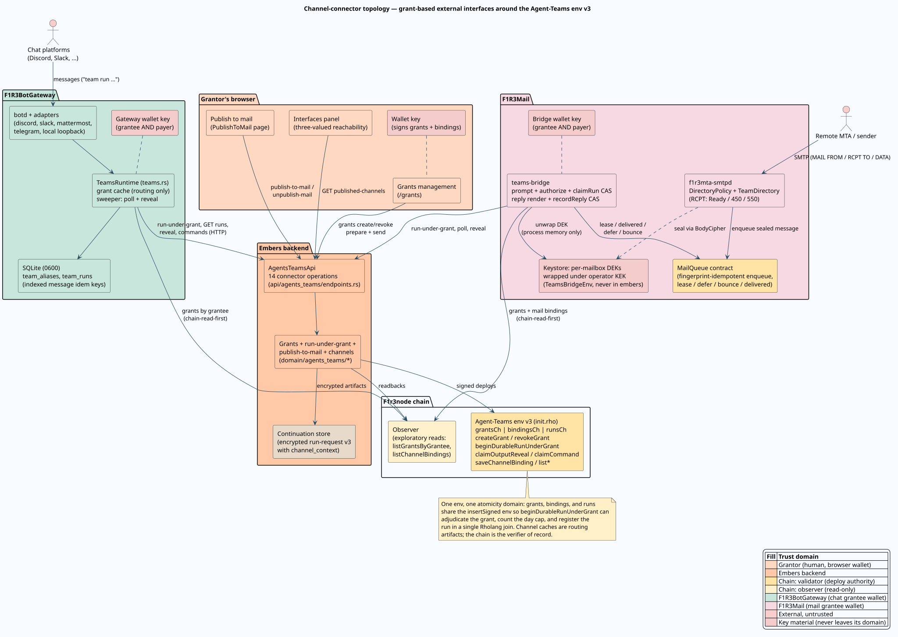

# Channel-grant trust model

This document is the adversarial view of the channel-connector layer: which party
holds which authority when a chat gateway or a mail bridge starts team runs under
a user's grant, what an attacker in each position can and cannot reach, and the
mail channel's specific exposure before sender authentication lands. It extends
the platform [threat model](threat-model.md) (assets, boundaries, and the
pre-connector threat table) and the
[object-capability model](capability-model.md) (mechanism classification); the
constructive specification it analyzes is
[channel grants](../architecture/channel-grants.md), with the surrounding
architecture in [external interfaces](../architecture/external-interfaces.md).
Terms (`channel`, `principal`, `grantor`, `grantee`, `binding`,
`chain-read-first`) carry their definitions from those documents.

## The trust split, stated once

| Party | Holds | Explicitly does not hold |
| --- | --- | --- |
| Grantor (human) | Run ownership (every granted run registers `owner = grantor`); owner reveal; every command class; grant creation and revocation | The channel's wallet; any way to spend the channel's funds beyond the cap |
| Channel service (grantee) | An ordinary funded wallet; delivery authority while the grant stands: initiate-within-caps, reveal when `authority.reveal`, the delegated command classes | The grantor's key; run ownership; reveal or command on anything after revocation; any authority over runs not initiated under its own grant |
| Embers backend | The two-phase HTTP surface; the encrypted artifact store; fail-fast advisory checks | Grant adjudication (the chain's), mailbox content keys (the bridge's), principal verification (the channel's) |
| Chain (agents-teams env v3) | The adjudication of record: signer, revocation, team, caps, reveal/command authority, all at claim time in one atomic join | Any sight of channel-native identity — it cannot see who typed a message |

Three consequences worth holding onto:

- **Grantor-owned runs.** The channel wallet signing and paying a deploy does
  not make it the owner; `beginDurableRunUnderGrant` registers the grantor. A
  compromised channel can burn its own funds and the grantor's daily cap; it
  cannot take over the grantor's runs, reveal runs from other grants, or touch
  runs after revocation.
- **Revocation cuts disclosure, not compute.** In-flight runs complete for their
  owner; the grantee's reveal and command claims fail from the instant of
  revocation, checked at claim time on chain. A channel holding a stale cache
  loses one failed paid deploy, never a wrong authorization.
- **Channel wallets are ordinary wallets — never `EMBERS__…__SERVICE_KEY`.** The
  [capability model](capability-model.md#service-key-concentration-and-the-confused-deputy)
  names the service key's concentration; the connector layer deliberately adds
  no new holder of it. A channel wallet's compromise radius is the grants that
  name it plus its own balance, and every one of those grants is individually
  revocable by its grantor.

## Principal spoofing is channel-side by design

The chain adjudicates *wallet* identities; the human on the far side of a channel
has none. Whoever convinces the channel service that a message came from
principal $`P`$ gets the use of $`P`$'s grant — the chain cannot check this, so
the check lives where the information lives:

- **Chat**: the gateway derives the principal itself
  (`custody::author_hash(identity_key)`) from the platform's authenticated
  session. Spoofing chat principals means compromising the platform or the
  gateway — the same trust the platform's own authentication carries.
  Workspace-scoping (Discord/Slack/Mattermost) means the same person in another
  workspace is another principal; Telegram identities are platform-global.
  `team whoami` prints the principal so grants are authored against the right
  string.
- **Mail**: the principal is the `MAIL FROM` address, and before SPF/DKIM/DMARC
  enforcement that is an assertion, not a fact. This is the layer's one open
  spoofing surface and gets its own analysis below.

Embers' `grant_principal_mismatch` check at prepare is the fail-fast half of the
channel's duty, not a substitute for it: embers string-matches what the channel
asserts.

## The mail-specific analysis: what a spoofed sender can and cannot do

Assume the pre-Phase-4 worst case: an attacker delivers a message into the
bridge's MailQueue with a forged `MAIL FROM` naming a victim principal who holds
a live mail grant.

**What the attacker cannot get: the output.** The reply path routes to the
*real* principal's mailbox, not to the transport peer: the bridge renders the
run's answer, seals it under the **victim's** mailbox key material and reply
path, and enqueues it for the grant's recorded principal. The attacker triggered
a run whose answer lands, encrypted, where the victim reads mail. There is no
reflection channel: reveal authority is the bridge's (grantee) and the owner's,
and the bridge only ever delivers to the principal on the grant. Output
exfiltration through sender spoofing is therefore structurally absent — not
because the forgery is detected, but because disclosure never follows the
forgeable field.

**What the attacker does get, and why it still matters:**

1. **Cap and fund burning.** Each forged message consumes a unit of the victim's
   `max_runs_per_day` and a deploy's phlo from the bridge wallet — a denial and
   cost lever.
2. **Victim-attributed side effects.** The run executes with the attacker's
   text as its prompt, under a grant the victim signed. A team whose workflow
   performs external effects (posts, notifications, downstream calls) performs
   them on a forged trigger attributed to the victim. This is a
   confused-deputy shape (Hardy,
   [doi:10.1145/54289.871709](https://doi.org/10.1145/54289.871709)): the bridge
   is the deputy, the forged sender field the confused designation.

**The layered mitigations, all as-built:**

- **Closed-federation default.** `BRIDGE__SENDER_POLICY=local-only` restricts
  grant-triggering senders to those the relay policy already admits;
  `allowlist` narrows further; `open` is available and announces its widened
  surface at startup. Pre-authentication, the trust perimeter is the
  federation's own submission path.
- **Bridge MAC for self-authentication.** Agent-to-agent chains inside the
  federation carry `X-F1R3-Bridge-MAC` (HMAC under the operator KEK over the
  message fingerprint), closing intra-federation spoofing of *team* principals
  — a team's own mail cannot be forged by another federation tenant.
- **Per-grant subject token.** A grant created with `require_token` mints a
  32-byte CSPRNG bearer token whose plaintext is shown **exactly once** in the
  prepare response; the chain stores only its blake2b-256 digest
  (`require_token_hash`). The channel demands the plaintext accompany the
  subject's messages and verifies by digest — possession, not sender-field,
  becomes the trigger authority. Loss is handled by revoke-and-regrant, the
  API-key discipline.
- **`min_auth`, recorded now, enforced when the verdicts exist.** The grant
  schema carries `none | spf | dkim | dmarc` today, and the MailQueue already
  records per-message `AuthResults` (spf, dkim, dmarc, remote IP, HELO, TLS) at
  enqueue. When F1R3Mail's authentication phase lands real verifiers
  ([RFC 7208 SPF, doi:10.17487/RFC7208](https://doi.org/10.17487/RFC7208);
  [RFC 6376 DKIM, doi:10.17487/RFC6376](https://doi.org/10.17487/RFC6376);
  [RFC 7489 DMARC, doi:10.17487/RFC7489](https://doi.org/10.17487/RFC7489)),
  the bridge refuses to authorize a message whose chain-recorded verdicts fall
  below the grant's floor — no grant migration needed, because the field was in
  the schema from day one.
- **Loop and backscatter guards** bound the abuse a forged trigger can start:
  null-sender refusal (bounces never trigger runs), `Auto-Submitted` handling
  per [RFC 3834](https://doi.org/10.17487/RFC3834), the `X-F1R3-Hops` ceiling,
  and the no-grant case answering with a *consumed* onboarding notice rather
  than a bounce (a third failure class — never backscatter to a forged sender,
  the classic joe-job amplifier).

## Bearer and secret inventory added by the layer

| Artifact | Class | Where it lives | Exposure discipline |
| --- | --- | --- | --- |
| Grant record | Public identity-list authority | Chain (agents-teams env) | Public by design; contains no secret. |
| `require_token` plaintext | Bearer token | Shown once in one prepare response; wherever the subject keeps it | Never stored by embers; chain holds the digest only; revoke-and-regrant on loss. |
| Run id of a granted run | Bearer read capability | Channel store (gateway SQLite mode 0600; bridge run ledger), backlinks in delivered replies | Same discipline as every run link: metadata-only read; `listRuns` scrubs `grant_id` so public enumeration cannot link runs to grantors. |
| Gateway / bridge wallet key | Signature identity | Channel service configuration (`EMBERS_WALLET_KEY_HEX`, `BRIDGE__WALLET_KEY`) | Ordinary funded wallet; never the embers service key; compromise radius = grants naming it + its balance. |
| Mailbox DEKs | Keyed content encryption | Minted by the bridge, wrapped under the operator KEK, stored wrapped on chain (TeamsBridgeEnv); unwrapped only in bridge memory | Never held by embers — an embers-held DEK would let embers read third-party mail; destroying the wrapped key is the crypto-shredding erasure. |

## Threat table

In the style of the [threat model](threat-model.md#threat-analysis); these rows
extend that table for the connector layer.

| Threat | Attack | Implemented control | Residual control |
| --- | --- | --- | --- |
| Channel-service compromise | Attacker controls the gateway or bridge wallet and process | Grants bound the blast radius: initiate-within-caps, reveal, listed commands, only for grants naming that wallet; runs stay grantor-owned; every grant individually revocable; channel wallets are never the service key | Per-grantor monitoring of `runs_today` burn; operational wallet-rotation runbook. |
| Stale grant cache races revocation | Channel routes on a cached grant the grantor just revoked | The chain re-adjudicates inside the atomic join at deploy time; staleness costs one failed paid deploy, never a wrong authorization; caches evict on refusal | Shorten refresh intervals where revocation latency matters. |
| Grant forgery or scope creep | Create a grant binding someone else, or widen one after signing | The grantor is derived from the creating deploy's signer, never a parameter; re-creation with any differing field aborts (`grant identity conflict`); the delegable command vocabulary excludes `timerFired` and `migrate` at prepare and the clause checks the recorded list at claim | None needed — the record is immutable except for the `revoked` flag. |
| Chat principal spoofing | Impersonate a workspace member to the gateway | The principal is the gateway's own author hash over the platform's authenticated identity; raw platform IDs never leave the process; workspace scoping partitions identities | Platform-side account compromise remains the platform's authentication problem. |
| Mail sender spoofing (pre-auth) | Forged `MAIL FROM` names a granted principal | No output exfiltration by construction (replies route to the real principal's sealed mailbox); closed-federation sender policy; bridge MAC for team principals; optional `require_token`; loop/backscatter guards | `min_auth` enforcement against chain-recorded `AuthResults` when SPF/DKIM/DMARC verifiers land; until then, `local-only` is the shipped default. |
| Intent laundering through a grant | A bystander approves or rejects another person's chat run | Initiator-only command policy in the gateway (the grant being exercised is the initiator's); deterministic per-message `decision_id` blocks decision replay | Wait-level delegated-approver ACL is the sanctioned second-user path, deciding with their own wallet in the embers UI. |
| Grantor de-anonymization via the grant link | Join public runs to public grants through `grant_id` | `listRuns` scrubs `owner` and `grant_id`; `getRun` keeps `grant_id` only behind the capability-gated read; the reveal event carries no actor | Treat run URLs with the established bearer-link discipline. |
| Cap-window abuse | Push burst traffic across a UTC midnight | Documented up-to-2x boundary property; the cap is an abuse throttle, not an invariant; channel-side rate buckets and concurrency caps sit in front | Grantors size `max_runs_per_day` to half the tolerable daily worst case where the boundary matters. |
| Payer starvation | Drain the channel wallet through granted runs | The channel's own admission control (spend tracker, per-channel concurrency, rate buckets) throttles; `deploy_unfunded` (HTTP 402) names the condition distinctly so operators top up rather than debug | Spend settlement against observed deploy costs; vault floor alerts. |
| Token disclosure | The one-time `require_token` plaintext leaks | Chain stores only the blake2b-256 digest; embers never stores the plaintext; presentation is channel-side | Revoke-and-regrant rotates it; the token authorizes only what the grant already scoped. |
| Mailbox key exfiltration via embers | Read team mail through the platform | Structural: embers never holds mailbox DEKs; bindings carry no key material; the keystore split is enforced by placement (bridge env, operator KEK) | KEK custody and rotation are bridge-operator duties. |

## What this layer deliberately does not defend

- **A malicious grantor.** A grantor who signs a grant for a team that does
  harmful work has authorized it; the layer attributes, caps, and revokes — it
  does not judge workflows.
- **Channel-platform compromise.** The gateway trusts the chat platform's
  session authentication; a platform that lies about message authorship defeats
  chat principal binding. That trust is explicit and per-platform.
- **Traffic analysis of public records.** Grant records are public authorization
  facts by design; that a grantor delegated *some* team to *some* channel wallet
  is visible on chain. The anonymity rule protects the run-to-grantor link, not
  the grant's own existence.
