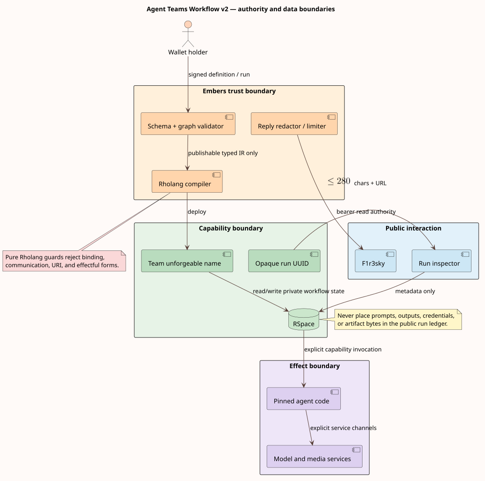

# Security and privacy model

This threat model covers Workflow Definition v2 authoring, compilation, RSpace execution, external activities, F1r3sky invocation, and the run inspector. It assumes cryptographic wallet operations and F1r3node consensus behave according to their own specifications. It does not treat an LLM as trusted.



## Assets

The protected assets are wallet signing authority, deployed team capabilities, agent source, private prompts and outputs, external-service credentials, artifact contents, workflow state and continuations, approval authority, execution budgets, and audit integrity.

Run metadata is intentionally less sensitive but still link-confidential: an opaque run URL reveals team URI, time, status, and event types to its bearer.

## Authorities

| Authority                      | Holder                                             | Permitted operation                                      | Must not imply                                           |
| ------------------------------ | -------------------------------------------------- | -------------------------------------------------------- | -------------------------------------------------------- |
| Wallet private key             | F1r3sky/Embers wallet session                      | Sign a prepared run or command contract                  | Read private artifacts or impersonate the Embers service |
| Embers service key             | One configured Embers service                      | Advance/recover runs and submit scheduled timer commands | Act as a run owner or delegated approver                 |
| Deployed team unforgeable name | Authorized Rholang processes                       | Invoke one team contract                                 | Registry-wide access                                     |
| Agent/effect return channel    | One activity invocation                            | Return one observation                                   | Invoke sibling activities                                |
| RSpace environment capability  | Embers templates                                   | Persist team/run records                                 | Publish private payloads                                 |
| Run UUIDv7                     | Link bearer                                        | Read one metadata record                                 | Resume, approve, cancel, or read artifacts               |
| Artifact derivation secret     | Embers continuation store                          | Derive one object path and authenticated-data binding    | Become public through a content/capability hash          |
| Approval grant                 | Designated approver address plus one exact wait ID | Approve or reject that wait                              | Signal, cancel, migrate, or decide another wait          |

This follows least privilege: every component receives the smallest authority needed for one role. The classic formulation is Saltzer and Schroeder, “The Protection of Information in Computer Systems,” _Proceedings of the IEEE_ 63(9), 1975, [doi:10.1109/PROC.1975.9939](https://doi.org/10.1109/PROC.1975.9939).

## Trust boundaries

1. **Browser to Embers API.** Definitions and run requests are untrusted until schema validation and signature checks succeed.
2. **Typed definition to compiler.** Only the closed, validated Rust representation reaches Rholang lowering. Raw canvas labels never become code without escaping.
3. **Control kernel to agent/effect.** The activity may be nondeterministic, adversarial, unavailable, expensive, or prompt-injected. Its output is an observation to validate and route.
4. **Private execution to public F1r3sky.** Only intended terminal text plus the run link may cross. Metadata and text limits are enforced server-side.
5. **Run link to ledger.** The UUID is a bearer capability. It is unguessable but transferable and may appear in browser history, screenshots, or referrers.
6. **Embers to F1r3drive.** Plaintext exists only inside the Embers process. AES-256-GCM ciphertext is flushed to a mount owned by the service; RSpace receives hashes, never encryption keys or derived capabilities.
7. **Parent to nested team.** The parent pins a child team URI and definition hash, passes one portable value, and receives one signed observation. Child waits are exposed only as path-qualified identities.
8. **Current runtime to future FLT adapters.** Foreign-language execution must not inherit ambient RSpace, filesystem, network, or wallet authority.

## Threat analysis

| Threat                               | Attack                                                                       | Implemented control                                                                                                                                                   | Residual control                                                                                              |
| ------------------------------------ | ---------------------------------------------------------------------------- | --------------------------------------------------------------------------------------------------------------------------------------------------------------------- | ------------------------------------------------------------------------------------------------------------- |
| Code injection through labels or IDs | Insert quotes, Rholang syntax, or URI delimiters                             | Rholang strings are escaped; URI literals reject unsafe delimiters; typed schema separates identity and presentation                                                  | Fuzz every rendering boundary with arbitrary Unicode.                                                         |
| Effectful guard                      | Hide sends, receives, fresh names, registry lookup, or output in a predicate | Total condition AST plus a bounded pure-Rholang subset; only declared paths are supplied                                                                              | Replace the lexical Rholang subset with a typed pure-term parser when the language specification supports it. |
| Infinite hot cycle                   | Create a subcycle that bypasses a visible bound                              | Exact residual-graph strongly connected component proof in frontend and backend                                                                                       | Add independent phlo, token-count, wall-clock, and spend budgets.                                             |
| Counter interference                 | Let one branch or run consume another’s loop budget                          | Counters travel with tokens; join keys include correlation/fork epochs                                                                                                | Define an explicit state-merge type for future shared mutable state.                                          |
| Join confusion                       | Mix arrivals from overlapping loop generations                               | Root, route-group, and value-key correlations are namespaced by fresh epoch stacks                                                                                    | Surface epochs in private traces for diagnosis.                                                               |
| Prompt or output disclosure          | Put execution payload in public RSpace                                       | Requests, continuations, outboxes, observations, commands, and outputs are AES-GCM encrypted in F1r3drive; RSpace stores only hashes and metadata                     | Add independently revocable artifact presentation capabilities when private payload viewing is exposed.       |
| Torn private/public commit           | Publish a ledger pointer before ciphertext is recoverable                    | Exclusive-create write, authenticated read-back, F1r3drive `fsync` finality, then signed ledger advancement and exact observer acknowledgement                        | Replicate the service key and scheduler with an operational failover policy.                                  |
| Run enumeration                      | Guess or scrape identifiers                                                  | UUIDv7 retains random bits and the endpoint exposes no global list                                                                                                    | Add authenticated/private inspectors and a strict referrer policy for sensitive deployments.                  |
| Capability confusion                 | Treat a public hash as artifact authority                                    | Derived HMAC capability never leaves the store; ledger capability hash is only a commitment; AES-GCM associated data binds kind/run/object/hash                       | Rotate encryption and derivation keys through an explicit re-encryption migration.                            |
| Oversized social post                | Cause API rejection or UI abuse                                              | Server reserves the run URL, truncates by Unicode scalar value, and verifies the final 280-character bound                                                            | Adopt grapheme-aware counting if the product contract changes.                                                |
| Malicious effect output              | Return a huge, malformed, or disposition-spoofed value                       | Typed envelope, content hash, signature, maximum output bytes, and portable JSON conversion                                                                           | Add per-activity portable output schemas and structural depth limits.                                         |
| Duplicate effect on retry            | Invoke a paid or irreversible effect twice                                   | Stable effect key, encrypted signed outbox, cached signed observation, and exactly-once-visible kernel transition                                                     | External providers must honor the effect key when physical de-duplication is required.                        |
| Approval forgery                     | Resume without the required authority                                        | Signed claim contract; owner/service authorization; delegated approval restricted to `waitId\|address`; encrypted command cross-checked against public class and wait | Add revocation/expiry for long-lived delegated approval grants.                                               |
| Stale or replayed command            | Apply a command to the wrong revision or wait                                | Compare-and-set expected revision, one public command slot, content/capability commitments, exact post-finality read, and wait identity validation                    | Retain rejected claim telemetry without public payload leakage.                                               |
| Audit omission or reordering         | Hide a rejected command or place approval before its claim                   | Hash-verified continuation identity plus order-preserving merge with the append-only RSpace event sequence; contiguous canonical numbering                            | Export signed audit receipts when third-party verification is introduced.                                     |
| Version drift                        | Resume a child or root against latest                                        | Continuations pin team URI and definition hash; nested manifests are revalidated; migration names both hashes and applies typed patches                               | Add static migration compatibility and signed migration manifests.                                            |
| Nested wait confusion                | Route a signal to a same-named sibling wait                                  | Recursive `nested:<execution-id>:<wait-id>` qualification and per-execution effect keys                                                                               | Bound serialized path length in addition to the depth cap.                                                    |
| FLT supply-chain attack              | Load mutable or malicious guest code                                         | FLTs are rejected at execution; schema already requires pinned language/artifact hashes, ABI, authorities, and budgets                                                | Activate only after the under-review FLT FIPS and bridge FIPS stabilize and the sandbox is verified.          |
| Resource exhaustion                  | Fan-out or large state consumes execution tokens or memory                   | Cost-accounted communication, positive loop bounds, 64 MiB artifact default, activity output limits, retry caps, and nested depth 32                                  | Add static fan-out estimates and run-wide budget vectors.                                                     |
| Stale-configuration restoration      | Re-enter a remembering scope so history restores a configuration that predates a policy or definition change, or restores a retired output position | History is keyed by the definition scope, captured only at completion, and restorable only onto that scope's own remembered or initial nodes; runs pin their definition hash, so a migration is the only way semantics change under a live run | Route retired branches into `final` nodes so captured sets name resting positions; the multi-target history-node accounting gap is a tracked known gap ([roadmap](../roadmap.md)). |
| Cancellation-teardown assumption     | Rely on scope exit activities firing during cancellation to release resources or revoke access | Cancellation abandons scope instances by design and never runs their exit activities; recorded compensations execute in strict reverse completion order, are never retried, and a failed compensation halts loudly rather than skipping | Attach resource release to compensation records, never to exit activities; exit activities run only on normal completion ([statechart semantics](../theory/statechart-semantics.md#retry-and-structured-cancellation)). |
| Epoch forgery or quorum starvation   | Forge a correlation epoch to smuggle an arrival into another generation's join, or withhold arrivals to starve a quorum | Epochs are minted kernel-side as SHA-256 over run, parent epoch, group, and generation — never client-supplied; a duplicate arrival per open epoch is an error; quorum and race joins close per epoch and honor explicit late policies | Quorum liveness still depends on producers: pair quorum joins with a timer race for deadline pressure; a `cancel` late policy hands any authorized late producer a run-cancellation lever — prefer `discard` unless cancellation is intended. |
| Approval stalling past its deadline  | An absent or adversarial approver stalls a run beyond its intended approval deadline | The deadline from the node timeout policy is recorded on the wait and published as the run's `dueAt` | Current behavior: the timer-recovery scan fires only timer and retry waits, so no `timedOut` disposition fires for approvals and the scan reports errors until the approval resolves ([roadmap known gap](../roadmap.md)); model the deadline today as an explicit approval-versus-timer race, and add grant revocation/expiry when delegated approvals are long-lived. |

## Pure guard boundary

A guard must be total and must not acquire authority. The present validator rejects communication punctuation, URI literals, and binding/effect tokens such as `new`, `for`, `contract`, `bundle`, `match`, `stdout`, and `registry`. It then substitutes only declared portable paths.

This is a useful hard boundary, but it is lexical rather than a proof over a parsed Rholang term. Avoid expanding the accepted source language by adding exceptions. The preferred evolution is a first-class pure condition AST with a compiler to Rholang, plus an optional verified pure-Rholang parser mode.

## Public reply policy

Terminal text is treated as intentionally public because it is posted into F1r3sky. The formatter:

1. derives text or an image embed from the team result;
2. constructs the configured Embers `/runs/{runId}` URL;
3. reserves the URL suffix before truncation;
4. truncates the result by Unicode scalar values and appends an ellipsis;
5. asserts by construction that the combined text is no more than 280 characters.

An image-only result still receives textual run identification. A configuration with an unreasonable base URL falls back to the shorter relative run path so the bound remains invariant.

## Metadata ledger policy

Allowed fields:

- opaque run ID;
- deployed Agent Team URI;
- creation timestamp;
- coarse status;
- monotonically sequenced event type names.

Forbidden fields:

- prompts, model output, intermediate values, or continuation state;
- wallet secrets, service tokens, or raw unforgeable-name encodings;
- artifact bytes or public decryption material;
- approval comments or personally identifying event payloads.

The owner wallet address may be stored internally to authorize writes but is removed by the read contract.

The inspector's canonical sequence is not trusted from either storage surface alone. It verifies and decrypts the exact checkpoint continuation, validates its run/team/definition identity, and merges its public kernel events with the RSpace coordination sequence while preserving both relative orders. Repeated command event names align to the rightmost compatible occurrence, which prevents a rejected attempt from being confused with the later successful claim.

## Implemented encrypted artifact envelope

The continuation store derives an object capability with HMAC-SHA-256 ([FIPS 198-1](https://doi.org/10.6028/NIST.FIPS.198-1)) over artifact kind, run ID, and object ID. It encrypts JSON with AES-256-GCM ([NIST SP 800-38D](https://doi.org/10.6028/NIST.SP.800-38D)) and binds the same identities plus the capability hash as additional authenticated data (AAD). The ciphertext format is:

```text
EncryptedObject = Magic("EMBERS-CONT-V1") || Nonce(96 bits) || AES-256-GCM(plaintext, AAD)
AAD = Protocol || Kind || RunId || ObjectId || SHA-256(DerivedCapability)
```

An `ArtifactPointer` contains schema version, kind, run/object identities, ciphertext content hash, capability hash, and byte length. It deliberately omits the derived capability and encryption key. Knowing a content hash, capability hash, or run URL does not authorize a read; only the configured Embers store can rederive and decrypt the object.

Files are created with exclusive-create semantics and private permissions. `fsync` crosses the F1r3drive finality boundary before a pointer is submitted to RSpace. An existing identity is accepted only when authenticated decryption yields byte-identical plaintext; otherwise the store reports an idempotency conflict.

## Security verification checklist

- Publish rejects unknown references, unpinned agents, incoherent groups, invalid joins, and hot cycles.
- Every string-to-Rholang boundary has an escaping or URI validation function.
- Pure guards cannot communicate or bind names.
- Run start and finish updates acknowledge persistence before work/result forwarding.
- F1r3drive flush completes before any corresponding ledger revision is published.
- Ledger transitions are accepted only after an observer returns the exact expected revision, hashes, waits, grants, output pointer, command clearing, and event.
- Inspector hydration rejects missing, hash-mismatched, capability-mismatched, or identity-mismatched continuations and preserves both durable and ledger event order.
- Every effect dispatch has a durable outbox; every applied result has a signed, hash-verified observation.
- Every command is signed, revision-fenced, and authorized by owner/service or one exact delegated approval grant.
- Nested waits remain path-qualified through arbitrary nesting up to the configured depth limit.
- Public records contain metadata only.
- Terminal replies retain the run link within the 280-character limit.
- Local-stack startup does not implicitly delete data; reset is explicit and confirmed.
- Protected repositories remain unchanged; required runtime evolution goes through FIPS.
