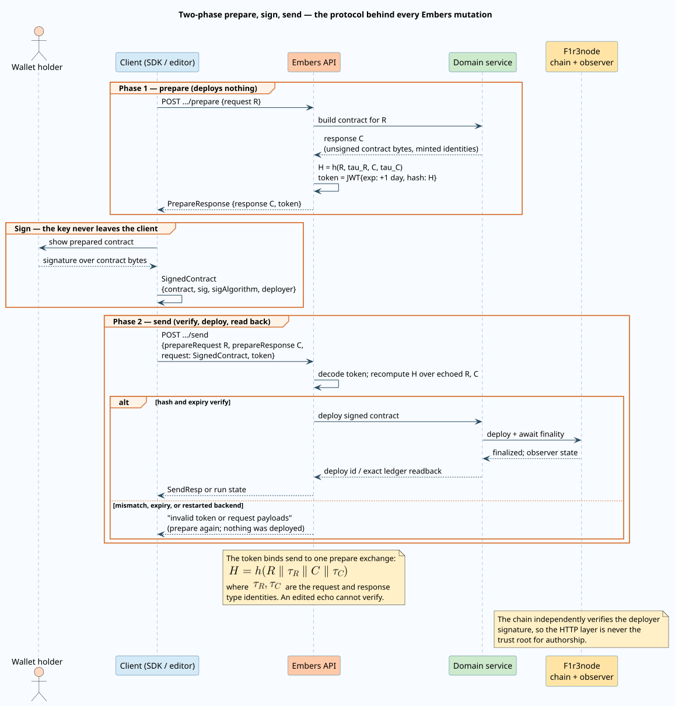

# HTTP API and OpenAPI surface

This document specifies the HTTP surface through which every Agent Teams operation reaches the Embers backend: the served OpenAPI description and its Swagger UI, the universal two-phase prepare, sign, send protocol that authenticates every mutation, the complete `/ai-agents-teams` endpoint reference, and the disciplined chain from the served specification to the generated TypeScript SDK. The portable workflow document itself is specified in [Workflow Definition v2](workflow-definition-v2.md); this document covers how such documents and their runs move over HTTP.

Code anchors reference the Embers backend repository (`packages/embers/src/`) and the client SDK package (`packages/client/`). Normative words such as **must** and **may** describe protocol behavior.

## Terms

Every term is defined before it is used elsewhere in this document.

| Term | Definition |
| --- | --- |
| Prepare | The first phase of a mutation: the client posts intent, and the server computes the exact contract that would realize it, without deploying anything. |
| Prepared contract | The Rholang contract bytes produced by prepare, returned base64-encoded, still unsigned and therefore inert. |
| Signed contract | The structure `{contract, sig, sigAlgorithm, deployer}` (`api/common.rs:409-417`): the prepared bytes plus the client wallet's signature and public key. Only a signed contract can be deployed. |
| Token | A compact JSON Web Token ([RFC 7519](https://doi.org/10.17487/RFC7519)) issued by prepare and echoed to send. It binds the send call to one specific prepare exchange (see the protocol section for the exact claim). |
| Send | The second phase: the client posts the signed contract together with the byte-identical prepare request, prepare response, and token; the server verifies the binding and deploys. |
| Deploy identifier | The chain deploy hash returned by fire-and-forget sends as `SendResp {deployId}` (`api/common.rs:449-452`). |
| Observer readback | For run and command sends, the response is not a deploy identifier but the run's ledger state read back from the chain observer after finality, so the client sees the exact post-state it acted on. |
| Run capability | The UUIDv7 ([RFC 9562](https://doi.org/10.17487/RFC9562)) run identifier. Possession of the run URL is the read authority for that run's metadata ledger; it grants no command authority. |
| Specification snapshot | The checked-in copy of the served OpenAPI description at `packages/client/schema.json`, the sole input of SDK generation. |
| Generator | The pinned `openapi-generator-cli` release that turns the snapshot into the TypeScript SDK. |

## The served surface

The backend composes one OpenAPI 3.0 service titled `Embers API`, version `0.1.0`, from six API modules and mounts it under the `/api` prefix (`main.rs:278-290`):

| Module | Concern |
| --- | --- |
| `ServiceApi` | Service health and metadata. |
| `TestnetApi` | Test-network faucet and conveniences. |
| `WalletsApi` | Wallet balances, transfers, and history. |
| `AgentsApi` | Individual agent lifecycle. |
| `AgentsTeamsApi` | Agent Teams: definitions, deployment, runs, commands, publication. |
| `OslfsApi` | OSLF document operations. |

Three sibling routes expose the description itself (`main.rs:292-300`):

| Route | Content |
| --- | --- |
| `/swagger-ui/index.html` | Interactive Swagger UI over the live specification; every endpoint can be exercised from the browser. |
| `/swagger-ui/openapi.json` | The specification as JSON — the document the snapshot mirrors. |
| `/swagger-ui/openapi.yaml` | The same specification as YAML. |

To browse it locally, start the local stack (see [the operator guide](../usage/editor-and-operations.md#start-the-local-stack-safely)) and open `/swagger-ui/index.html` on the local Embers service (the default local base is `http://localhost:8080`). Interactive exploration is read-safe; mutations attempted from the UI still require the full signing protocol below, which the UI cannot perform because it holds no wallet key.

## The two-phase prepare, sign, send protocol

Every mutation in the Embers API — creating, saving, deploying, running, commanding, publishing — follows one protocol whose purpose is a single invariant: **the wallet key never leaves the client, and the server only deploys bytes the client has seen and signed.**



The steps, with their exact mechanics (`api/common.rs:469-587`):

1. **Prepare.** The client posts the intent body `R` (for example `RunReq`). The domain service builds the response `C` containing the prepared contract bytes and any identities the operation mints (such as a fresh run capability). The server hashes the request and response — the hash `H` is a 64-bit digest over the byte-serialized pair and their type identities,

   ```math
   H \;=\; h\bigl(R,\ \tau_R,\ C,\ \tau_C\bigr)
   ```

   where $`\tau_R`$ and $`\tau_C`$ are the compile-time type identifiers of the request and response types (`api/common.rs:492-497`) — and issues the token: a JWT whose claims are exactly `{exp, hash}` with $`\mathrm{exp}`$ one day after issuance (`api/common.rs:462-466`, `:499-505`). The reply is `PrepareResponse {response, token}`.

2. **Sign.** The client verifies the prepared contract is what it intends, then signs the contract bytes with the wallet's private key, locally. Nothing secret is transmitted; the resulting `SignedContract` carries the signature, its algorithm name, and the deployer public key.

3. **Send.** The client posts `SendRequestBody {prepareRequest, prepareResponse, request, token}` — the prepare request and prepare response echoed back unchanged, the signed contract, and the token. Before the handler runs, the extractor decodes the token and recomputes $`H`$ over the echoed pair; any divergence — an edited field, a swapped response, an expired or foreign token — rejects the call with `invalid token or request payloads` before any domain logic executes (`api/common.rs:550-586`). The domain service then deploys the signed contract to F1r3node, awaits finality, and answers with either the deploy identifier or the observer readback of the resulting state.

Properties worth relying on, and their limits:

- **Signing locality.** The private key is used only inside the client; the server sees the public key and signature. The chain independently verifies the signature at deploy time, so the HTTP layer is not the trust root for authorship.
- **Exchange binding.** The token's hash covers the prepare request and prepare response. The signed contract is bound transitively: it must verify against the deployer signature over exactly the prepared bytes the response carried.
- **Expiry and process scope.** Tokens expire after one day, and the signing secret is a random per-process value generated at startup (`main.rs:276`), so a backend restart invalidates outstanding prepare exchanges. Clients recover by preparing again; nothing durable is lost, because prepare deploys nothing.
- **One asymmetry.** The delete flow predates the token discipline: its prepare returns the contract directly and its send accepts the signed contract alone, without the echoed exchange (`endpoints.rs:291-310`). The deletion contract is still signature-verified on chain; what the flow lacks is only the parity check that the other mutations perform at the HTTP boundary.

## Agent Teams endpoint reference

All paths are relative to `/api/ai-agents-teams` (`endpoints.rs:44`). `address` is a wallet address; `id` names a team; `version` selects a stored team version; `run_id` is a run capability. Request and response names are the OpenAPI model names, which the generated SDK mirrors one-to-one. Anchors are into `api/agents_teams/endpoints.rs`.

| Method and path | Request | Response | Purpose | Anchor |
| --- | --- | --- | --- | --- |
| `GET /{address}` | — | `AgentsTeams` | List the wallet's teams (latest versions). | `:46` |
| `GET /{address}/{id}/versions` | — | `AgentsTeams` or 404 | List every stored version of one team. | `:56` |
| `GET /{address}/{id}/versions/{version}` | — | `AgentsTeam` or 404 | Fetch one team version, including its workflow definition. | `:66` |
| `POST /create/prepare` | `CreateAgentsTeamReq` | `PrepareResponse<CreateAgentsTeamResp>` | Prepare the contract that records a new team. | `:77` |
| `POST /create/send` | `SendRequestBody<SignedContract, CreateAgentsTeamReq, CreateAgentsTeamResp>` | `SendResp` | Deploy the signed creation. | `:94` |
| `POST /deploy/prepare` | `DeployAgentsTeamReq` | `PrepareResponse<DeployAgentsTeamResp>` | Validate the definition strictly and prepare the compiled team deployment. | `:106` |
| `POST /deploy/send` | `SendRequestBody<DeploySignedAgentsTeamReq, DeployAgentsTeamReq, DeployAgentsTeamResp>` | `SendResp` | Deploy the signed compiled team. | `:124` |
| `POST /run/prepare` | `RunReq` | `PrepareResponse<RunResp>` | Prepare an invocation; the response mints the UUIDv7 run capability. | `:140` |
| `POST /run/send` | `SendRequestBody<SignedContract, RunReq, RunResp>` | run-state JSON | Deploy the signed invocation and read back the run ledger after finality. | `:157` |
| `POST /run-on-firesky/prepare` | `RunReq` | `PrepareResponse<RunResp>` | Prepare an invocation that will also answer a F1r3sky thread. | `:174` |
| `POST /run-on-firesky/send` | `SendRequestBody<DeploySignedRunOnFireskyReq, RunReq, RunResp>` | empty | Deploy the signed invocation; the terminal reply is posted socially. | `:191` |
| `GET /runs/{run_id}` | — | `RunState` or 404 | Capability-scoped run inspection: status, revision, waits, grants, event types. | `:213` |
| `POST /runs/{run_id}/commands/prepare` | `RunCommandReq` | `PrepareResponse<RunCommandResp>` | Prepare an authenticated run command (signal, event, approve, reject, retry, cancel, timerFired, migrate). | `:222` |
| `POST /runs/{run_id}/commands/send` | `SendRequestBody<SignedContract, RunCommandReq, RunCommandResp>` | run-state JSON | Deploy the signed command and read back the mutated ledger. | `:243` |
| `POST /{id}/save/prepare` | `SaveAgentsTeamReq` | `PrepareResponse<SaveAgentsTeamResp>` | Prepare a draft save (permissive validation). | `:262` |
| `POST /{id}/save/send` | `SendRequestBody<SignedContract, SaveAgentsTeamReq, SaveAgentsTeamResp>` | `SendResp` | Deploy the signed save. | `:280` |
| `POST /{id}/delete/prepare` | — | `DeleteAgentsTeamResp` | Prepare the deletion contract (see the delete asymmetry above). | `:291` |
| `POST /{id}/delete/send` | `SignedContract` | `SendResp` | Deploy the signed deletion. | `:301` |
| `GET /{address}/referencing/{agent_id}` | — | `ReferencingTeam[]` | Every team whose latest version uses the agent, so deletion can name what it would break. | `:314` |
| `POST /{address}/{id}/unpublish` | — | empty | Stop a published team answering mentions; reversible by publishing again. | `:328` |
| `GET /{address}/{id}/published` | — | `PublishedState` or 404 | The team's publication state as the chain records it, reconciled against the PDS. | `:342` |
| `POST /{address}/{id}/publish-to-firesky/prepare` | `PublishToFireskyReq` | `PrepareResponse<PublishToFireskyResp>` | Prepare the social publication. | `:352` |
| `POST /{address}/{id}/publish-to-firesky/send` | `SendRequestBody<SignedContract, PublishToFireskyReq, PublishToFireskyResp>` | `SendResp` | Deploy the signed publication. | `:373` |

## Authentication and authorization

Three distinct authorities govern the surface, and they compose rather than substitute:

- **Wallet signatures** authorize deployments. Every mutation is a chain deploy signed by the client wallet; the chain, not the HTTP service, is the verifier of record. An unsigned or badly signed contract cannot mutate anything regardless of what the HTTP layer accepts.
- **The run capability** authorizes reads. `GET /runs/{run_id}` answers to whoever holds the UUIDv7 run URL and returns execution metadata only — status, revision, public wait identifiers, grants, and event types; never prompts, outputs, credentials, or artifacts. Holding the URL grants no command authority.
- **The on-chain command ledger** authorizes commands. A signed `RunCommandReq` deploys a claim that the run ledger itself adjudicates: the run owner and the configured Embers service hold run-level authority for every command class, while delegated approvers may decide exactly the wait named in their grant. The full command model, including revision-gated optimistic concurrency, is specified in [Durable and hierarchical execution](../architecture/durable-execution.md) and its authority table in the [threat model](../security/threat-model.md).

## Error semantics

| Failure | Where it is detected | What the client sees |
| --- | --- | --- |
| Token or echo mismatch at send | Request extractor, before any domain logic (`api/common.rs:578-583`) | Request-payload error `invalid token or request payloads`; prepare again and re-sign. |
| Expired token | Same extractor (JWT $`\mathrm{exp}`$ check) | Same rejection; prepare again. Tokens live one day, and a backend restart invalidates them earlier. |
| Stale revision on a run command | The run ledger's compare-and-set at claim time | The command deploys but does not apply; the readback shows the unchanged revision and current waits. Refresh and re-issue against the observed revision. |
| Command rejected by the kernel | Command application after the claim | The readback carries the rejection (for example, a timer fire whose deadline does not equal the wait's recorded deadline, or a decision on a wait that is no longer pending). |
| Unknown team, version, or run | Domain lookup | HTTP 404. |
| Invalid definition at deploy | Strict publish validation | Deploy prepare fails with the first violated rule; the rule catalog is in [Workflow Definition v2](workflow-definition-v2.md#validation-phases). |

## The specification artifact chain

The generated SDK must always describe the API a backend actually serves. The chain that keeps this true has four links, each observable:

1. **Served specification.** The backend serves its own description at `/swagger-ui/openapi.json`; it is derived from the same Rust types that parse every request, so it cannot drift from the handlers.
2. **Snapshot.** `packages/client/schema.json` is the checked-in copy of that document, refreshed by fetching the served specification from a running backend (`curl -o … http://localhost:8080/swagger-ui/openapi.json`, per the client package README) and committed alongside the SDK it generates. Reviewing a snapshot diff is reviewing the API change.
3. **Pinned generator.** `pnpm generate-api-client` runs `openapi-generator-cli` at exactly `v7.20.0` (Docker image `openapitools/openapi-generator-cli:v7.20.0`, `packages/client/package.json`) with the `typescript-fetch` generator. The version is pinned because an unpinned generator rewrote the SDK's model surface underneath an unchanged snapshot (tracker item `pin-the-openapi-generator-used-by-the-embers-client-722166`); with the pin, the SDK is a deterministic function of the snapshot.
4. **Normalization.** `pnpm normalize-api-client` restores the hand-maintained entity re-exports (`scripts/restore-custom-model-exports.mjs`) and formats the output, so regeneration produces reviewable diffs instead of churn.

Domain-specific string formats map to hand-written entities rather than bare strings via `openapitools.json` type mappings:

| OpenAPI format | SDK type |
| --- | --- |
| `string+timestamp-millis` | `TimestampMillis` (a `Date` carrying millisecond precision) |
| `string+uint64` / `string+int64` | `UInt64` / `Int64` (`bigint`, sign-checked) |
| `string+bytes` | `Base64` |
| `string+blockchain-address` | `Address` |
| `string+public-key` | `PublicKey` |
| `string+blockchain-uri` | `Uri` (prefix- and checksum-validated) |
| `string+graphl` | `Graph` |

To regenerate after a backend change: start the local stack, fetch the served specification over the snapshot, run `pnpm generate-api-client`, and commit the snapshot and generated sources together. A clean drift check is the same procedure ending in an empty diff.

## Security notes

- **Transport.** Production deployments must terminate HTTPS in front of the service; the protocol's tokens and signed contracts do not protect against a plaintext network observer learning request contents.
- **No secrets in the description.** The served specification is structural metadata — paths, models, formats. Wallet keys exist only client-side; artifact contents are encrypted and capability-bound and never appear in this surface (see the [threat model](../security/threat-model.md) for the artifact-pointer design).
- **Abuse posture.** The service itself does not implement per-route request throttling. The protocol-level bounds are signature verification on every mutation, one-day token expiry, revision-gated command application, and capability-scoped reads; operational rate limiting is a deployment concern at the HTTPS termination point. The threat model tracks abuse cases (for example, oversized social posts) individually.

## Cross-references

- [Workflow Definition v2](workflow-definition-v2.md) — the document these endpoints carry.
- [Durable and hierarchical execution](../architecture/durable-execution.md) — the run ledger, recovery scheduler, and command authorization the run endpoints front.
- [Editor and operator guide](../usage/editor-and-operations.md) — the raw command example and local-stack instructions.
- [Conformance and verification](../engineering/conformance-and-testing.md) — the evidence row for snapshot-versus-served drift.
- [Threat model](../security/threat-model.md) — authorities, trust boundaries, and abuse cases.
