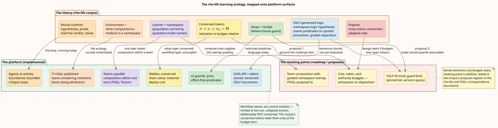

# rho-life correspondence

This theory document records the relationship between Agent Teams Workflow v2 and the
**rho-life corpus** — four companion notes and a survey deck in
`~/Workspace/f1r3fly.io/publications/rho-life/` that model *learning* as the loop the
scientific method describes, run by rho-calculus computations with a finite and conserved
token supply, in an environment made of other computations. The corpus is directly
relevant to this platform because its raw materials are the platform's raw materials:
agents executing at activity boundaries, OSLF-generated logic stored as first-class
records, workflow tokens, wallet value, and a social medium (F1r3sky) in which published
teams live among other computations. This document summarizes each note, maps its
constructs onto implementation surfaces with an implemented/roadmap/absent status, and
states the design changes the mapping motivates, in the corpus's proposal register.

**What this document claims, and what it does not.** The notes are theory: none of them
describes Embers, and nothing here claims the platform implements their models. The claim
is narrower and more useful — the notes supply the *theory of use* for surfaces the
platform already ships (OSLF documents, guards, publication into F1r3sky) and the *design
basis* for surfaces the roadmap already plans (cost, token, and authority budgets). Where
a row below says "absent", that is a statement about the platform, not a defect in either.

Companions: the [operational semantics](operational-semantics.md) owns workflow-token
semantics — whose tokens are control markers, *not* the conserved economy below; the
[TOGL correspondence](../design/togl-correspondence.md) owns the structural algebra this
document's composition section leans on; the
[capability model](../security/capability-model.md) owns authority mechanics; the
[roadmap](../roadmap.md) owns the budget item this document grounds.

## Reading guide: the framework in five sentences

A world is $`W \equiv S \mid E`$: a learner $`S`$ beside an environment $`E`$ that is
other computations, ontologically isolated, so what $`S`$ can come to know of $`E`$ is
bounded above by $`E`$'s context-labelled bisimulation class. Access comes in exactly
three grades — **perception** (structural predicates evaluated at the interaction
surface, priced by formula depth), **interaction** (context-labelled modalities
$`\langle K_j\rangle`$, costing a rendezvous per step), and **reflection** (the name
predicate $`@\varphi`$ on names already held, cheap because it crosses no surface) — and
the calculus offers no fourth. The hypothesis language is not chosen but **generated**:
feeding the rho-calculus presentation to the OSLF family yields one structural connective
per term former, one modality per rewrite rule, and a separating conjunction; names are
quoted processes, so $`n \models @\varphi \iff n = @P`$ with $`P \models \varphi`$ —
namespace logic, in which a namespace is described by a property rather than enumerated,
and freshness is manufactured by quotation with no registry. The motive is gamified by a
**conservation law**: tokens are conserved, $`\sigma + \kappa = \sigma_0 = \Theta`$
(live stacks plus the migrated record), there is no primary producer, and harvesting
another computation's stack — predation — is an ordinary receipt performed from a context
outside the encoding's image. Ecological structure then *derives* instead of being
posited: sources and prey are access profiles (persistent/non-exclusive/non-adaptive
versus linear/exclusive/adaptive), hypotheses are installed operationally as
`where`-clause guards on receipts so that **an assay is a receipt**, and refutation is
budget-relative.

## The corpus, note by note

**The Mortal Scientist** (`scientist-note.tex`) builds the framework: the cut and the
three access grades; senses as admitted structural predicates; hypotheses as
namespace-logic formulas installed as `where`-clause guards, so confirmation is a
rendezvous; the conserved-token game with foraging, metabolic channels, and predation as
the failure of internalisation to be faithful; the hypothesis space as a relaxation
lattice searched under a metered budget; and mortality — the learner's supply is finite,
so every experiment is paid for. Its access-profile table (source, prey, and their
schedules) is the vocabulary the later notes extend.

**Learning to Play** (`game-note.tex`) is the demonstration on a solved adversarial
world: noughts-and-crosses as an energy landscape (an arena that holds no stack and
merely routes; a stationary practice partner that is a *source* in the trophic sense),
with hypotheses drawn from the generated logic. Three things fall out of the mapping
rather than being put in: a move is an assay, so playing and experimenting are one act;
minimax is an alternating modal formula, so the modal asymmetry predicts attack is
learned before defence; and a fork — two threats at distinct squares — is a graded
separating conjunction at $`k = 0`$, a concept the generated logic already contains. The
world exists as runnable Rholang (`noughts.rho`), with the measurement harness in
`ladder.py` and `ttt.py`.

**Composing Learners** (`compose-note.tex`) moves the unit up: a learner is a
distribution over a population of scientists, mortal computations, and resource
reservoirs — and because that population is carried by a family of quotation-manufactured
names, **a learner *is* a namespace**, described by a name predicate. Learners compose by
parallel composition; disjointness of namespaces is exactly factorisation of the
distribution, so composition is strictly monoidal at grade zero and the lax structure map
elsewhere *is* the interaction — deviation from strictness is a measurement. One grade is
too coarse: the namespace is typed (metabolic, source, probe, mating), and grading over
each recovers the classical table of ecological relations as sign conditions.
Conservation makes cooperation and competition structurally unlike — tokens are conserved
and formulae are not, so mutualism is available only over the probe namespace,
competition only over the metabolic and source ones. Non-interference is not stable,
because independently manufactured names may coincide. The dilution model is runnable
(`compose.py`).

**Engines and Individuals** (`engine-note.tex`) gives each community its own token colour
and adjoins **engines**: conversion contracts of the kind the virtual-token note prices,
realised with the financial combinators of
[Peyton Jones, Eber & Seward 2000](https://doi.org/10.1145/351240.351267) in
cost-accounted form. The engine is an *organism*, not a contract — a fourth row in the
access-profile table: persistent and non-exclusive like a source, exhaustible per colour
like prey, and alone among the four **adaptive in its rate**; its dissipation
$`\theta`$ is endogenous, the metering charge of the rendezvous implementing the
conversion, and arbitrage-freedom becomes a property of a *marking* rather than of a
system. The engine graph carries an error-correcting code on prices (the cycle space);
media are namespaces and are higher-order; individuation — where a namespace closes — is
found inside the framework rather than assumed.

**F1R3FLY Ecology as Cognitive Architecture** (`F1R3FLY-Ecology-as-Cognitive-Architecture.pdf`)
is the umbrella deck placing the four notes in the platform's trajectory.

## Construct-by-construct correspondence

Status legend: **implemented** (a shipping surface realizes the construct's role),
**roadmap** (a planned item is the construct's natural home), **absent** (no surface and
no plan — recorded, not judged).

| rho-life construct | Implementation surface | Status | The relationship, precisely |
| --- | --- | --- | --- |
| Environment of other computations; the medium as a namespace | F1r3sky: [published teams](../../../../embers/docs/api/methods/ai-agents-teams/publish-to-firesky.md) answer mentions among other accounts; [run-on-firesky](../../../../embers/docs/api/methods/ai-agents-teams/run-on-firesky.md) posts terminal replies into threads | implemented | A published team is a computation living in a medium of other computations — the corpus's world, socially instantiated. |
| The learner's loop: hypothesize, probe, read the verdict, revise | The bounded critique loop pattern (draft → critique → decide with a bounded feedback route) — the corpus-wide worked example in the [operator guide](../usage/editor-and-operations.md) | implemented | The workflow layer runs scientific-method-shaped loops today; what it lacks is the corpus's *account* of them (cost, confinement, revision limits as budget). |
| OSLF-generated hypothesis language (namespace logic) | [OSLF documents](../../../../embers/docs/api/methods/oslfs/list.md): stored, versioned records with a `query` body authored in the Blockly OSLF editor | implemented (storage), absent (evaluation) | The platform stores the hypothesis language's sentences as first-class objects but nothing yet *evaluates* one against a running process. Proposal 2 below. |
| Hypotheses as `where`-clause guards; an assay is a receipt | v2 guards: literal, comparison, existence, and pure Rholang predicates on route groups ([operational semantics](operational-semantics.md)) | implemented (restricted) | Guards are effect-free predicates evaluated at a receipt-shaped boundary — the assay pattern with a deliberately restricted formula language. |
| Conserved token supply $`\sigma + \kappa = \sigma_0`$; refutation is budget-relative | Wallet value ([transfer](../../../../embers/docs/api/methods/wallets/transfer.md), REV-style conservation at the vault layer); workflow cost visible as `cost` on every [finalization event](../../../../embers/docs/api/methods/wallets/deploys-websocket.md) | implemented (value layer), roadmap (workflow layer) | Chain value is conserved and every deploy is metered — but nothing yet *couples* workflow execution to a budget. The roadmap's "Cost, token, and authority budgets" item is precisely this coupling; proposal 1 below grounds it. |
| Budget exhaustion as a disposition | Roadmap: "Treat budget exhaustion as a disposition so a team can degrade, request approval, or terminate cleanly" ([roadmap](../roadmap.md)) | roadmap | The corpus supplies the semantics the item needs: exhaustion is not an error but an outcome the routing layer can act on — exactly how `iterationLimit` already behaves. |
| Workflow tokens as control markers | [Token semantics](operational-semantics.md): minted at fan-out, collapsed at joins, deliberately **not** conserved | implemented | The two token notions must not be conflated: v2 tokens are Petri-style control; the corpus's tokens are metabolic value. The budget item is where the two meet. |
| Learners as namespaces; composition by $`\mid`$ with graded overlap | Teams as deployed compositions; [TOGL $`\otimes`$](../design/togl-correspondence.md) at the term layer | implemented (within a team), absent (between teams) | Within one team, parallel composition with disjointness discipline exists (Tensor, parallel scopes). Between teams, nothing composes — the corpus says what inter-team composition *means* (typed namespace overlap); TOGL proposal 6 says how to write it. |
| Typed namespaces (metabolic, source, probe, mating) → ecological relations | — | absent | No surface types the channels a team exposes; publication exposes exactly one (mentions). A future capability taxonomy could reuse the corpus's grading vector. |
| Sources, prey, engines as access profiles | Effect services and models invoked by activities are source-shaped (persistent, rate-limited, non-exclusive); [boost](../../../../embers/docs/api/methods/wallets/boost.md) moves value along social attribution | implemented (by analogy) | The access-profile vocabulary describes the platform's effect boundary accurately; nothing enforces it. |
| Engines: cross-colour conversion, endogenous dissipation, arbitrage-freedom as a marking property | — | absent | The platform has one value colour. If per-community tokens ever arrive (the deck's trajectory), the engine note is the design for their exchange layer, with the virtual-token and cost-accounting notes (`../virtual-tokens/`, `../cost-accounting/`) as its pricing inputs. |
| Freshness by quotation, no registry | Unforgeable names in the Rholang realization; fresh names isolate invocations ([determinism envelope](operational-semantics.md)) | implemented | The platform's isolation discipline is the proposition's engineering form. |
| Mortality; destructive assay | Run lifecycle termination; retry budgets ("retry budgets never mask outcomes") | implemented (partial) | Runs end and budgets bound retries, but nothing corresponds to harvesting a computation's stack — predation has no platform analogue, by design. |

## The axes that carry the correspondence

**Two token notions, one meeting point.** The
[operational semantics](operational-semantics.md) is explicit that workflow tokens are
control markers — minted at fan-out, collapsed at joins, counted for scope completion —
with no conservation law. The corpus's tokens are the opposite: conserved value whose
scarcity *is* the motive. These meet at exactly one place, the roadmap's budget item:
budgets attach conserved quantities (cost, spend, model tokens) to control-token
execution, and "budget exhaustion as a disposition" imports the corpus's central
discipline — that running out is an *outcome to route on*, already how `iterationLimit`
behaves — rather than an exception.

**The hypothesis language is already a first-class citizen — unevaluated.** The platform
stores OSLF documents as versioned records and lets guards run a restricted pure-Rholang
predicate language. The corpus closes this gap in theory: hypotheses *are* OSLF formulas,
and installing one as a `where`-clause guard is what makes an assay a receipt. The
missing piece is purely mechanical — a guard kind that references a stored, versioned
OSLF query — and it is proposal 2.

**Composition is the same idea at three layers.** Compose-note's learners compose by
parallel composition with graded namespace overlap; TOGL's terms compose by $`\otimes`$
with disjoint dependency contexts; v2's parallel scopes compose token trajectories with
epoch discipline. The three are one idea — disjointness as the strict case, measured
overlap as the interesting one — stated at population, term, and runtime layers. The
[TOGL correspondence](../design/togl-correspondence.md)'s proposal 6 (team composition)
should therefore be read with compose-note in hand: TOGL supplies the operator, the
corpus supplies what the *overlap grading* of two composed teams would mean.

**The ecology is already running.** A published team answers mentions in a medium of
other accounts, some of them teams; [boost](../../../../embers/docs/api/methods/wallets/boost.md) moves
conserved value along social attribution edges; engines' "media are namespaces" reads the
PDS itself as the higher-order namespace the accounts share. The corpus is not a proposal
to *build* an ecology; it is the theory of the one the platform is already growing.

## Proposals

In the corpus's proposal register
([authority enforcement](../design/authority-enforcement.md) is the pattern); numbered to
continue the [TOGL correspondence](../design/togl-correspondence.md)'s list, whose
proposals 1-4 and 6 are structural.

1. **Ground the budget item in the conserved-token design.** When "Cost, token, and
   authority budgets" is implemented, adopt the corpus's semantics wholesale: budgets are
   conserved quantities carried in token context (as loop counters already are);
   exhaustion is a disposition, never an exception; every probe of an external
   computation (activity effect, model call) is priced, with perception-style static
   checks cheap and interaction-style effects paying per rendezvous. The engine and
   virtual-token notes are the design basis if budgets ever span more than one unit of
   account.
2. **OSLF-formula guards.** Add a guard kind referencing a stored OSLF document by
   `(id, version)` — the [Oslfs API](../../../../embers/docs/api/methods/oslfs/version.md) already provides
   pinned, immutable resolution — evaluated in the same effect-free discipline as the
   pure-Rholang guard kind. This realizes the corpus's `where`-clause assay pattern,
   makes the OSLF editor's output *executable* on the platform that stores it, and gives
   guards a language with a generated, rather than hand-chosen, semantics.

## References

- L. G. Meredith et al., the rho-life corpus, unpublished manuscripts,
  `~/Workspace/f1r3fly.io/publications/rho-life/`: *The Mortal Scientist*
  (`scientist-note.tex`), *Learning to Play* (`game-note.tex`, with `noughts.rho`,
  `ladder.py`, `ttt.py`), *Composing Learners* (`compose-note.tex`, with `compose.py`),
  *Engines and Individuals* (`engine-note.tex`), and the survey deck
  *F1R3FLY Ecology as Cognitive Architecture*.
- Companion manuscripts the notes import, in the same publications tree:
  the virtual-token pricing note (`../virtual-tokens/`) and the cost-accounting line
  (`../cost-accounting/`, `../cost-accounting-as-monad/`).
- S. Peyton Jones, J.-M. Eber, and J. Seward, "Composing contracts: an adventure in
  financial engineering", ICFP 2000,
  [doi:10.1145/351240.351267](https://doi.org/10.1145/351240.351267) — the combinator
  language the engine note re-purposes as a reaction language.
- L. G. Meredith and M. Radestock, "A Reflective Higher-order Calculus", ENTCS 141(5),
  2005, [doi:10.1016/j.entcs.2005.05.016](https://doi.org/10.1016/j.entcs.2005.05.016);
  and "Namespace Logic", TGC 2005,
  [doi:10.1007/11580850_19](https://doi.org/10.1007/11580850_19) — the calculus and the
  logic the corpus's generated hypothesis language instantiates.
- M. Stay and L. G. Meredith, "Representing operational semantics with enriched Lawvere
  theories", [arXiv:1704.03080](https://arxiv.org/abs/1704.03080); C. Williams and
  M. Stay, "Native Type Theory", [arXiv:2102.04672](https://arxiv.org/abs/2102.04672) —
  the OSLF family.
- J. H. Holland, *Adaptation in Natural and Artificial Systems*, University of Michigan
  Press, 1975 — the evolutionary frame the corpus and the TOGL paper share.
