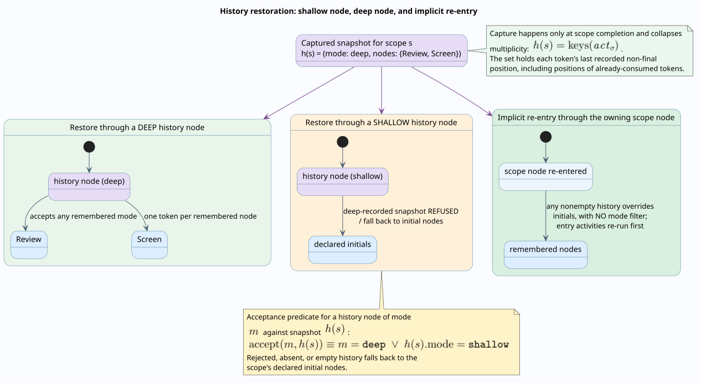

# Statechart semantics of the durable kernel

This document formalizes the statechart half of Agent Teams Workflow v2: hierarchical scopes, dynamic configurations, entry and exit activities, completion propagation, parallel-region token discipline, shallow and deep history, and the kernel's run-to-completion discipline. It reads the deterministic durable kernel (`packages/embers/src/domain/agents_teams/runtime.rs` in the Embers backend) as a statechart interpreter and states precisely where that reading is exact and where the kernel deliberately diverges from the classical statechart dialects of Harel, STATEMATE, UML, and SCXML.

Ownership is split across the theory and design layers so that no rule is stated twice:

- [Operational semantics](operational-semantics.md) owns tokens and markings, activity reduction, route-group selection (first match and all matches), the bounded-transition counter rule, join firing predicates, the progress-boundary theorem, the determinism envelope, and the soundness boundary.
- [Hierarchical continuation theory](hierarchical-continuations.md) owns crash equivalence, effect and guard key hashing, qualified waits, and journal composition.
- **This document** owns the scope tree, configurations, entry closure, completion propagation, parallel-region discipline, history, the fork-epoch algebra, the run-to-completion relation, and the statechart readings of cycles, guarded routing, joins, waits, approvals, retry, and cancellation.
- [Rholang realization](../design/rholang-realization.md) and [SCXML correspondence](../design/scxml-correspondence.md) are the design-layer companions: the first catalogs how each operation formalized here is composed in Rholang, the second maps each operation onto SCXML and analyzes the differences.

Every rule below cites the kernel region that implements it. Line anchors refer to the branch current at the time of writing (`dylon/embers-demo-fixes`, backend commit `d9a9e41`).

## Vocabulary

The following terms are used throughout with these precise meanings.

- **Scope** — a static container declared in the definition: `compound`, `parallel`, or `root`. Scopes form a tree.
- **Scope node** — the node of kind `scope` that owns a child scope; entering it instantiates the child.
- **Scope instance** — one dynamic activation of a scope, created when a token enters its owning scope node and destroyed when the scope completes (`ScopeInstance`, `runtime.rs:1499-1514`).
- **Active configuration** — the multiset of node positions currently recorded for a scope instance (`active_configuration`).
- **Entry closure** — the process that takes a freshly instantiated scope to its initial active configuration: entry activities first, then initial (or history-restored) tokens.
- **Completion** — the instant a scope instance's live-token count reaches zero; completion propagates a `completed` token to the owning scope node.
- **Lifecycle activity** — an activity node named in a scope's `entryActivities` or `exitActivities`, executed sequentially as an ordinary observed effect.
- **Pseudostate** — in statechart dialects, a transient control point that is not itself a state: initial, final in the UML sense, shallow history `[H]`, deep history `[H*]`, choice, join, fork. The kernel has no explicit pseudostate objects; this document identifies which kernel constructs play each role.
- **Run-to-completion (RTC)** — the discipline in which a state machine consumes one external stimulus, performs a maximal cascade of internal steps, and only then admits the next stimulus.
- **Microstep / macrostep** — one internal reduction, and a maximal sequence of them ending in a stable (blocked) configuration.
- **Shallow / deep history** — restoration of a previously recorded configuration: one level deep (shallow) or transitively (deep).
- **Fork epoch** — an identifier minted when routing selects more than one transition from one route group, distinguishing concurrent generations of fan-out for correlation.

### Symbols

The symbols $`N`$ (nodes), $`E`$ (transitions), $`S`$ (scopes), $`R`$ (route groups), $`M`$ (marking), and $`\kappa_c(e)`$ (bounded-iteration counters) are imported unchanged from the [operational semantics](operational-semantics.md). This document adds:

| Symbol | Definition |
| ------------------------ | ---------------------------------------------------------------- |
| $`\mathrm{par}(s)`$    | parent of scope $`s`$, undefined for the root                  |
| $`\mathrm{own}(s)`$    | the unique scope node owning non-root scope $`s`$              |
| $`\mathrm{init}(s)`$   | declared initial node identifiers of $`s`$                     |
| $`\mathrm{en}(s), \mathrm{ex}(s)`$ | entry- and exit-activity sequences of $`s`$        |
| $`\mathrm{hm}(s)`$     | history mode of $`s`$: $`\mathtt{none}`$, $`\mathtt{shallow}`$, or $`\mathtt{deep}`$ |
| $`\Sigma`$             | finite map from instance identifiers to live scope instances     |
| $`\sigma`$             | one scope instance                                               |
| $`h`$                  | history map from scope identifiers to captured configurations    |
| $`\varepsilon`$        | a token's fork-epoch stack                                       |
| $`\mathit{act}_\sigma`$ | active configuration of $`\sigma`$, a multiset over $`N`$   |
| $`\mathit{cnt}_\sigma`$ | live-token count of $`\sigma`$ (`active_tokens`)              |
| $`\mathit{pos}_\sigma`$ | token-position map of $`\sigma`$ (`active_token_nodes`)       |

## The scope tree and dynamic configurations

Statically, $`(S, \mathrm{par})`$ is a rooted tree. The validators on both sides of the wire enforce exactly the shape this document assumes: the entry scope is the unique parentless scope and the only scope of kind `root` (`workflow.rs:245`, `workflow.rs:399`; frontend diagnostics `invalid-root-scope-count`, `invalid-root-scope-kind`), parent chains are acyclic (`scope-parent-cycle`), and every non-root scope has exactly one owning scope node whose own scope is the child's parent (`invalid-scope-owner-count`, `invalid-scope-node`). The [specification](../specification/workflow-definition-v2.md) is normative for the static shape; this document is normative for the dynamics.

The operational semantics defines the configuration $`C = \langle M, J, \eta, \phi \rangle`$. The statechart layer refines it conservatively:

```math
C_h = \langle M, J, \Sigma, h, \eta, \phi \rangle,
```

where $`\Sigma`$ is the finite map of live scope instances and $`h`$ the history map. Erasing $`\Sigma`$ and $`h`$ recovers the operational-semantics configuration; no rule below contradicts a rule stated there.

A scope instance is the tuple

```math
\sigma = \langle \mathit{id},\; s,\; \mathrm{own}(s),\; \mathit{act}_\sigma,\; \mathit{cnt}_\sigma,\; \mathit{pos}_\sigma,\; v_\sigma \rangle,
```

mirroring `ScopeInstance` (`runtime.rs:1499-1514`): the instance identifier (`scope:{node}:{sequence}`, freshly minted at `runtime.rs:975-976`), the scope, its owning node, the active configuration, the live-token count, the token-position map, and the scope result $`v_\sigma`$.

**Position recording.** Every time a token enters a node, the kernel records the position in the token's innermost scope instance (`record_active_node`, `runtime.rs:1028-1052`). Nodes of kind `final` are never recorded (`runtime.rs:1035-1037`), so a configuration never names a final node. The rule, for token $`t`$ entering node $`n \neq \mathtt{final}`$ with $`\mathit{pos}_\sigma(t) = m`$:

```math
\frac{t \in \operatorname{dom}(\mathit{pos}_\sigma) \qquad \mathit{pos}_\sigma(t) = m}
     {\mathit{act}_\sigma' = \mathit{act}_\sigma - \{m\} + \{n\}, \qquad \mathit{pos}_\sigma' = \mathit{pos}_\sigma[t \mapsto n]}
\quad (\textsc{Record\text{-}Active})
```

For a token with no recorded position the rule degenerates to $`\mathit{act}_\sigma' = \mathit{act}_\sigma + \{n\}`$. The active configuration is therefore a **multiset**: two tokens on one node contribute multiplicity two.

This is the first deliberate divergence from the classical dialects. A Harel or UML configuration is a *set* of states with exactly one active substate per region ([Harel 1987](https://doi.org/10.1016/0167-6423(87)90035-9); OMG UML 2.5.1 clause 14). The kernel's configuration is a multiset of token positions in a flat scope; region structure is not part of the dynamic state. Section [Parallel regions](#parallel-regions-and-token-discipline) develops what this buys and costs.


## Entry semantics

Three rules govern how a scope goes from inert to active. Together they realize what UML calls default entry and entry actions, with one honest difference: the kernel's entry actions are observed effects, not zero-time actions.

**(Enter-Scope)** A token $`t`$ entering a node of kind `scope` instantiates the child scope and starts the entry lifecycle (`enter_node` dispatch at `runtime.rs:905-907`, `enter_scope` at `runtime.rs:965-995`). Writing $`\mathrm{fresh}(s, n, v_t)`$ for a new instance with $`\mathit{act} = \varnothing`$, $`\mathit{cnt} = 0`$, and result seeded from the entering token's value (`runtime.rs:991`):

```math
\frac{\mathrm{kind}(n) = \mathtt{scope}(s) \qquad \sigma = \mathrm{fresh}(s, n, v_t)}
     {\langle M \uplus \{t@n\},\; \Sigma \rangle \longrightarrow \langle M \uplus \{t_{\mathrm{en}(s),0}\},\; \Sigma \cup \{\sigma\} \rangle}
\quad (\textsc{Enter\text{-}Scope})
```

where $`t_{\mathrm{en}(s),0}`$ is the same token repurposed to run the first entry activity.

**(Lifecycle-Act)** Entry and exit activities run **strictly sequentially**. The kernel threads one token through the activity list with `TokenPurpose::ScopeLifecycle { scope_instance_id, stage, activity_index }` (`advance_scope_lifecycle`, `runtime.rs:601-633`); each lifecycle node must be an activity and is scheduled as an ordinary effect (`runtime.rs:775-789`), and the observation that completes it advances the index. Because each lifecycle activity is an effect, **entry and exit cross macrostep boundaries**: the kernel returns `KernelOutcome::Effects`, the orchestrator executes the activity on chain, and the observation re-enters the kernel. Harel's and UML's entry actions are conceptually instantaneous; the kernel's are durable, observable, and individually checkpointed.

Lifecycle failure has exact, sharp semantics (`runtime.rs:314-333`): a lifecycle activity that observes a non-`completed` disposition routes from the *activity node itself* — **with its lifecycle purpose intact and without the instance on its scope stack**. Three consequences follow. First, the failure routes in the *enclosing* scope's context, and the half-entered (or half-exited) instance remains live in $`\Sigma`$, neither consumed nor torn down. Second, a failure transition that targets another *activity* node re-enters the lifecycle machinery: the substitute activity runs with the same stage and index, and its `completed` observation resumes the original lifecycle list at the next index — so a chain of recovery activities can repair a failed entry or exit and let the scope proceed. Third, a failure transition that targets any *non-activity* node is a hard kernel error ("scope lifecycle node ... is not an activity", `runtime.rs:775-777`). Definitions should therefore route lifecycle-failure triggers either into recovery activities that re-complete the lifecycle or into no route at all (making lifecycle failure fatal by the no-group rule); routing them at gateways or waits is not executable.

**(Initials-or-Restore)** When the entry activities are exhausted, `start_scope_initials` (`runtime.rs:635-667`) seeds the scope's first tokens. The target set consults history first:

```math
\mathrm{targets}(s) =
\begin{cases}
h(s).\mathrm{nodes} & \text{if } h(s) \text{ is defined and nonempty}, \\
\mathrm{init}(s) & \text{otherwise.}
\end{cases}
```

Note the absence of a mode condition: on re-entry through the owning scope node, **any** nonempty remembered configuration overrides the declared initials, whether it was recorded shallow or deep (`runtime.rs:645-650`). The [history section](#history-capture-and-restoration) discusses this design. The kernel then sets $`\mathit{cnt}_\sigma := |\mathrm{targets}(s)|`$ (`runtime.rs:651-653`) and emits one token per target: the first reuses the entering token, the rest are clones with fresh identities (`clone_token`, `runtime.rs:153-159`), and each pushes $`\sigma`$ onto its scope stack (`runtime.rs:654-665`).

**Entry closure is iterative, not atomic.** UML computes the full transitive closure of default entries in one step of the entry algorithm. The kernel instead lets closure unfold across microsteps: if a target of $`\mathrm{targets}(s)`$ is itself a scope node, its own (Enter-Scope) fires in a later microstep. Closure terminates because $`(S, \mathrm{par})`$ is finite and acyclic — each nested instantiation strictly descends the scope tree, and the validator has excluded parent cycles.

The literate algorithm, verified against `runtime.rs:601-667` and `runtime.rs:965-995`:

```text
ENTER-SCOPE(token, scopeNode):
  # The instance id embeds a per-envelope sequence number, so re-entry of the
  # same scope node yields a distinguishable instance and history is keyed by
  # scope id, never by instance id.
  instance <- fresh ScopeInstance(id = "scope:" + scopeNode.id + ":" + seq,
                                  result = token.value)
  RUN-LIFECYCLE-ACTIVITY(token, instance, ENTRY, index = 0)

RUN-LIFECYCLE-ACTIVITY(token, instance, stage, index):
  activities <- instance.entryActivities if stage = ENTRY
                else instance.exitActivities
  if index < length(activities):
    # Sequential by construction: the next activity is scheduled only when the
    # observation for the current one arrives. Each is a durable effect, so
    # entry/exit ordering survives crash and resume.
    move token to activities[index] with purpose ScopeLifecycle(stage, index)
    return
  if stage = ENTRY: START-INITIALS-OR-RESTORE(token, instance)
  else:             FINISH-SCOPE(token, instance)

START-INITIALS-OR-RESTORE(token, instance):
  remembered <- history[instance.scopeId].nodes if defined and nonempty
  targets    <- remembered otherwise instance.initialNodeIds
  # The count is set to the emitted token population; every later fan-out and
  # consumption adjusts it, which is exactly the token-conservation invariant
  # the StatechartScopes TLA+ model checks.
  instance.activeTokens <- length(targets)
  for index, node in targets:
    child <- token if index = 0 else CLONE(token)
    child.node <- node; child.phase <- Enter
    push instance.id onto child.scopeStack
    enqueue child
```

## Run-to-completion: microsteps, macrosteps, and the command boundary

The kernel's main loop (`run_until_blocked`, `runtime.rs:688-743`) pops tokens from a FIFO queue. A **microstep** is one pop: an Enter-phase token dispatches to `enter_node` (`runtime.rs:745-913`), a Route-phase token to `route_token` (`runtime.rs:1198-1384`). A **macrostep** is a maximal sequence of microsteps ending when the loop returns a `KernelOutcome`:

```math
\mathrm{macrostep}(C_h) \;=\; C_h \longrightarrow^{k} C_h' \quad \text{with } k \le 10^6 \text{ and } C_h' \text{ blocked},
```

where the outcome at $`C_h'`$ is, in strict precedence order (`runtime.rs:712-742`): `Effects` if any effect is pending; else `Guards` if any Rholang guard needs an on-chain observation; else a hard error if the queue is nonempty (a blocked queue without an effect, guard, or wait is a kernel invariant violation, `runtime.rs:724-726`); else `Suspended` if waits are pending; else `Cancelled`; else `Completed` with the sequence-ordered output value. The $`10^6`$ step budget (`runtime.rs:700`) is defensive; the semantic termination guarantee is the [progress-boundary theorem](operational-semantics.md#progress-boundary-theorem), which this document does not restate.

External stimuli — authenticated commands, effect observations, guard observations — are admitted **only between macrosteps**. The kernel has no internal event queue at all: nothing a node does can enqueue an event for another node to consume. This is run-to-completion in exactly the STATEMATE asynchronous-time sense — changes are sensed only at step boundaries, and there is no zero-time chaining across an effect ([Harel and Naamad 1996](https://doi.org/10.1145/235321.235322)). Against SCXML the correspondence is: SCXML's *external* event queue corresponds to the authenticated command channel, but delivery is addressed to an exact qualified wait identity rather than matched by event name, and SCXML's *internal* queue has no counterpart whatsoever ([SCXML](https://www.w3.org/TR/scxml/), Appendix D; developed in the [SCXML correspondence](../design/scxml-correspondence.md)).

One subtlety is unique to the on-chain guard discipline: when a Route-phase token's eligible groups contain a Rholang guard that has not yet been observed, the kernel re-queues that token **at the front** and ends the macrostep with `Guards` (`runtime.rs:704-707`, `runtime.rs:1237-1246`). Guard evaluation can therefore itself be a macrostep boundary — a durable suspension point in the middle of what UML would consider a single transition selection. The macrostep boundaries are exactly the checkpoint opportunities of the [durable commit protocol](../architecture/durable-execution.md); this checkpointable RTC is the property that makes crash recovery coincide with normal resumption ([crash equivalence](hierarchical-continuations.md)).

Determinism inside a macrostep follows from the FIFO queue plus sorted iteration everywhere (`BTreeMap`/`BTreeSet` state, groups sorted by identifier, transitions by priority then identifier); this is the [determinism envelope](operational-semantics.md#determinism-envelope) restricted to the statechart layer, and it is what makes "last consumed result wins" below a deterministic rule rather than a race.

The kernel microstep automaton and its exits:

```text
MICROSTEP(queue):
  # One pop is one microstep. Enter performs node effects (join acceptance,
  # instantiation, suspension); Route performs transition selection. A token
  # alternates Enter -> Route -> Enter ... until it suspends, consumes, or
  # blocks on a guard observation.
  token <- pop front of queue
  if token.phase = Enter: ENTER-NODE(token)      # runtime.rs:745-913
  else:
    routed <- ROUTE-TOKEN(token)                 # runtime.rs:1198-1384
    if not routed:
      # An unobserved Rholang guard blocks the whole token, not one group:
      # requeue at the FRONT and end the macrostep with outcome Guards.
      push token at front of queue; yield Guards
```


## Completion propagation and exit

Completion is the kernel's synthesized analog of the UML *completion event*: when a composite state's content finishes, a completion transition fires out of it (OMG UML 2.5.1, clause 14.2.3.8.5). The kernel does not queue an event; it synthesizes the `completed` disposition directly on the token returned to the owning scope node.

**(Consume)** A token is consumed inside a scope when it reaches an output or final node, or when a no-match policy or join merge retires it (`consume_scope_token`, `runtime.rs:1054-1086`):

```math
\frac{\sigma = \Sigma(\mathrm{top}(t.\mathrm{scopes}))}
     {\mathit{cnt}_\sigma' = \mathit{cnt}_\sigma - 1, \qquad
      \mathit{pos}_\sigma' = \mathit{pos}_\sigma \setminus \{t\}, \qquad
      v_\sigma' = \begin{cases} v & \text{if a result } v \text{ is carried} \\ v_\sigma & \text{otherwise} \end{cases}}
\quad (\textsc{Consume})
```

Two asymmetries are load-bearing. First, consumption removes the token from $`\mathit{pos}_\sigma`$ but **does not decrement** $`\mathit{act}_\sigma`$ (`runtime.rs:1063-1064`): the multiset keeps the token's last recorded position. That is precisely what makes history capture meaningful — the captured configuration remembers where every token ended, including tokens already consumed. Second, when several results are carried by successive consumptions, the **last consumed result wins** (`runtime.rs:1065-1067`); by the determinism argument above this is a deterministic function of the definition and the observations, not a scheduler race.

Which consumptions carry results is exact (`runtime.rs:801-819`, `runtime.rs:1221-1229`, `runtime.rs:1267-1278`):

| Consumption site | Carries scope result? | Also emits a root output? |
| ------------------------------------- | ----------------- | ------------------------- |
| `final` node inside a scope           | yes (token value) | no |
| `output` node (anywhere)              | no                | yes (`outputProduced`) |
| routed `completed` token with no groups | yes             | yes |
| no-match policy `complete`            | yes               | yes |
| no-match policy `skip`                | no                | no |
| join merge (arrivals collapsed)       | not a consumption of the merged token; the scope count drops by $`\lvert\mathrm{arrivals}\rvert - 1`$ |

**(Complete)** When $`\mathit{cnt}_\sigma`$ reaches zero, the kernel snapshots history if the scope declares it (next section), then runs the exit activities through the same sequential lifecycle machinery, and finally `finish_scope_instance` (`runtime.rs:669-686`) destroys the instance and returns the completion token:

```math
\frac{\mathit{cnt}_\sigma = 0 \qquad \mathrm{ex}(s) \text{ exhausted}}
     {\Sigma' = \Sigma \setminus \{\sigma\}, \qquad
      t' = t\bigl[\mathrm{node} \mapsto \mathrm{own}(s),\; v \mapsto v_\sigma,\; d \mapsto \mathtt{completed},\; \mathrm{phase} \mapsto \mathtt{Route}\bigr]}
\quad (\textsc{Complete})
```

The completion token pops its scope stack and re-enters routing at the owning scope node with the scope result as its value. Completion therefore **propagates**: if the owning scope node's own scope also drains, its instance completes in turn, ascending toward the root. At the root, a `final` node with an empty scope stack ends the run itself (`rootCompleted`, `runtime.rs:809-818`).

```text
PROPAGATE-COMPLETION(token, result?):
  # Consumption never edits the recorded position multiset; that multiset is
  # exactly what history capture reads, so "where each token last was"
  # survives until the instant of completion.
  instance <- top of token.scopeStack; return if absent
  instance.activeTokens -= 1
  remove token from instance.activeTokenNodes
  if result? is present: instance.result <- result?
  if instance.activeTokens > 0: return

  # Completion is the synthesized analog of a UML completion event.
  if instance.historyMode != none:
    history[instance.scopeId] <- (instance.historyMode,
                                  keys(instance.activeConfiguration))
  RUN-LIFECYCLE-ACTIVITY(token, instance, EXIT, 0)
  # ...which, exhausted, FINISHes: destroy the instance, pop the scope stack,
  # and return the token to the owning scope node carrying the scope result
  # with disposition "completed" in Route phase.        runtime.rs:669-686
```

## Parallel regions and token discipline

The kernel treats `compound` and `parallel` scopes **identically at runtime**. `ScopeKind` is validated statically — a parallel scope may declare one or more initial nodes, a compound or root scope exactly one (`workflow.rs:292-307`) — and is carried on the instance (`runtime.rs:1505`) but never branched on by the lifecycle path. Orthogonality is therefore not a partition of the scope into regions; it is **multiplicity of tokens in one flat scope**. UML's "exactly one active substate per region" becomes "any multiset of positions"; the drawn `--` region separators in the diagrams of this corpus are a modeling view, chosen because the initial nodes of a parallel scope behave like region roots, not a runtime structure.

The discipline that replaces region bookkeeping is token conservation. Fan-out inside a scope increments the live count by the additional emissions (`adjust_scope_fanout`, `runtime.rs:1386-1395`); joins collapse $`|\mathrm{arrivals}| - 1`$ tokens (`runtime.rs:1194`) and late arrivals retire one (`runtime.rs:1133`, `runtime.rs:1140`); consumption decrements one. The intended invariant:

```math
\mathit{cnt}_\sigma \;=\; \bigl|\{\, t \in \text{live tokens} \mid \mathrm{top}(t.\mathrm{scopes}) = \sigma \,\}\bigr|.
```

The (Complete) rule is then the AND-synchronization on "all regions done": a parallel scope completes exactly when every token seeded into it (plus every token minted by fan-out, minus joins) has been consumed. This is the same observable behavior as UML's completion of an orthogonal state — all regions must reach their final states — obtained without regions. The `StatechartScopes` TLA+ model checks the conservation invariant and the entry/exit ordering over a two-token scope ([formal models](../formal/README.md)).

A worked trace for a parallel scope with initials $`\{A, B\}`$: entry activities run one after another; (Initials-or-Restore) sets $`\mathit{cnt} = 2`$ and enqueues tokens $`t_1@A`$, $`t_2@B`$; (Record-Active) yields $`\mathit{act} = \{A, B\}`$; $`t_1`$ reaches a final node — (Consume) drops $`\mathit{cnt}`$ to 1 and stores the scope result, while $`\mathit{act}`$ still contains $`t_1`$'s last non-final position; $`t_2`$ reaches a final node — $`\mathit{cnt} = 0`$, history snapshots $`\mathrm{keys}(\mathit{act})`$, exit activities run, and the owning node re-routes with disposition `completed`.

## History: capture and restoration

**(Capture)** History is recorded at the completion instant, and only then (`runtime.rs:1073-1082`):

```math
h' = h\bigl[\, s \mapsto \langle \mathrm{hm}(s),\; \mathrm{keys}(\mathit{act}_\sigma) \rangle \,\bigr]
\qquad \text{iff } \mathrm{hm}(s) \neq \mathtt{none} \text{ at } \mathit{cnt}_\sigma = 0.
```

Two consequences follow from the (Consume) asymmetry and (Record-Active):

1. **Multiplicity collapses.** $`\mathrm{keys}`$ drops counts: a configuration holding two tokens on one node restores as one token there.
2. **Consumed positions persist.** The captured set is "the last recorded non-final position of every token that entered the scope", including tokens consumed before completion. In particular, `output` node identifiers can appear in a captured configuration (only `final` nodes are excluded from recording, `runtime.rs:1035-1037`), and restoring one re-enters the output node — which immediately emits a root output and consumes again. Authors who want history to name only "resting" positions should route retired branches into `final` nodes rather than leaving them on activity or output nodes.

This capture point diverges from UML, which records history whenever the composite is *exited*, including exit by an outgoing transition. Kernel scopes exit only by completion, so completion is the only capture point.

**(Restore-A: implicit re-entry)** As stated in (Initials-or-Restore), re-entering a scope through its owning scope node consults history with **no mode filter**: any nonempty remembered configuration overrides the initials (`runtime.rs:645-650`). In statechart vocabulary, after its first completion a history-declaring scope behaves as if its initial pseudostate were replaced by a default-history pseudostate. UML default entry, by contrast, ignores history unless the transition targets the `[H]`/`[H*]` pseudostate explicitly. The pinned kernel test (`runtime.rs:2660-2751`) proves both the override and the fact that **entry and exit activities re-run on every restoration** — its observed effect order is entry, remembered node, exit, entry, remembered node, exit across two entries of the same scope.

**(Restore-B: history nodes)** A node of kind `history` inside a scope restores explicitly (`restore_history`, `runtime.rs:997-1026`). The mode filter is:

```math
\mathrm{accept}(m_{\mathrm{node}},\, h(s)) \;\equiv\; m_{\mathrm{node}} = \mathtt{deep} \;\lor\; h(s).\mathrm{mode} = \mathtt{shallow},
```

with fallback to $`\mathrm{init}(s)`$ when the entry is rejected, absent, or empty (`runtime.rs:1008-1014`). Plainly: a *shallow* history node refuses a *deep-recorded* configuration; a *deep* history node accepts anything remembered. The kernel then emits one token per target exactly as restoration-by-re-entry does.

```text
RESTORE-HISTORY(token, historyNode):
  scope      <- the scope containing historyNode
  remembered <- history[scope.id] if defined
                and (historyNode.mode = deep or remembered.mode = shallow)
  targets    <- remembered.nodes if nonempty, else scope.initialNodeIds
  # Restoration re-seeds positions but, unlike START-INITIALS-OR-RESTORE, does
  # not touch the live-token count: see the accounting caveat below.
  for index, node in targets:
    child <- token if index = 0 else CLONE(token)
    child.node <- node; child.phase <- Enter
    enqueue child
```

**Deepness composes lazily.** Recording is flat per scope: a parent's captured configuration names its child's *scope node* (that is the child's last recorded position under (Record-Active)), not the child's internal nodes. Restoring the parent re-enters that scope node, which re-instantiates the child, whose own (Initials-or-Restore) consults the child's own $`h`$ entry. Deep history in this kernel is therefore a chain of per-scope restorations resolved lazily on descent — not UML's one-shot transitive `[H*]` restore of the full nested configuration. The observable difference: a child scope with $`\mathrm{hm} = \mathtt{none}`$ restarts from its initials even under a deep restore of its parent, because nothing was recorded for it.



**Accounting caveat (verified defect surface).** `restore_history` emits its targets without adjusting $`\mathit{cnt}_\sigma`$ (`runtime.rs:1015-1024`; contrast (Initials-or-Restore), which sets the count, and fan-out, which adjusts it). For the single-target restorations pinned by the kernel test this is exact: one token in, one token out. For a **multi-node** remembered configuration restored through a history *node*, the containing scope's live count under-counts the emitted population, so the scope can complete while restored tokens are still live. Definitions today should keep configurations that a history node may restore single-noded (for example, by joining before completion when history will be consulted through a history node). This hazard was reported alongside the [durable-yield finding](#current-behavior-durable-yield-resumption) during the documentation review.

## Cycles as statechart transitions

The [progress-boundary theorem](operational-semantics.md#progress-boundary-theorem) owns cycle safety; this section only fixes the statechart reading of each cyclic construct, using the verified routing semantics (`route_token`, `runtime.rs:1198-1384`).

- **Plain revisit.** A transition back to an ordinary node is re-entry of a state with no entry or exit actions: the token re-enters, (Record-Active) moves its position, and nothing else happens. Persistent Rholang node contracts are what make the revisit executable on chain ([Rholang realization](../design/rholang-realization.md)).
- **Scope-node self-loop.** A cycle through a scope node is an *external self-transition on a composite state* in the UML sense: completion runs exit activities and captures history, and re-entry runs entry activities and restores — the full exit-then-re-enter cascade, pinned by the kernel history test.
- **Bounded transition.** The counter rule is owned by the operational semantics; the statechart reading is a transition guarded by $`\kappa_c(e) < b_e`$ whose traversal increments the counter. The check-then-increment order (`runtime.rs:1324-1333`) admits exactly $`b_e`$ traversals. Counters live in token context — they travel through suspension, checkpointing, and history untouched, which no state-attached counter could do.
- **Exhaustion.** When the bound is exhausted the kernel does not traverse: it rewrites the token's disposition to `iterationLimit` and re-routes it **from the source node** (`runtime.rs:1326-1331`). Exhaustion is a disposition-changing internal step, not a transition traversal — the statechart analog of raising a completion-like event consumed by the same state's outgoing transitions.
- **Durable yield.** A durable-yield transition performs checkpoint-and-suspend as its transition action (`runtime.rs:1334-1358`): the token is pre-positioned at the *target* node in Enter phase, parked under wait identity `yield:{token}:{transition}` with kind `durableYield`, and the `durableYield` event is emitted; no `transitionTaken` is recorded for it. See [current behavior](#current-behavior-durable-yield-resumption) for the resumption status.


## Conflict resolution and the fork-epoch algebra

**Selection order.** Route groups eligible for a disposition are processed in ascending group-identifier order, and transitions within a group in ascending $`(p(e), \operatorname{id}(e))`$ order (`runtime.rs:1216-1220`); the selection mathematics is owned by the [operational semantics](operational-semantics.md#route-group-reduction). The statechart contrast is in *how conflicts are resolved*: UML resolves by state-nesting depth and leaves residual nondeterminism to the implementation; SCXML resolves by child priority and document order; the kernel demands **explicit unique priorities** per first-match group and totalizes with the identifier tie-break — determinism by construction rather than by convention. There is also no cross-node conflict to resolve: transitions fire per token, and a token is at exactly one node.

**Several reaction sets per state.** All eligible groups of one disposition fire in the same Route microstep, each contributing its own selection (`runtime.rs:1248-1286`). A node can therefore emit through several route groups simultaneously — a deliberate generalization beyond UML's at-most-one-transition-per-active-simple-state, and the statechart face of the token model's explicit fan-out.

**Two-phase guards.** Pure structural conditions evaluate in the host (`runtime.rs:1917-2014`). Rholang guards evaluate as on-chain observations keyed by

```math
\mathrm{guardKey} = H(\mathit{run} \,\|\, \mathit{execution} \,\|\, \mathit{token} \,\|\, \mathit{attempt} \,\|\, \mathit{transition}),
```

with NUL separators (`runtime.rs:2090-2100`); results are cached for routing and purged immediately after the token routes (`runtime.rs:1373-1382`). A non-Boolean guard result is a terminal `invalidGuardResult` failure ([conformance](../engineering/conformance-and-testing.md)).

**Fork epochs.** When one group selects more than one transition, the kernel mints an epoch for that group (`runtime.rs:1291-1310`): the routing token's per-group generation counter increments, and

```math
\varepsilon' \;=\; H(\mathit{run} \,\|\, \varepsilon_{\mathrm{top}} \,\|\, \mathit{group} \,\|\, \mathit{gen}),
```

where $`\varepsilon_{\mathrm{top}}`$ is the token's current innermost epoch (or the literal `root`). Every child of that fan-out pushes $`\varepsilon'`$ and records it in its per-group correlation map (`runtime.rs:1318-1320`).

The algebra is **push-only**. No operation pops an epoch: a join's merged token is the least-identifier arrival with its stack intact (`runtime.rs:1165-1171`), so effects scheduled after the join remain keyed to the fork epoch through $`\varepsilon_{\mathrm{top}}`$ (`runtime.rs:922-930`). This is deliberate — distinct loop generations of the same fan-out produce distinct effect keys, which is what makes at-most-once effect semantics survive cycles ([hierarchical continuations](hierarchical-continuations.md)). Freshness needs no pop: collision-freedom of the hash over the NUL-separated tuple plus strict per-token generation growth keeps overlapping generations distinct.

Correlation lookup is total for `root` and `key` policies and partial for `routeGroup`: a route-group-correlated join *requires* each arrival's lineage to have forked through that group — a token that never did carries no epoch for it, and the kernel rejects the arrival (`correlation_key`, `runtime.rs:1879-1903`). Modeling rule: correlate a join by the same route group that produced its fan-out.

```text
MINT-FORK-EPOCH(token, groupId):
  # Minted only when the group selects MORE than one transition; single-target
  # routing keeps the parent epoch, so an epoch always names a real fork.
  token.forkGenerations[groupId] += 1
  epoch <- H(runId || NUL || top(token.epochStack) or "root"
                   || NUL || groupId || NUL || token.forkGenerations[groupId])
  # Every child of this fan-out pushes the SAME epoch: siblings correlate,
  # and a later generation of the same group hashes differently.
  for child in emitted children of groupId:
    push epoch onto child.epochStack
    child.correlations[groupId] <- epoch
```


## Joins as synchronization pseudostates

UML's join pseudostate synchronizes one transition out of several orthogonal regions; the workflow-pattern tradition generalizes synchronization well beyond it ([van der Aalst et al. 2003](https://doi.org/10.1023/A:1022883727209)). The kernel's join is a *stateful attribute of a target node*: arrivals accumulate per node and correlation under the occupancy key

```math
\mathrm{joinKey} \;=\; n \,\|\, \mathrm{corr}, \qquad
\mathrm{corr} = \begin{cases}
\texttt{root} & \text{root correlation} \\
\varepsilon_{\mathrm{group}} & \text{route-group correlation} \\
H(\mathrm{eval}(\mathit{expr})) & \text{key correlation}
\end{cases}
```

(`runtime.rs:1100-1101`, `runtime.rs:1879-1903`). The expected set is the node's incoming transition identifiers (`runtime.rs:1102-1107`); an arrival is an Enter-phase token not yet marked joined (`runtime.rs:762-767`); a duplicate arrival on one open correlation epoch is an error (`runtime.rs:1119-1123`). Firing predicates for all, each, quorum, race, and reduce are owned by the [operational semantics](operational-semantics.md#join-semantics); this document adds the occupancy rule above and the lifecycle facts the firing math does not capture:

- **Closure and re-arming.** Quorum and race joins *close* on firing (`runtime.rs:1164`) and honor their late-arrival policy thereafter — `cancel` starts structured cancellation, `discard` retires the token, `error` fails the run (`runtime.rs:1125-1146`); joins of other policies implicitly discard late arrivals. All and reduce joins never close: firing removes the state (`runtime.rs:1173`, `runtime.rs:1191-1193`), so the next arrival under the same correlation re-arms a fresh accumulation. A closed quorum or race join is itself removed once every expected arrival has been seen, which is what makes race *reusable per correlation epoch* rather than one-shot per run.
- **Merged token.** The merged continuation is the least-identifier arrival, marked joined, carrying: the winner's value (race), the accumulator (reduce), or the producer-keyed record with duplicate-label detection (all, quorum) (`runtime.rs:1165-1190`). The scope's live count collapses by $`|\mathrm{arrivals}| - 1`$ (`runtime.rs:1194`).
- **Reduce honesty.** The `until` condition is evaluated against the folded accumulator on each arrival (`runtime.rs:1152-1157`). Per correlation epoch, termination is bounded by the finite expected set — duplicates error out — so reduce cannot accumulate unboundedly within an epoch; the kernel does *not* require the reducer to be monotone, so an `until` that never becomes true simply defers to the join's expected-set exhaustion and the scope's completion discipline.

Beyond UML, quorum ($`k`$-of-$`n`$), race, and reduce have no pseudostate counterpart at all; they are workflow-pattern synchronizers grafted onto the statechart reading, which is precisely why this corpus is a hybrid ([operational semantics, "Why a hybrid?"](operational-semantics.md#why-a-hybrid-statechart-and-token-model)).


## Waits, approvals, and dispositions as triggers

The central divergence first: **there is no event broadcast**. A disposition is a token-local label matched against transition triggers *before* guards are evaluated (`runtime.rs:1210-1214`); no other token, node, or region can observe it. Harel's broadcast communication and SCXML's internal event queue have no counterpart. Cross-component coordination in this kernel happens only through joins and scope completion — by synchronization, never by signaling.

**Suspension construction** (`enter_node`, `runtime.rs:820-896`): a `wait` node parks its token under identity `wait:{token}:{node}` with kind `event`, `signal`, or `timer`; the deadline comes from `delayMillis` or an evaluated `deadline` expression, and the `runSuspended` event is emitted. An `approval` node parks under `approval:{token}:{node}` with kind `approval`, an `ApprovalState` holding policy, quorum, approvers, and an empty decision map, an optional deadline derived from the node's timeout policy, and emits `approvalRequired`.

One truthful sharp edge: deadline-*expression* evaluation failures are swallowed (`runtime.rs:826-843`) — an unparseable deadline yields a wait with **no** `dueAt`, and `timerFired` then fails with "timer has no deadline". A timer wait with an invalid deadline expression is unresumable; validate deadline expressions as values before deploying definitions that compute them.

**Resume rules** (`apply_command`, `runtime.rs:353-502`; `resume_wait`, `runtime.rs:538-556`), each an inference rule over the authenticated command boundary — authorization itself is the ledger's, not the kernel's ([durable execution](../architecture/durable-execution.md)):

- `signal` / `event` require a wait of matching kind and, when the wait names one, an equal name; the token resumes with disposition `completed` and the payload as its value when non-null.
- `timerFired` requires kind timer *or retry*, the **exact** recorded deadline, and $`\mathrm{now} \ge \mathrm{deadline}`$ — early firing is rejected.
- `approve` requires actor membership when the approver set is nonempty (an **empty approver set admits any ledger-authorized actor**), a globally unused `decisionId`, and at most one decision per actor. At quorum ($`|\mathrm{decisions}| \ge q`$, formalized in the [specification](../specification/workflow-definition-v2.md)) the wait resumes with disposition `completed`; below quorum the decision is recorded and the wait stays pending. `approvalRecorded` is emitted for **every** accepted decision; on the quorum-reaching decision the event order is `waitSatisfied`, then `approvalRecorded`, then `runResumed`.
- `reject` requires the same membership and resumes immediately with disposition **`rejected`** — a first-class standard disposition that routes like any other trigger.
- `retry` requires a retry wait and resumes it without waiting for its backoff deadline.
- `cancel` and `migrate` are run-level (no wait identity); cancellation is described below, and migration re-pins the definition after verifying the source hash, applying the state patch, and emitting `runMigrated`.

**The resume-phase asymmetry** (`runtime.rs:545-549`): a resumed *retry* wait re-enters its node in **Enter** phase — the node re-executes with the incremented attempt. Every other resumption re-enters in **Route** phase — the wait node's work is done and the disposition routes onward. In statechart terms: retry resumption is re-entry of the state; all other resumptions are traversal out of it.

Approval deadlines carry one further verified caveat: the deadline is recorded on the wait and published to the run ledger (the ledger's `dueAt` is the minimum over *all* waits, `orchestration.rs:1043`), but the timer-recovery scan only fires timer and retry waits (`runtime.rs:508-517`). An expired approval deadline is therefore **not enforced** — no `timedOut` disposition fires — and additionally causes the recovery scan to report "run due_at does not correspond to a pending timer" on every poll until the approval resolves. Until the tracked fix lands, prefer modeling approval timeouts as an explicit race between an approval and a timer wait joined by a race join.


## Retry and structured cancellation

**Retry** is a guarded self-re-entry through a durable timer. When an effect observes a retryable disposition — a disposition in the node's `retryOn` list, or, when that list is empty, in the default set $`\{\mathtt{failed}, \mathtt{timedOut}, \mathtt{resourceExhausted}\}`$ — and attempts remain ($`a < \mathrm{maxAttempts}`$ before incrementing), the kernel increments the attempt and parks the token as a retry wait named for the *upcoming* attempt, `retry:{token}:{a+1}`, with a deadline computed by the deterministic backoff schedule, and emits `retryScheduled` (`runtime.rs:282-311`); the schedule and jitter formulas are normative in the [specification](../specification/workflow-definition-v2.md#node-execution-policies) (`retry_delay_millis`, `runtime.rs:2067-2088`). The scheduler-submitted `timerFired` (or a manual `retry` command) then re-enters the node in Enter phase with the incremented attempt — the state re-executes; it is never "resumed past".

**Structured cancellation** is a chart-wide abort followed by Saga compensation ([Garcia-Molina and Salem 1987](https://doi.org/10.1145/38713.38742)). `begin_cancellation` (`runtime.rs:590-599`) clears the queue, joins, waits, effects, and nested workflows, emits `cancellationRequested`, and starts draining the compensation stack: records pushed on each successful completion of a node with a compensation policy pop in **reverse push order**, each executing as an effect `compensate:{originalEffectKey}` with input `{forwardInput, forwardOutput}` (`runtime.rs:558-588`). Compensation effects carry no retry policy — they are never retried — and a failed compensation is a hard error, not a skipped step. `runCancelled` is emitted when the stack drains.

The divergence to name: this is **not** the UML exit-action cascade, which runs exit behaviors deepest-first by state nesting at the moment of exit. Kernel compensation unwinds recorded *forward effects* in reverse completion order, independent of where in the scope tree those effects ran. Exit activities and compensation are different mechanisms with different orders — exit activities are per-scope and run at completion; compensation is per-run and runs at cancellation. Cancellation **abandons** live scope instances outright: `begin_cancellation` clears tokens, joins, waits, effects, and nested workflows but leaves $`\Sigma`$ and $`h`$ in place untouched, and no exit activity runs for an abandoned instance. Interrupted teardown is owned entirely by compensation — by design, since exit activities of a cancelled scope could themselves fail or suspend, while the compensation stack replays only work that actually completed.


## Where the kernel diverges: consolidated table

Von der Beeck's classical survey organizes statechart variants along exactly the axes where implementations must choose ([von der Beeck 1994](https://doi.org/10.1007/3-540-58468-4_163)); this table positions the kernel on each divergent axis. "Classical" summarizes Harel 1987 / STATEMATE / UML 2.5.1 / SCXML where they agree; where they disagree the relevant dialect is named.

| # | Kernel behavior (anchor) | Classical counterpart | Rationale |
| - | ------------------------ | --------------------- | --------- |
| 1 | Configurations are multisets of token positions in flat scopes (`runtime.rs:1028-1052`) | Set-valued configuration, one active substate per region | Fan-out, joins, and producer-keyed fan-in need multiplicity |
| 2 | No event broadcast; no internal event queue (`runtime.rs:688-743`) | Harel broadcast; SCXML internal queue | Determinism and durable replay; coordination via joins and completion |
| 3 | Dispositions are token-local triggers filtered before guards (`runtime.rs:1210-1214`) | Events from a shared queue | Trigger locality keeps routing a pure function of the token |
| 4 | Guard evaluation can end a macrostep (on-chain observation) (`runtime.rs:1237-1246`) | Guards are side-effect-free and instantaneous | Rholang guards are real deploys; honesty over pretended instantaneity |
| 5 | Entry/exit activities are observed effects crossing macrosteps (`runtime.rs:601-633`) | Zero-time entry/exit actions | Durability: each lifecycle step is individually checkpointed |
| 6 | History captured only at completion (`runtime.rs:1073-1082`) | UML records on any exit of the composite | Scopes exit only by completion; capture point coincides |
| 7 | Nonempty history overrides default entry with no mode filter (`runtime.rs:645-650`) | Default entry ignores history unless `[H]`/`[H*]` targeted | Re-entry of a remembering scope is resumption by default |
| 8 | Deep history composes lazily per scope | UML `[H*]` restores the nested configuration in one shot | Restoration must survive checkpoints; per-scope lookup is replayable |
| 9 | Flat scopes; parallel = multiplicity, kind checked statically only (`workflow.rs:292-307`) | Orthogonal regions partition the composite | One lifecycle path; conservation invariant replaces region bookkeeping |
| 10 | Several route groups fire per Route microstep (`runtime.rs:1248-1286`) | At most one transition per active simple state | Explicit fan-out is the token model's core strength |
| 11 | Explicit unique priorities with identifier tie-break (`runtime.rs:1216-1220`) | Nesting depth (UML) / document order (SCXML) | Determinism by construction, reviewable in the definition |
| 12 | Macrostep boundaries are durable suspension points | RTC steps are in-memory | Checkpointable RTC makes crash recovery equal normal resumption |
| 13 | Joins generalized to quorum, race, reduce with correlation epochs (`runtime.rs:1088-1196`) | Join pseudostate synchronizes regions | Workflow patterns require $`k`$-of-$`n`$, race, and fold |
| 14 | Compensation unwinds effects in reverse completion order (`runtime.rs:558-588`) | Exit-action cascade deepest-first | Sagas compensate work performed, not states occupied |

## Current behavior: durable-yield resumption

A durable-yield transition checkpoints its token and suspends durably: the kernel records wait `yield:{token}:{transition}` with suspension kind `durableYield` and emits `durableYield` (`runtime.rs:1334-1358`). The suspension itself is complete and crash-safe, and the parked token is already positioned at the transition's target. As of this revision, however, no command class in `apply_command` (`runtime.rs:380-497`) accepts a `durableYield` suspension — signal and event require signal/event waits, `timerFired` requires timer or retry, approve and reject require an approval, and retry requires a retry wait — so **no authenticated command can resume such a wait**; only run-level `cancel` or `migrate` can act on the run. Progress-boundary validation and checkpointing are unaffected; only the resume arm is future work, tracked as work item `provide-a-resume-command-path-for-durable-yield-suspensions-b0684d` under the Workflow v2 epic and listed in the [roadmap](../roadmap.md).

## Statechart operations as rho-calculus processes

The deployed half of every operation above is a Rholang process, and the correspondence is direct because Rholang derives from the reflective higher-order $`\rho`$-calculus ([Meredith and Radestock 2005](https://doi.org/10.1016/j.entcs.2005.05.016)):

- **States as private channels.** Each node's contract listens on a channel introduced by `new` — a $`\nu`$-restriction. Nothing outside the deployed contract can forge a reference to a node, which is the capability discipline behind the [threat model](../security/threat-model.md)'s executable boundary.
- **Re-enterable states as replicated inputs.** A `contract` is a persistent, replicated input. This is precisely what makes cyclic revisits executable: a second send to `workflowNode3` finds the same contract, where a linear `for` would have been consumed by the first traversal.
- **Fan-out as parallel composition.** All-match routing lowers to parallel sends — $`P \mid Q`$ — one per selected transition.
- **Joins as joined inputs.** Fan-in lowers to the joined-receive form `for (a <- x & b <- y) { ... }`, the process-calculus face of the synchronization pseudostate.
- **Publication as signed capability export.** A deployed team binds its channels behind the versioned `insertSigned` registry publication, exporting exactly one entry capability and three control heads.

The per-feature lowering — with excerpts from the actual generator and templates, each parsed for validity — is cataloged in the [Rholang realization](../design/rholang-realization.md); each section of that document mirrors a section of this one.

## Formal properties

The statechart layer's checked properties live in `formal/StatechartScopes.tla` ([formal models](../formal/README.md)), model-checked with TLC for each history mode over a two-level hierarchy: entry activities strictly precede tokens, exit runs only on an empty scope, lifecycle phases are mutually exclusive, tokens are conserved, history changes only at completion, restoration seeds exactly the remembered configuration, and each entry finishes at most once. As with the other two models, this is a design-level abstraction validated by exhaustive search, not a refinement proof of the Rust implementation; the abstraction boundaries are stated in the module header.

## References

- David Harel, "Statecharts: A Visual Formalism for Complex Systems," *Science of Computer Programming* 8(3), 1987, [doi:10.1016/0167-6423(87)90035-9](https://doi.org/10.1016/0167-6423(87)90035-9).
- David Harel and Amnon Naamad, "The STATEMATE Semantics of Statecharts," *ACM Transactions on Software Engineering and Methodology* 5(4), 1996, [doi:10.1145/235321.235322](https://doi.org/10.1145/235321.235322).
- Object Management Group, *Unified Modeling Language Specification*, version 2.5.1 (formal/2017-12-05), clause 14 "StateMachines," [omg.org/spec/UML/2.5.1](https://www.omg.org/spec/UML/2.5.1/).
- W3C, *State Chart XML (SCXML): State Machine Notation for Control Abstraction*, W3C Recommendation, 2015, [w3.org/TR/scxml](https://www.w3.org/TR/scxml/).
- Michael von der Beeck, "A Comparison of Statecharts Variants," in *Formal Techniques in Real-Time and Fault-Tolerant Systems*, LNCS 863, 1994, [doi:10.1007/3-540-58468-4_163](https://doi.org/10.1007/3-540-58468-4_163).
- Wil M. P. van der Aalst, Arthur H. M. ter Hofstede, Bartek Kiepuszewski, and Alistair P. Barros, "Workflow Patterns," *Distributed and Parallel Databases* 14(1), 2003, [doi:10.1023/A:1022883727209](https://doi.org/10.1023/A:1022883727209).
- Hector Garcia-Molina and Kenneth Salem, "Sagas," *SIGMOD 1987*, [doi:10.1145/38713.38742](https://doi.org/10.1145/38713.38742).
- L. Gregory Meredith and Matthias Radestock, "A Reflective Higher-order Calculus," *Electronic Notes in Theoretical Computer Science* 141(3), 2005, [doi:10.1016/j.entcs.2005.05.016](https://doi.org/10.1016/j.entcs.2005.05.016).
