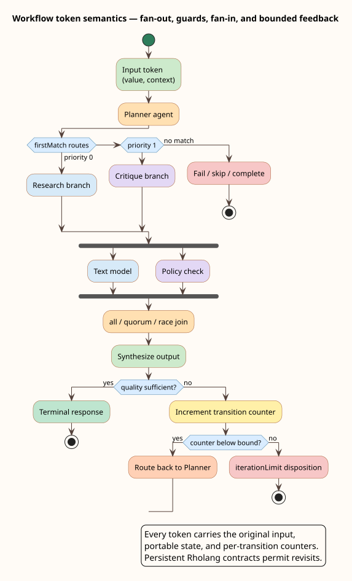

# Editor and operator guide

This guide is for a team author using Embers and for an operator running the local F1r3sky–Embers–F1r3node stack.

## Build a cyclic, branching team

1. Open the Agent Team graph editor and add agent, gateway, wait, approval, input, and output nodes as needed.
2. Connect nodes in the natural direction of control flow. Back-edges are valid; the canvas no longer assumes a directed acyclic graph.
3. Open an edge’s context menu and choose **Configure transition**.
4. Select a trigger disposition. `completed` is the ordinary successful result; structured agents can also produce application-specific dispositions such as `failed`, `rejected`, or `timedOut`.
5. Select `firstMatch` when exactly one ordered route should win, or `allMatches` when every true route should fan out.
6. Define a guard using a literal, comparison, existence test, or pure Rholang expression.
7. For every feedback path, choose a positive iteration bound or a durable yield. A path through a wait node is already a progress boundary.
8. Where several branches converge, open the target node’s context menu and choose **Configure fan-in**. Select `all`, `each`, `quorum`, or `race`, plus the late-arrival disposition where applicable.



### Example: bounded critique loop

Create `Draft -> Critique -> Decide`. Configure two transitions from `Decide` in one first-match route group:

```json
{
  "accept": {
    "guard": {
      "kind": "compare",
      "left": { "kind": "path", "root": "output", "path": ["score"] },
      "operator": "ge",
      "right": { "kind": "literal", "value": 0.8 }
    },
    "priority": 0,
    "targetNodeId": "publish"
  },
  "revise": {
    "guard": { "kind": "literal", "value": true },
    "loop": { "maxIterations": 3 },
    "priority": 1,
    "targetNodeId": "draft"
  }
}
```

The unconditional `revise` route is the fallback. Its bound belongs to that transition, not to the nodes, so another feedback edge can have a different budget.

### Read the canvas: edge annotations

A fully default transition — `completed` trigger, all-matches routing, `fail` on no match, priority 0, no guard, no loop — draws as a bare edge with **no annotation**: only deviations from the default earn ink. Deviations compose left to right, separated by a raised dot, in a fixed order; hovering an annotated edge shows the full descriptive label, and right-clicking the edge opens **Configure transition** as before.

| Symbol | Meaning | Source field |
| --- | --- | --- |
| a disposition or custom name (for example `failed`, `reviewDone`) | Non-default trigger | `trigger` |
| `output.score ≥ 0.8`, `∃ state.flag`, `¬(…)`, `∧`, `∨`, `⊥` | Guard, compressed to mathematical notation | `guard` |
| `rho` | The guard is a pure Rholang expression | `guard.kind = "rholang"` |
| `↻ ≤ n` | Bounded cycle with budget `n` | `loop.maxIterations` |
| `↻ d` | Durable-yield cycle (checkpoints each iteration) | `loop.durableYield` |
| `#n` | Routing order inside a first-match group (shown even at 0) | `priority` under `routeMode: "firstMatch"` |
| `∅→skip`, `∅→done` | Non-default no-match policy (`fail` is silent) | route group `noMatch` |

The example above renders its `accept` edge as `output.score ≥ 0.8 · #0` and its `revise` edge as `↻ ≤ 3 · #1` — the whole decision structure is readable from the canvas without opening a dialog.

## Compose scopes, regions, and history

Hierarchy is authored with two editor gestures and one node kind:

1. Select the nodes that belong together (they must share one parent) and choose **Wrap in state scope** from the context menu. The editor creates a state-scope container owning a fresh child scope and moves the selection inside it.
2. Open the container's **Edit node** dialog to set the scope fields: the scope kind and `history` mode are picker controls offering exactly their domains — `compound` (one initial node) or `parallel` (several; parallelism is token multiplicity, one token per initial), and `none`, `shallow`, or `deep` — alongside the initial node identifiers and the entry and exit activity lists. Entry and exit entries must name activity nodes inside the scope; they run sequentially as ordinary durable effects, before the initials and after the last token is consumed respectively. Every transition leaving an entry or exit activity must itself target an activity node — publish validation enforces this on any trigger, because a lifecycle failure routes with its lifecycle purpose intact and only activities can continue the lifecycle.
3. Place a `history` node inside a scope to restore a remembered configuration explicitly on some path: a `deep` history node accepts any remembered snapshot, a `shallow` one only shallow-recorded snapshots, and both fall back to the scope's initials when nothing acceptable is remembered.

Two behaviors are worth internalizing before relying on history. First, after a remembering scope completes once, simply re-entering it through its owning container restores the remembered configuration — no history node required and no mode filter; the initials apply only to the first entry. Second, history remembers each token's *last recorded position*, including tokens that were consumed before the scope completed; route retired branches into `final` nodes so snapshots name resting positions. Multi-node remembered configurations restore with exact live-token accounting through a history node, so no shape restriction applies. The full semantics, with diagrams, are in the [statechart semantics](../theory/statechart-semantics.md); the scope statechart is [diagram 13](../diagrams/13-scope-hierarchy-semantics.svg) and the restoration cases are [diagram 15](../diagrams/15-history-restoration.svg).

## Draft versus deploy

Save accepts structurally valid but incomplete work. This permits ordinary editor workflows such as placing a node before connecting it. Deploy is the semantic gate and checks all references, route groups, agent version pins, joins, pure guards, and cycle progress boundaries. The diagnostic panel on the canvas previews these errors before deployment.

The exact cycle check removes all wait nodes and all bounded or durable-yield edges, then rejects any strongly connected component that still contains a cycle. It therefore rejects a hot inner loop even if a larger surrounding cycle contains a bound.

## Guard roots

Value paths begin at one of four roots:

| Root     | Meaning at a transition                                          |
| -------- | ---------------------------------------------------------------- |
| `input`  | The immutable invocation input carried in the execution context. |
| `output` | The value produced by the source node.                           |
| `state`  | Portable workflow state in the execution context.                |
| `error`  | The source value interpreted by an error route.                  |

A pure Rholang guard declares the paths it consumes and then references them as `$name`. Communication, receives, fresh-name binding, contracts, URI literals, registry access, and other effectful forms are rejected. Keep guards small; call an activity node when computation requires authority or effects.

## Invoke from F1r3sky

Publish a post that mentions the F1r3sky identity configured for the team. F1r3sky resolves the identity’s `com.f1r3sky.agentsteam.config`, prepares and signs the Embers invocation with the active wallet, and marks the thread as pending. Embers runs the team and posts one terminal reply.

The terminal post is at most 280 Unicode scalar values. If the result is longer, Embers truncates it with an ellipsis before appending the run URL. The URL is never omitted. Opening it shows the run capability, team URI, start time, status, and ordered event types. It never shows prompt text, model output, credentials, or artifacts.

## Inspect and resume a durable run

The run page polls while a run is `running`, `resuming`, or `suspended`, shows its revision, public wait IDs, deadline, approval grants, and event sequence, and exposes commands when the current browser has a wallet session. Select the exact wait before sending `signal`, `event`, `approve`, `reject`, or `retry`. Cancellation targets the whole run. Two further command classes are offered as deliberate operator tools rather than routine buttons. `timerFired` is an escape hatch for degraded-scheduler operation: due timers (including approval deadlines, durable yields, and timers nested at arbitrary depth) are normally fired by the Embers recovery scheduler, so the form prefills the expected deadline from the run's published `dueAt` and the kernel cleanly rejects a mismatched or early fire. `migrate` rebinds the run to another pinned definition and is gated behind an explicit confirmation summarizing the source hash, target hash, and target team URI, with the state patch validated as a JSON array of patch operations before anything is signed. The UI prepares a contract, signs it with the active wallet, and sends the same request/response/token bundle used by every Embers mutation. The run status machine is [diagram 09](../diagrams/09-run-lifecycle.svg) and the wait lifecycle is [diagram 10](../diagrams/10-wait-approval-lifecycle.svg).

Commands use optimistic concurrency. A request made against revision 4 cannot mutate revision 5; refresh and inspect the new waits instead. A delegated approver can decide only a grant for the exact wait and wallet address. The owner and configured Embers service retain run-level authority for recovery, scheduling, cancellation, and migration.

The raw API has two phases:

```http
POST /api/ai-agents-teams/runs/{runId}/commands/prepare
Content-Type: application/json

{
  "expected_revision": "4",
  "type": "signal",
  "wait_id": "nested:7f…:wait:token:3",
  "name": "reviewReady",
  "payload": { "approved": true }
}
```

Sign the returned `response.contract`, then post the signed contract together with the unchanged prepare request, prepare response, and token to `/commands/send`. Client applications should use `AgentsTeamsApiSdk.command`, which performs this protocol and preserves all hashes and timestamps. The protocol's exact binding rules, the complete endpoint reference, and the served Swagger/OpenAPI surface are specified in [HTTP API and OpenAPI surface](../../../../embers/docs/api/http-api.md).

Timer commands must repeat the ledger’s exact `dueAt` value and cannot be applied early. Approval commands require a unique `decisionId`; replay is rejected. Migration is intentionally not a casual run-page operation because it changes the pinned definition and requires a reviewed target URI, target hash, and state patch.

## Control authority: approvers, links, and publication

Every authority you set as an author or operator is a concrete control with concrete limits; the [capability model](../security/capability-model.md) specifies what each one is made of, and this section is the operator-facing view of the knobs.

**Custody your keys, and know what each one is.** Your wallet key is deploy authority — it signs every mutation. A team's registry key is its *upgrade authority*: whoever holds it can replace the team behind its `rho:id:` URI with a higher version, and losing it freezes the version. Approver wallets are approval authority. These are distinct; sign only bytes you prepared (the two-phase protocol refuses a pre-signed contract), and treat the registry key with the same care as the wallet key.

**Choose approvers deliberately — a grant is wait-scoped and irrevocable until the wait resolves.** A delegated grant names one exact wait and one exact wallet address; an approver cannot forward it, cannot attenuate it, and there is no revoke command. The only ways a grant ends are a decision, the declared deadline firing `timedOut`, or a run-level `cancel` or `migrate`. Always declare an approval timeout with a `timedOut` route (publish validation requires the route when a timeout is present) so an absent approver cannot stall the run indefinitely. One authorized `reject` resumes the run regardless of quorum; an empty approver list means owner-only approval in effect.

**Share run links as public metadata.** A run URL is a bearer read capability — possession is the only check — and for F1r3sky-invoked runs Embers posts the link publicly on the terminal reply by design. So treat a run's status, wait IDs, grants, deadline, and event types as world-readable; a direct chain reader can even enumerate owner-scrubbed run records. The link never confers command authority (commands need a wallet), so the risk is disclosure of metadata, not control. Avoid F1r3sky invocation for teams whose metadata is sensitive; the browser-history and referrer cautions are in the [threat model](../security/threat-model.md#trust-boundaries).

**Know what publishing exposes.** Publishing a team to F1r3sky makes its URI public, and because registry lookup is unauthenticated the team's entry capability and control heads become public-invocable: anyone with the URI can run the team — at their own cost and as their own run owner — and read the full definition and hash through the manifest head. Never embed a secret in a definition, prompt, or node/wait name you intend to publish. Republishing a higher version redirects future lookups but does not recall a URI someone already holds.

**Which policy knobs are enforced today.** On an activity's execution policy, the timeout, maximum output bytes, retry caps, loop bounds, and the 32-deep nesting limit are enforced at runtime. The `authorities` field is recorded but not yet enforced, and the visibility field is a placeholder — the [capability model](../security/capability-model.md#recorded-but-unenforced) states their status and the [authority-enforcement proposal](../design/authority-enforcement.md) specifies how `authorities` would become a real confinement control. The editor hides the Authorities input and the Foreign-language term node for exactly this reason: neither controls anything today, so offering them would imply a capability that does not exist.

## Start the local stack safely

From `../embers-local-stack/`:

```bash
./stack.sh up
```

`up` is idempotent and does not wipe chain or F1r3sky state. A new profile creates its browser-importable wallet before genesis so that wallet is funded. If a preserved chain predates that file, `up` exports the already-funded local Embers service wallet instead of resetting or rewriting genesis; the banner prints the exact JSON file to import through **Wallets → Add wallet**. It reuses the standard `../f1r3node-rust/target/release/node` binary by default. Override repository or binary locations with `F1R3NODE_BIN`, `EMBERS_REPO`, `F1R3SKY_REPO`, and `F1R3SKY_BACKEND`.

`up` also mounts F1r3drive and starts storage, Embers, and the F1r3sky web UI as restartable user services. Unit names are scoped by the first 12 hexadecimal digits of `SHA-256(canonical run directory)`, for example `embers-local-stack-85acf1f3910a-f1r3drive.service`, `embers-local-stack-85acf1f3910a-embers.service`, and `embers-local-stack-85acf1f3910a-f1r3sky-web.service`. This prevents one profile's status or stop command from claiming another profile's processes. For foreground development logs, stop the managed stack and run:

```bash
./stack.sh embers
```

The script mounts an owner-isolated F1r3drive, starts it in manual-propose mode, configures independent encryption and capability-derivation keys, and sets `EMBERS__PUBLIC_RUN_URL` to the configured Embers UI plus `/runs`. Embers refuses durable startup if the path is not an actual F1r3drive FUSE mount. F1r3drive recovers stale FUSE registrations and restarts on failure. Embers is ordered after, requires, and is bound to the matching drive unit; the drive unit continuously upholds Embers so a recovered mount recreates the API service. The managed F1r3sky web unit retains its process tree after `up` exits and is restarted on failure. `./stack.sh status` distinguishes managed, external, starting, down, and durable/degraded states. `./stack.sh stop` stops the web UI and Embers before its drive and unmounts only the selected profile. Start the Embers frontend development server in `embers-frontend` if it is not already available.

The stack sets `EMBERS__FINALIZATION__DEPLOY_TIMEOUT_MILLIS=120000`. This is the shared budget for implicit finalized-deploy waits during bootstrap, Testnet deployment, Agent Team runs and commands, guards, effects, and run advancement. Explicit activity timeouts remain authoritative. Increase the value for a deliberately slower network; it must remain positive. Client request timeouts should exceed it so transport and observer visibility retain their own headroom.

Only the explicit command below deletes the local chain and F1r3sky development-network state. It requires an interactive confirmation:

```bash
./stack.sh reset
```

Use `./stack.sh status` to check nodes, Embers, PostgreSQL, Valkey, F1r3sky services, the web UI, and the local wallet.

## Operational failure modes

One dashboard flow deserves its shape stated because it once deadlocked: deleting an agent first reads which teams reference it under the loading overlay, then asks for confirmation only after the overlay is released — dialogs are never awaited under the loader, so the confirmation is always answerable, and dismissing any dialog (Escape included) settles it as a cancellation instead of leaving the page stuck. If the referencing-teams read fails, the deletion is refused with an alert rather than guessed at, because deleting an agent a team still uses would break that team silently; confirming stops and removes each referencing team before the agent, halting at the first failure so no team is ever left pointing at a deleted agent.

| Symptom                                                | Likely cause                                                        | Action                                                                                      |
| ------------------------------------------------------ | ------------------------------------------------------------------- | ------------------------------------------------------------------------------------------- |
| Deploy rejects a cycle                                 | A hot subcycle bypasses every wait/bound/yield                      | Bound the bypass edge or route it through a wait.                                           |
| Deploy reports an unpinned agent                       | The node has an ID but no version                                   | Select and save an immutable agent version.                                                 |
| `up` refuses to start F1r3sky                          | The service is down while its database contains an old dev network  | Preserve it for diagnosis, or deliberately run `./stack.sh reset`.                          |
| Run link returns 404                                   | The UUID capability is malformed or belongs to another environment  | Use the exact link from the terminal reply.                                                 |
| Thread keeps showing pending after a failed invocation | A stale F1r3sky client predates pending cleanup                     | Reload after upgrading; current code clears both parent and root immediately.               |
| Command returns stale revision                         | Another command or recovery step already advanced the run           | Refresh the inspector and target the new revision/wait.                                     |
| Approval is rejected as unauthorized                   | The wallet is neither owner/service nor granted for that exact wait | Use the designated approver wallet or update the workflow’s approval policy.                |
| F1r3drive flush fails                                  | The encrypted object did not reach proposal finality                | Keep the run unadvanced, restore drive/node health, and let recovery retry.                 |
| A profile reports Embers as external                   | Another run directory owns the API process on the shared port       | Run `status` with that profile's `EMBERS_STACK_RUN_DIR`; stop it before switching profiles. |
| Nested wait command cannot find a child                | The qualified path is stale or was copied without its prefixes      | Copy the exact current `waitId` from the run inspector.                                     |
| A `yield:` wait stays suspended                        | The recovery scheduler is not polling, or the yield predates auto-resume (no `dueAt`) | Check scheduler health first — yields resume automatically at the poll cadence; a pre-fix parked yield can only be cancelled or migrated. |
| An approval resumed `timedOut` without any decision    | Its declared deadline expired and the scheduler fired it            | Expected: the `timedOut` route ran; late decisions answer "wait ... is not pending".        |
| A published team behaves differently without a redeploy you made | A higher `insertSigned` version was published behind the same URI   | Verify custody of the team's registry key; nested consumers are protected by the manifest-hash pin. |
| A stranger ran your published team                     | Publication makes the URI publicly invocable — this is by design    | Expected: the stranger's run is theirs (they are its owner and pay its cost); it confers no authority over your runs. |

## Current boundary

Cycles, deterministic branching, all five join families, correlated epochs, compound/parallel scopes, history, pinned agents and child teams, Rholang URI activities, durable waits/commands, deadlines, retry, cancellation, compensation, encrypted snapshots, recovery, short F1r3sky replies, and the metadata-only run inspector execute without f1r3node or MeTTaIL changes. Foreign Language Terms remain publish-time rejected until the Rholang 1.4 specification and the under-review FLT/virtual-bridge FIPS stabilize; the Foreign-language term node is correspondingly hidden from the editor palette (its registry entry stays, so an existing definition containing one still renders). The execution-policy dialog's Authorities field is likewise hidden while it is recorded-only. The three gaps the statechart review verified — durable-yield resumption, multi-target history-node restoration accounting, and approval-deadline enforcement — are resolved and evidenced ([roadmap](../roadmap.md#resolved-review-findings)). See the [capability matrix](../README.md#capability-matrix).
