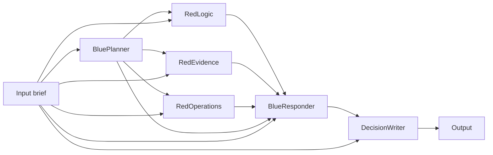

# Red/blue engineering decision demo

Publication defaults, account credentials, and per-agent inputs/outputs are covered in [Publishing a team and inspecting its agents](publication-and-agent-history.md).

Build **RedBlueDecisionReview** live in 25–30 minutes. Blue proposes and revises a plan. Three red reviewers challenge it. The decision writer produces a useful brief.

The demo uses six agents, one review round, and a final answer. The UI and fallback seeder both deploy a durable Workflow v2 team, with a separate finalized activity for each agent. It does not execute the proposed plan. The original RedTeam and Research Desk demos remain separate.

## Before the audience arrives

1. Follow the [shared stack runbook](customer-demo-runbook.md) for the compatible node build and service startup.
2. Confirm the profile and stack status:

```sh
cd ~/Workspace/f1r3fly.io/embers-local-stack
./stack.sh status
```

The default demo profile is `embers-local-stack/run/profiles/research-desk`. Both nodes, the validator proposer, F1r3drive, and Embers must be up. Bot and mail services are not required.

3. Open <http://localhost:5173> and sign in with the funded wallet shown by `stack.sh status`. Use the `value` field from its wallet JSON. Do this before screen sharing.
4. Run the deterministic integration checks:

```sh
cd ~/Workspace/f1r3fly.io/embers/packages/embers
uv run pytest tests/api/agents_teams/test_red_blue_demo.py -v --strict-services
```

Expect three passes with no skips. They cover a flawed proposal, an acceptable proposal, and missing information. These tests call the local chain, not a model.

5. Prepare a fallback team and rehearse the model service:

```sh
cd ~/Workspace/f1r3fly.io/embers/packages/embers
uv run python ../../../embers-frontend/demo/red-blue/seed.py --seed \
  --brief-file ../../../embers-frontend/demo/red-blue/brief.txt
```

This command calls the configured model through all six agents. Run integration tests and model rehearsals sequentially; allow the tests to finish before presenting. Each `--seed` creates a new set of agents and a new deployment. Use the saved deployment for later CLI runs by omitting `--seed`. Public deployment metadata is saved in the profile's `red-blue-demo.json`. Use `--run-dir /absolute/profile/path` for a different profile.

Keep this fallback separate from the live build: name the presentation's team **RedBlueDecisionReview-live**. The fallback agents have the prefix `RedBlueBackup-`. Use the six exact names below for the live build. Keep the six agent names themselves exact: downstream input keys depend on them.

## 0–3 minutes: explain the decision

Say: “We want a practical engineering policy. Blue must make it work. Red must identify concrete ways it could fail. The result must explain what changed.”

The brief asks a five-person team to adopt mandatory code review. It has one on-call engineer and no new tooling budget. The deliberately flawed starting policy requires two approvals even during emergencies and assumes recovery will never be delayed.

Show the workflow:



The original brief goes to every agent. Each critic gets the same proposal. BlueResponder waits for all three critiques before revising it.

## 3–12 minutes: create the six agents

Repeat these steps for each agent in the table:

1. From the dashboard, choose **Create new agent**.
2. Enter the exact agent name and choose **Continue**.
3. Wait until the editor shows the comment with the current agent’s name, such as `// BluePlanner agent.`.
4. Click inside the code editor and select all its text with Ctrl+A.
5. Paste the complete matching Rholang body from the code section below.
6. Choose **Save changes** and wait for the save confirmation in the log.
7. Choose **Back to dashboard** and confirm the navigation.

The individual agents need to be saved, but do not need separate deployments. Team deployment incorporates their saved code.

| Exact name     | Presenter explanation                                          |
| -------------- | -------------------------------------------------------------- |
| BluePlanner    | “Propose a plan within our real constraints.”                  |
| RedLogic       | “Find contradictions. What fails if this assumption is wrong?” |
| RedEvidence    | “Separate known facts from claims we have not measured.”       |
| RedOperations  | “Can our staffing and emergency process support this?”         |
| BlueResponder  | “Change the plan or explain why we accept each risk.”          |
| DecisionWriter | “Give us a brief we can use, preserving unresolved concerns.”  |

**Checkpoint:** all six new agents appear in the dashboard. Each saved body starts with `contract main(@input, return)`.

## 12–20 minutes: assemble the team

1. Choose **Agent teams**, then **Create new agent team**.
2. Name it **RedBlueDecisionReview-live** and choose **Continue**.
3. Drag one **Input** node, all six newly saved agents, and one **Output** node onto the canvas.
   For each agent drop, the **Configure Agent** dialog opens. Keep **protocol** set to `simple-v1` and choose **Save**.

4. Arrange Input, BluePlanner, the three critics, BlueResponder, DecisionWriter, and Output from left to right. Stack the critics vertically.
5. Click a right-side output handle, then the target’s left-side input handle. Repeat for this table.

| Source         | Targets                                                                          | Connections |
| -------------- | -------------------------------------------------------------------------------- | ----------: |
| Input          | BluePlanner, RedLogic, RedEvidence, RedOperations, BlueResponder, DecisionWriter |           6 |
| BluePlanner    | RedLogic, RedEvidence, RedOperations, BlueResponder                              |           4 |
| RedLogic       | BlueResponder                                                                    |           1 |
| RedEvidence    | BlueResponder                                                                    |           1 |
| RedOperations  | BlueResponder                                                                    |           1 |
| BlueResponder  | DecisionWriter                                                                   |           1 |
| DecisionWriter | Output                                                                           |           1 |

Keep the default successful routes and wait-for-all joins. Do not add a back-edge or an approval node. The shared [graph definition](../../../demo/red-blue/graph.json) lists these same 15 connections.

**Checkpoint:** eight nodes and 15 edges. Each critic has two incoming edges, BlueResponder has five, and DecisionWriter has two. No validation errors remain.

Say: “The red reviews can proceed independently. Blue cannot revise until every review is available. One round keeps the review finite.”

## 20–23 minutes: deploy

1. Choose **Deploy** in the graph editor. This saves the team and opens the deployment review.
2. Review the team name and choose **Deploy** again.
3. Wait for the **Success deploy** dialog.
4. Choose **View Agent** to return to the team editor.

**Checkpoint:** the **Run** button is available. Keep this tab open; avoid refreshing it during the presentation.

## 23–28 minutes: run the decision review

1. Choose **Run**.
2. Paste the full brief below into **Input prompt**.
3. Choose **Run** in the prompt dialog.
4. Wait for the result in the bottom log panel.

```text
Decision: Introduce mandatory code review for a team of five engineers.
Constraints: One engineer is on call at a time. No new tooling budget. Urgent production fixes must retain an emergency path. Use existing pull requests and CI.
Initial proposal to challenge: Require two approvals before every merge, including emergencies. Assume this never delays recovery.
Deliverable: Recommend a practical policy, explain changes after red-team review, preserve unresolved risks, and give a short rollout checklist with responsible roles, success measures and rollback.
Unknowns: We have not measured review turnaround time or emergency-fix frequency. Do not invent these measurements.
```

**Checkpoint:** the result is a non-empty brief with four sections:

| Section              | What to show the audience                                                                 |
| -------------------- | ----------------------------------------------------------------------------------------- |
| Recommendation       | A practical review policy within the five-person team's constraints.                      |
| Changes after review | Finding labels such as L1, E1, F1 and a change, mitigation, or accepted-risk explanation. |
| Remaining risks      | Missing baseline measurements and unresolved concerns, without invented evidence.         |
| Rollout checklist    | Responsible roles, a pilot, success measures, and conditions for rollback.                |

Ask: “What did red change?” Point to a concrete policy adjustment, such as an audited emergency bypass or a lighter approval requirement. Wording and recommendations can vary between model runs. The integration tests verify data flow; the rehearsal assesses the usefulness of the model's answer.

The node inspector shows execution metadata, not intermediate model text. Do not promise an intermediate-answer viewer. The final brief is the presentation artifact.

## 28–30 minutes: close and recover if needed

Explain that the next human decision is whether to adopt the recommendation. The workflow has not changed repositories, deployment settings, or team policy.

| Symptom                      | Recovery                                                                                                                                                                                     |
| ---------------------------- | -------------------------------------------------------------------------------------------------------------------------------------------------------------------------------------------- |
| Wrong or missing agent       | Return to the dashboard, verify the save, then select the newly saved version. Preserve exact names.                                                                                         |
| Missing input or run error   | Check all 15 connections, especially Input to downstream agents and all three critics to BlueResponder.                                                                                      |
| Validation failure           | Repair the incomplete graph before deploying. The shared graph and connection counts are the reference.                                                                                      |
| Empty model answer           | Use the preflight rehearsal to verify the configured model service. Use a previously captured rehearsal result if the service is unavailable.                                                |
| Finalization delay           | Check `stack.sh status`. Follow node/Embers recovery in the shared runbook; do not reset the chain during the demo.                                                                          |
| Agent `timedOut`             | Let other tests or runs finish, then run the query again without `--seed`. The successful UI rehearsal is saved in `embers-local-stack/run/profiles/research-desk/red-blue-live-answer.txt`. |
| Refresh loses the Run button | Re-deploy the saved live team, or use the prepared CLI fallback below.                                                                                                                       |
| Backup agents in the palette | Use exact names without `RedBlueBackup-` for the live build. The fallback seeder records its IDs in `red-blue-demo.json`.                                                                    |
| Log truncates a long answer  | Use the CLI fallback to print the complete model response.                                                                                                                                   |

CLI fallback, using the preflight deployment:

```sh
cd ~/Workspace/f1r3fly.io/embers/packages/embers
uv run python ../../../embers-frontend/demo/red-blue/seed.py \
  --brief-file ../../../embers-frontend/demo/red-blue/brief.txt
```

The browser integration journey is `e2e/tests/stack/red-blue.stack.spec.ts`. With the funded wallet key supplied privately in `EMBERS_E2E_STACK_KEY`, run it from `embers-frontend`:

```sh
EMBERS_E2E_STACK=1 pnpm --filter @f1r3fly-io/embers-e2e exec playwright test \
  --project=stack --workers=1 red-blue.stack.spec.ts
```

This journey funds a separate test wallet to keep test agents out of the presenter’s palette. It creates all six agents with deterministic bodies, draws the connections, deploys, runs a query, and checks the exact final result. It uses no model calls. A passing report must show one passed test and no skips.

## Complete agent code

Copy each complete body. These agents accept the editor’s exact-case producer labels and the legacy seeder’s lower-camel-case labels.

### BluePlanner

Source: [BluePlanner.rho](../../../demo/red-blue/agents/BluePlanner.rho)

```rholang
contract main(@input, return) = {
  new gpt4(`rho:ai:gpt4`) in {
    gpt4!("Use the supplied brief as the only factual source. Label assumptions and missing information. Do not invent evidence or claim to execute actions. Propose a practical engineering decision in at most 180 words. Include staffing, an emergency-fix path, rollout, success measures and rollback. Honor constraints and identify unresolved tradeoffs."
      ++ "\nBrief: " ++ input, *return)
  }
}
```

### RedLogic

Source: [RedLogic.rho](../../../demo/red-blue/agents/RedLogic.rho)

```rholang
contract main(@input, return) = {
  new gpt4(`rho:ai:gpt4`) in {
    gpt4!("Use the supplied brief as the only factual source. Label assumptions and missing information. Do not invent evidence or claim to execute actions. Review the proposal for contradictions and missing assumptions. Give at most two findings labeled L1 and L2. Each must include a concrete failure scenario and a suggested change or verification. If no material issue exists, say so without manufacturing an objection. Maximum 120 words."
      ++ "\nBrief: " ++ input.getOrElse("input", input.getOrElse("Input", input.getOrElse("input-node", Nil)))
      ++ "\nProposal: " ++ input.getOrElse("bluePlanner", input.getOrElse("BluePlanner", Nil)), *return)
  }
}
```

### RedEvidence

Source: [RedEvidence.rho](../../../demo/red-blue/agents/RedEvidence.rho)

```rholang
contract main(@input, return) = {
  new gpt4(`rho:ai:gpt4`) in {
    gpt4!("Use the supplied brief as the only factual source. Label assumptions and missing information. Do not invent evidence or claim to execute actions. Review the proposal for unsupported claims and missing evidence. Give at most two findings labeled E1 and E2. Each must include a concrete failure scenario and a suggested change or verification. If no material issue exists, say so. Maximum 120 words."
      ++ "\nBrief: " ++ input.getOrElse("input", input.getOrElse("Input", input.getOrElse("input-node", Nil)))
      ++ "\nProposal: " ++ input.getOrElse("bluePlanner", input.getOrElse("BluePlanner", Nil)), *return)
  }
}
```

### RedOperations

Source: [RedOperations.rho](../../../demo/red-blue/agents/RedOperations.rho)

```rholang
contract main(@input, return) = {
  new gpt4(`rho:ai:gpt4`) in {
    gpt4!("Use the supplied brief as the only factual source. Label assumptions and missing information. Do not invent evidence or claim to execute actions. Review staffing, rollout and operational failure handling. Give at most two findings labeled F1 and F2. Each must include a concrete failure scenario and a suggested change or verification. If no material issue exists, say so. Maximum 120 words."
      ++ "\nBrief: " ++ input.getOrElse("input", input.getOrElse("Input", input.getOrElse("input-node", Nil)))
      ++ "\nProposal: " ++ input.getOrElse("bluePlanner", input.getOrElse("BluePlanner", Nil)), *return)
  }
}
```

### BlueResponder

Source: [BlueResponder.rho](../../../demo/red-blue/agents/BlueResponder.rho)

```rholang
contract main(@input, return) = {
  new gpt4(`rho:ai:gpt4`) in {
    gpt4!("Use the supplied brief as the only factual source. Label assumptions and missing information. Do not invent evidence or claim to execute actions. Revise the proposal using all three reviews. Address EVERY finding by its label with CHANGE, MITIGATE, or ACCEPT RISK and a reason. Do not silently drop unresolved concerns. Preserve missing information. Include responsible roles, success measures and rollback. Maximum 300 words."
      ++ "\nBrief: " ++ input.getOrElse("input", input.getOrElse("Input", input.getOrElse("input-node", Nil)))
      ++ "\nOriginal proposal: " ++ input.getOrElse("bluePlanner", input.getOrElse("BluePlanner", Nil))
      ++ "\nLogic review: " ++ input.getOrElse("redLogic", input.getOrElse("RedLogic", Nil))
      ++ "\nEvidence review: " ++ input.getOrElse("redEvidence", input.getOrElse("RedEvidence", Nil))
      ++ "\nOperations review: " ++ input.getOrElse("redOperations", input.getOrElse("RedOperations", Nil)), *return)
  }
}
```

### DecisionWriter

Source: [DecisionWriter.rho](../../../demo/red-blue/agents/DecisionWriter.rho)

```rholang
contract main(@input, return) = {
  new gpt4(`rho:ai:gpt4`) in {
    gpt4!("Use the supplied brief as the only factual source. Label assumptions and missing information. Do not invent evidence or claim to execute actions. Write a decision brief with exactly these four headings: Recommendation; Changes after review; Remaining risks; Rollout checklist. Preserve all finding labels and their dispositions, unresolved concerns, missing evidence, responsible roles, success measures and rollback. Do not turn accepted risk into a resolved issue. Maximum 240 words and 1900 characters total."
      ++ "\nBrief: " ++ input.getOrElse("input", input.getOrElse("Input", input.getOrElse("input-node", Nil)))
      ++ "\nReviewed plan: " ++ input.getOrElse("blueResponder", input.getOrElse("BlueResponder", Nil)), *return)
  }
}
```

### Reading a published run’s full answer

Open the run link in the F1r3sky reply. The Embers run page shows status first, then the response panel. Use **Sign in to view response** with the wallet that submitted the query, then **Reveal full response**. The answer is formatted with headings, lists, tables, and code. **Copy response** copies its original text; **Raw response** exposes the complete returned value. **Agent activity → Unlock agent history** authorizes access to each agent’s retained inputs and outputs. Repeated executions and nested agents remain distinct. **Technical details → Event history** preserves the lower-level runtime events. Reloading or changing wallets requires revealing the answer again.

To verify an existing completed run against the real stack, privately supply its submitting wallet key in `EMBERS_E2E_STACK_KEY`, set `EMBERS_E2E_REVEAL_RUN_ID` to the run ID, and run from `embers-frontend`:

```sh
EMBERS_E2E_STACK=1 pnpm --filter @f1r3fly-io/embers-e2e exec playwright test \
  --project=stack --workers=1 run-reveal.stack.spec.ts
```

This test signs a reveal request and checks that the response remains inside the viewport. It creates no teams or model runs. Require one passed test with no skips.
