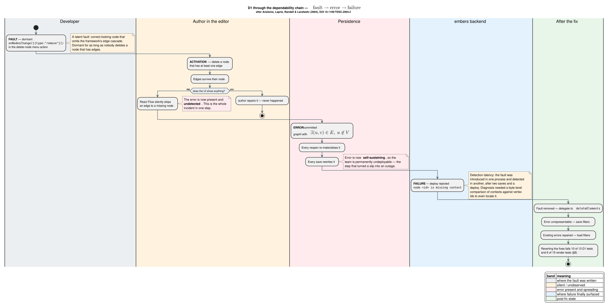
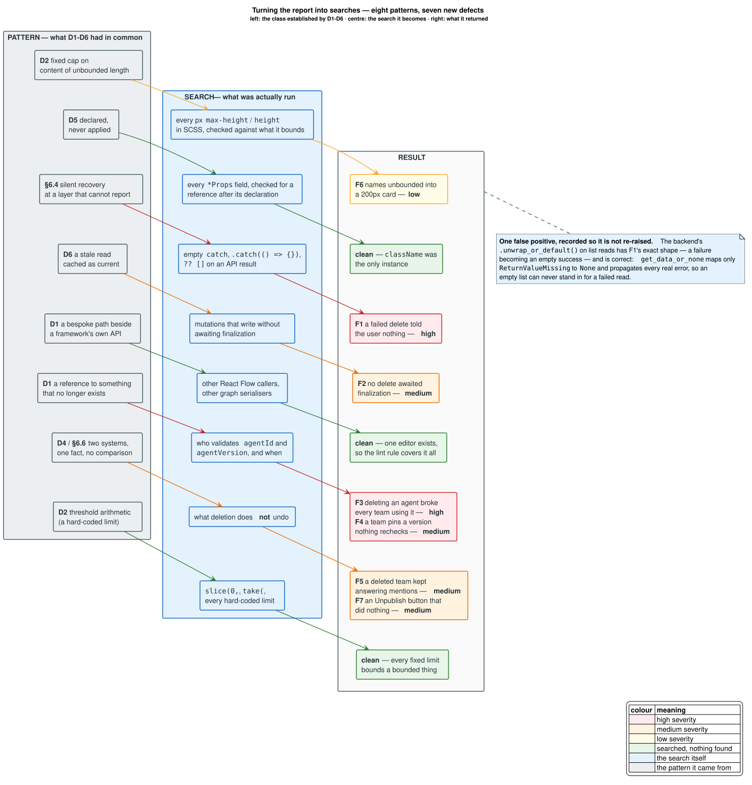
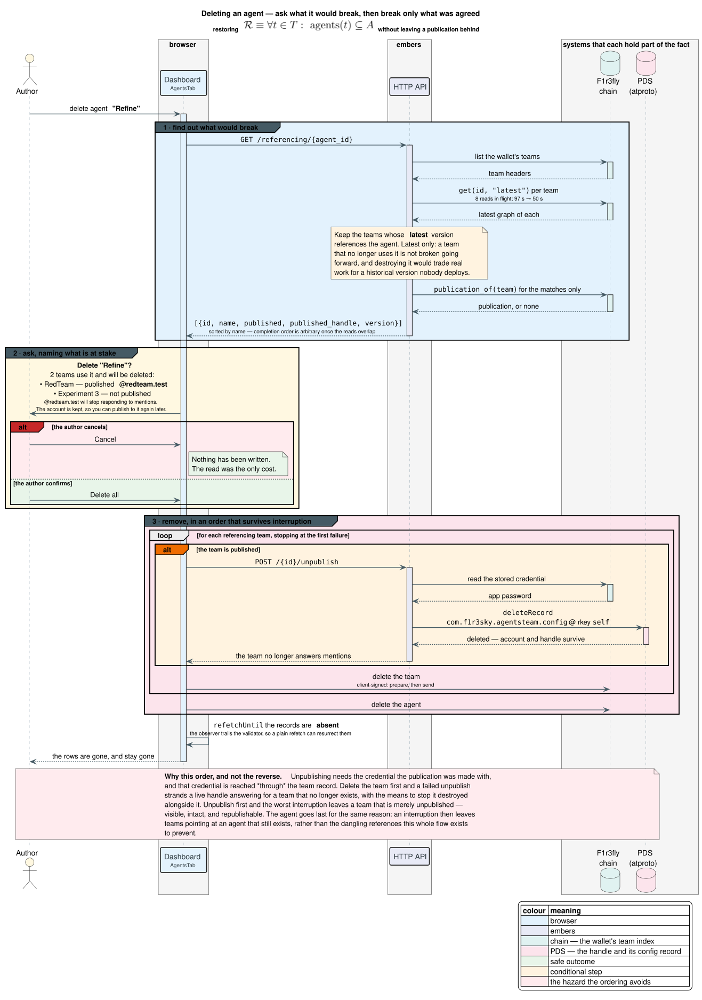
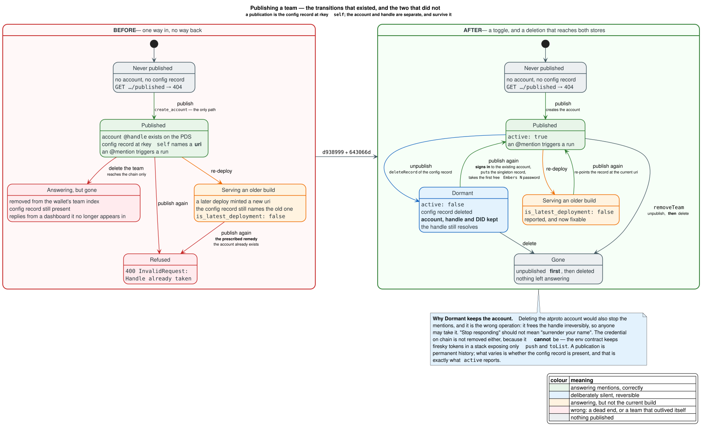
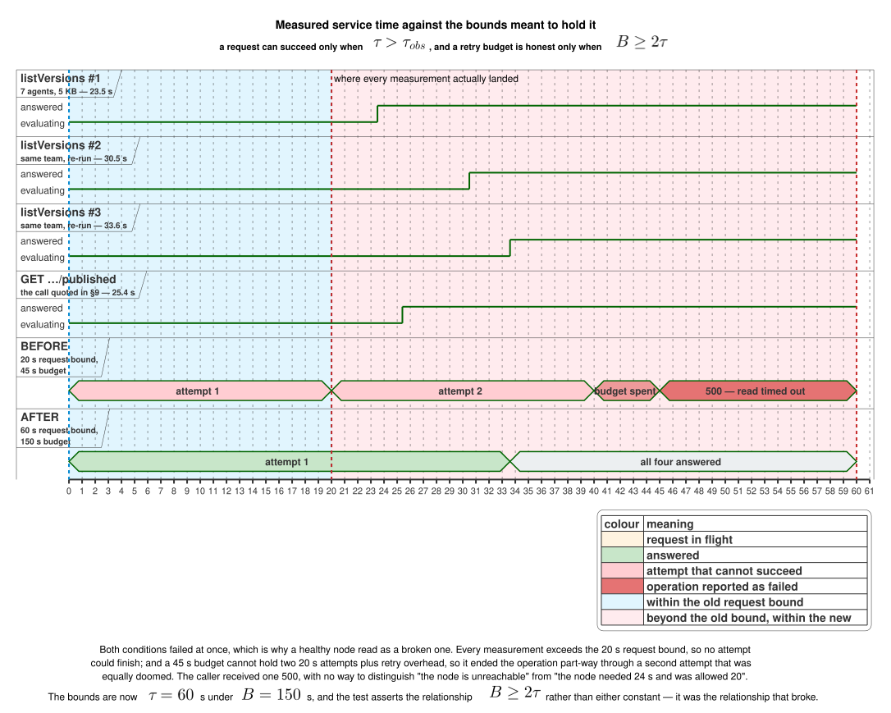

# Post-mortem: silent-failure defects in the agent-team editor

**Date of incident:** 2026-07-29 / 2026-07-30 (UTC)
**Surfaced by:** preparing the red-team agent-team demo on the local stack
**Status:** all six defects fixed, all nine prevention measures implemented, all eight
action items closed, and every one covered by a test that fails without it. The
patterns drawn from these six were later re-run as searches over the rest of the
codebase and found seven more, recorded in
[§10](#10-applying-this-report-to-the-rest-of-the-system) together with the
corrections that work forced on this report.
**Fixes in `embers-frontend`:** `f9f3759`, `d5bc2d0`, `dc3076a`, `96ecf54`, `ae78b40`,
`147ed82`, `5795e69`, `4402ce4`, `693554f`, `6ebaa9c`
**Fixes in `embers`:** `c27a824`, `ed79aaa`, `53467b1`, `643066d`, `d938999`

---

## 1. Summary

Six defects were found while building a six-agent team in the Embers graph editor.
One of them made a team **permanently undeployable** once triggered, and because
nothing in the interface indicated a problem, it survived every reload and every save
until a deploy was attempted. A seventh agent, authored on the same wallet but not
part of the team, is what activated the second.

| #      | Defect                                                         | Severity                            | User-visible symptom                                                 | Fix                  |
| ------ | -------------------------------------------------------------- | ----------------------------------- | -------------------------------------------------------------------- | -------------------- |
| **D1** | Deleting a node from the context menu left its edges behind    | **Critical** — data corruption      | Deploy fails with `node <id> is missing context`, permanently        | `f9f3759`            |
| **D2** | The sidebar's agent panel clipped every row past the sixth     | **High** — data loss to the eye     | The seventh agent (`Refine`) simply was not there                    | `d5bc2d0`            |
| **D3** | Deploy and publish had no entry point once a team was deployed | Medium — usability                  | The editor offers only `Run`; publishing appears impossible          | `dc3076a`            |
| **D4** | A dev-env restart un-publishes a team without un-marking it    | Medium — cross-system inconsistency | `@handle` does not autocomplete although the team reads as published | `ed79aaa`, `d938999` |
| **D5** | `AccordionProps.className` was declared but never applied      | Low — latent                        | A caller's `className` is silently ignored                           | `d5bc2d0`            |
| **D6** | A newly created agent or team did not appear in its list       | Medium — stale read                 | The record is missing until some later refetch                       | `ae78b40`            |

**The property they share, and the reason this document exists:** every one of them
failed _without emitting a signal at the point of failure._ A graph was corrupted
but drawn as if intact. A list was clipped but reported no overflow. A team was
un-published but still presented as published. A prop was declared but quietly
discarded. In each case the system held information the operator did not, and the
gap between those two states is where the cost accumulated.

That property is the reusable part. Turned into a set of searches and run over the
rest of the codebase, it found **seven further defects**, none of them known and one
of them a button that did nothing at all —
[§10](#10-applying-this-report-to-the-rest-of-the-system). Fixing those in turn
corrected several claims made below — most consequentially in
[§5.4](#54-d4--a-dev-env-restart-un-publishes-a-team-without-un-marking-it) and
[§9](#what-a5-turned-up), where a recovery this report prescribed turned out to be one
the code could not perform. The corrections are marked where they occur rather than
quietly folded in, so the record shows what was believed as well as what is true.

### Impact

The demo could still be given: the published team pointed at an intact deployment
(`rho:id:f6pgt8k8…`, team version `019fb065`), so `@redteam.test` worked throughout.
What could **not** be demonstrated was _creating a new team_, because D1 corrupts a
graph the moment a node is deleted from the context menu — an action any live
demonstration of editing would plausibly perform. There was no data loss on chain
(storage is append-only, so the corrupt versions sit alongside intact ones), and no
production system was involved.

So this is a **near-miss**, and it is written up for the reason Beyer et al. give for
writing up near-misses at all [[8](#references)]: what a post-mortem is worth is
determined by what the system let through, not by how much the failure happened to
cost. The delivered demo is evidence about luck — an intact deployment that predated
the corruption — and nothing about the defects. Waiting for a defect to cost something
before analysing it means analysing only the ones that were also unlucky, and
[§10](#10-applying-this-report-to-the-rest-of-the-system) is what that would have
forfeited: seven further defects, found by taking this incident seriously enough to
extract a pattern from it.

---

## 2. Terminology

Defined before first use, so the analysis below can be read without cross-referencing.

| Term                        | Meaning                                                                                                                                                                                                                                                                                                                                                                |
| --------------------------- | ---------------------------------------------------------------------------------------------------------------------------------------------------------------------------------------------------------------------------------------------------------------------------------------------------------------------------------------------------------------------- |
| **Agent**                   | A user-authored Rholang contract stored per wallet, addressed by `(id, version)`.                                                                                                                                                                                                                                                                                      |
| **Agent team**              | A directed graph whose nodes are agents or built-in node kinds, compiled to a single Rholang `contract agentsTeam(@input, return)`.                                                                                                                                                                                                                                    |
| **Node kind**               | The type of a graph node: `agent`, `compress`, `input-node`, `output-node`, `text-model`, `tti-model`, `tts-model`, `deploy-container`.                                                                                                                                                                                                                                |
| **graphl**                  | The textual graph language a team is stored as on chain. The browser converts between it and an in-memory AST via the WASM package `@f1r3fly-io/graphl-parser`.                                                                                                                                                                                                        |
| **Vertex**                  | A graph node's identifier as it appears in graphl, e.g. `aae6cd198179248b2af377980fe4f55db`.                                                                                                                                                                                                                                                                           |
| **Context**                 | The JSON blob attached to a vertex recording its node kind and data, e.g. `{"type":"agent","agentId":…}`. A vertex **with** a context is a real node; one **without** is the defect at the centre of D1.                                                                                                                                                               |
| **Dangling edge**           | An edge naming a vertex that has no context — i.e. an edge to a node that does not exist.                                                                                                                                                                                                                                                                              |
| **Registry URI**            | The `rho:id:…` address a deployed team's contract is reachable at. Each deploy mints a new one.                                                                                                                                                                                                                                                                        |
| **PDS**                     | Personal Data Server — the atproto server (`:2583`) holding accounts and records. Publishing a team creates an account here.                                                                                                                                                                                                                                           |
| **AppView**                 | The atproto indexing service (`:2584`) that serves search and timelines, fed from the PDS. `@`-autocomplete queries it.                                                                                                                                                                                                                                                |
| **Observer / read node**    | The F1r3fly node embers reads from. It trails the validator, so a read immediately after a write can legitimately return older state.                                                                                                                                                                                                                                  |
| **Handle**                  | An account's human-readable atproto name, e.g. `redteam.test`. Unique across a PDS, and what an `@mention` is written with.                                                                                                                                                                                                                                            |
| **DID**                     | Decentralised identifier — an account's permanent machine identity, e.g. `did:plc:…`. Survives a handle change; a handle does not survive account deletion.                                                                                                                                                                                                            |
| **rkey**                    | Record key — the name a record has within a collection in an atproto repository. A collection whose every account holds at most one record uses the fixed rkey `self`.                                                                                                                                                                                                 |
| **Config record**           | The `com.f1r3sky.agentsteam.config` record at rkey `self` on a published team's account. Its presence is what makes f1r3sky treat the handle as a team, and therefore what makes an `@mention` fire.                                                                                                                                                                   |
| **Publication**             | The act of giving a team a handle: create or claim the account, store its credential on chain, and write the config record. **Unpublishing** deletes only the config record.                                                                                                                                                                                           |
| **App password**            | A revocable per-application credential issued by an atproto account. Names are unique per account, which is why a second publication cannot reuse one.                                                                                                                                                                                                                 |
| **Fault / error / failure** | Following Avizienis et al. [[1](#references)]: a **fault** is the latent defect in the code; it becomes an **error** when activated and the system's state is wrong; it becomes a **failure** when that wrong state is externally observed. The three are separated in time, and that separation is a large part of this story.                                        |
| **Failure detector**        | The mechanism by which one component decides another has failed — here, a timeout. Chandra and Toueg [[10](#references)] characterise one by its **completeness** (every real failure is eventually suspected) and its **accuracy** (a healthy component is not). [§10.4](#104-a-slow-node-and-a-broken-one-were-the-same-observation) is a detector that had neither. |
| **Referential integrity**   | Codd's requirement [[9](#references)] that every reference resolve to something that exists, and the **referential action** — cascade, or refuse — a system takes when a delete would break one. [§10.3](#103-two-invariants-that-had-no-name) applies both to a team graph.                                                                                           |

---

## 3. The invariant that was violated

A saved team is a directed graph. Let $`V`$ be the set of vertices carrying a
context and $`E`$ the set of edges. Well-formedness is the statement that every
edge connects vertices that exist:

```math
\mathcal{W}(G) \;\equiv\; \forall\,(u,v) \in E:\; u \in V \;\wedge\; v \in V
```

$`\mathcal{W}`$ is exactly what the backend checks when it parses a team, and
exactly what D1 violated. Denote by $`W = \{\,G : \mathcal{W}(G)\,\}`$ the set of
well-formed graphs.

Now write $`s`$ for save (`toApiGraph`) and $`l`$ for load (`fromApiGraph`). Before
the fix, neither inspected edge endpoints, so both preserved a violation:

```math
G \notin W \;\Longrightarrow\; s(l(G)) \notin W
```

The ill-formed graph was therefore a **fixed point** of the edit cycle. This is the
formal content of the phrase "self-perpetuating", and it explains the symptom that
made D1 severe rather than annoying: it was not that one deploy failed, but that
_every subsequent_ deploy failed, with no edit the author could make to escape —
reopening the team read the phantom edge back in, and saving wrote it out again.

The fix makes $`l`$ a retraction onto $`W`$:

```math
\operatorname{im}(l) \subseteq W
\qquad\text{hence}\qquad
s(l(G)) \in W \;\text{ for every } G
```

so a single load-then-save cycle repairs any stored graph, and $`s \circ l`$ is
idempotent on $`W`$ thereafter. That distinction — a **repair** rather than a mask —
is the property a reviewer should check, and it is why the fix is placed on load as
well as on save.

D2 requires only arithmetic, but the arithmetic is the reason it lay dormant. With a
panel height cap $`H_{\max}`$ and a row pitch $`h_{\text{row}}`$, the number of rows
a fixed-height panel can show is

```math
n_{\text{visible}} \;=\; \left\lfloor \frac{H_{\max}}{h_{\text{row}}} \right\rfloor
\;=\; \left\lfloor \frac{300\,\text{px}}{48\,\text{px}} \right\rfloor \;=\; 6
```

For an agent set $`A`$, the defect is therefore unobservable while
$`|A| \le 6`$ and appears on the transition to $`|A| = 7`$. Nothing in the code
changed to activate it; **data growth did**.

---

## 4. Timeline

All times UTC, taken from `run/embers.log`, `run/val.log`, the PDS, and on-chain
version metadata — not from recollection.

| Time                         | Event                                                                                                                                                  |
| ---------------------------- | ------------------------------------------------------------------------------------------------------------------------------------------------------ |
| 23:28:56 – 23:29:18          | Six red-team agents created (`Hypothesize` … `Condense`), blocks 1007–1013                                                                             |
| 23:30:40                     | Team `RedTeam` created, version `019fb037-46d1`                                                                                                        |
| 23:30:47                     | Deployed → `rho:id:xfut9kwp…`; a live run returns in **18.6 s**, reply 278 chars                                                                       |
| 23:35:16 – 23:35:26          | Version `019fb03b-7c52` created and deployed                                                                                                           |
| 23:49:48                     | `stack.sh backend` cold start — dev-env state wiped, `user1.test` re-seeded (**D4 armed**)                                                             |
| 00:21:17                     | Version `019fb065-9fc7` created                                                                                                                        |
| 00:24:48                     | `redteam.test` account created on the PDS — **publish succeeded**                                                                                      |
| 00:55:14, 00:55:24, 01:10:35 | Three publish attempts fail: `400 InvalidRequest: Handle already taken: redteam.test` — retries of a publish that had already landed (**D4 observed**) |
| 01:12:55                     | Deploy rejected: `node a6ecd2a90419242a3ac8c5cd9456b8bac is missing context` (**D1 observed**)                                                         |
| —                            | A seventh agent, `Cavify`, is created; `Refine` disappears from the sidebar (**D2 observed**)                                                          |
| —                            | Versions `019fb096-dafe` and `019fb096-f503` saved, each with 9 contexts and 10 vertex ids                                                             |

Note the ordering: **D1's fault was introduced before 01:12:55 but only detected
then**, and detection required comparing context declarations against vertex
references byte by byte. The gap between cause and evidence is the central
observation of [§6](#6-why-none-of-them-were-caught).

---

## 5. Defect analysis

### 5.1 D1 — deleting a node stranded its edges


_Figure 1 — where a team graph travels, and the three points that now enforce
$`\mathcal{W}(G)`$. Before the fix, only Guard 3 existed, and it ran in another
process._

#### Mechanism

The editor's context-menu action built removal changes by hand:

```ts
// apps/embers/src/lib/components/GraphEditor/GraphEditor.tsx — before the fix
onClick: () => {
  const changes: NodeChange<Node>[] = input.nodes.map((node) => ({
    id: node.id,
    type: "remove" as const,
  }));
  onNodesChange(changes);
},
```

`onNodesChange` applies `applyNodeChanges`, which removes the node from the node
array and **does not touch edges**. React Flow removes a node's edges only through
its own `deleteElements`, verified in the installed source
(`@xyflow/system@0.0.74`):

```js
// getElementsToRemove — the edge cascade the hand-built path skipped
const connectedEdges = getConnectedEdges(matchingNodes, deletableEdges);
const matchingEdges = connectedEdges;
```

The same function also cascades to child nodes via `parentId`, and skips anything
marked `deletable: false`. The keyboard route
(`deleteKeyCode={["Delete","Backspace"]}`, `GraphEditor.tsx:126`) goes through
`deleteElements` and was therefore always correct. **Two paths existed; only the
bespoke one was wrong, and only the built-in one had ever been exercised.**

#### Why it was invisible

React Flow declines to draw an edge whose endpoint is absent. That is a reasonable
defence in a view layer, but here it removed the only feedback channel that could
have told the author something was wrong. The canvas looked exactly as intended.

Nothing downstream objected either. `buildGraphEdges` emitted a binding for every
edge regardless of whether its endpoints were being written, and `buildEdges` read
every edge back without checking that its endpoints existed. So the phantom edge
round-tripped indefinitely.


_Figure 2 — the loop. Load re-materialised the phantom, save wrote it back, and the
only signal arrived at deploy time in a different process._

#### Evidence

Comparing context declarations against vertex references across saved versions
isolated it precisely:

| Version         | Deployed | Contexts | Vertex ids | Dangling                            |
| --------------- | -------- | -------- | ---------- | ----------------------------------- |
| `019fb091-8fcc` | yes      | 10       | 10         | —                                   |
| `019fb096-dafe` | no       | 9        | 10         | `aae6cd198179248b2af377980fe4f55db` |
| `019fb096-f503` | no       | 9        | 10         | `aae6cd198179248b2af377980fe4f55db` |

The corrupt versions' edge list shows what the author did. The dangling id appears
in **two** edges — `Condense → ghost` and `ghost → Output` — alongside a direct
`Condense → Output`. That is the signature of deleting a node in the middle of a
chain and reconnecting its neighbours: the rewire succeeded, and both stubs of the
removed node survived.

The identity of the ghost confirms it. The last intact version, `019fb091-8fcc`,
defines that same id `aae6cd198179248b2af377980fe4f55db` with a context naming the
agent **`Cavify`**, wired `Condense → Cavify → Output`. So the sequence was: insert
`Cavify` into the chain, deploy, then delete it from the context menu and reconnect
`Condense` straight to `Output`. The reconnection is visible in the saved graph; so
are both edges to the node that no longer exists.

#### Fix

Three changes, in `f9f3759`:

1. **Prevent** — the menu delegates to React Flow's own deletion, so the menu and
   the keyboard cannot diverge again:

   ```ts
   // apps/embers/src/lib/components/GraphEditor/menuItems.tsx:167
   void rf.deleteElements({ nodes: input.nodes });
   ```

2. **Repair** — load drops edges naming an undefined vertex (`graph.ts:330`), which
   is what makes $`l`$ a retraction onto $`W`$ and heals stored graphs.

3. **Refuse** — save drops edges whose endpoints are not being written
   (`graph.ts:60`), so no future path can persist one.

The choice to **filter rather than throw** is deliberate, and differs from
`requireString`, which throws when an agent node lacks its id. The distinction is
recoverability: a missing agent id represents lost intent that must surface, whereas
a dangling edge carries no information at all, so discarding it is a repair and not
a concealment. See [§7](#7-prevention) P3 for the residual concern that this repair
is currently silent.

### 5.2 D2 — the sidebar clipped every agent past the sixth


_Figure 3 — a 300 px cap against seven 48 px rows, and why $`|A| \le 6`$ hid it._

#### Mechanism

Three CSS rules composed into a dead end:

```scss
/* Accordion.module.scss — before the fix */
.accordion-content {
  max-height: 0;
  overflow: hidden;
}
.accordion-content.open {
  max-height: 300px;
  overflow: auto;
}
.accordion-content.open.overflow-hidden {
  /* … */
  overflow: hidden;
}
```

`.open` capped the panel at 300 px but set `overflow: auto`, so the remainder would
at least have been scrollable. The sidebar passed `overflow="hidden"`, which
activated the third rule and **removed that escape hatch**. Rows past the cap were
rendered, drawn outside the box, and unreachable.

The row pitch follows from `NodeItem.module.scss`: `padding: 8px` around a 24 px row
gives a 40 px box, and `margin: 8px 0` collapses between siblings to give an 8 px
gap, so $`h_{\text{row}} = 48\,\text{px}`$. Measurement corroborates it — the panel
reported 354 px for seven rows, and
$`8 + 7(40) + 6(8) + 8 + 10 = 354`$ (leading margin, rows, gaps, trailing margin,
panel padding).

#### Why it was invisible

Two reasons, and the second is the more instructive.

First, CSS clipping produces no error, no warning, and no scrollbar once
`overflow: hidden` is set. The only way to observe it is to compare `scrollHeight`
against `clientHeight`, which requires a layout engine.

Second, it is a **latent threshold fault**. $`\lfloor 300/48 \rfloor = 6`$, and there
were six agents for as long as anyone had looked. No commit activated it; creating a
seventh agent did. This is why it appeared to the author as though `Cavify` had _replaced_
`Refine`: the list is sorted case-insensitively by name, `Cavify` sorts to the top
and `Refine` sorts last, so adding one at the front pushed the last one past the cap.

#### Fix

`d5bc2d0` adds a `fitContent` flag that removes the cap for panels whose length is
not known in advance:

```scss
/* Accordion.module.scss:65 */
.accordion-content.open.fit-content {
  max-height: none;
  overflow: visible;
}
```

`max-height: none` rather than a larger number is the point: the panel is as tall
as its rows, whether that is three or ninety, and shrinks again on delete, so **no
count is encoded anywhere.** Overflow moves to the sidebar body, which already
declares `overflow-y: auto`. The four log-panel accordions keep the cap, where a
bounded scrolling box is the desired behaviour.

`overflow="hidden"` is not merely unnecessary now — it was the setting that
converted an overflow into a clip, so the sidebar no longer passes it. If a cap ever
returns, the list will scroll rather than silently truncate.

The same commit reorders the two panels so the curated **All Nodes** list precedes
**Your Agents**. That is not cosmetic: the curated list is a fixed six, so placing
it first means the unbounded list grows downward into the sidebar's scroll instead
of pushing the built-in nodes out of view.

Verified in a browser: seven rows in name order, `max-height: none`, and
`scrollHeight === clientHeight === 354`.

### 5.3 D3 — deploy and publish became unreachable


_Figure 4 — the lifecycle, the states from which an action was unreachable (D3), and
the divergent state that no code reconciled (D4). The note on `Divergent` also records
what was later found about its only exit: "publish again" worked here solely because
the dev-env wipe had freed the handle as well.
[Figure 9](#103-two-invariants-that-had-no-name) is the same lifecycle after both were
fixed._

The editor header renders one primary button, labelled by
`canRun = isDeployed && !hasGraphChanges`. On a deployed team with no pending edits
it reads **Run** — at which point re-deploying required making an edit first, and
publishing existed only on the dashboard card. Neither action was discoverable from
the editor, which is where a user working on a team actually is.

`dc3076a` adds a caret beside the primary button opening a menu with **Deploy** and
**Publish to F1R3SKY**, gated on `isDeployed` — the precondition both share, since a
second deploy is only ever a re-deploy and the server rejects publishing an
undeployed team outright. Clicking the button itself is unchanged.

The menu says "Publish", not "Re-publish", because **the client cannot tell the
difference.** Neither the team record nor the SDK's `AgentsTeam` model carries a
published handle or DID, and the publish token is stored on chain encrypted with no
read endpoint. Naming it "Re-publish" would be wrong on a first publish. This is the
same missing state as D4, and P7 addresses both.

### 5.4 D4 — a dev-env restart un-publishes a team without un-marking it

Publishing calls `create_account` on the PDS and records the result on chain. Those
are two systems holding one fact, and nothing compares them.

`stack.sh backend` wipes dev-env state on any cold start — `pg_clear` plus a valkey
flush, unconditional whenever the PDS is not already answering `/xrpc/_health` — and
re-seeds only `user1.test`. That destroys a published team's account while the
publish record on chain survives. Embers therefore continues to present the team as
published, `@`-autocomplete finds nothing, and the only remedy is to publish again.

The misleading part is that the _observable_ failure looks like an autocomplete bug.
It is not. Diagnosis is a two-step check:

```sh
# 1. Does an agent-team account exist at all?  A healthy dev-env holds exactly
#    mod-authority.test, lex-authority.test, user1.test — a published team is a 4th.
curl -s 'http://localhost:2583/xrpc/com.atproto.sync.listRepos?limit=50'

# 2. Is typeahead itself working?  Unauthenticated against the AppView, this must
#    return user1.test.  Through the PDS proxy the same call needs auth.
curl -s 'http://localhost:2584/xrpc/app.bsky.actor.searchActorsTypeahead?q=user'
```

If step 2 returns `user1.test` and step 1 shows only three repos, the account is
gone and the chain record is stale.

**Closed by `ed79aaa` and `d938999`.** The reconciliation A5 describes now answers
this question directly: `GET …/published` consults the PDS rather than trusting the
chain record alone, and reports `account_exists` and `active` as three-valued —
true, false, or unknown when the PDS could not be asked. The diagnosis above is
retained because it is still the fastest way to confirm the _cause_ once the endpoint
reports a divergence, and because it is what the endpoint was written against.

**A correction to what this section claimed.** The last sentence of the paragraph
above — "the only remedy is to publish again" — was true of the intent and false of
the code. `publish_to_firesky` called `create_account` unconditionally and treated
its failure as fatal, so publishing to a handle the team already owned could not
succeed. The remedy worked _only_ in the case examined here, where the dev-env wipe
had also freed the handle; in every other case it failed with
`400 InvalidRequest: Handle already taken`. That is the same error this report's own
timeline records three times, where it was read as retries of a publish that had
already landed. That reading is correct and incomplete: those three lines are also
the only surviving trace of a defect that made a documented recovery path
unreachable. See [§10.2](#102-what-it-found) F5 and the note in
[§9](#what-a5-turned-up).

### 5.5 D5 — a prop declared but never applied

`AccordionProps` declared `className?: string`, but the component never destructured
or applied it, so any caller's class was silently discarded. Harmless in effect —
nothing passed one — but it is the same failure shape as the rest: a declared
capability that does nothing, with no diagnostic. Fixed in `d5bc2d0` by applying it
to the root element.

### 5.6 D6 — a new agent or team did not appear in its list

Creating an agent left it missing from the dashboard. The invalidation after
finalization fires while the dashboard is unmounted, so it only marks the list
stale; the refetch then happens on the next mount and reads the observer node, which
still trails the validator. **That read succeeds and returns the list as it was** —
stale data, not an empty response — so neither react-query's retry nor the backend's
retry-on-empty helpers notice, and it is cached as current.

`ae78b40` refetches until the written record is actually present, with bounded
exponential backoff. `type: "all"` is required because the list query is inactive at
that point — writes happen from an editor page, not the dashboard — so invalidating
alone would defer straight back into the same lag.

**That fix covered creation only.** Deletion has the identical exposure in the
opposite direction — the observer can return a record the validator has already
removed, so an optimistically removed row reappears — and none of the three delete
mutations awaited finalization or refetched at all. The gap was not noticed when
`ae78b40` was written and was found later by re-running this section's own pattern
against the rest of `queries.ts` (F1 and F2 in [§10.2](#102-what-it-found)). Both
directions now go through one helper, `refetchUntil(client, key, predicate)`, with
creation passing "present" and deletion passing "absent", so the two cannot drift
apart again. Generalising the helper rather than writing a second one was the point:
the defect was not that deletion lacked a fix, but that the fix for creation was
expressible only for creation.

---

## 6. Why none of them were caught


_Figure 5 — the layers that should have stopped each defect, the hole each slipped
through, and which holes remain open. The layered framing follows Reason [[2](#references)]:
an incident reaches the operator only when every layer has an aligned gap._

Six causes. Each is tied to evidence rather than asserted.

### 6.1 Coverage shaped like the happy path

Every pre-existing graph test built a **single-edge** graph and asserted
`toHaveLength(1)`. Fan-out, fan-in, and malformed input had never been constructed
at all. The suite established that the code worked on the input it expected; it said
nothing about what the code did with input it should reject. Hoare's framing
[[4](#references)] is apt — the tests asserted post-conditions on valid input, never
the invariant itself.

### 6.2 Component rendering was structurally untestable

`jest.config.js` declared `testEnvironment: "node"`, there was no jsdom, and
`moduleNameMapper` covered only `\.module\.scss$`. Importing any component therefore
threw on its first stylesheet or icon import — `@xyflow/react/dist/style.css` was
enough to fail a test file outright.

The barrier was incidental rather than intentional, but its effect was decisive:
**there was no component-render coverage of any kind**, which is precisely where D2,
D3 and D5 lived. A test-suite shape can foreclose a category of defect from ever
being caught, without anyone deciding that it should.

### 6.3 Two paths, one tested

React Flow provides `deleteElements`; the app also hand-rolled removal changes. Only
the framework path was exercised, and only the bespoke path was wrong. Parnas's
argument for hiding a module's internals [[5](#references)] applies directly: the
edge cascade is part of what "delete a node" _means_ in React Flow's model, and
reimplementing the caller's half of it re-implemented it incompletely.

The generalisable rule is P9: whenever the app adds a bespoke path beside a
framework built-in, both must be tested against the same invariant.

### 6.4 Silent recovery at the wrong layer

React Flow's refusal to draw an edge to a missing node is defensive and sensible in
isolation. Placed where it was, it suppressed the only signal that could have
reached the one person able to act. Leveson and Turner's analysis of the Therac-25
[[3](#references)] makes the same point about a latent fault combined with absent
feedback: the fault was necessary for the accident, but the missing feedback is what
made it consequential.

The lesson is not "never recover silently" — it is that **recovery at a layer that
cannot report is indistinguishable from concealment.**

### 6.5 Distance between fault and failure



_Figure 6 — D1 along the dependability chain of Avizienis et al. [[1](#references)].
The fault sat dormant in the menu action; the error was the graph saved with a
phantom edge; the failure was a deploy rejected minutes later in another process.
The width of the gap between the three is what made a small mistake expensive._

The fault was written in the editor. The failure surfaced in a different process,
after two saves and a deploy, as:

```
node aae6cd198179248b2af377980fe4f55db is missing context
```

No node label, no indication that a stale edge was the cause, no hint that
reopening and saving would repair it. Locating the cause required fetching the
stored graphl and comparing its `context … for <id>` declarations against every
`let <id> =` reference. That diagnostic is now recorded in
[Appendix A](#appendix-a-invariant-check), but the underlying issue is that the
error names an internal identifier rather than anything the author recognises (P6).

### 6.6 Divergent state with no reconciliation

D4's cause is structural: one fact, two stores, no comparison. Any system that
records in store _A_ that something exists in store _B_ needs either a reconciliation
path or a read that consults _B_. Embers had neither, so the UI was confidently wrong
after a dev-env reset and — the same gap — could not label its own publish button
correctly. `ed79aaa` supplies the second: `GET …/published` consults the PDS on every
read rather than reconciling periodically, which is the cheaper answer here because
the fact is small, read rarely, and needed fresh exactly when a user is looking at it.

This is the cause with the longest reach in the whole report. Of the seven defects
found later by re-reading these six as search patterns, **three** are instances of it
— a published team surviving its own deletion (F5), a team pinning an agent version
the agent no longer has (F4), and a team referencing an agent that no longer exists
(F3). In each, two stores hold one fact and only one of them is written. It is worth
stating the general form, since it will recur:

> Whenever a write to store _A_ implies something about store _B_, either the write
> reaches both, or a read consults both. Anything else is a divergence waiting for
> the interval between them to matter.

---

## 7. Prevention

Prioritised. Each item is concrete enough to act on, and names the defect it closes.

| #      | Measure                                                                                                         | Closes     | Status                    |
| ------ | --------------------------------------------------------------------------------------------------------------- | ---------- | ------------------------- |
| **P1** | ESLint rule rejecting hand-built `{ type: "remove" }` node changes, pointing at `deleteElements`                | D1         | **done**                  |
| **P2** | Property-based round-trip tests over generated graphs, asserting $`\mathcal{W}(s(l(G)))`$ for arbitrary $`G`$   | D1         | **done**                  |
| **P3** | Make the silent repair observable — warn when `buildEdges` or `toApiGraph` drops an edge                        | D1         | **done**                  |
| **P4** | jsdom and `@testing-library/react` for interaction-level tests                                                  | D2, D3, D5 | **done**                  |
| **P5** | Codify "no fixed height cap on content of unbounded length" in `../architecture/patterns/component-patterns.md` | D2         | **done**                  |
| **P6** | Backend graph errors name the neighbouring nodes and the remedy, not only a vertex id                           | D1         | **done**                  |
| **P7** | Record the published handle/DID; reconcile chain against PDS                                                    | D3, D4     | **done**                  |
| **P8** | Fixtures must exceed any layout capacity — test with $`N`$ greater than any cap                                 | D2         | **done**                  |
| **P9** | When the app adds a bespoke path beside a framework built-in, test both against the same invariant              | D1         | **done**, and generalised |

P9 was recorded as "done for D1" and has since earned its general form. The measure
was written about a bespoke path beside a _framework_ built-in, but the property that
matters is narrower and more common: **two paths reaching the same effect, only one of
which carries the guard.** F5 in [§10.2](#102-what-it-found) is that shape with no
framework involved — a team could be deleted from the dashboard card or as part of an
agent cascade, and only the cascade stopped the publication first. Both now call one
`removeTeam`, which is the enforcement P9 actually asks for: not two tested paths, but
one path the other must go through.

### Notes on the measures

**P1** turns a convention into a build failure. The rule below was tested against
both spellings before being written down:

```js
// eslint.config.js
"no-restricted-syntax": ["error", {
  selector: "ObjectExpression:has(Property[key.name='type']:has(Literal[value='remove']))",
  message: "Use rf.deleteElements() — hand-built remove changes strand a node's edges.",
}],
```

The nested `:has(Literal[value='remove'])` is load-bearing, and the reason is worth
recording because it is a trap of the same shape as the incident itself. The obvious
form — `Property[key.name='type'][value.value='remove']` — **does not match the code
that caused this bug.** In `{ id: node.id, type: "remove" as const }` the property's
value is a `TSAsExpression` wrapping the literal, not a `Literal`, so the attribute
selector silently fails. Verified with ESLint: the naive selector flags
`{ type: "remove" }` and ignores `{ type: "remove" as const }`; the form above flags
both and leaves `{ type: "add" }` alone. A prevention measure that quietly matches
nothing is worse than none, because it also removes the incentive to look again.

The rule will need scoping to the GraphEditor directory, since edge removal
legitimately constructs the same shape.

**P2** carries a dependency decision. `fast-check` is **not** currently installed,
so this is either a new dev dependency or a dependency-free seeded generator written
in-repo. The property is short and exactly the invariant of [§3](#3-the-invariant-that-was-violated):

```
for all generated (nodes, edges), including edges to absent nodes:
    W(fromApiGraph(toApiGraph(nodes, edges)))
```

QuickCheck's original argument [[6](#references)] is the relevant one — the defect
here is precisely the sort that arises on inputs a human fixture author does not
think to write, because writing a malformed graph on purpose requires already
suspecting the bug.

**P3** was the most important of them, and the least obvious. The fix as first
written repaired a corrupt graph _silently_. That is a strict improvement over
corrupting it silently, but it is the same failure mode one layer along: the author
is never told that a connection they once drew has been removed. `147ed82` closes the
feedback loop §6.4 identifies as the real enabler — dropping an edge now warns,
naming the endpoints removed.

The warning is unconditional rather than development-only, which was not the original
intent. `import.meta.env` is unavailable under the CommonJS output the tests compile
to, so a `DEV`-gated warning could not be observed by the test that proves it fires.
Given a choice between a repair announced everywhere and a repair whose announcement
is untestable, the first is right: this is a correction to the user's own data, and
there is no environment in which they should not hear about it.

**P4** was bounded by what the original approach could reach. The 15 render tests
added in `96ecf54` use `renderToStaticMarkup`, which needs no jsdom and no
testing-library — deliberately, to avoid adding dependencies. It cannot observe
layout, clicks, or focus, so it can assert that the `fit-content` class is applied but
**not** that nothing is clipped. `5795e69` adds the missing half, bringing in jsdom
and `@testing-library/react` for `headerInteraction.test.tsx`. It is enabled per file
through an `@jest-environment jsdom` docblock rather than globally, so suites that do
not need a DOM keep the faster `node` environment; `publishSuccessModal.test.tsx`,
added later in `6ebaa9c`, opts in the same way.

One limit survives deliberately and is worth stating, because it is the kind of gap
that otherwise gets forgotten: **jsdom has no layout engine.** `scrollHeight` and
`clientHeight` are both `0` there, so D2's clipping still cannot be asserted in a unit
test at all. The tests assert the mechanism — which class is applied, which value the
stylesheet gives it — and the outcome is verified in a real browser. A test that
appeared to check the clipping would be worse than none, since it would report a
capacity it cannot measure.

---

## 8. What went well

Worth recording, so these are not lost in a future refactor.

- **The backend rejected the corrupt graph.** D1 could have produced a team that
  deployed and then misbehaved at run time, which would have been far harder to
  diagnose. `parse` refusing an ill-formed graph is what bounded the damage to "will
  not deploy" — a loud failure — instead of "deploys and does the wrong thing".
- **Append-only storage preserved the intact versions.** Because a save creates a new
  version rather than mutating one, the last good version (`019fb091-8fcc`, and the
  published `019fb065`) remained deployable throughout. The demo survived on that
  property alone.
- **The join semantics were already correct.** Fan-out to several sinks and fan-in to
  one agent needed no new capability; a run returning at all is proof that every
  upstream stage produced a value, because a four-channel join cannot fire otherwise.
- **Every fix was validated by reverting it.** The tests were run against the pre-fix
  code and observed to fail: 10 of the 13 D1 tests, and 6 of the 15 render tests. The
  remainder are guards against _over_-correction — that an edge naming a deploy
  container is legitimate, that deleting a connector still works, that the delete
  action stays hidden for a container — and those correctly pass either way. A test
  that cannot fail documents nothing, and which tests could fail was measured rather
  than assumed.

---

## 9. Action items

All landed. Each is covered by a test that fails without it, verified by reverting
the change and observing the failure.

| #   | Item                                                    | Closes                         | Where                                                                                                     |
| --- | ------------------------------------------------------- | ------------------------------ | --------------------------------------------------------------------------------------------------------- |
| A1  | Warn when an edge is dropped, naming the endpoints      | §6.4 feedback gap              | `lib/graph.ts`                                                                                            |
| A2  | Lint rule against hand-built node removals              | D1 recurrence                  | `apps/embers/eslint.config.js`                                                                            |
| A3  | Unbounded-list rule recorded for reuse                  | D2 recurrence                  | `component-patterns.md`, [ADR-003](../architecture/decisions/003-graph-invariants-and-unbounded-lists.md) |
| A4  | Graph errors name the neighbouring nodes and the remedy | §6.5 fault→failure distance    | `graphl_parsing.rs`                                                                                       |
| A5  | Publish state recorded and reconciled against the PDS   | D3 label, D4 entirely          | `published_state.rs`, `GET …/published`                                                                   |
| A6  | jsdom + testing-library for interaction tests           | residual half of §6.2          | `headerInteraction.test.tsx`                                                                              |
| A7  | Property-based round-trip tests                         | the D1 _class_, not just D1    | `graphProperties.test.ts`                                                                                 |
| A8  | ADR recording the standards drawn from this             | drift back to the old patterns | [ADR-003](../architecture/decisions/003-graph-invariants-and-unbounded-lists.md)                          |

### What A5 turned up

Implementing the reconciliation exposed a third divergence nobody had named. A
publication is keyed by **deployment uri, not by team id** — every deploy mints a
fresh uri, while the account's `com.f1r3sky.agentsteam.config` record keeps naming
whichever uri was current when it was published. So re-deploying a published team
leaves mentions running the **older build**, silently.

`GET …/published` therefore reports `is_latest_deployment`, and the editor's menu
says so. Against the real `RedTeam` (`c1fd70d0-0487-4301-9353-c20c6b9a1e63`) it
answers:

```json
{
  "published_version": "019fb065-9fc7-71b2-bc91-9ba4befc3052",
  "uri": "rho:id:f6pgt8k8zgd3gecfaz6i7useie5tw8m1q1joozbkjxippiay8nsb5s",
  "is_latest_deployment": false,
  "active": null,
  "handle": null,
  "did": null,
  "account_exists": null
}
```

`false` is correct — a later version was deployed after the publish — and the nulls
are correct too: that publish predates handles being recorded, and the three-valued
`account_exists` reports "unknown" rather than claiming the account is gone. `active`
was added later, by the unpublish work in `643066d`, and is three-valued for the same
reason: it reports whether the config record that makes a mention fire is present on
the account, and `null` when that question cannot be put — either because the PDS did
not answer, or, as here, because the publication records no handle and no DID, so
there is no repository to ask about.

**Two things about this response were not understood when it was first recorded.**

First, the remedy it implies could not be performed. If mentions are running an older
build because publication is keyed by uri, the fix is to publish again at the current
uri — and publishing again was impossible until `d938999`, for the reason set out in
[§5.4](#54-d4--a-dev-env-restart-un-publishes-a-team-without-un-marking-it). The
report named a divergence and prescribed a recovery that the code could not carry out.
Naming a defect is not the same as checking that its remedy runs.

Second, the call that produced this block was past a limit nobody had measured. Re-run
against the same team after the bounds were raised, it took **25.4 s**; the per-request
read timeout in force when the block was first recorded was 20 s. One measurement is
not a distribution, so the honest statement is narrow: this call, on this team, took
longer than the bound that was supposed to hold it. `GET …/versions` for the same team
is the stronger case — three consecutive runs at 23.5 s, 30.5 s and 33.6 s, every one
of them over the bound, which makes it not flaky but unreadable. The block above is
therefore evidence twice over: for what it says, and for the fact that obtaining it sat
on the wrong side of a limit that reported a slow node as a broken one. That is
[§10.4](#104-a-slow-node-and-a-broken-one-were-the-same-observation).

### A note for whoever changes the API next

The generated client under `packages/client/src/api-client` has been **hand-extended**
— `Graph` is mapped through the WASM `astToGraphl`, which no generator emits.
Regenerating it produces 117 differing entries and would discard those edits, breaking
the editor. A5's endpoint is therefore read with a direct `fetch` in
`useTeamPublishedState`, documented at the call site. `schema.json` is kept current
regardless, so the spec stays honest about what the API offers.

Three endpoints now follow that pattern, each documented where it is called:

| Endpoint                                                    | Read by                                             | Added for |
| ----------------------------------------------------------- | --------------------------------------------------- | --------- |
| `GET /api/ai-agents-teams/{address}/{id}/published`         | `useTeamPublishedState`, `useTeamPublicationReader` | A5        |
| `GET /api/ai-agents-teams/{address}/referencing/{agent_id}` | `useReferencingTeamsReader`                         | F3        |
| `POST /api/ai-agents-teams/{address}/{id}/unpublish`        | `useUnpublishAgentsTeamMutation`                    | F5, F7    |

The rule for the next one is the same: extend `schema.json`, add the `fetch` beside
the others with a comment saying why it is not generated, and leave the generated
client alone. Regenerating it is a project in itself — the WASM mapping has to be
re-applied — and doing it accidentally, as part of adding an endpoint, is how the
editor breaks.

---

## 10. Applying this report to the rest of the system

The six defects above shared one property: each failed without emitting a signal at
the point of failure. A property is more useful than a list, because a property can be
**searched for**. This section records what happened when the shapes described in
[§6](#6-why-none-of-them-were-caught) were turned into searches and run over the rest
of the codebase — seven further defects, none previously known — and the corrections
that fixing them forced on this report.

The searches are written down so they can be re-run. That is the deliverable here as
much as the fixes are: a defect found once is a fix, and a defect _class_ found once is
a check.



_Figure 7 — each defect class from this report, the search it becomes, and what that
search returned. Three classes returned nothing, which is a result and is drawn as
one; a search that is never run and a search that finds nothing are indistinguishable
afterwards unless the difference is recorded._

### 10.1 The patterns, as searches

| Pattern from this report                          | Search                                                                              | Result         |
| ------------------------------------------------- | ----------------------------------------------------------------------------------- | -------------- |
| Fixed cap on unbounded content (D2)               | every pixel `max-height` and `height` in SCSS, cross-checked against what it bounds | **F6**         |
| Declared but never applied (D5)                   | every `*Props` field, checked for a reference after its declaration                 | clean          |
| Silent recovery (§6.4)                            | empty `catch`, `.catch(() => {})`, `?? []` applied to an API result                 | **F1**         |
| Stale read cached as current (D6)                 | mutations that write without awaiting finalization                                  | **F2**         |
| Hand-built beside a framework API (D1)            | other React Flow callers, other graph serialisers                                   | clean          |
| Reference to something that no longer exists (D1) | who validates `agentId` and `agentVersion`, and when                                | **F3**, **F4** |
| Two systems, one fact (D4, §6.6)                  | what deletion does _not_ undo                                                       | **F5**, **F7** |
| Threshold arithmetic (D2)                         | `slice(0,`, `take(`, every hard-coded limit                                         | clean          |

**A search does not only find its own pattern's defects.** "Who validates `agentId`
and `agentVersion`" was derived from D1 — a reference to something that no longer
exists — and it did find F3, which is exactly that. It also found F4, which is not:
a pinned `agentVersion` refers to something that still exists but has moved on, which
is §6.6's shape rather than D1's. The searches are addresses to look at, not
classifications of what is found there, and the table below therefore records where
each defect was found separately from what it turned out to be.

**The clean results are load-bearing.** "Declared but never applied" came back clean,
which is what makes D5's fix credible rather than lucky — `className` was the only
instance. "Hand-built beside a framework API" came back clean because there is exactly
one graph editor, so P9's lint rule covers the whole surface it was written for.
"Threshold arithmetic" came back clean because the only fixed limits in the codebase
bound genuinely bounded things.

**One search produced a false positive worth recording**, since it will look
suspicious again to the next reader. The backend uses `.unwrap_or_default()` on list
reads, which has exactly F1's shape — a failure becoming an empty success. It is
correct here: `get_data_or_none` maps only `ReturnValueMissing` to `None` and
propagates every real error, so an empty list can never stand in for a failed read.
The pattern is right and this instance is not an example of it.

### 10.2 What it found

Seven defects. Four were reachable by a user at the time; three were latent, waiting
on a condition that had not yet occurred. One of the four — F7 — was a control the
user could press that did nothing whatsoever.

"Latent" carries the meaning [§2](#2-terminology) gives it: the fault was in the code
and would become an error the moment it was activated. F3 needed only an author to
delete an agent some team was using, and F5 only a published team to be deleted.
Neither had happened yet on this wallet — a fact about how the system had been used,
not about how safe it was.

| #      | Defect                                                                                                                                                                               | Echoes       | Severity | Visible then | Fixed in             |
| ------ | ------------------------------------------------------------------------------------------------------------------------------------------------------------------------------------ | ------------ | -------- | ------------ | -------------------- |
| **F1** | A failed delete told the user nothing: `onError` rolled the optimistic removal back and discarded the reason, so a rejected delete looked like a row vanishing and quietly returning | §6.4         | **High** | yes          | `6ebaa9c`            |
| **F2** | No delete awaited finalization or refetched; the hardening D6 received was never applied to the opposite direction                                                                   | D6           | Medium   | yes          | `6ebaa9c`            |
| **F3** | Deleting an agent silently broke every team referencing it, with **no repair path** — the graph carries the agent's _name_, so the editor kept drawing the node                      | D1           | **High** | latent       | `6ebaa9c`, `643066d` |
| **F4** | A team pins the agent version it was built with; editing an agent left teams compiling the old code, unreported                                                                      | D4           | Medium   | latent       | `6ebaa9c`            |
| **F5** | Deleting a team removed it from the dashboard but not from the PDS, so a published team kept answering `@mentions`                                                                   | D4           | Medium   | latent       | `6ebaa9c`, `643066d` |
| **F6** | Agent and team names were unbounded and rendered into a fixed `height: 200px` card with no overflow rule                                                                             | D2           | Low      | yes          | `6ebaa9c`            |
| **F7** | The "Unpublish" button was `() => { close(); }`, and no unpublish existed anywhere in the backend; "View on F1R3SKY" had no handle to build a link from                              | dead control | Medium   | yes          | `6ebaa9c`, `643066d` |

**F3 deserves the emphasis it gets.** It is D1's shape with the recovery removed. A
dangling edge is repairable, because the edge carries no information and dropping it
restores a well-formed graph. A reference to a deleted agent is not: the node is
perfectly well formed, its `agentName` still renders, and only its referent is gone.
There is nothing to filter and nothing to infer. `deploy.rs` was the only thing that
noticed, at deploy time, in another process, naming a UUID the author had never seen.
The fix is therefore prevention rather than repair: deletion asks which teams would
break, names them, and takes them with it only if the user agrees.

**F4 was verified as a hazard, not as an instance.** At the time of the sweep, the
live `RedTeam` pinned seven agents and all seven were current, so nothing was actually
stale. Recording that distinction matters: the defect is that a team _can_ silently
compile an old agent and nothing says so, and it would be dishonest to present a
hazard as damage. The marking added to agent nodes makes both the stale case and F3's
missing case visible on the canvas, which is where the author is.

### 10.3 Two invariants that had no name

Both F3 and F5 are instances of §6.6 — one fact in two stores, and a write reaching
only one of them. Stating them in the register of
[§3](#3-the-invariant-that-was-violated) is what makes them checkable rather than
memorable.

Let $`A`$ be the set of agents a wallet holds and $`T`$ the set of its teams. For a
team $`t \in T`$, write $`\mathrm{agents}(t)`$ for the set of agent identifiers its
**latest** version references. **Referential integrity** is the statement that every
such reference resolves:

```math
\mathcal{R} \;\equiv\; \forall\,t \in T:\; \mathrm{agents}(t) \subseteq A
```

Deleting an agent $`a \in A`$ violates $`\mathcal{R}`$ for precisely the teams

```math
\mathrm{Ref}(a) \;=\; \{\,t \in T \;:\; a \in \mathrm{agents}(t)\,\}
```

and for no others. $`\mathrm{Ref}(a)`$ is exactly what
`GET …/referencing/{agent_id}` computes and exactly what the cascade removes, which
makes the fix the referential action of the relational model [[9](#references)] —
`ON DELETE CASCADE` — applied to a graph the type system does not police. The analogy
is worth taking seriously rather than as decoration: a database refuses the delete or
cascades it, and the one thing it never does is complete the delete and leave the
reference dangling. That third behaviour is what embers had.

**Latest versions only, deliberately.** $`\mathrm{agents}(t)`$ is defined over the
latest version rather than all of them. A team whose _latest_ version does not use the
agent is not broken going forward, and destroying it to protect a historical version
nobody is deploying would trade real work for nothing. The cost follows the same
bound: one list read plus one parse per team, rather than one per version per team.

The second invariant concerns publication. Let $`C`$ be the set of teams for which a
live `com.f1r3sky.agentsteam.config` record exists on the PDS — the record that makes
f1r3sky treat a handle as a team, and therefore the thing that makes an `@mention`
fire. **No publication outlives its team:**

```math
\mathcal{P} \;\equiv\; \forall\,t:\; t \in C \;\Longrightarrow\; t \in T
```

F5 is the failure of $`\mathcal{P}`$. Deleting a team removed $`t`$ from $`T`$
and left it in $`C`$, because `run.rho` resolves a team by registry uri and calls its
deployed contract directly, never consulting the wallet index that deletion writes to.
The team went on replying from a dashboard where it no longer appeared.



_Figure 8 — the cascade end to end. The read that names the affected teams happens
before the user is asked, so the confirmation describes what will actually be
destroyed; the removals then run in an order chosen so that any interruption leaves a
recoverable state._

**The order carries the whole guarantee.** Unpublishing needs the credentials the
publication was made with, and those are reached _through_ the team record. Delete
first, and a failed unpublish strands a live handle answering for a team that no longer
exists, with the means to stop it destroyed along with the team. Unpublish first, and
the worst interruption leaves a team that is merely unpublished — visible, intact, and
republishable. The costs are not symmetric, so the order is not arbitrary.

Following [Appendix B](#appendix-b-the-well-formedness-guards-as-literate-pseudocode),
the two operations stated as intent and then as code:

> _Removing one team stops it answering before it stops existing._ Whether it is
> published is passed in rather than discovered here, so the caller can put the same
> fact in front of the user before they confirm it. A team that was never published
> skips straight to deletion: unpublishing one that never was fails, and that failure
> would abort a removal with nothing wrong with it.

```
algorithm REMOVE-TEAM(teamId, published):
    if published:
        UNPUBLISH(teamId)              ▷ deletes the config record; keeps the account
    DELETE-TEAM(teamId)                ▷ removes the entry from the wallet index
```

Implemented as `removeTeam` in `apps/embers/src/lib/teams/removeTeam.ts`, called by
both delete paths so they cannot disagree about what "deleted" means.

> _Deleting an agent removes every team that would be broken by it, and only then the
> agent itself._ Sequential rather than concurrent: the first failure must stop the
> rest, and running the removals together would turn "stop at the first failure" into
> "stop after all of them have already happened". The agent goes last so that an
> interruption leaves teams pointing at an agent that still exists, rather than the
> reverse.

```
algorithm CASCADE(agentId, Ref(a)):
    for each t ∈ Ref(a), in the order shown to the user:
        REMOVE-TEAM(t.id, t.published)     ▷ stops on the first failure
    DELETE-AGENT(agentId)
```

Implemented as `runCascade` in
`apps/embers/src/pages/Dashboard/components/AgentsTab/deleteAgentCascade.tsx`.



_Figure 9 — publication as a state machine, before and after. The transition that did
not exist is the one from `published` back to `published`: publishing always created a
fresh account, so the only path out of `published` was through a handle nobody wanted
to change._

**Why unpublishing keeps the account.** Deleting the atproto account would also stop
the mentions, and it is the wrong operation: it frees the handle irreversibly, so
anyone can take it, and "stop responding" should not mean "surrender your name". What
unpublishing removes is the config record at rkey `self`. The stored credential on
chain is not removed either, because it _cannot_ be — the env contract keeps firesky
tokens in a stack exposing only `push` and `toList`. A publication is therefore
permanent history, and the only thing that varies is whether the config record is
present. That is what `active` reports.

Keeping the account is what made the republish defect load-bearing rather than
cosmetic: the entire justification for a reversible unpublish is that you can publish
to the same handle again, and until `d938999` you could not.

### 10.4 A slow node and a broken one were the same observation

The timeout finding is the one that changes how a reader should treat the rest of this
report, because it was not a defect in any feature — it was a constant chosen once and
never measured against the thing it bounds.

Write $`\tau`$ for the per-request timeout, $`B`$ for the total retry budget an
operation is given, and $`\tau_{\text{obs}}`$ for the service time actually observed.
Two conditions have to hold. A request can only succeed when its bound exceeds the work:

```math
\tau \;>\; \tau_{\text{obs}}
```

and a retry budget is only honest when it admits a second complete attempt, since a
budget that expires mid-retry reports "gave up" for what is really "was never allowed
to finish":

```math
B \;\ge\; 2\tau
```

Measured against a local network of 13 700 blocks, `listVersions` for a seven-agent
team returned 5 KB in $`\tau_{\text{obs}} = 23.5`$, $`30.5`$ and $`33.6`$ seconds
on three consecutive runs — the cost is in evaluating the term, not in moving the
result — and `GET …/published` for the same team in $`25.4`$ seconds. The configured
values were $`\tau = 20\,\text{s}`$ under $`B = 45\,\text{s}`$. Every attempt died
at the bound, the budget then ended the operation, and so `GET …/versions` and the
whole publish state of that team were **permanently unreadable** — not flaky,
unreadable, for as long as the team had that many agents.



_Figure 10 — the four measured service times against the old and new bounds. Every
measurement falls in the band the old configuration could not reach, and the old budget
could not have held two attempts even if one had been long enough._

This is a failure detector, and it was neither complete nor accurate in the sense
Chandra and Toueg give those words [[10](#references)]: it reported a healthy node as
failed, and it offered the caller no way to tell that report from a real failure. Every
diagnosis made through it was therefore suspect, including a slow endpoint that had
been written off as a broken one.

The bounds are now $`\tau = 60\,\text{s}`$ under $`B = 150\,\text{s}`$, and the
test that guards them asserts $`B \ge 2\tau`$ rather than either constant, because
what broke was the relationship and not the numbers:

```rust
// packages/firefly-client/src/read_node_client.rs
#[test]
fn read_budget_fits_two_attempts() {
    let request_timeout = ReadNodeConfig::default().request_timeout;

    assert!(
        TOTAL_READ_BUDGET >= request_timeout * 2,
        "a {}s cap cannot hold two {}s attempts",
        TOTAL_READ_BUDGET.as_secs(),
        request_timeout.as_secs(),
    );
}
```

The write path had the same shape at $`\tau = 10\,\text{s}`$: steady state is
5–45 ms, but the first call after an idle period pays to re-establish the gRPC channel,
and eleven consecutive requests died at exactly 10.00 s while the node was busy. One
succeeded at 13.8 s once the bound was raised. It is now 20 s — deliberately _below_
the 30 s a typical HTTP client allows, so the caller sees this client's diagnostic,
which knows what it was waiting for, rather than its own timeout, which does not.

The general form is worth stating, because a timeout is the easiest constant in a
system to choose by feel:

> A timeout is a claim about how long the work takes. Choose it from a measurement of
> that work, pin the relationship between the request bound and the retry budget rather
> than the values, and make the diagnostic say which of the two was hit — otherwise a
> slow dependency and a dead one produce the same message and the same conclusion.

### 10.5 A defect introduced while fixing the others

The first cut of F3's fix asked "which teams use this agent" through a `useQuery` keyed
by component state, and triggered the refetch inside the callback that set that state.
React state does not update within the callback that sets it, so the query answered
about the _previous_ render's key: `undefined` on the first deletion, and the
**previously deleted agent** on every one after.

That is this report's own shape, reproduced in code written to close it. A wrong answer
was produced with no signal — the read succeeded, the list was well formed, and only its
referent was wrong — and it was then acted on by deleting the teams it named. It is the
D6 pattern, "a stale read cached as current", one layer up: not stale data from a
trailing node, but a stale _question_.

The fix removes the question's dependence on render timing. Both deletion reads are now
plain functions that take the identifier as an argument at call time —
`useReferencingTeamsReader` and `useTeamPublicationReader` — so there is no key, no
cache, and no interval during which the wrong one could be current.
`deletionReaders.test.tsx` pins it by asserting the read is issued for the identifier
passed to it, which fails against the state-keyed version.

It is recorded here rather than quietly fixed for the reason [§8](#8-what-went-well)
gives for measuring which tests could fail: the useful part of a post-mortem is the
class, and a class that recurs _while being fixed_ is evidence about how easily it
recurs.

### 10.6 Cost, and one correction to the record

**Tests.** 71 tests across 9 new suites, each checked against a reverted fix, bringing
the frontend to 143 tests across 16 suites. On the backend, 4 new API tests cover
unpublishing — including republishing afterwards, which is the assertion that would have
caught the defect in [§5.4](#54-d4--a-dev-env-restart-un-publishes-a-team-without-un-marking-it)
had it existed.

**Latency.** `referencing_teams` reads its teams concurrently, bounded at eight in
flight. Two `listVersions` reads took 62 s in sequence and 43 s together — the gain is
real but sub-linear, because the node partially serialises — and against the demo
wallet the endpoint went from 97 s to 50 s. The reads run through a
`FuturesUnordered`, but the bound on how many are in flight is deliberate rather than
incidental: unbounded fan-out would turn a wallet holding fifty teams into fifty
simultaneous explore-deploys, making the node slower for everyone — including the
caller that asked.

**A correction.** The commit message on `6ebaa9c` says 67 new tests. The count is 71.
It is recorded here rather than by rewriting the commit, since a published commit is
history and a post-mortem is the right place for a correction to it.

---

## Appendix A: invariant check

The diagnostic that located D1, and the one to reach for whenever a team will not
deploy. It compares context declarations against vertex references in a stored
graph; the two counts must be equal.

```python
import json, re, urllib.request

URL = "http://[::1]:8080/api/ai-agents-teams/{address}/{team_id}/versions/{version}"

graphl = json.load(urllib.request.urlopen(URL))["graph"]

# Vertices that carry a context are real nodes; every id named anywhere must be one.
contexts = set(re.findall(r'context\s+"(?:[^"\\]|\\.)*"\s+for\s+(\w+)', graphl))
referenced = set(re.findall(r'let\s+(\w+)\s*=', graphl))

dangling = sorted(referenced - contexts)
print(f"contexts={len(contexts)} referenced={len(referenced)} dangling={dangling}")
assert not dangling, "graph violates W(G): these ids are named by edges but never defined"
```

A healthy graph prints equal counts and an empty list. The corrupt versions printed
`contexts=9 referenced=10 dangling=['aae6cd198179248b2af377980fe4f55db']`.

## Appendix B: the well-formedness guards, as literate pseudocode

Presented in the style Knuth argued for [[7](#references)] — intent in prose first,
then the code that realises it, each cross-referenced to the implementation.

### B.1 The save-side guard

> _An edge may be written only if both of its endpoints are also being written._
> Container identifiers count as endpoints: `collectGraphParts` records a subgraph's
> own variable as a vertex, so an edge naming a container is not dangling. The
> comparison is therefore against **every** node passed to the writer, not only the
> non-container ones.

```
algorithm CONNECTED-EDGES(nodes, edges):
    present ← { n.id : n ∈ nodes }          ▷ includes deploy containers
    return [ e ∈ edges : e.source ∈ present ∧ e.target ∈ present ]
```

Implemented as `connectedEdges` in `apps/embers/src/lib/graph.ts:60`, applied at
`graph.ts:45`.

### B.2 The load-side guard

> _An edge read from storage is kept only if the graph defines both of its
> endpoints._ This is the clause that repairs history: applied on load, it makes the
> image of $`l`$ lie inside $`W`$, so reopening a corrupt team and saving it emits a
> well-formed graph. Without it, the corruption is a fixed point of the edit cycle
> and no sequence of user actions can escape it.

```
algorithm BUILD-EDGES(flatGraph):
    pairs ← [ (u, v) : (u, targets) ∈ flatGraph.edges, v ∈ targets ]
    kept  ← [ (u, v) ∈ pairs : u ∈ flatGraph.vertexes ∧ v ∈ flatGraph.vertexes ]
    return [ { id: fresh(), source: u, target: v } : (u, v) ∈ kept ]
```

Implemented as `buildEdges` in `apps/embers/src/lib/graph.ts:330`.

---

## References

1. Avizienis, A., Laprie, J.-C., Randell, B. & Landwehr, C. (2004). _Basic Concepts
   and Taxonomy of Dependable and Secure Computing._ IEEE Transactions on Dependable
   and Secure Computing, 1(1), 11–33. [doi:10.1109/TDSC.2004.2](https://doi.org/10.1109/TDSC.2004.2)
2. Reason, J. (2000). _Human error: models and management._ BMJ, 320(7237), 768–770.
   [doi:10.1136/bmj.320.7237.768](https://doi.org/10.1136/bmj.320.7237.768)
3. Leveson, N. G. & Turner, C. S. (1993). _An Investigation of the Therac-25
   Accidents._ IEEE Computer, 26(7), 18–41.
   [doi:10.1109/MC.1993.274940](https://doi.org/10.1109/MC.1993.274940)
4. Hoare, C. A. R. (1969). _An Axiomatic Basis for Computer Programming._
   Communications of the ACM, 12(10), 576–580.
   [doi:10.1145/363235.363259](https://doi.org/10.1145/363235.363259)
5. Parnas, D. L. (1972). _On the Criteria To Be Used in Decomposing Systems into
   Modules._ Communications of the ACM, 15(12), 1053–1058.
   [doi:10.1145/361598.361623](https://doi.org/10.1145/361598.361623)
6. Claessen, K. & Hughes, J. (2000). _QuickCheck: a lightweight tool for random
   testing of Haskell programs._ ICFP '00, 268–279.
   [doi:10.1145/351240.351266](https://doi.org/10.1145/351240.351266)
7. Knuth, D. E. (1984). _Literate Programming._ The Computer Journal, 27(2), 97–111.
   [doi:10.1093/comjnl/27.2.97](https://doi.org/10.1093/comjnl/27.2.97)
8. Beyer, B., Jones, C., Petoff, J. & Murphy, N. R. (2016). _Site Reliability
   Engineering: How Google Runs Production Systems._ O'Reilly Media.
   ISBN 978-1-491-92912-4. — on blameless post-mortems and the practice of writing
   them for near-misses, not only outages.
9. Codd, E. F. (1970). _A Relational Model of Data for Large Shared Data Banks._
   Communications of the ACM, 13(6), 377–387.
   [doi:10.1145/362384.362685](https://doi.org/10.1145/362384.362685) — the source of
   referential integrity and of the referential actions §10.3 borrows for a graph.
10. Chandra, T. D. & Toueg, S. (1996). _Unreliable Failure Detectors for Reliable
    Distributed Systems._ Journal of the ACM, 43(2), 225–267.
    [doi:10.1145/226643.226647](https://doi.org/10.1145/226643.226647) — completeness
    and accuracy, and why a timeout that cannot separate slow from dead is a failure
    detector that is neither.

---

## Diagram sources

Every figure is generated from PlantUML source in [`diagrams/`](diagrams/), rendered
with `plantuml -tsvg`. Formulae in diagram labels use PlantUML's `<latex>…</latex>`,
typeset by the bundled JLaTeXMath, rather than unicode literals.

```sh
plantuml -tsvg docs/post-mortems/diagrams/*.puml
```

Note when editing them: this PlantUML build fails to parse a `#FILL;line:#BORDER`
element style when the diagram also contains arrows, and reports the error on the
_arrow_ line. Use `#line:BORDER;back:FILL` instead. PlantUML also emits an SVG
_containing_ an error message rather than exiting non-zero, so check the output for
`Error line` rather than trusting the exit status.
