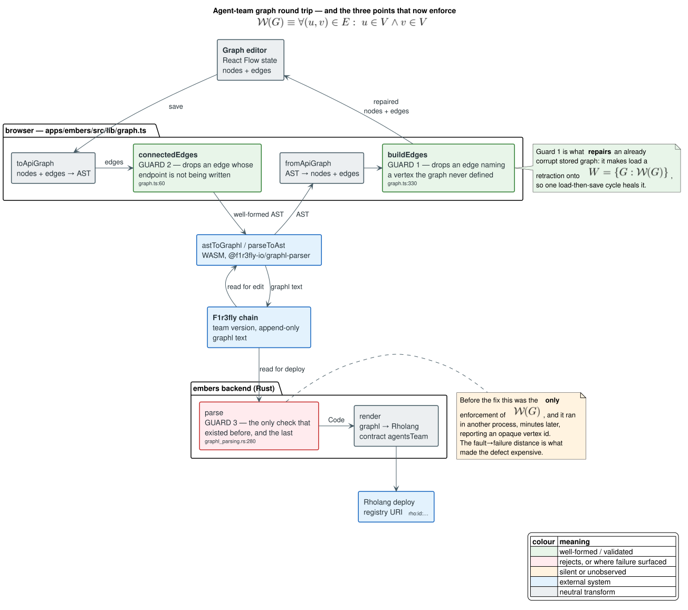
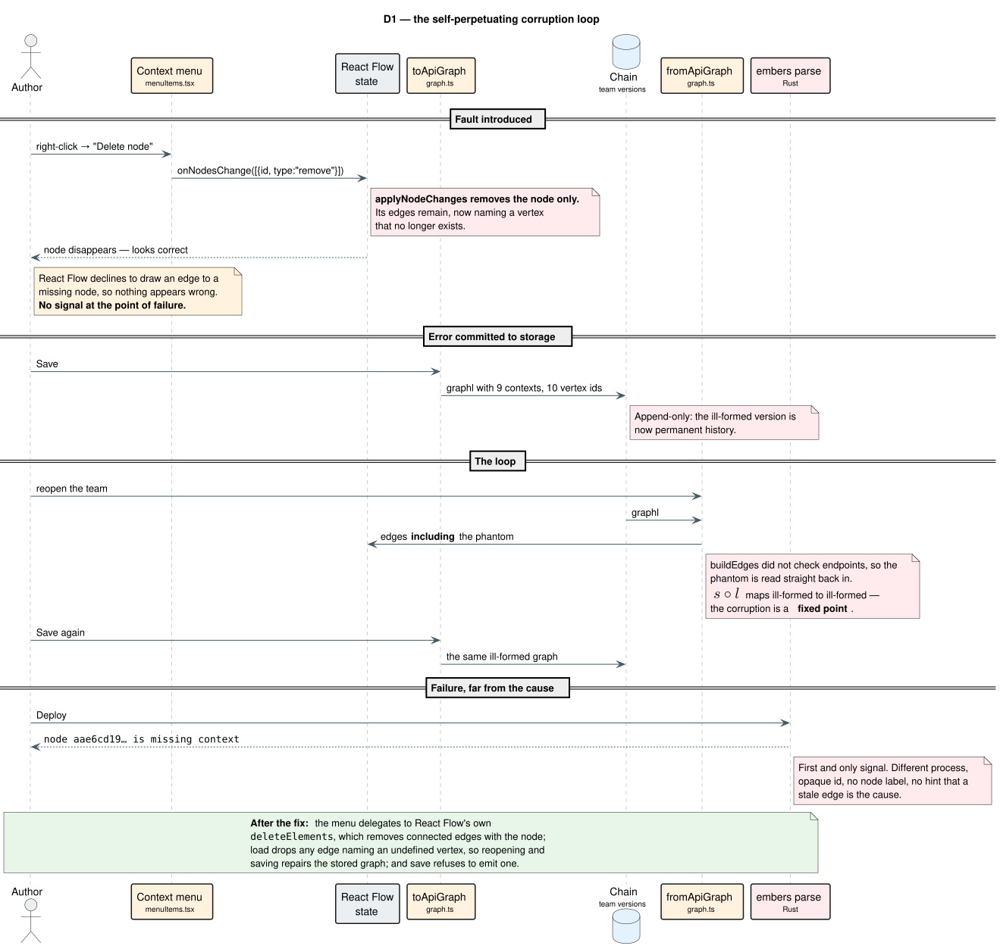
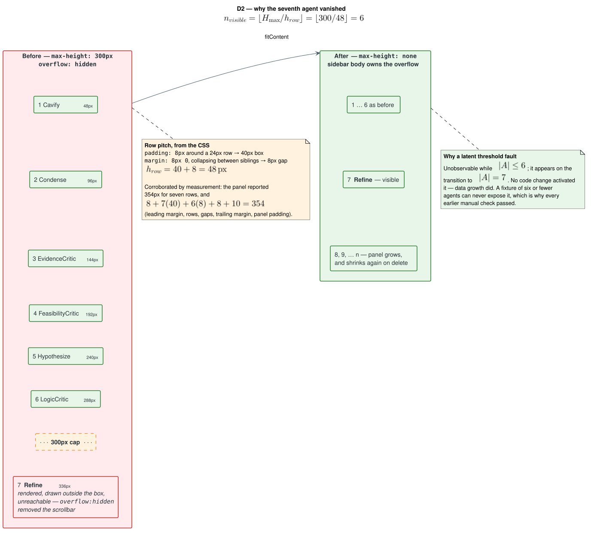
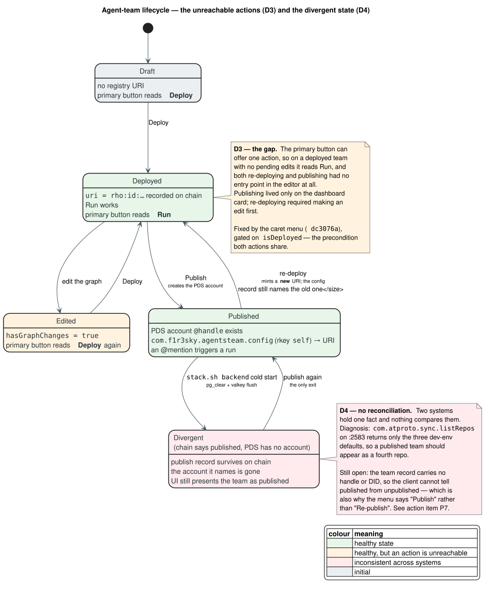
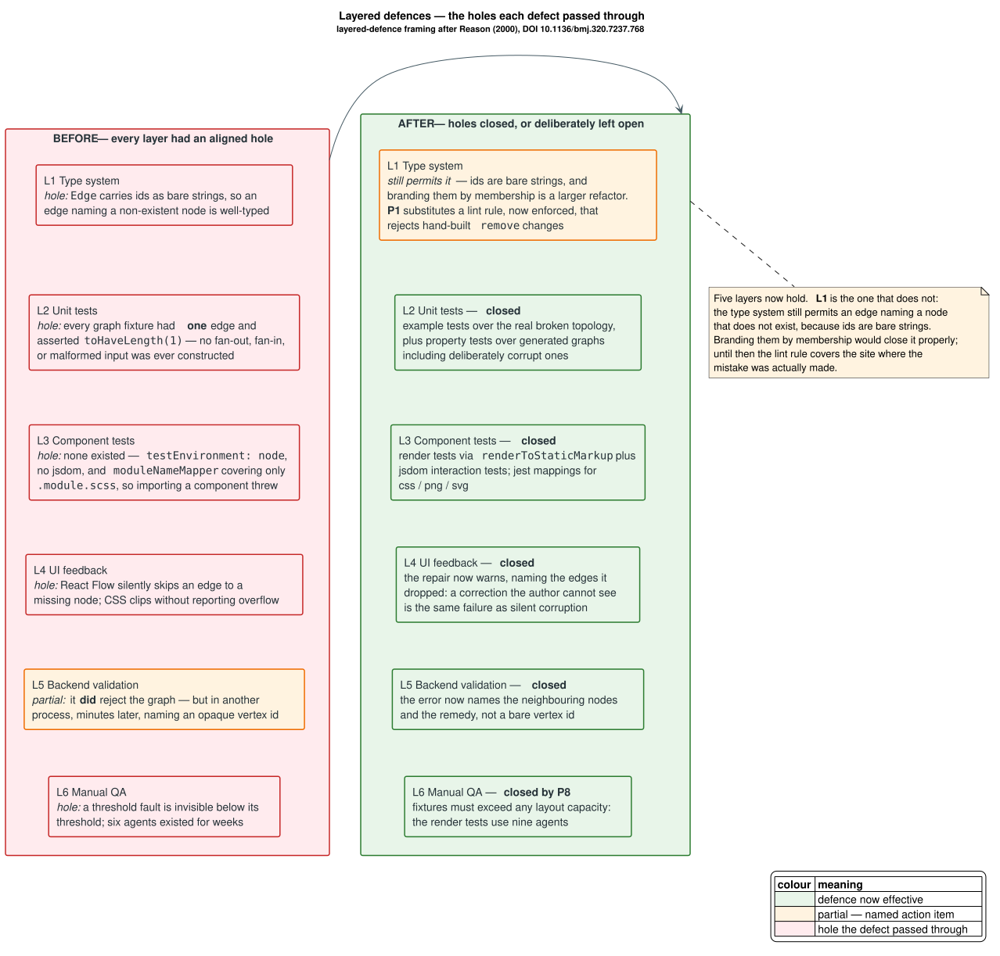

# Post-mortem: silent-failure defects in the agent-team editor

**Date of incident:** 2026-07-29 / 2026-07-30 (UTC)
**Surfaced by:** preparing the red-team agent-team demo on the local stack
**Status:** all six defects fixed and covered by regression tests; three prevention
items remain open and are tracked in [§9](#9-action-items)
**Fixes:** `f9f3759`, `d5bc2d0`, `dc3076a`, `96ecf54`, `ae78b40`

---

## 1. Summary

Six defects were found while building a six-agent team in the Embers graph editor.
One of them made a team **permanently undeployable** once triggered, and because
nothing in the interface indicated a problem, it survived every reload and every save
until a deploy was attempted. A seventh agent, authored on the same wallet but not
part of the team, is what activated the second.

| # | Defect | Severity | User-visible symptom | Fix |
|---|---|---|---|---|
| **D1** | Deleting a node from the context menu left its edges behind | **Critical** — data corruption | Deploy fails with `node <id> is missing context`, permanently | `f9f3759` |
| **D2** | The sidebar's agent panel clipped every row past the sixth | **High** — data loss to the eye | The seventh agent (`Refine`) simply was not there | `d5bc2d0` |
| **D3** | Deploy and publish had no entry point once a team was deployed | Medium — usability | The editor offers only `Run`; publishing appears impossible | `dc3076a` |
| **D4** | A dev-env restart un-publishes a team without un-marking it | Medium — cross-system inconsistency | `@handle` does not autocomplete although the team reads as published | *open* — see P7 |
| **D5** | `AccordionProps.className` was declared but never applied | Low — latent | A caller's `className` is silently ignored | `d5bc2d0` |
| **D6** | A newly created agent or team did not appear in its list | Medium — stale read | The record is missing until some later refetch | `ae78b40` |

**The property they share, and the reason this document exists:** every one of them
failed *without emitting a signal at the point of failure.* A graph was corrupted
but drawn as if intact. A list was clipped but reported no overflow. A team was
un-published but still presented as published. A prop was declared but quietly
discarded. In each case the system held information the operator did not, and the
gap between those two states is where the cost accumulated.

### Impact

The demo could still be given: the published team pointed at an intact deployment
(`rho:id:f6pgt8k8…`, team version `019fb065`), so `@redteam.test` worked throughout.
What could **not** be demonstrated was *creating a new team*, because D1 corrupts a
graph the moment a node is deleted from the context menu — an action any live
demonstration of editing would plausibly perform. There was no data loss on chain
(storage is append-only, so the corrupt versions sit alongside intact ones), and no
production system was involved.

---

## 2. Terminology

Defined before first use, so the analysis below can be read without cross-referencing.

| Term | Meaning |
|---|---|
| **Agent** | A user-authored Rholang contract stored per wallet, addressed by `(id, version)`. |
| **Agent team** | A directed graph whose nodes are agents or built-in node kinds, compiled to a single Rholang `contract agentsTeam(@input, return)`. |
| **Node kind** | The type of a graph node: `agent`, `compress`, `input-node`, `output-node`, `text-model`, `tti-model`, `tts-model`, `deploy-container`. |
| **graphl** | The textual graph language a team is stored as on chain. The browser converts between it and an in-memory AST via the WASM package `@f1r3fly-io/graphl-parser`. |
| **Vertex** | A graph node's identifier as it appears in graphl, e.g. `aae6cd198179248b2af377980fe4f55db`. |
| **Context** | The JSON blob attached to a vertex recording its node kind and data, e.g. `{"type":"agent","agentId":…}`. A vertex **with** a context is a real node; one **without** is the defect at the centre of D1. |
| **Dangling edge** | An edge naming a vertex that has no context — i.e. an edge to a node that does not exist. |
| **Registry URI** | The `rho:id:…` address a deployed team's contract is reachable at. Each deploy mints a new one. |
| **PDS** | Personal Data Server — the atproto server (`:2583`) holding accounts and records. Publishing a team creates an account here. |
| **AppView** | The atproto indexing service (`:2584`) that serves search and timelines, fed from the PDS. `@`-autocomplete queries it. |
| **Observer / read node** | The F1r3fly node embers reads from. It trails the validator, so a read immediately after a write can legitimately return older state. |
| **Fault / error / failure** | Following Avizienis et al. [[1](#references)]: a **fault** is the latent defect in the code; it becomes an **error** when activated and the system's state is wrong; it becomes a **failure** when that wrong state is externally observed. The three are separated in time, and that separation is a large part of this story. |

---

## 3. The invariant that was violated

A saved team is a directed graph. Let `$V$` be the set of vertices carrying a
context and `$E$` the set of edges. Well-formedness is the statement that every
edge connects vertices that exist:

```math
\mathcal{W}(G) \;\equiv\; \forall\,(u,v) \in E:\; u \in V \;\wedge\; v \in V
```

`$\mathcal{W}$` is exactly what the backend checks when it parses a team, and
exactly what D1 violated. Denote by `$W = \{\,G : \mathcal{W}(G)\,\}$` the set of
well-formed graphs.

Now write `$s$` for save (`toApiGraph`) and `$l$` for load (`fromApiGraph`). Before
the fix, neither inspected edge endpoints, so both preserved a violation:

```math
G \notin W \;\Longrightarrow\; s(l(G)) \notin W
```

The ill-formed graph was therefore a **fixed point** of the edit cycle. This is the
formal content of the phrase "self-perpetuating", and it explains the symptom that
made D1 severe rather than annoying: it was not that one deploy failed, but that
*every subsequent* deploy failed, with no edit the author could make to escape —
reopening the team read the phantom edge back in, and saving wrote it out again.

The fix makes `$l$` a retraction onto `$W$`:

```math
\operatorname{im}(l) \subseteq W
\qquad\text{hence}\qquad
s(l(G)) \in W \;\text{ for every } G
```

so a single load-then-save cycle repairs any stored graph, and `$s \circ l$` is
idempotent on `$W$` thereafter. That distinction — a **repair** rather than a mask —
is the property a reviewer should check, and it is why the fix is placed on load as
well as on save.

D2 requires only arithmetic, but the arithmetic is the reason it lay dormant. With a
panel height cap `$H_{\max}$` and a row pitch `$h_{\text{row}}$`, the number of rows
a fixed-height panel can show is

```math
n_{\text{visible}} \;=\; \left\lfloor \frac{H_{\max}}{h_{\text{row}}} \right\rfloor
\;=\; \left\lfloor \frac{300\,\text{px}}{48\,\text{px}} \right\rfloor \;=\; 6
```

For an agent set `$A$`, the defect is therefore unobservable while
`$|A| \le 6$` and appears on the transition to `$|A| = 7$`. Nothing in the code
changed to activate it; **data growth did**.

---

## 4. Timeline

All times UTC, taken from `run/embers.log`, `run/val.log`, the PDS, and on-chain
version metadata — not from recollection.

| Time | Event |
|---|---|
| 23:28:56 – 23:29:18 | Six red-team agents created (`Hypothesize` … `Condense`), blocks 1007–1013 |
| 23:30:40 | Team `RedTeam` created, version `019fb037-46d1` |
| 23:30:47 | Deployed → `rho:id:xfut9kwp…`; a live run returns in **18.6 s**, reply 278 chars |
| 23:35:16 – 23:35:26 | Version `019fb03b-7c52` created and deployed |
| 23:49:48 | `stack.sh backend` cold start — dev-env state wiped, `user1.test` re-seeded (**D4 armed**) |
| 00:21:17 | Version `019fb065-9fc7` created |
| 00:24:48 | `redteam.test` account created on the PDS — **publish succeeded** |
| 00:55:14, 00:55:24, 01:10:35 | Three publish attempts fail: `400 InvalidRequest: Handle already taken: redteam.test` — retries of a publish that had already landed (**D4 observed**) |
| 01:12:55 | Deploy rejected: `node a6ecd2a90419242a3ac8c5cd9456b8bac is missing context` (**D1 observed**) |
| — | A seventh agent, `Cavify`, is created; `Refine` disappears from the sidebar (**D2 observed**) |
| — | Versions `019fb096-dafe` and `019fb096-f503` saved, each with 9 contexts and 10 vertex ids |

Note the ordering: **D1's fault was introduced before 01:12:55 but only detected
then**, and detection required comparing context declarations against vertex
references byte by byte. The gap between cause and evidence is the central
observation of [§6](#6-why-none-of-them-were-caught).

---

## 5. Defect analysis

### 5.1 D1 — deleting a node stranded its edges



*Figure 1 — where a team graph travels, and the three points that now enforce
`$\mathcal{W}(G)$`. Before the fix, only Guard 3 existed, and it ran in another
process.*

#### Mechanism

The editor's context-menu action built removal changes by hand:

```ts
// apps/embers/src/lib/components/GraphEditor/GraphEditor.tsx — before the fix
onClick: () => {
  const changes: NodeChange<Node>[] = input.nodes.map((node) => ({
    id: node.id,
    type: "remove" as const,
  }));
  onNodesChange(changes);
},
```

`onNodesChange` applies `applyNodeChanges`, which removes the node from the node
array and **does not touch edges**. React Flow removes a node's edges only through
its own `deleteElements`, verified in the installed source
(`@xyflow/system@0.0.74`):

```js
// getElementsToRemove — the edge cascade the hand-built path skipped
const connectedEdges = getConnectedEdges(matchingNodes, deletableEdges);
const matchingEdges = connectedEdges;
```

The same function also cascades to child nodes via `parentId`, and skips anything
marked `deletable: false`. The keyboard route
(`deleteKeyCode={["Delete","Backspace"]}`, `GraphEditor.tsx:126`) goes through
`deleteElements` and was therefore always correct. **Two paths existed; only the
bespoke one was wrong, and only the built-in one had ever been exercised.**

#### Why it was invisible

React Flow declines to draw an edge whose endpoint is absent. That is a reasonable
defence in a view layer, but here it removed the only feedback channel that could
have told the author something was wrong. The canvas looked exactly as intended.

Nothing downstream objected either. `buildGraphEdges` emitted a binding for every
edge regardless of whether its endpoints were being written, and `buildEdges` read
every edge back without checking that its endpoints existed. So the phantom edge
round-tripped indefinitely.



*Figure 2 — the loop. Load re-materialised the phantom, save wrote it back, and the
only signal arrived at deploy time in a different process.*

#### Evidence

Comparing context declarations against vertex references across saved versions
isolated it precisely:

| Version | Deployed | Contexts | Vertex ids | Dangling |
|---|---|---|---|---|
| `019fb091-8fcc` | yes | 10 | 10 | — |
| `019fb096-dafe` | no | 9 | 10 | `aae6cd198179248b2af377980fe4f55db` |
| `019fb096-f503` | no | 9 | 10 | `aae6cd198179248b2af377980fe4f55db` |

The corrupt versions' edge list shows what the author did. The dangling id appears
in **two** edges — `Condense → ghost` and `ghost → Output` — alongside a direct
`Condense → Output`. That is the signature of deleting a node in the middle of a
chain and reconnecting its neighbours: the rewire succeeded, and both stubs of the
removed node survived.

The identity of the ghost confirms it. The last intact version, `019fb091-8fcc`,
defines that same id `aae6cd198179248b2af377980fe4f55db` with a context naming the
agent **`Cavify`**, wired `Condense → Cavify → Output`. So the sequence was: insert
`Cavify` into the chain, deploy, then delete it from the context menu and reconnect
`Condense` straight to `Output`. The reconnection is visible in the saved graph; so
are both edges to the node that no longer exists.

#### Fix

Three changes, in `f9f3759`:

1. **Prevent** — the menu delegates to React Flow's own deletion, so the menu and
   the keyboard cannot diverge again:

   ```ts
   // apps/embers/src/lib/components/GraphEditor/menuItems.tsx:167
   void rf.deleteElements({ nodes: input.nodes });
   ```

2. **Repair** — load drops edges naming an undefined vertex (`graph.ts:330`), which
   is what makes `$l$` a retraction onto `$W$` and heals stored graphs.

3. **Refuse** — save drops edges whose endpoints are not being written
   (`graph.ts:60`), so no future path can persist one.

The choice to **filter rather than throw** is deliberate, and differs from
`requireString`, which throws when an agent node lacks its id. The distinction is
recoverability: a missing agent id represents lost intent that must surface, whereas
a dangling edge carries no information at all, so discarding it is a repair and not
a concealment. See [§7](#7-prevention) P3 for the residual concern that this repair
is currently silent.

### 5.2 D2 — the sidebar clipped every agent past the sixth



*Figure 3 — a 300 px cap against seven 48 px rows, and why `$|A| \le 6$` hid it.*

#### Mechanism

Three CSS rules composed into a dead end:

```scss
/* Accordion.module.scss — before the fix */
.accordion-content                      { max-height: 0;     overflow: hidden; }
.accordion-content.open                 { max-height: 300px; overflow: auto;   }
.accordion-content.open.overflow-hidden { /* … */            overflow: hidden; }
```

`.open` capped the panel at 300 px but set `overflow: auto`, so the remainder would
at least have been scrollable. The sidebar passed `overflow="hidden"`, which
activated the third rule and **removed that escape hatch**. Rows past the cap were
rendered, drawn outside the box, and unreachable.

The row pitch follows from `NodeItem.module.scss`: `padding: 8px` around a 24 px row
gives a 40 px box, and `margin: 8px 0` collapses between siblings to give an 8 px
gap, so `$h_{\text{row}} = 48\,\text{px}$`. Measurement corroborates it — the panel
reported 354 px for seven rows, and
`$8 + 7(40) + 6(8) + 8 + 10 = 354$` (leading margin, rows, gaps, trailing margin,
panel padding).

#### Why it was invisible

Two reasons, and the second is the more instructive.

First, CSS clipping produces no error, no warning, and no scrollbar once
`overflow: hidden` is set. The only way to observe it is to compare `scrollHeight`
against `clientHeight`, which requires a layout engine.

Second, it is a **latent threshold fault**. `$\lfloor 300/48 \rfloor = 6$`, and there
were six agents for as long as anyone had looked. No commit activated it; creating a
seventh agent did. This is why it appeared to the author as though `Cavify` had *replaced*
`Refine`: the list is sorted case-insensitively by name, `Cavify` sorts to the top
and `Refine` sorts last, so adding one at the front pushed the last one past the cap.

#### Fix

`d5bc2d0` adds a `fitContent` flag that removes the cap for panels whose length is
not known in advance:

```scss
/* Accordion.module.scss:65 */
.accordion-content.open.fit-content {
  max-height: none;
  overflow: visible;
}
```

`max-height: none` rather than a larger number is the point: the panel is as tall
as its rows, whether that is three or ninety, and shrinks again on delete, so **no
count is encoded anywhere.** Overflow moves to the sidebar body, which already
declares `overflow-y: auto`. The four log-panel accordions keep the cap, where a
bounded scrolling box is the desired behaviour.

`overflow="hidden"` is not merely unnecessary now — it was the setting that
converted an overflow into a clip, so the sidebar no longer passes it. If a cap ever
returns, the list will scroll rather than silently truncate.

The same commit reorders the two panels so the curated **All Nodes** list precedes
**Your Agents**. That is not cosmetic: the curated list is a fixed six, so placing
it first means the unbounded list grows downward into the sidebar's scroll instead
of pushing the built-in nodes out of view.

Verified in a browser: seven rows in name order, `max-height: none`, and
`scrollHeight === clientHeight === 354`.

### 5.3 D3 — deploy and publish became unreachable



*Figure 4 — the lifecycle, the states from which an action was unreachable (D3), and
the divergent state that no code reconciles (D4).*

The editor header renders one primary button, labelled by
`canRun = isDeployed && !hasGraphChanges`. On a deployed team with no pending edits
it reads **Run** — at which point re-deploying required making an edit first, and
publishing existed only on the dashboard card. Neither action was discoverable from
the editor, which is where a user working on a team actually is.

`dc3076a` adds a caret beside the primary button opening a menu with **Deploy** and
**Publish to F1R3SKY**, gated on `isDeployed` — the precondition both share, since a
second deploy is only ever a re-deploy and the server rejects publishing an
undeployed team outright. Clicking the button itself is unchanged.

The menu says "Publish", not "Re-publish", because **the client cannot tell the
difference.** Neither the team record nor the SDK's `AgentsTeam` model carries a
published handle or DID, and the publish token is stored on chain encrypted with no
read endpoint. Naming it "Re-publish" would be wrong on a first publish. This is the
same missing state as D4, and P7 addresses both.

### 5.4 D4 — a dev-env restart un-publishes a team without un-marking it

Publishing calls `create_account` on the PDS and records the result on chain. Those
are two systems holding one fact, and nothing compares them.

`stack.sh backend` wipes dev-env state on any cold start — `pg_clear` plus a valkey
flush, unconditional whenever the PDS is not already answering `/xrpc/_health` — and
re-seeds only `user1.test`. That destroys a published team's account while the
publish record on chain survives. Embers therefore continues to present the team as
published, `@`-autocomplete finds nothing, and the only remedy is to publish again.

The misleading part is that the *observable* failure looks like an autocomplete bug.
It is not. Diagnosis is a two-step check:

```sh
# 1. Does an agent-team account exist at all?  A healthy dev-env holds exactly
#    mod-authority.test, lex-authority.test, user1.test — a published team is a 4th.
curl -s 'http://localhost:2583/xrpc/com.atproto.sync.listRepos?limit=50'

# 2. Is typeahead itself working?  Unauthenticated against the AppView, this must
#    return user1.test.  Through the PDS proxy the same call needs auth.
curl -s 'http://localhost:2584/xrpc/app.bsky.actor.searchActorsTypeahead?q=user'
```

If step 2 returns `user1.test` and step 1 shows only three repos, the account is
gone and the chain record is stale. **Still open** — see P7.

### 5.5 D5 — a prop declared but never applied

`AccordionProps` declared `className?: string`, but the component never destructured
or applied it, so any caller's class was silently discarded. Harmless in effect —
nothing passed one — but it is the same failure shape as the rest: a declared
capability that does nothing, with no diagnostic. Fixed in `d5bc2d0` by applying it
to the root element.

### 5.6 D6 — a new agent or team did not appear in its list

Creating an agent left it missing from the dashboard. The invalidation after
finalization fires while the dashboard is unmounted, so it only marks the list
stale; the refetch then happens on the next mount and reads the observer node, which
still trails the validator. **That read succeeds and returns the list as it was** —
stale data, not an empty response — so neither react-query's retry nor the backend's
retry-on-empty helpers notice, and it is cached as current.

`ae78b40` refetches until the written record is actually present, with bounded
exponential backoff. `type: "all"` is required because the list query is inactive at
that point — writes happen from an editor page, not the dashboard — so invalidating
alone would defer straight back into the same lag.

---

## 6. Why none of them were caught



*Figure 5 — the layers that should have stopped each defect, the hole each slipped
through, and which holes remain open. The layered framing follows Reason [[2](#references)]:
an incident reaches the operator only when every layer has an aligned gap.*

Six causes. Each is tied to evidence rather than asserted.

### 6.1 Coverage shaped like the happy path

Every pre-existing graph test built a **single-edge** graph and asserted
`toHaveLength(1)`. Fan-out, fan-in, and malformed input had never been constructed
at all. The suite established that the code worked on the input it expected; it said
nothing about what the code did with input it should reject. Hoare's framing
[[4](#references)] is apt — the tests asserted post-conditions on valid input, never
the invariant itself.

### 6.2 Component rendering was structurally untestable

`jest.config.js` declared `testEnvironment: "node"`, there was no jsdom, and
`moduleNameMapper` covered only `\.module\.scss$`. Importing any component therefore
threw on its first stylesheet or icon import — `@xyflow/react/dist/style.css` was
enough to fail a test file outright.

The barrier was incidental rather than intentional, but its effect was decisive:
**there was no component-render coverage of any kind**, which is precisely where D2,
D3 and D5 lived. A test-suite shape can foreclose a category of defect from ever
being caught, without anyone deciding that it should.

### 6.3 Two paths, one tested

React Flow provides `deleteElements`; the app also hand-rolled removal changes. Only
the framework path was exercised, and only the bespoke path was wrong. Parnas's
argument for hiding a module's internals [[5](#references)] applies directly: the
edge cascade is part of what "delete a node" *means* in React Flow's model, and
reimplementing the caller's half of it re-implemented it incompletely.

The generalisable rule is P9: whenever the app adds a bespoke path beside a
framework built-in, both must be tested against the same invariant.

### 6.4 Silent recovery at the wrong layer

React Flow's refusal to draw an edge to a missing node is defensive and sensible in
isolation. Placed where it was, it suppressed the only signal that could have
reached the one person able to act. Leveson and Turner's analysis of the Therac-25
[[3](#references)] makes the same point about a latent fault combined with absent
feedback: the fault was necessary for the accident, but the missing feedback is what
made it consequential.

The lesson is not "never recover silently" — it is that **recovery at a layer that
cannot report is indistinguishable from concealment.**

### 6.5 Distance between fault and failure

The fault was written in the editor. The failure surfaced in a different process,
after two saves and a deploy, as:

```
node aae6cd198179248b2af377980fe4f55db is missing context
```

No node label, no indication that a stale edge was the cause, no hint that
reopening and saving would repair it. Locating the cause required fetching the
stored graphl and comparing its `context … for <id>` declarations against every
`let <id> =` reference. That diagnostic is now recorded in
[Appendix A](#appendix-a-invariant-check), but the underlying issue is that the
error names an internal identifier rather than anything the author recognises (P6).

### 6.6 Divergent state with no reconciliation

D4's cause is structural: one fact, two stores, no comparison. Any system that
records in store *A* that something exists in store *B* needs either a
reconciliation path or a read that consults *B*. Embers has neither, so the UI is
confidently wrong after a dev-env reset, and — the same gap — cannot label its own
publish button correctly.

---

## 7. Prevention

Prioritised. Each item is concrete enough to act on, and names the defect it closes.

| # | Measure | Closes | Status |
|---|---|---|---|
| **P1** | Add a `no-restricted-syntax` ESLint rule rejecting hand-built `{ type: "remove" }` node changes, with a message pointing at `deleteElements` | D1 | open |
| **P2** | Property-based round-trip tests over generated graphs, asserting `$\mathcal{W}(s(l(G)))$` for arbitrary `$G$` | D1 | open |
| **P3** | Make the silent repair observable — warn in development when `buildEdges` or `toApiGraph` drops an edge | D1 | open |
| **P4** | Add jsdom and `@testing-library/react` for interaction-level tests | D2, D3, D5 | open |
| **P5** | Codify "no fixed height cap on content of unbounded length" in `../architecture/patterns/component-patterns.md` | D2 | open |
| **P6** | Backend graph errors should name the node's label and the likely cause, not only a vertex id | D1 | open |
| **P7** | Expose the published handle/DID on the team record and add a chain-vs-PDS reconciliation check | D3, D4 | open |
| **P8** | Fixtures must exceed any layout capacity — test with `$N$` greater than any cap | D2 | **done** |
| **P9** | When the app adds a bespoke path beside a framework built-in, test both against the same invariant | D1 | **done** for D1 |

### Notes on the open items

**P1** turns a convention into a build failure. The rule below was tested against
both spellings before being written down:

```js
// eslint.config.js
"no-restricted-syntax": ["error", {
  selector: "ObjectExpression:has(Property[key.name='type']:has(Literal[value='remove']))",
  message: "Use rf.deleteElements() — hand-built remove changes strand a node's edges.",
}],
```

The nested `:has(Literal[value='remove'])` is load-bearing, and the reason is worth
recording because it is a trap of the same shape as the incident itself. The obvious
form — `Property[key.name='type'][value.value='remove']` — **does not match the code
that caused this bug.** In `{ id: node.id, type: "remove" as const }` the property's
value is a `TSAsExpression` wrapping the literal, not a `Literal`, so the attribute
selector silently fails. Verified with ESLint: the naive selector flags
`{ type: "remove" }` and ignores `{ type: "remove" as const }`; the form above flags
both and leaves `{ type: "add" }` alone. A prevention measure that quietly matches
nothing is worse than none, because it also removes the incentive to look again.

The rule will need scoping to the GraphEditor directory, since edge removal
legitimately constructs the same shape.

**P2** carries a dependency decision. `fast-check` is **not** currently installed,
so this is either a new dev dependency or a dependency-free seeded generator written
in-repo. The property is short and exactly the invariant of [§3](#3-the-invariant-that-was-violated):

```
for all generated (nodes, edges), including edges to absent nodes:
    W(fromApiGraph(toApiGraph(nodes, edges)))
```

QuickCheck's original argument [[6](#references)] is the relevant one — the defect
here is precisely the sort that arises on inputs a human fixture author does not
think to write, because writing a malformed graph on purpose requires already
suspecting the bug.

**P3** is the most important of the open items, and the least obvious. The current
fix repairs a corrupt graph *silently*. That is a strict improvement over corrupting
it silently, but it is the same failure mode one layer along: the author is never
told that a connection they once drew has been removed. A development-mode warning
naming the dropped edges closes the feedback loop that §6.4 identifies as the real
enabler.

**P4** is bounded by what the current approach can reach. The 15 render tests added
in `96ecf54` use `renderToStaticMarkup`, which needs no jsdom and no
testing-library — deliberately, to avoid adding dependencies. It cannot observe
layout, clicks, or focus, so it can assert that the `fit-content` class is applied
but **not** that nothing is clipped. That limit is stated in the test comments rather
than implied away, and closing it needs a real DOM.

---

## 8. What went well

Worth recording, so these are not lost in a future refactor.

- **The backend rejected the corrupt graph.** D1 could have produced a team that
  deployed and then misbehaved at run time, which would have been far harder to
  diagnose. `parse` refusing an ill-formed graph is what bounded the damage to "will
  not deploy" — a loud failure — instead of "deploys and does the wrong thing".
- **Append-only storage preserved the intact versions.** Because a save creates a new
  version rather than mutating one, the last good version (`019fb091-8fcc`, and the
  published `019fb065`) remained deployable throughout. The demo survived on that
  property alone.
- **The join semantics were already correct.** Fan-out to several sinks and fan-in to
  one agent needed no new capability; a run returning at all is proof that every
  upstream stage produced a value, because a four-channel join cannot fire otherwise.
- **Every fix was validated by reverting it.** The tests were run against the pre-fix
  code and observed to fail: 10 of the 13 D1 tests, and 6 of the 15 render tests. The
  remainder are guards against *over*-correction — that an edge naming a deploy
  container is legitimate, that deleting a connector still works, that the delete
  action stays hidden for a container — and those correctly pass either way. A test
  that cannot fail documents nothing, and which tests could fail was measured rather
  than assumed.

---

## 9. Action items

| # | Item | Owner | Effort | Closes |
|---|---|---|---|---|
| A1 | P3 — warn in development when an edge is dropped | frontend | S | the feedback gap of §6.4 |
| A2 | P1 — lint rule against hand-built `remove` changes | frontend | S | D1 recurrence |
| A3 | P5 — record the unbounded-list rule in `component-patterns.md` | frontend | S | D2 recurrence |
| A4 | P6 — richer backend graph errors (node label + likely cause) | backend | S | §6.5 fault→failure distance |
| A5 | P7 — publish state on the team record; chain↔PDS reconciliation | backend + frontend | M | D3 label, D4 entirely |
| A6 | P4 — jsdom + testing-library for interaction tests | frontend | M | the residual half of §6.2 |
| A7 | P2 — property-based round-trip tests (decide on `fast-check`) | frontend | M | D1 class, not just D1 |
| A8 | An ADR recording P1 and P5 as project standards | frontend | S | drift back to the old patterns |

---

## Appendix A: invariant check

The diagnostic that located D1, and the one to reach for whenever a team will not
deploy. It compares context declarations against vertex references in a stored
graph; the two counts must be equal.

```python
import json, re, urllib.request

URL = "http://[::1]:8080/api/ai-agents-teams/{address}/{team_id}/versions/{version}"

graphl = json.load(urllib.request.urlopen(URL))["graph"]

# Vertices that carry a context are real nodes; every id named anywhere must be one.
contexts = set(re.findall(r'context\s+"(?:[^"\\]|\\.)*"\s+for\s+(\w+)', graphl))
referenced = set(re.findall(r'let\s+(\w+)\s*=', graphl))

dangling = sorted(referenced - contexts)
print(f"contexts={len(contexts)} referenced={len(referenced)} dangling={dangling}")
assert not dangling, "graph violates W(G): these ids are named by edges but never defined"
```

A healthy graph prints equal counts and an empty list. The corrupt versions printed
`contexts=9 referenced=10 dangling=['aae6cd198179248b2af377980fe4f55db']`.

## Appendix B: the well-formedness guards, as literate pseudocode

Presented in the style Knuth argued for [[7](#references)] — intent in prose first,
then the code that realises it, each cross-referenced to the implementation.

### B.1 The save-side guard

> *An edge may be written only if both of its endpoints are also being written.*
> Container identifiers count as endpoints: `collectGraphParts` records a subgraph's
> own variable as a vertex, so an edge naming a container is not dangling. The
> comparison is therefore against **every** node passed to the writer, not only the
> non-container ones.

```
algorithm CONNECTED-EDGES(nodes, edges):
    present ← { n.id : n ∈ nodes }          ▷ includes deploy containers
    return [ e ∈ edges : e.source ∈ present ∧ e.target ∈ present ]
```

Implemented as `connectedEdges` in `apps/embers/src/lib/graph.ts:60`, applied at
`graph.ts:45`.

### B.2 The load-side guard

> *An edge read from storage is kept only if the graph defines both of its
> endpoints.* This is the clause that repairs history: applied on load, it makes the
> image of `$l$` lie inside `$W$`, so reopening a corrupt team and saving it emits a
> well-formed graph. Without it, the corruption is a fixed point of the edit cycle
> and no sequence of user actions can escape it.

```
algorithm BUILD-EDGES(flatGraph):
    pairs ← [ (u, v) : (u, targets) ∈ flatGraph.edges, v ∈ targets ]
    kept  ← [ (u, v) ∈ pairs : u ∈ flatGraph.vertexes ∧ v ∈ flatGraph.vertexes ]
    return [ { id: fresh(), source: u, target: v } : (u, v) ∈ kept ]
```

Implemented as `buildEdges` in `apps/embers/src/lib/graph.ts:330`.

---

## References

1. Avizienis, A., Laprie, J.-C., Randell, B. & Landwehr, C. (2004). *Basic Concepts
   and Taxonomy of Dependable and Secure Computing.* IEEE Transactions on Dependable
   and Secure Computing, 1(1), 11–33. [doi:10.1109/TDSC.2004.2](https://doi.org/10.1109/TDSC.2004.2)
2. Reason, J. (2000). *Human error: models and management.* BMJ, 320(7237), 768–770.
   [doi:10.1136/bmj.320.7237.768](https://doi.org/10.1136/bmj.320.7237.768)
3. Leveson, N. G. & Turner, C. S. (1993). *An Investigation of the Therac-25
   Accidents.* IEEE Computer, 26(7), 18–41.
   [doi:10.1109/MC.1993.274940](https://doi.org/10.1109/MC.1993.274940)
4. Hoare, C. A. R. (1969). *An Axiomatic Basis for Computer Programming.*
   Communications of the ACM, 12(10), 576–580.
   [doi:10.1145/363235.363259](https://doi.org/10.1145/363235.363259)
5. Parnas, D. L. (1972). *On the Criteria To Be Used in Decomposing Systems into
   Modules.* Communications of the ACM, 15(12), 1053–1058.
   [doi:10.1145/361598.361623](https://doi.org/10.1145/361598.361623)
6. Claessen, K. & Hughes, J. (2000). *QuickCheck: a lightweight tool for random
   testing of Haskell programs.* ICFP '00, 268–279.
   [doi:10.1145/351240.351266](https://doi.org/10.1145/351240.351266)
7. Knuth, D. E. (1984). *Literate Programming.* The Computer Journal, 27(2), 97–111.
   [doi:10.1093/comjnl/27.2.97](https://doi.org/10.1093/comjnl/27.2.97)
8. Beyer, B., Jones, C., Petoff, J. & Murphy, N. R. (2016). *Site Reliability
   Engineering: How Google Runs Production Systems.* O'Reilly Media.
   ISBN 978-1-491-92912-4. — on blameless post-mortems and the practice of writing
   them for near-misses, not only outages.

---

## Diagram sources

Every figure is generated from PlantUML source in [`diagrams/`](diagrams/), rendered
with `plantuml -tsvg`. Formulae in diagram labels use PlantUML's `<latex>…</latex>`,
typeset by the bundled JLaTeXMath, rather than unicode literals.

```sh
plantuml -tsvg docs/post-mortems/diagrams/*.puml
```

Note when editing them: this PlantUML build fails to parse a `#FILL;line:#BORDER`
element style when the diagram also contains arrows, and reports the error on the
*arrow* line. Use `#line:BORDER;back:FILL` instead. PlantUML also emits an SVG
*containing* an error message rather than exiting non-zero, so check the output for
`Error line` rather than trusting the exit status.
