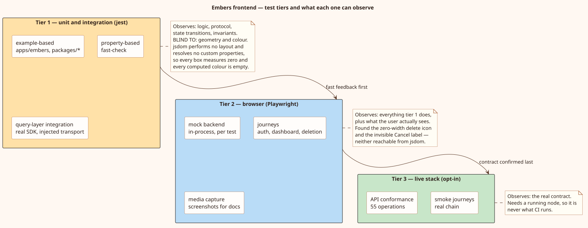

# Testing the Embers frontend

How this codebase is tested, why it is layered the way it is, and what each
layer can and cannot see. The companion documents are
[the theory](./theory.md), which explains the techniques, and
[the ledger](./LEDGER.md), which records every defect this campaign found and
the evidence for each.

---

## 1. The problem this structure solves

Before this campaign the repository had 294 tests and a serious blind spot. The
application's own suite ran in **no** continuous-integration workflow, so every
regression in `apps/embers` depended on somebody remembering to run Jest by
hand. Coverage was never measured anywhere. The entire SDK service layer — the
prepare/sign/send protocol that every write goes through — had no tests at all.
No test ever opened a browser.

The consequence was not an absence of testing but a _shape_ of testing that
could not see certain whole classes of defect. Three separate bugs shipped that
all presented to a user as the same sentence, "I cannot delete this":

| Cause                                                   | Where it lived   | Why the existing tests missed it                                     |
| ------------------------------------------------------- | ---------------- | -------------------------------------------------------------------- |
| The loading overlay covered the confirmation dialog     | flow ordering    | Ordering was tested on one tab only; the other kept the broken shape |
| The delete icon was squeezed to zero pixels wide        | CSS flexbox      | jsdom performs no layout; every box it reports is zero               |
| The Cancel label was drawn in its own background colour | CSS theme tokens | jsdom resolves no custom properties; both colours read as empty      |

Two of those three are invisible to any test that does not render in a real
browser. That is the single most important fact about this structure, and it is
why the tiers exist.

There was a second blind spot with the same shape. Nothing had ever driven the
interface the way a person does — create a team, drag one agent onto the canvas,
save it — and that path was broken: the save threw before issuing a request,
reporting an internal `TypeError` into the dock and saving nothing
([defect 9](./LEDGER.md#9-saving-a-new-team-crashed-before-the-request-was-sent)).
It survived 570 passing tests because the state it needs cannot be written by
hand: a fixture has an `edges` array because the person writing it supplies one.



---

## 2. The tiers

### Tier 1 — unit, property-based, and integration (Jest)

Runs in Node and jsdom. Fast — the whole suite is a few seconds — so it is what
runs on every save and every push.

- **Example-based tests** state a specific behaviour: this input produces that
  output, this flow calls those things in that order.
- **Property-based tests** ([fast-check](https://fast-check.dev/)) state a
  _law_ and let the library search for a counterexample. See
  [the theory](./theory.md#2-property-based-testing) for what this buys and
  what it costs.
- **Integration tests** run the real SDK against an injected transport, so the
  query layer, the two-phase protocol, real signing, and real finalization
  events are all exercised together without a network.

**What tier 1 cannot see:** anything whose only symptom is visual. jsdom
implements no layout engine and no cascade for custom properties. An element
collapsed to zero width and a healthy one are indistinguishable; a label
painted in its own background colour and a readable one are indistinguishable.
No amount of additional tier-1 testing closes this gap.

### Tier 2 — browser (Playwright, against a mock backend)

Runs the **production build** in Chromium against an in-process stand-in
backend, one per test. Because it is the real build in a real engine, it can
measure what a user actually sees: bounding boxes, computed colours, whether a
control is covered by an overlay.

The backend is a stand-in rather than a recording. It speaks the real wire
shapes (snake_case, string-encoded integers, base64 bytes), derives finalization
events from the client's own signature, and returns `501` for any request it
does not recognise — because a silently-answered request is how an end-to-end
test passes while exercising nothing.

It can also simulate faults the real chain produces but cannot be asked for on
demand: **observer lag** (a write is accepted before it is readable, so a list
answers 200 with a stale view), rejected sends, silence where a finalization
event should be, and finalization that reports the deploy failed on chain.

Because it holds real state — version history, which agents a team's saved
definition references, whether a team has ever been deployed — the journeys can
assert against the server rather than against the screen. "The row disappeared"
and "the record was deleted" are different claims, and only the second one
matters.

Its **drag-and-drop is dispatched, not simulated with a mouse**. The palette is
an HTML5 drag source: it writes three custom MIME entries onto `dataTransfer` in
`dragstart` and the canvas reads them back in `drop`. A pointer drag produces
none of those events, so it would silently do nothing — and a test asserting
"the node did not appear" would then pass for entirely the wrong reason. Edges
are the opposite case and _are_ drawn with the real mouse, because the graph
library tracks pointer events on its handles.

### Tier 3 — live stack (opt-in, never in CI)

Runs against a real local node. Confirms the contract the mock only imitates.
It needs a running stack, cannot be hermetic, and is therefore never what CI
runs; it is invoked deliberately. Two things live here.

**Browser journeys** (`e2e/tests/stack/`) drive the same flows tier 2 does, but
through a real chain: sign in with a funded wallet, create and save an agent,
assemble and deploy a team, deploy it again after an edit, and delete an agent a
team depends on. Timeouts are minutes rather than seconds because a single
mutation is prepare, sign, send, and a wait the server budgets at 120 seconds.

**API conformance** (`packages/api-conformance/`) asks a narrower question: does
the running server answer in the shapes `packages/client/schema.json` declares?
Response bodies are validated on the RAW wire, before the generated client
deserializes them — the client's mappers coerce and default, so a body that is
wrong on the wire can reach a caller looking entirely plausible.

Both refuse to run rather than guess. Without the opt-in, or without a stack
answering, every scenario **skips** with a message naming the missing
precondition — not a failure, because an absent environment is not a defect in
the product, and not a pass either, because a scenario reporting success while
making no request is how a suite comes to mean nothing.

The conformance package's OFFLINE half is a different matter: everything
decidable from the pinned document alone runs in tier 1 and in CI. That is
where the contract gaps reported upstream are measured — 44 of 55 operations
declaring only a success code, three declaring a response whose schema is the
empty object — asserted exactly, so an upstream fix arrives as a failing
expectation to update rather than as a number silently changing.

---

## 3. Running everything

```sh
pnpm -r test          # tier 1, all workspaces, with coverage gates
pnpm build            # the build the browser tier serves

pnpm --filter @f1r3fly-io/embers-e2e e2e            # tier 2
pnpm --filter @f1r3fly-io/embers-e2e e2e:ui         # tier 2, interactive
pnpm --filter @f1r3fly-io/embers-e2e capture:media  # documentation media

# tier 3, both halves. Each prints why it is skipping if it cannot run.
EMBERS_E2E_STACK=1 EMBERS_E2E_STACK_KEY=<hex> \
  pnpm --filter @f1r3fly-io/embers-e2e e2e:stack
EMBERS_INTEGRATION=1 \
  pnpm --filter @f1r3fly-io/embers-api-conformance itest
```

`pnpm -r test` is the canonical gate and must stay green. Nothing it runs can
reach a network: the e2e workspace deliberately defines **no** `test` script,
and the conformance package's `test` matches only `*.test.ts` while the live
scenarios are `*.itest.ts` under a separate config.

---

## 4. Coverage, and an honest denominator

Every workspace measures coverage and enforces a floor.

| Workspace              | statements | branches | functions | lines |
| ---------------------- | ---------- | -------- | --------- | ----- |
| `apps/embers`          | 65         | 56       | 50        | 65    |
| `packages/client`      | 80         | 65       | 70        | 80    |
| `packages/oslf-editor` | 25         | 28       | 28        | 25    |

The thresholds sit just below the measured values, so a **drop** fails the
build. Raise them as coverage rises; never lower one to make a build pass.

The important decision was the denominator. Jest by default counts only files
that some test happened to import — a number that _rises when you delete
tests_. Configuring `collectCoverageFrom` over all source dropped the
application's reported figure from 77% to 64.9%. The lower number is the true
one, and it is the one worth ratcheting.

Exclusions are argued rather than convenient:

- `packages/client` excludes `src/api-client` and `src/generated`. Both are
  machine output regenerated wholesale from schemas; counting them measures the
  generators, and the figure would lurch whenever a schema changed. Excluding
  the protobuf bindings alone moved the package from 17.9% to 87.7%, which
  shows how much of the denominator was generated code. The hand-written
  wrappers that _use_ them are counted, because that is where a defect can live.
- `apps/embers` excludes `main.tsx` (it mounts the app and nothing else),
  generated style typings, translation catalogues (data, not logic), and the
  Vite-only HMR shim, which every test necessarily replaces.
- `packages/oslf-editor` excludes the rendered editor — injection, renderer,
  theme, gradients. jsdom cannot exercise it honestly, so it belongs to tier 2.

---

## 5. Conventions

**Assert behaviour, not implementation.** Prefer roles and test ids over copy.
Where copy is asserted, assert the part that carries meaning — that a failure
message names the missing agent, not its exact wording.

**Every regression test must fail without its fix.** Every fix in
[the ledger](./LEDGER.md) was verified by reintroducing the defect and watching
the test fail, then restoring it. A test that passes against the broken code
proves nothing, and this is the only way to know.

**Pin behaviour you are not changing, and say so.** Several tests are marked
`PINNED, NOT ENDORSED`: they record what the code does today, explain the
consequence, and state what would have to be true before changing it. This is
how a known wart stays visible instead of becoming folklore.

**Name what failed.** Assertions collect and report the offending items rather
than counting them — which button went blank, which locale key resolved empty,
which file awaited a dialog under a loader. A failure should say what to fix.

**Test doubles stand in for the boundary, not the logic.** The SDK's own
services are tested against an injected transport, not a mocked SDK. The app's
query layer is tested against the real SDK. Mocking a module means testing that
a component calls a function, which is rarely the property that matters.

**The `@jest-environment` pragma goes first, and a test enforces it.** Jest
reads it only from the opening docblock, and an import sorted above it is
silently ignored — the suite then runs under `node` and every DOM access fails
somewhere unrelated. `tests/jestEnvironmentPragma.test.ts` checks position and
uniqueness for every file that declares one. It exists because `eslint --fix`
caused exactly this, mid-campaign
([defect 11](./LEDGER.md#11-two-suites-were-silently-running-in-the-wrong-environment)).

---

## 6. Where each kind of test lives

| Path                              | Tier | Contents                                                           |
| --------------------------------- | ---- | ------------------------------------------------------------------ |
| `apps/embers/tests/`              | 1    | Components, providers, flows, the query layer                      |
| `apps/embers/tests/helpers/`      | 1    | Shared fixtures, builders, the WebSocket fake                      |
| `packages/client/tests/`          | 1    | Entities, crypto, the six service classes, the event stream        |
| `packages/client/tests/services/` | 1    | The two-phase protocol, per service                                |
| `packages/oslf-editor/tests/`     | 1    | Rholang generation, headless workspace                             |
| `e2e/tests/`                      | 2    | Browser journeys: auth, dashboard, agent lifecycle, team lifecycle |
| `e2e/mock-backend/`               | 2    | The stand-in server, its state, and its routes                     |
| `e2e/support/`                    | 2    | Fixtures, the drag-and-drop protocol, shared assertions            |
| `e2e/capture/`                    | —    | Documentation media (not tests)                                    |

The mock backend can also be run on its own, for driving the interface by hand
without a node:

```sh
pnpm --filter @f1r3fly-io/embers-e2e mock:serve
```

It prints the address to point `window.API_URL` at and seeds two agents and a
team, because an empty dashboard is a poor place to start.

---

## 7. Continuous integration

`.github/workflows/embers.yaml` runs typecheck, format, lint, **the application
test suite with coverage**, the OSLF editor's suite, and the build; a separate
`e2e` job builds the application, caches the browser by lockfile hash, and runs
the browser tier, uploading traces only on failure.

One thing about that workflow is worth knowing before you read it: every step
runs with `working-directory: apps/embers`, so `pnpm run lint` there is the
application's lint, not the repository root's. The root's `ci:lint` is
`eslint '*'` — top-level files only. Checking the root and concluding the gate
is green is a mistake this campaign made and had to correct; run each
workspace's own gates.

The application suite being there at all is new. It is the single highest-value
change in this campaign's infrastructure work: 412 tests that previously ran
only when someone remembered.
