# Using Embers

A walkthrough of the platform as a user encounters it. Every screenshot and
recording here is generated by an automated capture run against fixed fixture
data, so the images match the current interface and change only when the
interface does. Regenerate them with:

```sh
pnpm --filter @f1r3fly-io/embers-e2e capture:media
```

That drives each journey in a real browser, writes the numbered screenshots, and
re-encodes the recordings as GIFs under `media/journeys/`. Each GIF is held
under 5 MB by stepping down the frame rate and width until it fits; if a journey
cannot be made to fit, the run fails naming that journey rather than quietly
shipping an image nobody will wait for.

One honest caveat about regenerating: the **screenshots** are reproducible, so a
diff on one means the interface changed. The **GIFs** are not — a recording
captures whatever frames the machine produced, so two runs of an unchanged
interface still differ by a few kilobytes. Regenerate them when a flow changes,
not as a matter of routine.

---

## 1. Signing in

Embers authenticates with a wallet private key. There is no account, no
password, and no server-side session: the key is held **in memory for the
lifetime of the page**.


Choose **Sign in with F1R3SKY Wallet** and supply the key, either by pasting the
hexadecimal value or by loading a wallet JSON file.

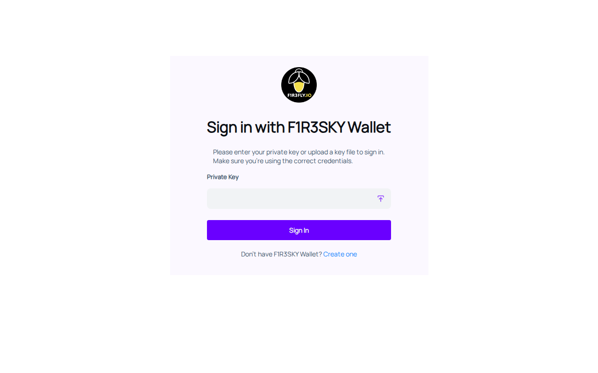

Two consequences of the in-memory session are worth knowing before they
surprise you:

- **Reloading the page signs you out.** The key is not written to local storage
  or a cookie, so a refresh ends the session.
- **A bookmarked deep link never opens signed in.** Following one takes you to
  the sign-in screen; you are returned to the page you asked for afterwards.

Once signed in you arrive at the dashboard.


The whole sequence:


---

## 2. The dashboard

Three tabs divide the work: **Agents**, **Agent Teams**, and **Graphical
Queries**. The tab you were last on is remembered, so returning does not send
you somewhere else.

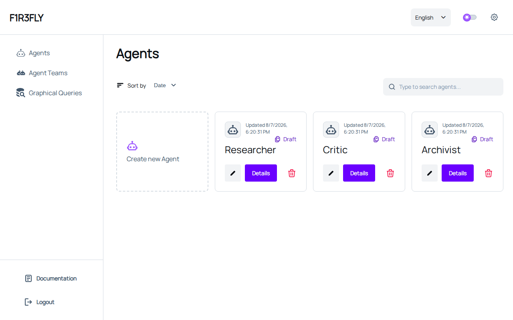

Each card shows a record's name, when it was created, and whether it has ever
been deployed — a record that has not is marked **Draft**.

**Search** filters on more than the name: an identifier, a shard, or a version
all match, so a record you cannot quite name is still findable.

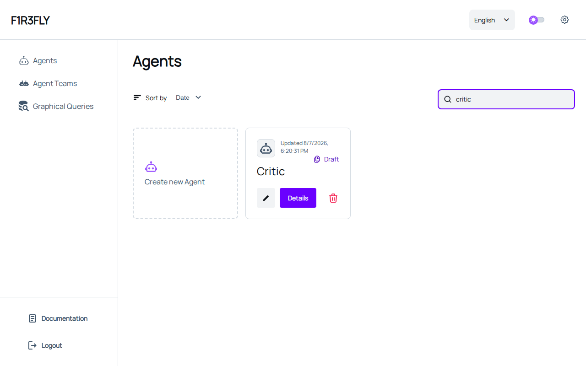

**Sort by** orders by date (newest first) or by name. The search text survives a
tab change, so moving between Agents and Agent Teams keeps the filter you typed.

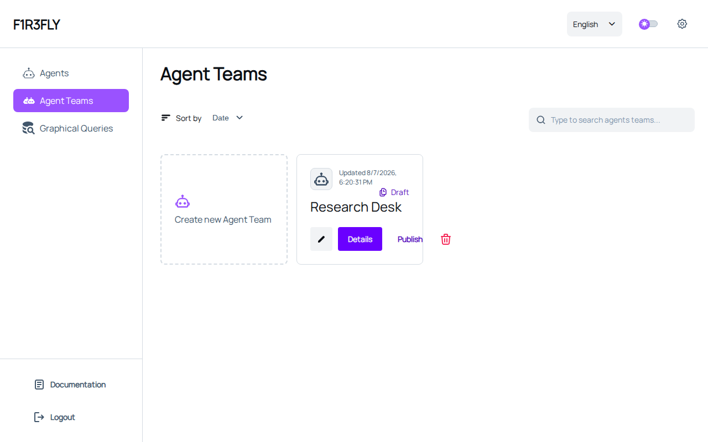

Team cards carry one extra action, **Publish**, which offers the team to F1R3SKY
under a handle.


---

## 3. Building a team from your agents

A team is a graph. Its nodes are the agents you have saved, plus the built-in
steps that route between them; its edges are the transitions.

Start from the **Agent Teams** tab and choose **Create new Agent Team**. The
first step asks only for a name and a description.

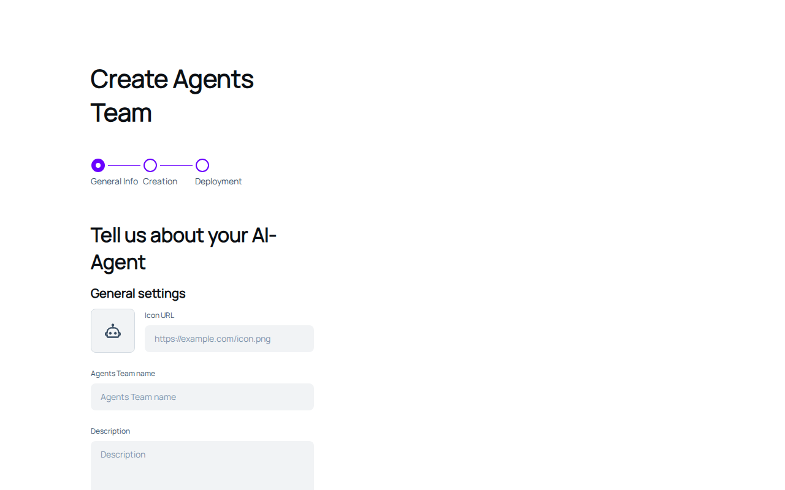

**Continue** opens the canvas. The palette on the left holds two lists: the
built-in node kinds, and — under **Your Agents** — every agent you have saved.

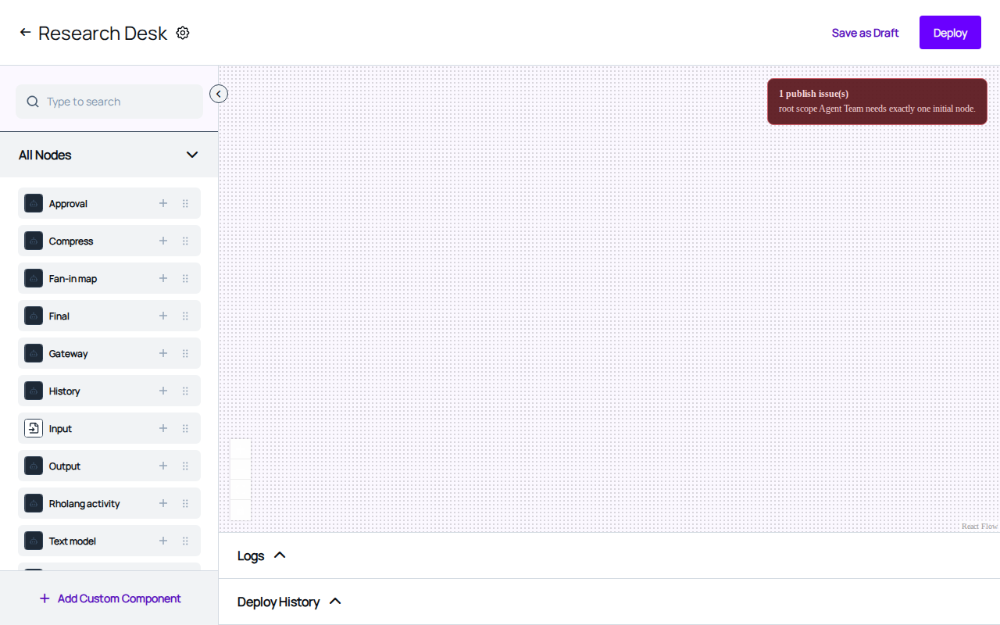

An agent appears here as soon as it is **saved**, whether or not it has ever
been deployed. A team splices an agent's code in, so the agent's own deployment
is irrelevant to whether it can be used.

Drag an agent onto the canvas. Node kinds that carry settings ask for them
before the node is placed.

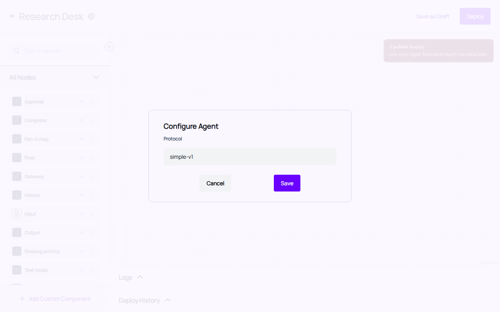

**Save** puts the node down, labelled with the agent's name so you can tell one
from another on a canvas of otherwise identical shapes.

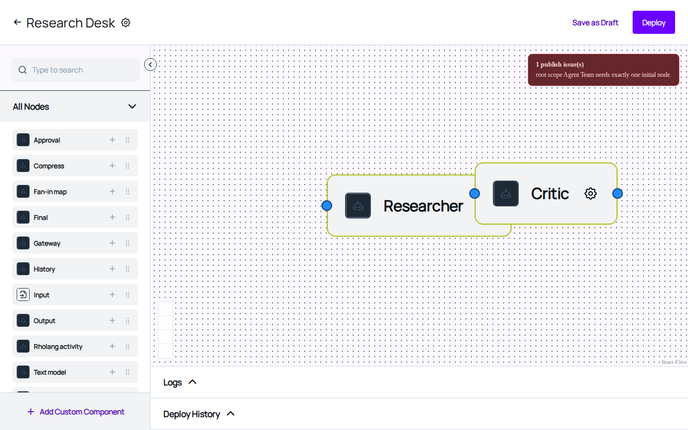

Connect nodes by dragging from one node's right-hand handle to another's
left-hand handle. A fresh connection carries the default transition — run when
the source completes, take every matching route — and shows no label, because a
label on every edge would say nothing.

**Save as Draft** stores the team at any point, however incomplete. **Deploy**
is stricter: it validates the graph first and refuses one that could not run,
naming what is wrong in the dock at the foot of the editor. That split is
deliberate — a draft is allowed to be unfinished; a deployment is not.


---

## 4. Deleting an agent, and what it can take with it

Deletion is the operation that most needs care, because an agent may be
referenced by a team. Deleting it without the team knowing is what used to make
a team permanently undeployable.

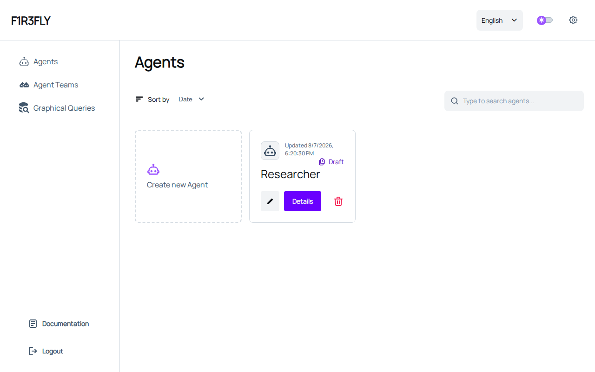

Choosing the delete control **first asks the server which teams use this
agent**, then tells you before anything is removed.

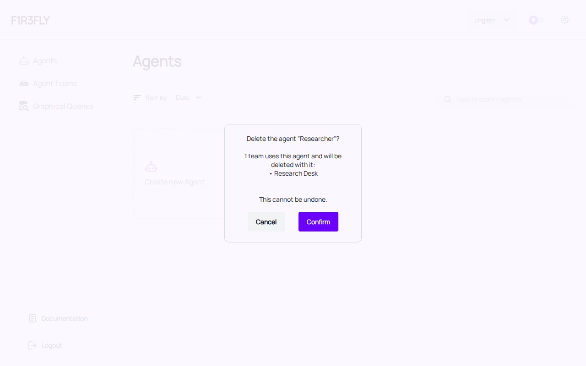

The dialog names every team that would be affected. Confirming removes them
along with the agent, in a specific order: each team is **unpublished first**,
then deleted, then the agent itself. The order carries the guarantee.
Unpublishing needs credentials that are reached _through_ the team, so deleting
first and failing to unpublish would leave a handle answering mentions for a
team that no longer exists, with nothing left to stop it through.

If the server cannot be asked which teams are affected, the deletion is
**refused** rather than guessed at, and the reason is shown. If any step of the
cascade fails, the cascade halts — an interrupted cascade must never leave a
team pointing at an agent that is gone.

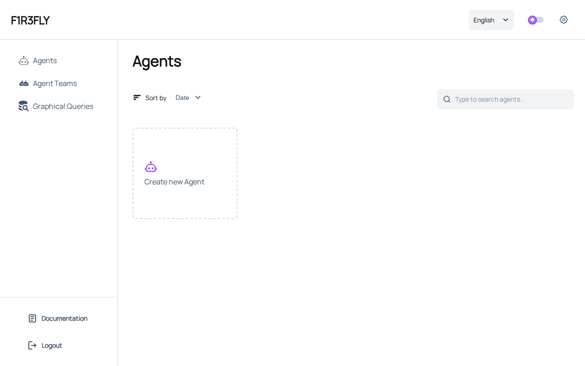

A deleted record stays gone. The list is re-read until the server agrees it has
been removed, because a chain node can briefly answer successfully with a view
that predates the deletion — which would otherwise make a deleted row reappear.


---

## 5. Deploying and re-deploying a team

Deploying a team publishes it to the chain and gives it a registry address. Two
things are recorded when it succeeds: the registry key and the URI it produces,
and the fact that there are no unsaved graph changes.

Together these decide what the editor offers next. A team with a recorded
deployment and no pending changes offers **Run**; a team with pending changes
offers **Deploy**. Both actions remain reachable from the caret beside the
primary button, so a deployed team can always be deployed again — editing an
agent and re-deploying the team picks up the agent's new version.

A failed deploy records neither the key nor the URI, and leaves the
pending-changes flag alone. A team that failed to deploy must not look
deployed.

---

## 6. Publishing to F1R3SKY

Publishing gives a team a handle that answers `@mentions`. It needs the handle,
the address of the PDS to publish to, and account credentials.

**Unpublishing** removes the record that makes F1R3SKY treat the handle as a
team. The account itself is kept, so the same handle can be published to again
later. The confirmation says so explicitly, because "unpublish" otherwise reads
as something irreversible.

---

## 7. When something goes wrong

Embers has no toast notifications. Failures reach you in one of two places:

- **Dialogs**, for anything that interrupts what you were doing — a refused
  deletion, a failed deploy.
- **The dock**, the Logs and Deploy History panels at the foot of the editors.
  Entries arrive newest-first and are marked unread until the panel is opened.

Two failure messages are worth recognising, because they mean opposite things:

| Message                                                                                             | Meaning                                             | What to do                                                     |
| --------------------------------------------------------------------------------------------------- | --------------------------------------------------- | -------------------------------------------------------------- |
| "…was accepted but its observer finalization confirmation timed out… the deploy may still finalize" | The chain took it; only the confirmation is missing | **Verify before retrying.** Retrying may duplicate the record. |
| "…finalized but its execution failed on chain; nothing was recorded"                                | The chain settled it and it did not take effect     | **Retry.** Nothing was written.                                |

---

## 8. Languages

The interface offers English, German, and French. German and French are
partially translated; any phrase without a translation appears in English
rather than blank, so the interface remains usable while translation continues.
